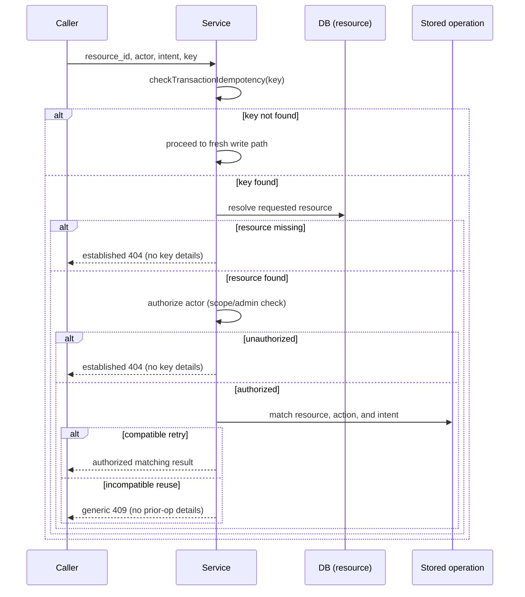

# W02-R1C: Request-intent binding and access-before-replay order

Date: 2026-10-29  
Branch: `codex/w02r1c-intent-access-order`  
Base: `87a9f40b` (main after PR #112 — W02-R1 replay binding)  
Addresses: C1 and C2 from [SERVER-HANDOVER-W02-R1-PR112-REVIEW.md]

## Problem summary

### C1 — Incomplete intent binding

PR #112 bound idempotency keys to resource ID and transaction type. Two creation-defining
dimensions are still unbound:

**Create path (`createReward`):** Scope type/ID are checked but `amount_stroops`,
`reward_type`, and `currency_code` are not. A same-scope, same-key request with
`amountStroops: '20000000'` returns the original `10000000` reward — incompatible
intent treated as a genuine retry.

**Fund paths (`fundReward`, `fundRewardAsync`, `fundRewardVerified`):** Resource ID
and action type (`fund`) are checked but `fundingSourceType` and `fundingReference`
are not. A key used for `admin_grant` can be replayed as `stellar` with a different
reference and return the existing funded reward — different financial mechanism, same
result, no conflict raised.

### C2 — Binding check precedes resource authorization

All fund, cancel, release, and refund idempotency fast-return paths check binding
before resolving the requested resource. An unrelated actor requesting a foreign
reward's fund endpoint:

- With that reward's own matching key → 404 (correct)
- With a key from a *different* reward → 409 `IDEMPOTENCY_CONFLICT` **before scope check**

This reveals key/resource association to unauthorized actors and violates the required
access-before-replay order. The missing-resource path similarly can produce 409 instead
of 404 when the key happens to exist.

---

## Scope and constraints

- Preserve all W02-R1 (#112) resource/action binding — do not remove or weaken existing checks.
- Preserve all W01 funding guards (funding verification, reference opaqueness, atomic claim).
- `expireReward` is a trusted system actor (no `actorId`): apply C2 ordering (resource before binding) but no scope check.
- Do not add an idempotency framework, new schema columns, or unrelated schema changes.
- Paystack, Stellar, and platform-credit remain unavailable per W01 containment. Do not enable them.
- Do not add global admin write permissions or `skipAuth` flags.

---

## C1: Canonical intent contract

### `createReward` — bound fields

| Field | Column | Comparison | Rationale |
|-------|--------|-----------|-----------|
| `amountStroops` | `amount_stroops` | `BigInt(cached.amount_stroops) !== amount` | Core financial amount; explicitly called out in review |
| `rewardType` | `reward_type` | `cached.reward_type !== params.rewardType` | Defines what kind of reward |
| `currency` | `currency_code` | `cached.currency_code !== currency` | Defines the financial unit; `currency` already normalized to `'XLM'` default at top of function |

**Intentionally non-binding (documented):**

| Field | Rationale |
|-------|-----------|
| `maxRecipients` | Financial exposure is captured by `amount_stroops`; null/0/undefined normalization creates edge cases with no security benefit |
| `autoRelease` | Behavioral config; not financially material |
| `description` | Display/audit field |
| `eligibilityConfig` | Operational config; managed separately |
| `expiresAt` | Scheduling/operational; can be conceptually updated |

**Default normalization:** `currency` is already computed as `params.currency ?? 'XLM'` before the
idempotency check. Omitting currency is equivalent to `'XLM'` and will match a stored `'XLM'`
reward. No additional normalization needed.

**Legacy rows:** All `rewards` rows have `amount_stroops`, `reward_type`, and `currency_code`
because they are NOT NULL in the schema and are set on every insert. No legacy-compatibility
concern for the comparison.

### `fundReward` / `fundRewardAsync` / `fundRewardVerified` — bound fields

| Field | Source | Stored column | Comparison |
|-------|--------|--------------|-----------|
| Source type | `source.type` | `funding_source_type` | `idem.fundingSourceType !== source.type` |
| Reference | `normalizeReference(source.reference)` | `funding_reference` | `normalizeReference(source.reference) !== idem.fundingReference` |

**Opaque reference identity (W01 preserved):** `normalizeReference` converts empty/absent to `null`
and stores the value verbatim (no trim, no lowercase). The binding comparison uses
`normalizeReference(source.reference)` on the incoming request, matching exactly how the stored
value was produced. `null === null` (both absent) is a match; `'TX-ABC' !== 'tx-abc'` is a conflict.

**Admin-grant internal reference pattern:** The existing R1-F1-1c positive test generates a new
reference on genuine retry, which is incorrect under C1. A genuine retry must supply the same
reference that was originally used. The test must be updated to pass the original reference.

**Other fund-family actions (cancel, release, refund, expire):** No additional intent fields.
- `cancelReward`: `reason` is a display/audit field, not financially material.
- `releaseAllocation` / `refundAllocation`: Allocation ID uniquely identifies amount and recipient; no additional financial intent.
- `expireReward`: System actor; resource binding only.

**`checkTransactionIdempotency` upgrade:** Add `funding_source_type` and `funding_reference` to
the SELECT and to the `IdempotencyResult` interface. Fund-path callers use both fields; other
callers ignore them (the fields are `undefined`-tolerant).

---

## C2: Access-before-replay order

### Required sequencing (all idempotency fast-return paths)

### Per-operation details

**`fundReward` / `fundRewardAsync` / `fundRewardVerified`:**
1. `checkTransactionIdempotency` — key lookup only
2. If exists: `getReward(rewardId)` → 404 if missing
3. `hasPermission(actorId, 'reward.manage') || validateScope(actorId, ...)` → 404 if denied
4. Check: `idem.rewardId !== rewardId || idem.transactionType !== 'fund'` → 409
5. Check: `idem.fundingSourceType !== source.type || normalizeReference(source.reference) !== idem.fundingReference` → 409
6. Return `cached`

**`cancelReward`:**
1. `checkTransactionIdempotency` — key lookup only
2. If exists: `getReward(rewardId)` → 404 if missing
3. Scope check (no admin bypass for cancel) → 404 if denied
4. Check resource/action binding → 409
5. Return `cached`

**`releaseAllocation`:**
1. `checkTransactionIdempotency` — key lookup only
2. If exists: `getAllocation(allocationId)` → 404 if missing
3. Resolve parent reward from `cachedAlloc.reward_id` (the *requested* allocation's parent)
4. Admin bypass or scope check on parent reward → 404 if denied
5. Check `idem.allocationId !== allocationId || idem.transactionType !== 'release'` → 409
6. Return `cachedAlloc`

**`refundAllocation`:** Same as `releaseAllocation` but `transactionType !== 'refund'`.

**`expireReward` (system actor):**
1. `checkTransactionIdempotency` — key lookup only
2. If exists: `getReward(rewardId)` → 404 if missing
3. (No scope check — trusted system actor)
4. Check resource/action binding → 409
5. Return `cached`

### Error privacy

- Missing/unauthorized resource: always the established error code for that operation
  (`REWARD_NOT_FOUND` 404 or `ALLOCATION_NOT_FOUND` 404).
- Authorized incompatible reuse: `IDEMPOTENCY_CONFLICT` 409 with generic message
  `'Idempotency key already used for a different operation or resource'`.
  No prior-operation details (no stored reward ID, no stored source type) in the message.

---

## Requirement-to-test matrix

| Test ID | C | Scenario | Pre-fix | Post-fix |
|---------|---|----------|---------|---------|
| R1C-C1-1 | C1 | `createReward` different amount same key | returns original | 409 IDEMPOTENCY_CONFLICT |
| R1C-C1-2 | C1 | `createReward` different reward_type same key | returns original | 409 IDEMPOTENCY_CONFLICT |
| R1C-C1-3 | C1 | `createReward` different currency same key | returns original | 409 IDEMPOTENCY_CONFLICT |
| R1C-C1-4 | C1 | `fundReward` different source type same key | returns funded reward | 409 IDEMPOTENCY_CONFLICT |
| R1C-C1-5 | C1 | `fundReward` different reference same key | returns funded reward | 409 IDEMPOTENCY_CONFLICT |
| R1C-G-1 | C1+ | `createReward` same amount/type/currency retry | — | success, returns original |
| R1C-G-2 | C1+ | `createReward` omit currency (default XLM) retry | — | success, returns original |
| R1C-G-3 | C1+ | `fundReward` same source/reference genuine retry | — | success, returns funded |
| R1C-G-4 | C1+ | `fundReward` same reference, null→null | — | success |
| R1C-C2-1 | C2 | foreign actor + foreign reward's fund key → must be 404 | 409 exposed to unauth | 404 |
| R1C-C2-2 | C2 | missing reward + any key → must be 404 | 409 if key exists | 404 |
| R1C-C2-3 | C2 | foreign actor + foreign reward's cancel key → must be 404 | 409 exposed to unauth | 404 |
| R1C-C2-4 | C2 | foreign actor + foreign alloc's release key → must be 404 | 409 exposed to unauth | 404 |
| R1C-C2-5 | C2 | unauth + own reward's mismatched key → must be 404, not 409 | varies | 404 |
| R1C-FIX | fix | R1-F1-1c genuine fund retry uses same reference | uses new ref (wrong) | uses same ref (correct) |
| HTTP-C2-1 | C2 | authenticated HTTP: foreign actor with bound key gets 404 not 409 | 409 | 404 |

---

## Files to modify

| File | Change |
|------|--------|
| `src/services/rewards/rewardIdempotencyService.ts` | Add `fundingSourceType`, `fundingReference` to `IdempotencyResult` and SELECT |
| `src/services/rewards/rewardService.ts` | C2 reorder (fund×3, cancel, release, refund, expire); C1 add intent check (fund×3, create) |
| `src/__tests__/reward-idempotency-binding.test.ts` | Add R1C tests; fix R1-F1-1c |

No schema changes. No new error codes (IDEMPOTENCY_CONFLICT already exists).

---

## Out of scope

- W02-R2 (nested action URL parent binding, F2/F3)
- W03 / W04 (allocation cap, eligibility)
- Deployment, migrations, provider enablement
