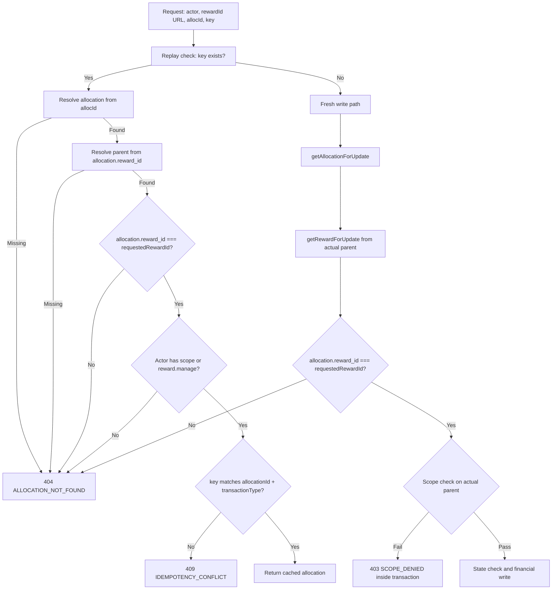
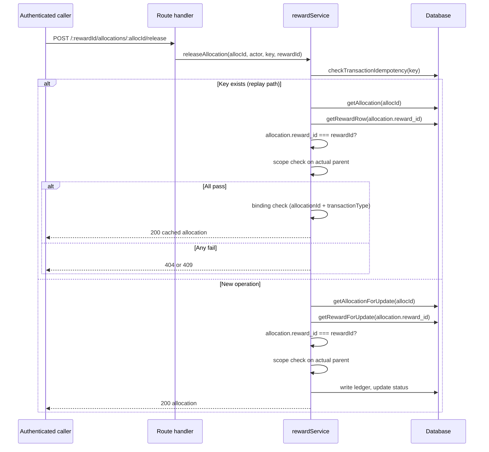

# W02-R2: Nested allocation parent binding and real route/list coverage

Date: 2026-10-29  
Branch: `codex/w02r2-nested-parent-binding`  
Base: `88db657a` (main after PR #113 — W02-R1C intent/access-order)  
Addresses: F2 and F3 from [SERVER-HANDOVER-W02-PR111-REVIEW.md]

## Problem summary

### F2 — Nested action URLs ignore the reward parent

All six release/refund route handlers pass only `allocId` to the service; the URL
parameter `:id` (the requested reward ID) is silently ignored.

```
POST /sponsor/rewards/:id/allocations/:allocId/release   → releaseAllocation(allocId, actor, key)
POST /sponsor/rewards/:id/allocations/:allocId/refund    → refundAllocation(allocId, actor, key)
POST /teacher/rewards/:id/allocations/:allocId/release   → releaseAllocation(allocId, actor, key)
POST /parent/rewards/:id/allocations/:allocId/release    → releaseAllocation(allocId, actor, key)
POST /employer/rewards/:id/allocations/:allocId/release  → releaseAllocation(allocId, actor, key)
POST /employer/rewards/:id/allocations/:allocId/refund   → refundAllocation(allocId, actor, key)
```

The service authorizes the allocation's *actual* parent reward but never checks
`allocation.reward_id === requestedRewardId`. A caller who owns allocation A
(under reward A) can post to `/:foreignRewardId/allocations/:allocA/release`
and the operation succeeds — the URL's foreign reward ID is simply ignored.

Additionally, the W02-R1C replay fast-return paths contain `if (parentReward && !hasPermission...)`,
which skips the scope check and returns the allocation when the parent reward row is missing
(orphaned allocation). This fails open rather than closed.

### F3 — Route/list test evidence does not prove the claimed behavior

The tests labelled "Route-layer" in `reward-cross-owner.test.ts` (W02-R-1 through W02-R-8)
call raw getters (`getReward`, `validateScope`) and `hasPermission` directly. They never
send HTTP requests through the application routers and would stay green if the route
middleware were removed. The sponsor prefix has real HTTP coverage in
`rbac-sponsor-isolation.test.ts`; teacher, parent, and employer prefixes do not.

The list test (`W02-L-1`) wraps `require('../services/rewards/rewardService.js')` inside
a test body. In the Vitest/ESM environment this throws `MODULE_NOT_FOUND`; the list
function is never called; the test stays green because `toThrow()` catches the wrong error.

---

## Scope and constraints

- Preserve all W02-R1 and W02-R1C idempotency and scope checks.
- Preserve all W01 funding guards.
- Do not create new action endpoints (e.g. teacher refund, parent refund) to satisfy
  coverage symmetry — cover only routes that actually exist.
- Do not add `skipAuth`, optional-context flags, or caller-controlled authorization bypasses.
- Trusted internal callers (auto-release worker) must supply the known parent ID explicitly.
- No new schema columns, no migration, no provider enablement.

---

## F2: Nested parent binding contract

### Authorization and matching sequence

Both fresh and replay paths must resolve resources and enforce matching in this order:

```
1. Resolve allocation from allocationId              → 404 ALLOCATION_NOT_FOUND if missing
2. Resolve actual parent reward from allocation.reward_id → 404 if parent missing (fail closed)
3. Check allocation.reward_id === requestedRewardId  → 404 ALLOCATION_NOT_FOUND if mismatch
4. Scope check on actual parent reward               → 404 ALLOCATION_NOT_FOUND if unauthorized
5. Replay binding check (existing W02-R1)            → 409 IDEMPOTENCY_CONFLICT if mismatch
6. State check / financial write
```

Steps 3 and 4 are the new additions. Steps 1, 2 (partially) and 5 already exist;
step 2 is strengthened (fail closed when parent is null).

### Why check 3 before 4

If the requested `:id` is a foreign reward, the caller is unauthorized for it (step 4
would return 404). But step 3 is checked first for an additional reason: checking scope
*before* verifying the parent/alloc match would require resolving the *requested* reward
(not the actual parent) for the scope check. That is unnecessary complexity. Since the
actual parent IS the requested reward after step 3 passes, the scope check in step 4
already uses the correct reward row.

### Error privacy

- Missing allocation → `ALLOCATION_NOT_FOUND` 404
- Missing parent reward (orphaned allocation) → `ALLOCATION_NOT_FOUND` 404 (same response)
- Parent ID mismatch → `ALLOCATION_NOT_FOUND` 404 (do not confirm the allocation exists elsewhere)
- Unauthorized scope → `ALLOCATION_NOT_FOUND` 404 (existing W02 contract)
- Authorized match, incompatible replay key → `IDEMPOTENCY_CONFLICT` 409

No 403 in these paths. 403 is only used inside fresh write transactions (scope denial on
the actual parent, existing behavior), which fire after the steps above have already passed.

### Service signature change

```typescript
// Before:
function releaseAllocation(allocationId: string, actorId: string, idempotencyKey: string): AllocationRow

// After:
function releaseAllocation(allocationId: string, actorId: string, idempotencyKey: string, requestedRewardId: string): AllocationRow
```

Same change for `refundAllocation`. `requestedRewardId` is required — no default, no optional
bypass. All callers must supply it.

### Caller inventory

| Caller | File | Supply value | Notes |
|--------|------|-------------|-------|
| Sponsor release route | `routes/sponsor.ts:348` | `req.params.id` | Route URL param |
| Sponsor refund route | `routes/sponsor.ts:363` | `req.params.id` | Route URL param |
| Teacher release route | `routes/teacher.ts:301` | `req.params.id` | Route URL param |
| Parent release route | `routes/parent.ts:349` | `req.params.id` | Route URL param |
| Employer release route | `routes/employer.ts:406` | `req.params.id` | Route URL param |
| Employer refund route | `routes/employer.ts:421` | `req.params.id` | Route URL param |
| Auto-release worker | `services/rewards/rewardEligibilityService.ts:222` | `reward.id` | Has `reward: RewardRow` in scope |
| Admin retry route | `routes/adminRewards.ts:112` | `attempt.reward_id` | `reward_refund_attempts` table stores `reward_id` |
| Test direct calls | `__tests__/reward-lifecycle.test.ts` | `reward_id` (from fixture) | Update tests |
| Test direct calls | `__tests__/reward-orchestration.test.ts` | `reward_id` (from fixture) | Update tests |
| Test direct calls | `__tests__/reward-refund-admin.test.ts` | `reward_id` (from fixture) | Update tests |
| Test direct calls | `__tests__/reward-r13-routes.test.ts` | `reward_id` (from fixture) | Update tests |
| Test direct calls | `__tests__/reward-cross-owner.test.ts` | `reward_id` (from fixture) | Update tests |
| Test direct calls | `__tests__/reward-idempotency-binding.test.ts` | `reward_id` (from fixture) | Update tests |
| Test direct calls | `__tests__/reward-student-view.test.ts` | `reward_id` (from fixture) | Update tests |
| Test direct calls | `__tests__/reward-internal-funding-auth.test.ts` | `reward_id` (from fixture) | Update tests |

### Implementation in `rewardService.ts`

**`releaseAllocation` replay path (currently lines 655–673):**

```typescript
const idem = checkTransactionIdempotency(idempotencyKey);
if (idem.exists) {
  // W02-R2 (F2): Resolve and authorize the actual allocation and its parent first.
  const cachedAlloc = getAllocation(allocationId);
  if (!cachedAlloc) throw new RewardError('ALLOCATION_NOT_FOUND', `Allocation ${allocationId} not found`, 404);
  // F2: Fail closed on missing parent (no if(parentReward &&) skip).
  const parentReward = getRewardRow(cachedAlloc.reward_id);
  if (!parentReward) throw new RewardError('ALLOCATION_NOT_FOUND', `Allocation ${allocationId} not found`, 404);
  // F2: Bind to requested URL parent before revealing any binding information.
  if (cachedAlloc.reward_id !== requestedRewardId) {
    throw new RewardError('ALLOCATION_NOT_FOUND', `Allocation ${allocationId} not found`, 404);
  }
  if (!hasPermission(actorId, 'reward.manage') &&
      !validateScope(actorId, parentReward.scope_type as ScopeType, parentReward.scope_id)) {
    throw new RewardError('ALLOCATION_NOT_FOUND', `Allocation ${allocationId} not found`, 404);
  }
  if (idem.allocationId !== allocationId || idem.transactionType !== 'release') {
    throw new RewardError('IDEMPOTENCY_CONFLICT', 'Idempotency key already used for a different operation or resource', 409);
  }
  return cachedAlloc;
}
```

**`releaseAllocation` write transaction path (currently lines 674–680):**

```typescript
const txn = db.transaction(() => {
  const allocation = getAllocationForUpdate(allocationId);
  const reward = getRewardForUpdate(allocation.reward_id);

  // W02-R2 (F2): Allocation must belong to the requested URL reward.
  if (allocation.reward_id !== requestedRewardId) {
    throw new RewardError('ALLOCATION_NOT_FOUND', `Allocation ${allocationId} not found`, 404);
  }
  if (!validateScope(actorId, reward.scope_type as ScopeType, reward.scope_id)) {
    throw new RewardError('SCOPE_DENIED', 'Actor does not have access to this reward', 403);
  }
  // … rest unchanged
```

Same pattern for `refundAllocation` write transaction (currently lines 730–740).

### What is NOT changed

- `expireReward` — system actor; no `actorId`, no route exposure, no `requestedRewardId` needed.
- `cancelReward` — no allocation parameter; not a nested resource action.
- `activateReward` / `approveReward` — same, not allocation-level.
- Fresh-write scope denial inside transactions remains 403 (SCOPE_DENIED) for internal consistency.
- Admin bypass (`reward.manage`) is preserved in both paths.

---

## F3: Real HTTP route coverage

### What to replace

`reward-cross-owner.test.ts` W02-R-1 through W02-R-8 (lines 363–478 approximately) are
raw service-call imitations that must be replaced with real HTTP requests.
`W02-L-1` (list test) uses `require()` and must use a static top-level import.

### Routes to cover (real HTTP GET)

| Route | Scope type | Endpoint |
|-------|-----------|---------|
| Sponsor reward detail | `sponsor_cohort` | `GET /api/v1/sponsor/rewards/:id` |
| Teacher reward detail | `teacher_class` | `GET /api/v1/teacher/rewards/:id` |
| Parent reward detail | `parent_family` | `GET /api/v1/parent/rewards/:id` |
| Parent child reward detail | `parent_child` | `GET /api/v1/parent/rewards/:id` |
| Employer reward detail | `employer_team` | `GET /api/v1/employer/rewards/:id` |
| Sponsor allocations | — | `GET /api/v1/sponsor/rewards/:id/allocations` |
| Sponsor transactions | — | `GET /api/v1/sponsor/rewards/:id/transactions` |
| Teacher allocations | — | `GET /api/v1/teacher/rewards/:id/allocations` |
| Teacher transactions | — | `GET /api/v1/teacher/rewards/:id/transactions` |
| Parent allocations | — | `GET /api/v1/parent/rewards/:id/allocations` |
| Employer allocations | — | `GET /api/v1/employer/rewards/:id/allocations` |
| Employer transactions | — | `GET /api/v1/employer/rewards/:id/transactions` |

### Actor matrix per endpoint

| Actor | Expected outcome |
|-------|----------------|
| Owner (correct scope) | 200 |
| Foreign user (different scope type) | 404 |
| Missing reward ID | 404 |
| Admin (`reward.manage`) | 200 |
| Unauthenticated | 401 |

### List test fix

`W02-L-1` must:
1. Use a top-level ES `import { listRewards } from '../services/rewards/rewardService.js'`
2. Assert `error.code === 'SCOPE_DENIED'` and `error.statusCode === 403`
3. Verify the call does NOT throw `MODULE_NOT_FOUND`

### Fixture discipline

- Sponsors, teachers, parents, employers: use legacy role `'student'` (prevents
  `trg_auto_assign_user_role` from granting `role_admin` which adds `reward.manage`).
  Assign only the intended RBAC role via `user_roles`.
- Admin: use legacy role `'admin'` — gets `role_admin` via trigger (correct).
- No incidental `role_instructor` on lecturer-backed fixtures. Teacher/parent/employer
  users must not hold sponsor role, and vice versa.
- Effective permission set must be asserted in fixtures where possible.

---

## Requirement-to-test matrix

| Test ID | Category | Scenario | Expected | Guards checked |
|---------|----------|---------|---------|---------------|
| F2-S-1 | F2 fresh | Own alloc under correct reward → success | 200/AllocationRow | Parent match, scope |
| F2-S-2 | F2 fresh | Own alloc under owned-but-different reward → 404 | 404 ALLOCATION_NOT_FOUND | Parent mismatch |
| F2-S-3 | F2 fresh | Own alloc under foreign reward → 404 | 404 ALLOCATION_NOT_FOUND | Parent mismatch + scope |
| F2-S-4 | F2 fresh | Foreign alloc under own reward → 404 | 404 ALLOCATION_NOT_FOUND or SCOPE_DENIED | Scope on actual parent |
| F2-S-5 | F2 fresh | Own alloc, missing requested reward ID → 404 | 404 ALLOCATION_NOT_FOUND | Parent mismatch (empty string or nonexistent) |
| F2-R-1 | F2 replay | Own alloc, genuine replay under correct reward → 200 | 200 AllocationRow | Preserved |
| F2-R-2 | F2 replay | Own alloc, replay under different owned reward → 404 | 404 ALLOCATION_NOT_FOUND | C2 before binding |
| F2-R-3 | F2 replay | Orphaned alloc (missing parent) → 404 | 404 ALLOCATION_NOT_FOUND | Fail closed |
| F2-R-4 | F2 replay | Authorized match, incompatible key → 409 | 409 IDEMPOTENCY_CONFLICT | Binding preserved |
| F2-H-1 | F2 HTTP | Own alloc under correct reward URL → 200 | 200 | Route + service |
| F2-H-2 | F2 HTTP | Own alloc under foreign reward URL → 404 | 404 | Route + service (regression guard) |
| F2-H-3 | F2 HTTP | Employer refund — own alloc correct reward → 200 | 200 | Employer prefix |
| F2-H-4 | F2 HTTP | Employer refund — own alloc wrong reward → 404 | 404 | Employer prefix |
| F2-H-5 | F2 HTTP | Replay under correct reward, same key → 200 | 200 | Route replay |
| F2-H-6 | F2 HTTP | Replay under wrong reward, same key → 404 | 404 | C2 ordering preserved |
| F2-ADMIN | F2 fresh | Admin releases alloc under any reward ID → success | 200 | Admin bypass preserved |
| F3-R-1 | F3 HTTP | Teacher: owner detail → 200 | 200 | Teacher route guard added |
| F3-R-2 | F3 HTTP | Teacher: foreign detail → 404 | 404 | Teacher route guard added |
| F3-R-3 | F3 HTTP | Teacher: missing ID → 404 | 404 | Teacher route guard added |
| F3-R-4 | F3 HTTP | Teacher: admin → 200 | 200 | Admin bypass |
| F3-R-5 | F3 HTTP | Teacher: allocations owner → 200 | 200 | Teacher allocations |
| F3-R-6 | F3 HTTP | Teacher: allocations foreign → 404 | 404 | Teacher allocations guard |
| F3-R-7 | F3 HTTP | Parent: owner detail → 200 | 200 | Parent route guard |
| F3-R-8 | F3 HTTP | Parent: foreign detail → 404 | 404 | Parent route guard |
| F3-R-9 | F3 HTTP | Employer: owner detail → 200 | 200 | Employer route guard |
| F3-R-10 | F3 HTTP | Employer: foreign detail → 404 | 404 | Employer route guard |
| F3-R-11 | F3 HTTP | Unauthenticated → 401 | 401 | Auth middleware |
| F3-L-1 | F3 list | listRewards foreign scope → SCOPE_DENIED 403 | SCOPE_DENIED | Module import fixed |

---

## Mermaid: authorization and resource resolution for nested allocation actions





---

## Files to modify

| File | Changes |
|------|---------|
| `LMS-Server/docs/specs/w02-r2-nested-parent-binding-spec.md` | NEW — this spec |
| `LMS-Server/src/services/rewards/rewardService.ts` | Add `requestedRewardId` param to `releaseAllocation` + `refundAllocation`; fix fail-open; add parent-ID match check |
| `LMS-Server/src/services/rewards/rewardEligibilityService.ts` | Pass `reward.id` as `requestedRewardId` to `releaseAllocation` |
| `LMS-Server/src/routes/sponsor.ts` | Pass `req.params.id` to release/refund |
| `LMS-Server/src/routes/teacher.ts` | Pass `req.params.id` to release |
| `LMS-Server/src/routes/parent.ts` | Pass `req.params.id` to release |
| `LMS-Server/src/routes/employer.ts` | Pass `req.params.id` to release/refund |
| `LMS-Server/src/__tests__/reward-nested-parent.test.ts` | NEW — F2 service + HTTP tests |
| `LMS-Server/src/__tests__/reward-cross-owner.test.ts` | Replace W02-R-1 to W02-R-8 with real HTTP tests; fix W02-L-1 list test |
| `LMS-Server/src/__tests__/reward-lifecycle.test.ts` | Add `requestedRewardId` arg to releaseAllocation/refundAllocation calls |
| `LMS-Server/src/__tests__/reward-orchestration.test.ts` | Same |
| `LMS-Server/src/__tests__/reward-refund-admin.test.ts` | Same |
| `LMS-Server/src/__tests__/reward-r13-routes.test.ts` | Same |
| `LMS-Server/src/__tests__/reward-idempotency-binding.test.ts` | Same |
| `LMS-Server/src/__tests__/reward-student-view.test.ts` | Same |
| `LMS-Server/src/__tests__/reward-internal-funding-auth.test.ts` | Same |

## Not changed

- `expireReward`, `cancelReward`, `activateReward`, `approveReward` — no `allocId` param
- Schema/migrations — no changes
- Provider enablement, W03 cap, W04 eligibility — explicitly excluded
- `adminRewards.ts`, `studentRewards.ts` — separate service layers with different semantics
