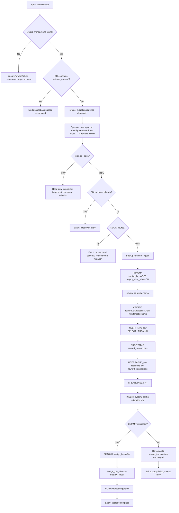
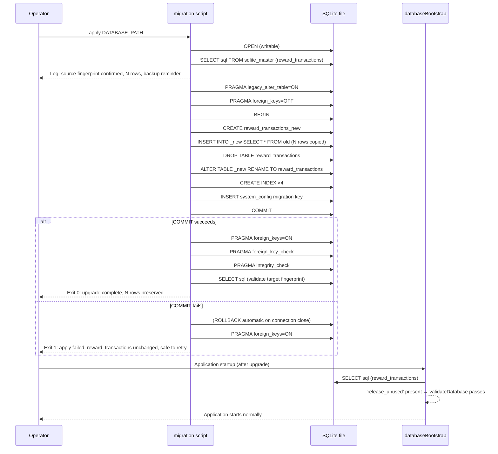

# W03-R2 — Existing-ledger CHECK constraint upgrade for release_unused

Date: 2026-10-30
Status: IMPLEMENTATION_READY
Supersedes: N/A
Implements: W03-R2 prompt at `b3001e17` on `codex/platform-wiring-audit`

---

## 1. Problem statement

PR #118 (W03-R1, `5b3c180`) introduced transaction type `release_unused` and updated
`reward_transactions` CHECK constraints in `database/schema.sql` and the
`CREATE TABLE IF NOT EXISTS` definition in `src/config/database.ts`. Because SQLite's
`CREATE TABLE IF NOT EXISTS` is a no-op on existing tables, databases initialized under
#117 (`655e11c`) or earlier still carry the old constraints:

**Source (pre-W03-R2):**
```sql
transaction_type TEXT NOT NULL CHECK (transaction_type IN (
  'fund', 'reserve', 'release', 'cancel', 'refund', 'expire'
)),
CHECK ((transaction_type IN ('reserve', 'cancel', 'expire') AND source_user_id IS NOT NULL)
    OR (transaction_type NOT IN ('reserve', 'cancel', 'expire'))),
```

**Target (W03-R2):**
```sql
transaction_type TEXT NOT NULL CHECK (transaction_type IN (
  'fund', 'reserve', 'release', 'cancel', 'refund', 'expire', 'release_unused'
)),
CHECK ((transaction_type IN ('reserve', 'cancel', 'expire', 'release_unused') AND source_user_id IS NOT NULL)
    OR (transaction_type NOT IN ('reserve', 'cancel', 'expire', 'release_unused'))),
```

When `reconcileUnusedReservation()` fires on a below-cap reward reaching `released`,
the INSERT fails with:
```
SqliteError: CHECK constraint failed: transaction_type IN ('fund', 'reserve', 'release', 'cancel', 'refund', 'expire')
```

---

## 2. Scope

- **In scope**: Offline migration script to upgrade the CHECK constraint; preflight
  enforcement to reject old-schema databases with actionable diagnostic; test coverage
  per the 12 behavioral requirements.
- **Out of scope**: W04, deployment, live migration execution, historical financial
  reconciliation for stranded funds on already-released rewards (a separate operator task,
  documented in §9).

---

## 3. Architecture

### 3.1 Migration pattern choice

The repository has two migration mechanisms:
- **Startup migrations** (`startupMigrations` array in `database.ts`): additive operations
  (ADD COLUMN, CREATE TABLE IF NOT EXISTS, CREATE UNIQUE INDEX IF NOT EXISTS) that are
  safe to run on every startup without changing existing data.
- **Offline migration scripts** (`src/scripts/migrate*.ts`): operator-initiated, require
  explicit invocation, support `--plan` / `--apply` modes.

SQLite CHECK constraint changes require full table reconstruction (rename-to-temp, create-
new, copy rows, drop old, rename-new-to-original, recreate indexes). This is destructive
and not idempotent by default — it must not be hidden in ordinary startup.

**Decision**: Implement as an offline migration script `src/scripts/migrateRewardTxnCheck.ts`,
registered as `npm run db:migrate-reward-txn-check`. Follow the existing script pattern.

### 3.2 Migration identity

- **Version**: `002-reward-transactions-check-upgrade`
- **Source fingerprint**: `reward_transactions` DDL does NOT contain `'release_unused'`
- **Target fingerprint**: `reward_transactions` DDL contains `'release_unused'` in both
  the transaction_type CHECK AND the source_user_id compound CHECK
- **Migration metadata key**: `system_config.migration_002_reward_txn_check` (ISO8601 value)

### 3.3 Reconstruction protocol

```sql
PRAGMA legacy_alter_table = ON;   -- prevent FK rewriting in other tables
PRAGMA foreign_keys = OFF;        -- must be outside transaction in SQLite
BEGIN;
  CREATE TABLE reward_transactions_new (...target schema...);
  INSERT INTO reward_transactions_new SELECT * FROM reward_transactions;
  DROP TABLE reward_transactions;
  ALTER TABLE reward_transactions_new RENAME TO reward_transactions;
  CREATE INDEX idx_reward_txn_reward ON reward_transactions(reward_id);
  CREATE INDEX idx_reward_txn_allocation ON reward_transactions(allocation_id);
  CREATE INDEX idx_reward_txn_idem ON reward_transactions(idempotency_key);
  CREATE UNIQUE INDEX idx_reward_txn_fund_ref_unique ON reward_transactions(funding_reference)
    WHERE funding_reference IS NOT NULL AND transaction_type = 'fund';
  INSERT OR REPLACE INTO system_config (key, value, updated_at, updated_by)
    VALUES ('migration_002_reward_txn_check', datetime('now'), datetime('now'), 'db:migrate-reward-txn-check');
COMMIT;
PRAGMA foreign_keys = ON;
PRAGMA foreign_key_check;
PRAGMA integrity_check;
```

### 3.4 Safety constraints

- `--plan` mode: opens database READ ONLY; validates source/target fingerprint; reports
  proposed changes; makes no mutation.
- `--apply` mode: validates source fingerprint; performs reconstruction in single
  transaction; validates target fingerprint after commit; runs FK and integrity checks.
- **Already-applied detection**: if `reward_transactions` DDL already contains
  `'release_unused'`, exit 0 with "already at target schema".
- **Unsupported schema**: if DDL matches neither source nor target, refuse before mutation.
- **Interrupted apply**: transaction is all-or-nothing; if it fails, `reward_transactions`
  is unchanged (original DDL still present), indexes still present, `system_config` not
  written. Safe to re-run.
- **Partial-swap detection**: `reward_transactions_new` present in `sqlite_master` without
  `reward_transactions` → refuse (interrupted prior run detected; manual recovery required).

### 3.5 Preflight enforcement

`databaseBootstrap.validateDatabase()` is called before the application opens the
database for writing. A new check is added:

```typescript
const txnRow = db.prepare(
  "SELECT sql FROM sqlite_master WHERE type='table' AND name='reward_transactions'"
).get() as { sql: string } | undefined;
if (txnRow && !txnRow.sql.includes("'release_unused'")) {
  refuse(
    "reward_transactions CHECK constraint is pre-W03-R2; " +
    "run: npm run db:migrate-reward-txn-check -- --apply DATABASE_PATH " +
    "before starting the application"
  );
}
```

This fires on file-backed databases only. In-memory test databases are already
initialized from the current `schema.sql` (which includes `release_unused`) so tests
are unaffected.

---

## 4. Source/target schema inventory — reward_transactions

All other columns/constraints are IDENTICAL in source and target.

| Object | Source (#117) | Target (#118+) | Change |
|---|---|---|---|
| CHECK transaction_type | `IN ('fund','reserve','release','cancel','refund','expire')` | `IN (...,'release_unused')` | ADD `'release_unused'` |
| CHECK source_user_id | `IN ('reserve','cancel','expire')` | `IN ('reserve','cancel','expire','release_unused')` | ADD `'release_unused'` |
| PK | `id TEXT PRIMARY KEY` | same | none |
| UNIQUE idempotency_key | `UNIQUE` | same | none |
| FK reward_id | `REFERENCES rewards(id) ON DELETE RESTRICT` | same | none |
| FK allocation_id | `REFERENCES reward_allocations(id) ON DELETE RESTRICT` | same | none |
| FK source_user_id | `REFERENCES users(id) ON DELETE RESTRICT` | same | none |
| FK destination_user_id | `REFERENCES users(id) ON DELETE RESTRICT` | same | none |
| FK actor_user_id | `REFERENCES users(id) ON DELETE RESTRICT` | same | none |
| CHECK actor_type/user | `system+NULL OR user+NOT NULL` | same | none |
| CHECK fund | `fund → funding_source_type NOT NULL` | same | none |
| CHECK release/refund | `allocation_id+destination_user_id NOT NULL` | same | none |
| CHECK fund destination | `destination_user_id NOT NULL AND funder` | same | none |
| idx_reward_txn_reward | `ON reward_transactions(reward_id)` | same | recreated |
| idx_reward_txn_allocation | `ON reward_transactions(allocation_id)` | same | recreated |
| idx_reward_txn_idem | `ON reward_transactions(idempotency_key)` | same | recreated |
| idx_reward_txn_fund_ref_unique | partial UNIQUE, funding_reference | same | recreated |

### Referenced by reward_transactions (outgoing FKs)
- `rewards(id)` via reward_id
- `reward_allocations(id)` via allocation_id
- `users(id)` via source_user_id, destination_user_id, actor_user_id

### Referencing reward_transactions (incoming FKs)
None. No other table has a FK pointing to `reward_transactions`.

---

## 5. Backup and rollback

### Pre-apply backup
Operator must capture a consistent WAL-mode backup before running `--apply`:
```bash
sqlite3 "$DB" "PRAGMA wal_checkpoint(TRUNCATE);"
cp "$DB" "$DB.bak-pre-w03r2"
# WAL file should be empty after checkpoint; copy it if not
cp "$DB-wal" "$DB.bak-pre-w03r2-wal" 2>/dev/null || true
```
The migration script logs this requirement but does NOT perform it automatically.

### Schema rollback
Once `release_unused` rows exist in `reward_transactions`, the old CHECK schema CANNOT
store them. Rolling back the schema while such rows exist would require deleting or
relabeling financial rows — which is prohibited.

**Compatible rollback path**:
- If migration was applied but no `release_unused` rows exist: restore from pre-apply
  backup (requires quiesced database, no writers since backup).
- If `release_unused` rows exist: DO NOT downgrade the schema or the application image.
  Forward-fix only: keep the upgraded schema and deploy the W03-R1+ image.

The script documents this in its `--plan` output.

### Application rollback
Pre-W03-R2 application images (pre-`5b3c180`) do NOT write `release_unused` rows.
Rolling back the application to a pre-`5b3c180` image on a migrated database is safe
(the new CHECK permits the old types; the old image never writes `release_unused`).

---

## 6. Limitations

1. **Historical stranded funds**: Rewards that were released before W03-R1 was deployed
   continue to have stranded `funder.reserved` balances. The migration does NOT
   automatically reconcile these — it only enables future `release_unused` entries.
   Operator assessment required for historical reconciliation.

2. **Pre-R3 partial UNIQUE index**: Handled by existing `legacyUniqueExemptions` in
   `databaseBootstrap.ts` — unchanged.

3. **No automated production apply**: This unit rehearses on disposable fixtures only.
   Production apply requires a separately authorized operational session with:
   - Verified backup + WAL checkpoint
   - Quiesced writers
   - Protected-copy rehearsal
   - Operator approval

---

## 7. Requirement-to-test matrix

| Req | Description | Test ID |
|---|---|---|
| 1 | #117-schema fixture + services → CHECK failure before repair | COMPAT-REPRO |
| 2 | Plan/dry-run leaves DB content/schema unchanged; refusal behaviors | COMPAT-PLAN |
| 3 | Apply preserves all rows and unrelated records; exact value comparison | COMPAT-APPLY-PRESERVE |
| 4 | All constraints preserved; positive/negative post-migration inserts | COMPAT-CONSTRAINTS |
| 5 | Repeat apply recognized; current-schema recognized; fresh init/preflight work | COMPAT-IDEMPOTENT |
| 6 | Unknown schema refuses before mutation | COMPAT-UNKNOWN-SCHEMA |
| 7 | Failure injection → rollback; original ledger preserved; enforcement restored | COMPAT-ROLLBACK |
| 8 | WAL backup/restore rehearsal + integrity/FK checks pass | COMPAT-BACKUP-RESTORE |
| 9 | Post-upgrade cap=5/audience=3: 500 reserved, 300 distributed, 200 returned once | COMPAT-E2E-LIFECYCLE |
| 10 | Existing 26+19 tests pass; retry, isolation, refund/cancel/expiry interactions | COMPAT-REGRESSION |
| 11 | Old-schema startup refuses; target passes; false receipt doesn't bypass | COMPAT-PREFLIGHT |
| 12 | Compatible restore/rollback path rehearsed; no financial row deletion | COMPAT-RESTORE-PATH |

---

## 8. Upgrade/preflight flow diagram



---

## 9. Transaction/recovery diagram


