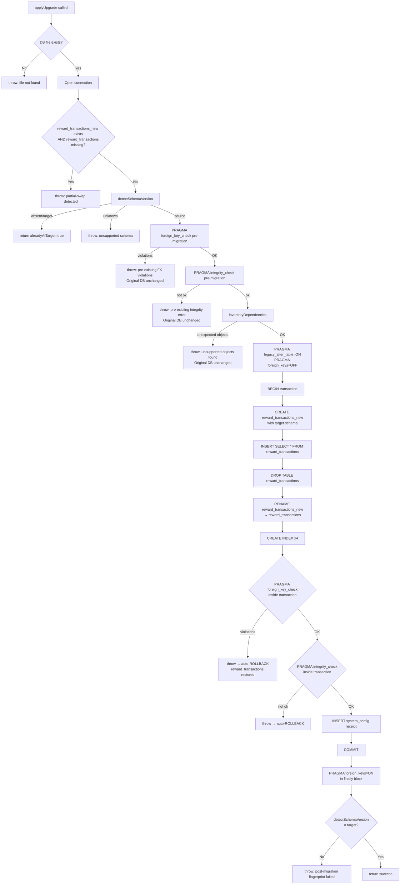
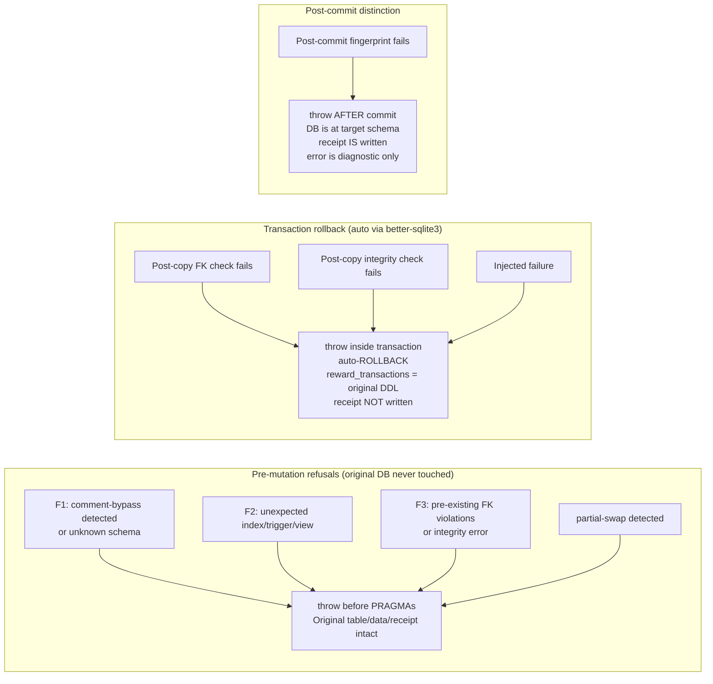

# W03-R3 — Correct migration validation, preservation and commit boundaries

Date: 2026-10-30
Status: IMPLEMENTATION_READY
Supersedes: `docs/superpowers/specs/2026-10-30-W03-R2-ledger-check-upgrade.md` (extends; W03-R2 receipts preserved)
Implements: W03-R3 prompt at `b1fd4d6d` on `codex/platform-wiring-audit`

---

## 1. Problem statement

Three independently reproduced defects in the W03-R2 migration (`migrateRewardTxnCheck.ts`,
`databaseBootstrap.ts`) were found after PR #119 merged at `bc3e0df`:

### F1 — False target classification

`detectSchemaVersion` uses `sql.includes("'release_unused'")` — a single substring check
against the raw DDL. A SQL comment `/* 'release_unused' */` inserted anywhere in an otherwise
pre-W03-R2 DDL causes the function to return `'target'`, marking an un-upgraded schema as
already migrated. `planUpgrade` reports `alreadyAtTarget: true` and `applyUpgrade` returns
without making any changes, leaving the old 6-type CHECK constraint in place.

The same substring check appears verbatim in `databaseBootstrap.validateDatabase` (line 96),
so startup accepts a commented-old-schema without diagnostic.

### F2 — Silent schema-object loss

`applyUpgrade` reconstructs `reward_transactions` by dropping the old table and recreating it,
then hardcodes exactly four `CREATE INDEX` statements. Any additional indexes or triggers that
exist on `reward_transactions` (e.g. an operator-added index on `amount_stroops`, or a
synthetic BEFORE DELETE guard trigger) are silently dropped. The apply operation reports
success and the target schema but the extra objects are gone.

Neither `planUpgrade` nor `applyUpgrade` inventories existing schema objects before mutation,
so there is no warning that objects will be lost.

### F3 — Validation failure after irreversible commit

`applyUpgrade` runs `conn.exec('PRAGMA foreign_keys = ON')` and then
`conn.pragma('foreign_key_check')` **after** the `migrate()` call that commits the
transaction. If the input database has pre-existing FK violations (e.g. in another table
added with FK enforcement off), `foreign_key_check` detects them post-commit, throws an
error, and the caller sees a failed operation — but the database already has:

- `reward_transactions` at target schema
- `migration_002_reward_txn_check` written to `system_config`

The "failed" migration is irreversible because the commit already happened.

---

## 2. Scope

- **In scope**: Fix F1/F2/F3 in `src/scripts/migrateRewardTxnCheck.ts` and the F1 fix in
  `src/config/databaseBootstrap.ts`; regression tests per the 12 required behaviors.
- **Out of scope**: W04, deployment, live migration execution, historical financial
  reconciliation, and any unrelated code changes.

---

## 3. Source / Target / Dependency matrix

### Schema version DDL fingerprints (after comment-strip and whitespace normalization)

| Version | `transaction_type` CHECK | Compound `source_user_id` CHECK |
|---------|--------------------------|----------------------------------|
| **source** (pre-W03-R2) | `IN ('fund', 'reserve', 'release', 'cancel', 'refund', 'expire')` | `IN ('reserve', 'cancel', 'expire') AND source_user_id IS NOT NULL` |
| **target** (W03-R2+) | `IN ('fund', 'reserve', 'release', 'cancel', 'refund', 'expire', 'release_unused')` | `IN ('reserve', 'cancel', 'expire', 'release_unused') AND source_user_id IS NOT NULL` |

Both CHECKs must match to certify a version. Unknown drift → `'unknown'`.

### Supported schema objects on `reward_transactions`

| Object | Type | Name / definition |
|--------|------|-------------------|
| Primary key | auto | `id TEXT PRIMARY KEY` |
| Auto unique index | SQLite auto | `sqlite_autoindex_reward_transactions_1` (idempotency_key UNIQUE) |
| Reward index | explicit | `idx_reward_txn_reward` — `ON reward_transactions(reward_id)` |
| Allocation index | explicit | `idx_reward_txn_allocation` — `ON reward_transactions(allocation_id)` |
| Idempotency index | explicit | `idx_reward_txn_idem` — `ON reward_transactions(idempotency_key)` |
| Fund-ref partial unique | explicit | `idx_reward_txn_fund_ref_unique` — partial on `funding_reference WHERE ... transaction_type = 'fund'` |

Any explicitly-created index **not** in this set, any trigger, and any dependent view are
**unsupported** — the migration must refuse before any mutation.

### Dependencies

| Dependency | Direction | Tables |
|------------|-----------|--------|
| `reward_transactions.reward_id` | → | `rewards(id)` |
| `reward_transactions.allocation_id` | → | `reward_allocations(id)` |
| `reward_transactions.source_user_id` | → | `users(id)` |
| `reward_transactions.destination_user_id` | → | `users(id)` |
| `reward_transactions.actor_user_id` | → | `users(id)` |
| `system_config` receipt write | → | `system_config(key, value, updated_at, updated_by)` — `updated_by = NULL` avoids FK |

---

## 4. Authoritative detection strategy (F1 fix)

Replace `sql.includes("'release_unused'")` with a two-step comment-aware normalized pattern
match:

1. **Strip SQL comments**: remove `/* ... */` block comments and `-- ...` line comments from
   the raw DDL text.
2. **Normalize whitespace**: collapse all whitespace sequences to a single space.
3. **Require both target-specific substrings** (after normalization) to classify as `'target'`:
   - `transaction_type IN ('fund', 'reserve', 'release', 'cancel', 'refund', 'expire', 'release_unused')`
   - `transaction_type IN ('reserve', 'cancel', 'expire', 'release_unused') AND source_user_id IS NOT NULL`
   - `transaction_type NOT IN ('reserve', 'cancel', 'expire', 'release_unused')`
4. **Require both source-specific substrings** to classify as `'source'` (absence of release_unused
   in each CHECK is implicit because neither target pattern appears):
   - `transaction_type IN ('fund', 'reserve', 'release', 'cancel', 'refund', 'expire')`
   - `transaction_type IN ('reserve', 'cancel', 'expire') AND source_user_id IS NOT NULL`
5. Anything else is `'unknown'`.

The `databaseBootstrap.validateDatabase` preflight check imports `detectSchemaVersion`
from `migrateRewardTxnCheck.ts` rather than reimplementing the check.

**What this defeats:**
- SQL-comment bypass (`/* 'release_unused' */`)
- Unrelated string literals (the patterns are multi-token and specific to CHECK constraints)
- Missing source-user compound check (both patterns required)
- Permissive OR branches or malformed CHECKs (won't match exact target patterns)
- Forged migration receipts (system_config not consulted for schema version)

**What it does NOT attempt to detect:**
- Adversarial DDL modifications that perfectly reproduce the exact multi-word patterns in a
  non-functional context. This would require a full SQL parser. The prompt explicitly permits
  not implementing a general SQL parser. Classification of such inputs returns `'unknown'` and
  refuses safely.

---

## 5. Dependency inventory strategy (F2 fix)

Before any mutation in both `planUpgrade` and `applyUpgrade`:

1. Query `sqlite_master WHERE type='index' AND tbl_name='reward_transactions'`.
2. Exclude SQLite autoindexes (names starting with `sqlite_autoindex_`).
3. Compare remaining explicitly-created indexes against the supported set.
4. Query `sqlite_master WHERE type='trigger' AND (tbl_name='reward_transactions' OR sql LIKE '%reward_transactions%')`.
5. Query `sqlite_master WHERE type='view' AND sql LIKE '%reward_transactions%'`.
6. If any unexpected index, trigger, or view is found: throw with an actionable diagnostic
   listing the unexpected object names. Leave schema and data unchanged.

---

## 6. Validation boundary (F3 fix)

Revised `applyUpgrade` execution order:

### Phase 1 — Pre-migration read-only checks (connection in default FK-enforced state)
1. Partial-swap detection (unchanged from W03-R2)
2. `detectSchemaVersion` — refuse if 'unknown'; short-circuit if 'target'/'absent'
3. `PRAGMA foreign_key_check` — refuse if any violation (pre-existing, not caused by migration)
4. `PRAGMA integrity_check` — refuse if not 'ok'
5. Dependency inventory — refuse if unexpected objects

### Phase 2 — Reconstruction (outside-transaction PRAGMAs then atomic transaction)
6. `PRAGMA legacy_alter_table = ON` (outside transaction)
7. `PRAGMA foreign_keys = OFF` (outside transaction)
8. `BEGIN` (via `conn.transaction()`)
9. `CREATE TABLE reward_transactions_new`
10. `INSERT INTO reward_transactions_new SELECT * FROM reward_transactions`
11. `DROP TABLE reward_transactions`
12. `ALTER TABLE reward_transactions_new RENAME TO reward_transactions`
13. `CREATE INDEX` × 4
14. **`PRAGMA foreign_key_check`** — throw if violations → auto-ROLLBACK
15. **`PRAGMA integrity_check`** — throw if not 'ok' → auto-ROLLBACK
16. `INSERT OR REPLACE INTO system_config (migration receipt)` — only if checks pass
17. `COMMIT`

### Phase 3 — Post-commit verification
18. `PRAGMA foreign_keys = ON` (in finally block for safety)
19. `detectSchemaVersion` — verify 'target'
20. `conn.close()`

**Key change from W03-R2:** Steps 14–15 (FK and integrity checks) and step 16 (receipt write)
are now **inside** the transaction. If they fail, `better-sqlite3` auto-rolls back and
`reward_transactions` reverts to the original schema. The receipt is never written for a
failed reconstruction.

---

## 7. Requirement-to-test mapping

| # | Requirement | New test count | Test file |
|---|-------------|----------------|-----------|
| 1 | F1 comment bypass, unrelated literal, malformed/missing CHECKs, missing compound check, permissive OR, fake receipt | 7 | `reward-txn-check-migration.test.ts` |
| 2 | Valid source/target no-op, fresh init, repeated apply, runtime | 3 | same |
| 3 | Extra index refusal (plan+apply), extra trigger refusal, dependent view refusal, incoming FK scenario | 6 | same |
| 4 | Partial-swap extended: both tables exist, only _new exists, stale _old rename, drift between plan and apply | 4 | same |
| 5 | Pre-existing FK violation: refuse before reconstruction; original schema/data/receipt preserved | 2 | same |
| 6 | Fault injection post-rename pre-commit: rollback; safe rerun; FK enforcement restored | 2 | same |
| 7 | Plan/apply drift: source schema changes between planUpgrade and applyUpgrade | 1 | same |
| 8 | Exact ledger value preservation: idempotency keys, funding_reference, amount_stroops match row-by-row | 2 | same |
| 9 | WAL-aware backup/restore rehearsal | 1 | same |
| 10 | Post-upgrade cap=5/audience=3 monetary lifecycle | 1 | same |
| 11 | Original 35 W03-R2 tests unchanged | 35 | same (regression) |
| 12 | Rollback guidance: target DB with release_unused rows; no schema downgrade on forward-only DB | 1 | same |

**Total new tests:** ~30 (exact count set by TDD RED step)

---

## 8. Mermaid diagrams

### 8a — Inspect / lock / revalidate / reconstruct / validate / commit flow

### 8b — Refusal / rollback flow

---

## 9. Production apply prerequisites (no action in this unit)

- Obtain consistent WAL checkpoint backup before applying:
  `sqlite3 "$DB" "PRAGMA wal_checkpoint(TRUNCATE);" && cp "$DB" "$DB.bak-pre-w03r3"`
- Run `--plan` first; inspect reported indexes and confirm none are unexpected.
- If unexpected objects reported: investigate, add to supported set via a separate reviewed
  migration, or remove the objects first.
- If pre-existing FK violations reported: do NOT apply. Repair the source violation or obtain
  a clean database restore before applying.
- After successful apply, verify the system starts cleanly and `validateDatabase` passes.

---

## 10. Recovery / forward-fix guidance

- Databases already at target schema (containing `release_unused` rows): `applyUpgrade`
  short-circuits with `alreadyAtTarget: true`. No schema changes. No data moved.
- Databases in partial-swap state: restore from pre-apply backup. Do not attempt to manually
  rename `reward_transactions_new`.
- No schema downgrade path is supported. If `release_unused` ledger entries exist, a
  schema downgrade would break referential integrity; forward-fix only.
