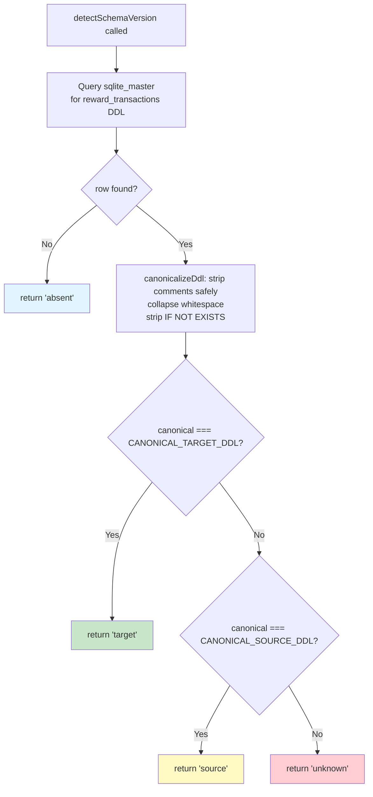
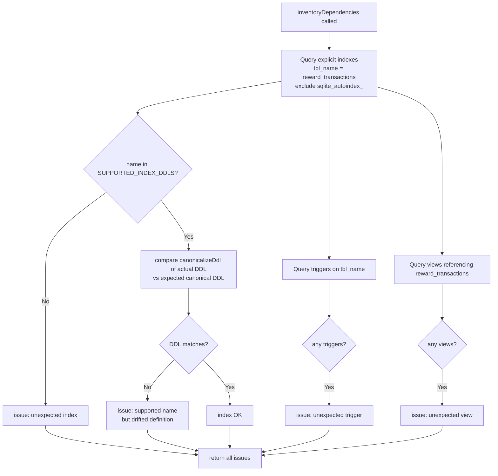
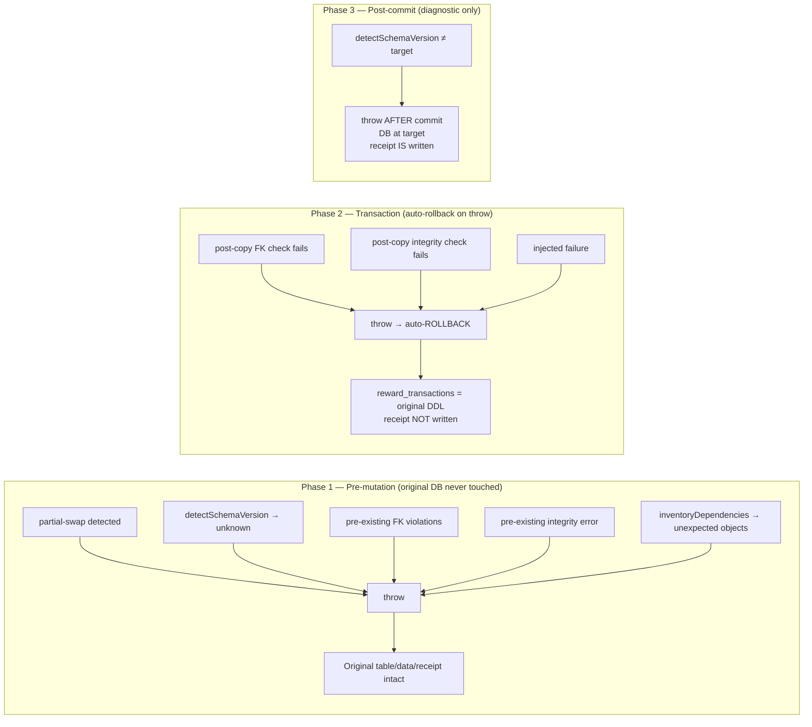

# W03-R4 — Authoritative complete-schema compatibility

Date: 2026-10-30
Status: IMPLEMENTATION_READY
Supersedes: `docs/superpowers/specs/2026-10-30-W03-R3-migration-corrections.md` (extends; W03-R3 receipts preserved)
Implements: W03-R4 prompt at `b92e4f01` on `codex/platform-wiring-audit`

---

## 1. Problem statement

Two residual defects in the W03-R3 migration (`migrateRewardTxnCheck.ts`,
`databaseBootstrap.ts`) were independently reproduced after PR #120 merged at `fc59ec2`.
59 tests executed; 57 passed, 2 failed.

### F1 — Permissive target CHECK accepted

The current `detectSchemaVersion` function checks whether the normalized DDL
**contains** the target pattern strings as substrings. A weakened but syntactically
valid DDL such as:

```sql
transaction_type TEXT NOT NULL CHECK (transaction_type IN ('fund', 'reserve', 'release',
  'cancel', 'refund', 'expire', 'release_unused') OR 1=1)
```

still contains `TARGET_TXN_TYPE_PATTERN` as a substring, so `detectSchemaVersion`
returns `'target'`. `planUpgrade` reports `alreadyAtTarget: true`; `applyUpgrade` no-ops.
The constraint is actually permissive — SQLite accepts any `transaction_type` value.
Bootstrap/preflight also accepts this database without diagnostic.

**Proof**: Inserting a row with `transaction_type = 'NOT_A_REAL_KIND'` into a table
with the `OR 1=1` constraint succeeds in SQLite (confirmed on synthetic database).

### F2 — Additional source CHECK silently removed

If the source DDL has an extra table-level CHECK (e.g., `CHECK (amount_stroops < 1000)`),
the current source classification still matches (the two required substrings are present,
and `'release_unused'` is absent). `applyUpgrade` proceeds and reconstructs the canonical
target table — the extra CHECK is silently dropped, and the operation reports success.

The required behavior is to **refuse** before mutation when the source DDL contains any
semantics not in the supported canonical form.

---

## 2. Scope

- **In scope**: Replace substring-based `detectSchemaVersion` with exact canonicalized-DDL
  comparison in `src/scripts/migrateRewardTxnCheck.ts` and `src/config/databaseBootstrap.ts`;
  add index-definition verification to `inventoryDependencies`; explicit column mapping in
  `INSERT INTO ... SELECT`; regression tests per all 12 required behaviors.
- **Out of scope**: W04, deployment, live migration execution, production data, provider
  features, or any change to financial business logic.

---

## 3. Source / Target canonical schema identities

Both supported schema forms are defined as **complete canonical DDL strings** embedded in
the migration module. `detectSchemaVersion` uses exact comparison after normalization —
not substring search.

### 3.1 Supported source DDL (pre-W03-R2)

Exactly matching the `reward_transactions` definition in `database/schema-v117-fixture.sql`.
Key distinguishing feature: `transaction_type IN ('fund','reserve','release','cancel','refund','expire')`
and `IN ('reserve','cancel','expire')` compound check — no `'release_unused'`.

### 3.2 Supported target DDL (W03-R2+)

Exactly matching `targetCreateTable('reward_transactions')` as embedded in the migration
module. Key distinguishing feature: `transaction_type IN (...,'release_unused')` in both
the `transaction_type` CHECK and the compound `source_user_id` CHECK.

### 3.3 What is NOT supported

Any DDL that does not normalize to exactly one of the two canonical forms is classified
`'unknown'` and refused before mutation:

| Variant | F1/F2 defect type | Classification |
|---------|-------------------|----------------|
| `transaction_type IN (...) OR 1=1` | F1: permissive extra OR | `'unknown'` |
| Extra table-level `CHECK (amount_stroops < 1000)` | F2: unsupported semantics | `'unknown'` |
| Missing any required CHECK (e.g., no actor check) | missing constraint | `'unknown'` |
| Changed nullability or DEFAULT value | structural drift | `'unknown'` |
| Changed FK ON DELETE action | FK drift | `'unknown'` |
| Extra column | unsupported column | `'unknown'` |
| Reordered columns | column order drift | `'unknown'` |
| Additional OR branch in any existing CHECK | permissive weakening | `'unknown'` |
| Unrelated literal containing expected text | false positive | `'unknown'` |

---

## 4. Canonical DDL normalization

A safe, token-aware canonicalization function is applied to both the stored DDL and the
in-code canonical DDL constants before comparison.

### 4.1 Normalization rules

1. **String literals** (`'...'`, `''` escaping): preserved verbatim — their content is not
   whitespace-collapsed, not comment-stripped, not case-changed.
2. **Double-quoted identifiers** (`"..."`): preserved verbatim.
3. **Block comments** (`/* ... */`): replaced with a single space.
4. **Line comments** (`-- ...`): replaced with a single space (up to end of line only).
5. **Whitespace sequences**: all whitespace (space, tab, newline) collapsed to a single
   space; leading/trailing stripped.
6. **`IF NOT EXISTS`** phrase: stripped case-insensitively before the table/index name
   (single explicit structural equivalence: the migration uses `CREATE TABLE name (...)`,
   schema.sql uses `CREATE TABLE IF NOT EXISTS name (...)`; both are the same contract).

### 4.2 What normalization does NOT do

- Does NOT change keyword case.
- Does NOT reorder constraints, columns, or CHECK expressions.
- Does NOT strip string literal content.
- Does NOT evaluate or simplify expressions.
- Does NOT tolerate extra/fewer clauses even if semantically equivalent.

### 4.3 Why this defeats F1 and F2

- **F1**: `CHECK (... OR 1=1)` normalizes to a different string than the canonical CHECK
  because `OR 1=1` is outside the string literal and is preserved in the non-string region.
  The canonical target DDL does NOT contain `OR 1=1`.
- **F2**: Extra `CHECK (amount_stroops < 1000)` added to the source DDL produces a longer
  normalized string that does not equal the canonical source DDL.

---

## 5. Index-definition verification (F2 extension to inventoryDependencies)

The W03-R3 fix checks index *names* against the supported set. W03-R4 additionally
verifies that each present supported-named index has the expected DDL definition:

| Index name | Expected type | Expected DDL (after canonicalization) |
|---|---|---|
| `idx_reward_txn_reward` | non-unique | `CREATE INDEX idx_reward_txn_reward ON reward_transactions(reward_id)` |
| `idx_reward_txn_allocation` | non-unique | `CREATE INDEX idx_reward_txn_allocation ON reward_transactions(allocation_id)` |
| `idx_reward_txn_idem` | non-unique | `CREATE INDEX idx_reward_txn_idem ON reward_transactions(idempotency_key)` |
| `idx_reward_txn_fund_ref_unique` | unique | `CREATE UNIQUE INDEX idx_reward_txn_fund_ref_unique ON reward_transactions(funding_reference) WHERE funding_reference IS NOT NULL AND transaction_type = 'fund'` |

A supported-named index whose DDL does not match the expected DDL is treated as an
**unexpected object** and causes a pre-mutation refusal.

---

## 6. Explicit column mapping

The `INSERT INTO reward_transactions_new SELECT * FROM reward_transactions` is replaced
with explicit source and destination column lists naming all 23 columns in their defined
order. This makes the copy contract unambiguous and independent of source schema layout
assumptions.

---

## 7. Requirement-to-test mapping

| # | Requirement | New test count | Test file |
|---|-------------|----------------|-----------|
| 1 | F1: permissive OR in target CHECK detected; plan/apply/preflight all refuse; SQLite accepts invalid row on weakened fixture | 5 | `reward-txn-check-migration.test.ts` |
| 2 | F2: extra source CHECK detected as 'unknown'; apply refuses before mutation; original DDL/data preserved | 3 | same |
| 3 | Complete-schema mutations: missing actor check, missing source-user check, extra OR in non-critical CHECK, wrong type IN list, changed nullability, changed DEFAULT, changed FK ON DELETE, added column, reordered columns | 9 | same |
| 4 | Comment/string tokenization: comment containing realistic text, string literal that looks like a comment | 2 | same |
| 5 | Index drift: wrong column, non-unique replacing unique, altered predicate | 3 | same |
| 6 | Valid source/target match; fresh init; repeated apply; original schemas from repo fixtures accepted | 4 | same (regression) |
| 7 | Plan/apply/preflight agree on supported/unknown; fake receipt bypass | 2 | same |
| 8 | Pre-existing FK violation, injection rollback, rerun, FK enforcement restore | 2 | same (regression) |
| 9 | WAL-aware backup/restore rehearsal | 1 | same (regression) |
| 10 | Post-upgrade cap=5/audience=3 lifecycle | 1 | same (regression) |
| 11 | Original 55 W03-R2/R3 tests unchanged | 55 | same (regression) |
| 12 | Rollback guidance: target DB with release_unused rows | 1 | same (regression) |

**Total new tests**: ~30 (exact count set by TDD RED step)

---

## 8. Mermaid diagrams

### 8a — detectSchemaVersion canonical comparison flow



### 8b — inventoryDependencies enhanced flow



### 8c — applyUpgrade refusal/rollback flow (W03-R4 state)



---

## 9. Production apply prerequisites (no action in this unit)

- Same as W03-R3 spec §9: WAL checkpoint backup, `--plan` inspection, quiesced writers,
  operator approval.
- This unit corrects the detection logic only; no new operational step is added.

---

## 10. Recovery / forward-fix guidance

- Same as W03-R3 spec §10.
- Databases with `unknown` classification require manual investigation before applying.
- No schema downgrade path is supported.
