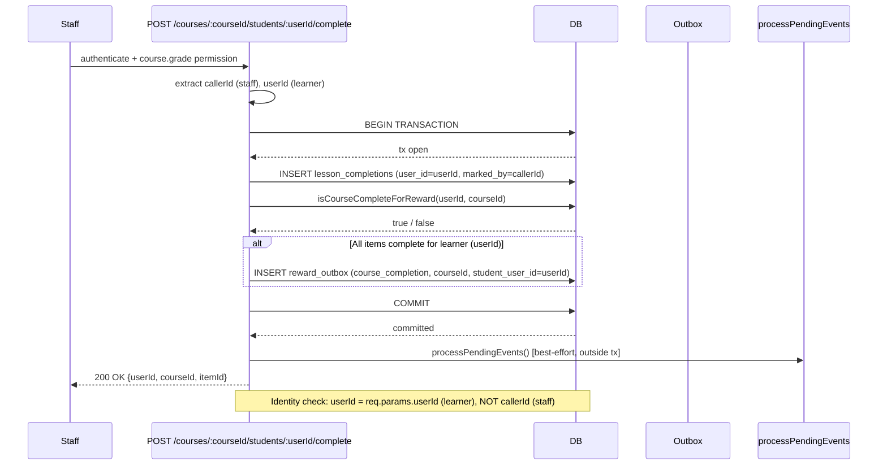
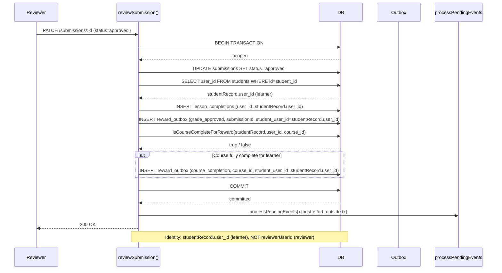
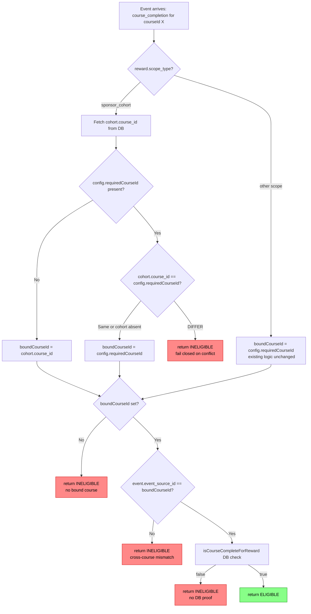

# W04-R1 — Producer/Consumer Identity and Conflict-Detection Fixes

Date: 2026-10-31
Branch: `codex/w04-r1`
Base: `4285048` (W04 PR #123 merged to main)
Status: IN_PROGRESS

---

## 1. Overview

### 1.1 What W04 PR #123 fixed

W04 closed three systemic defects in the reward pipeline:

1. **Premature outbox events** — `lessonCompletions.ts` previously emitted
   `course_completion` after every non-assessment lesson write, before a
   genuine full-course check.  W04 introduced `isCourseCompleteForReward()`
   and a DB-backed proof requirement, ensuring the event fires only when all
   required items are genuinely complete.

2. **Missing course binding in consumer** — `evaluateEligibility()` previously
   accepted any `course_completion` event regardless of which course it
   originated from.  W04 added `boundCourseId` derivation and an independent
   `isCourseCompleteForReward()` verification call inside the consumer.

3. **Dedup poisoning** — premature ineligible events silently blocked
   legitimate later completions due to the `UNIQUE(event_type,
   event_source_id, student_user_id)` constraint on the outbox.  W04 tightened
   the producer guard so that the event is only ever emitted once the course is
   genuinely complete, preventing stale ineligible records.

### 1.2 What W04-R1 adds (three residual findings)

After W04 landed, three gaps remain:

| # | Finding | Affected file |
|---|---------|---------------|
| F1 | Staff-mark route never calls `isCourseCompleteForReward` or emits `course_completion` | `src/routes/lessonCompletions.ts` |
| F2 | Submission-approval path emits `grade_approved` but never emits `course_completion` even when the approved item is the final required item | `src/controllers/submissionsController.ts` |
| F3 | Consumer silently overwrites `cohort.course_id` with `config.requiredCourseId` when both are present and differ, accepting a conflicting binding rather than failing closed | `src/services/rewards/rewardEligibilityService.ts` |

---

## 2. F1 — Staff-mark route: missing completion producer

### 2.1 Route identity

```
POST /courses/:courseId/students/:userId/lessons/:itemId/complete
```

Middleware chain: `authenticate → requirePermission('course.grade') → requireCourseScope`

- `callerId` = `req.user!.userId` (the staff member performing the mark)
- `userId` = `req.params.userId` (the **target learner** whose record is updated)

### 2.2 Current behavior (bug)

`lessonCompletions.ts` lines 299–308: the staff-mark handler calls `execute()`
directly — no `db.transaction()` wrapper, no `isCourseCompleteForReward` check,
no `produceOutboxEvent`, no `processPendingEvents`.  A learner whose final item
is marked by a staff member never receives a `course_completion` outbox event
and therefore never becomes eligible for a `course_completion` reward.

### 2.3 Required behavior

1. Wrap the INSERT into `db.transaction()` (same pattern as the self-mark route,
   lines 151–165).
2. Inside the transaction, after the INSERT, call
   `isCourseCompleteForReward(userId, courseId)` — using **`req.params.userId`
   (the learner)**, NOT `callerId` (the staff member).
3. If true, call `produceOutboxEvent('course_completion', courseId, userId)`.
4. Outside the transaction (in a try/catch best-effort block), call
   `processPendingEvents()`.
5. Preserve the existing `course.grade` permission guard and `requireCourseScope`
   middleware — do not alter the auth chain.
6. On transaction failure return HTTP 500 with `ErrorCodes.INTERNAL_ERROR` (same
   pattern as the self-mark route).

### 2.4 Identity invariant

The completion record is written for `userId` (the learner).
The outbox event `student_user_id` must be `userId` (the learner).
The reward allocation lookup must therefore resolve to the learner's allocation.
Using `callerId` here would credit the staff member, not the learner — a
correctness and privacy defect.

### 2.5 Transaction boundary

```
┌── db.transaction() ──────────────────────────────────────┐
│  INSERT lesson_completions  (userId, courseId, itemId)    │
│  if isCourseCompleteForReward(userId, courseId):          │
│      produceOutboxEvent('course_completion', courseId, userId) │
└───────────────────────────────────────────────────────────┘
processPendingEvents()   ← outside, best-effort
```

Atomicity guarantee: the completion record and the outbox event row are either
both committed or both rolled back.  The outbox UNIQUE constraint prevents
duplicate events if the transaction is retried.

---

## 3. F2 — Submission-approval: missing course_completion producer

### 3.1 Function identity

`reviewSubmission()` in `submissionsController.ts`

- `reviewerUserId` = authenticated reviewer (staff/teacher)
- `studentRecord.user_id` = the **student** whose submission is being reviewed

### 3.2 Current behavior (bug)

Inside the existing `db.transaction()` (lines 461–504), after the auto-complete
lesson write at line 485–491, the handler produces `grade_approved` (line 497)
but never checks `isCourseCompleteForReward` and never produces
`course_completion`.  If the approved submission was the final required item for
that student, the course completion event is never emitted.

### 3.3 Required behavior

After the auto-complete lesson write (after the `execute()` block at line ~490),
and still **inside the existing `db.transaction()`**, add:

```typescript
if (isCourseCompleteForReward(studentRecord.user_id, existing.course_id)) {
  produceOutboxEvent('course_completion', existing.course_id, studentRecord.user_id);
}
```

Guards that must all be true before this code path is entered (matching the
existing outer conditions):

- `status === 'approved'`
- `existing.course_id` is set (non-null, non-empty)
- `existing.item_id` is set (non-null, non-empty)
- `studentRecord.user_id` is set (non-null)

Identity invariant: use `studentRecord.user_id` (the **student**), never
`reviewerUserId`.

### 3.4 Both events in one transaction

```
┌── db.transaction() ──────────────────────────────────────────┐
│  UPDATE submissions (status='approved')                       │
│  INSERT lesson_completions (studentRecord.user_id, ...)       │
│  produceOutboxEvent('grade_approved', id, studentRecord.user_id) │
│  if isCourseCompleteForReward(studentRecord.user_id, course_id): │
│      produceOutboxEvent('course_completion', course_id, studentRecord.user_id) │
└───────────────────────────────────────────────────────────────┘
processPendingEvents()   ← outside, best-effort (status==='approved' guard)
```

Both `grade_approved` and `course_completion` events are committed atomically
with the submission update.  This ensures no partial state (e.g., grade approved
but completion event missing, or vice versa).

### 3.5 Non-approved paths

For `status !== 'approved'` (rejected, pending), no change.  No
`course_completion` event is produced.  No `grade_approved` event is produced
(existing behaviour preserved).

---

## 4. F3 — Consumer: silent conflict acceptance for sponsor_cohort

### 4.1 Location

`evaluateEligibility()` in `rewardEligibilityService.ts`, lines 262–284.

### 4.2 Current behavior (bug)

```typescript
// Derive bound course: sponsor_cohort uses cohort.course_id; others use
// eligibilityConfig.requiredCourseId.
let boundCourseId: string | null = null;
if (reward.scope_type === 'sponsor_cohort') {
  const cohort = db.prepare('SELECT course_id FROM sponsor_cohorts WHERE id = ?')
    .get(reward.scope_id) as { course_id: string } | undefined;
  boundCourseId = cohort?.course_id ?? null;
}
// eligibilityConfig.requiredCourseId takes precedence (already conflict-checked
// at activation).
if (typeof config?.requiredCourseId === 'string') {
  boundCourseId = config.requiredCourseId as string;   // ← silent overwrite
}
```

The comment "already conflict-checked at activation" is incorrect: no activation-
time conflict check exists.  When `cohort.course_id = 'course-A'` and
`config.requiredCourseId = 'course-B'`, the consumer silently uses `course-B`
and accepts events for `course-B` even though the cohort is bound to `course-A`.
This allows cross-course eligibility leakage.

### 4.3 Required behavior

For `reward.scope_type === 'sponsor_cohort'` rewards: if **both**
`cohort.course_id` and `config.requiredCourseId` are present **and they differ**,
return `'ineligible'` immediately.  Do **not** throw.

Policy rationale: fail closed on conflict.  A conflict indicates either a data
migration anomaly or a misconfiguration.  Awarding in the face of ambiguity
risks incorrect payments; failing closed forces the operator to resolve the
conflict explicitly.

```typescript
if (reward.scope_type === 'sponsor_cohort') {
  const cohortCourseId = cohort?.course_id ?? null;
  const configCourseId = typeof config?.requiredCourseId === 'string'
    ? config.requiredCourseId
    : null;

  // Conflict detection: both set and different → fail closed
  if (cohortCourseId && configCourseId && cohortCourseId !== configCourseId) {
    return 'ineligible';
  }

  // Use whichever is available (config takes precedence only when cohort is absent
  // or identical)
  boundCourseId = configCourseId ?? cohortCourseId;
}
```

### 4.4 Non-cohort scopes

Scopes other than `sponsor_cohort` are not affected.  The `requiredCourseId`
precedence logic for non-cohort paths remains unchanged.

### 4.5 API-reachability note

The conflicting-state condition (`cohort.course_id !== config.requiredCourseId`)
is currently only reachable via synthetic DB fixtures; there is no admin UI path
that simultaneously sets both values on a reward with `scope_type=sponsor_cohort`.
Until activation-time conflict validation is added, the unit tests for F3 must
create the fixture directly in the test DB.

---

## 5. Diagrams

### 5.1 Staff-to-completion-to-outbox flow



### 5.2 Submission-approval to grade_approved + course_completion flow



### 5.3 Consumer binding check: activation-time gap vs consumption-time conflict detection



---

## 6. Requirement-to-test matrix

| Test ID | F# | Scenario | Expected result | HTTP/Unit |
|---------|-----|----------|-----------------|-----------|
| F1-H-1 | F1 | Staff marks final item for learner via `POST /courses/:cid/students/:uid/lessons/:iid/complete` | HTTP 200; `course_completion` outbox event with `student_user_id = uid` (learner, not caller) | HTTP |
| F1-H-2 | F1 | Staff marks an early (non-final) item for learner | HTTP 200; no `course_completion` event produced | HTTP |
| F1-H-3 | F1 | Staff marks final item; identity check: event `student_user_id` must equal learner `userId`, not `callerId` (staff) | `reward_outbox.student_user_id = req.params.userId` | HTTP |
| F1-H-4 | F1 | Caller without `course.grade` permission attempts staff-mark route | HTTP 403; no DB writes; no outbox event | HTTP |
| F2-H-1 | F2 | Reviewer approves submission that is final required item for learner | HTTP 200; both `grade_approved` and `course_completion` events present in outbox for `studentRecord.user_id` | HTTP |
| F2-H-2 | F2 | Reviewer approves submission; verified event identity: `course_completion.student_user_id = studentRecord.user_id`, not `reviewerUserId` | `reward_outbox.student_user_id = studentRecord.user_id` | HTTP |
| F2-H-3 | F2 | Reviewer approves submission that is NOT the final required item | HTTP 200; `grade_approved` event present; no `course_completion` event | HTTP |
| F2-H-4 | F2 | Reviewer rejects submission | HTTP 200; no `grade_approved`; no `course_completion` event | HTTP |
| F2-H-5 | F2 | Approved submission has no `course_id` or no `item_id` set | HTTP 200; `grade_approved` produced (if `student_user_id` present); no `course_completion` (guard: `course_id && item_id` required) | HTTP |
| F3-U-1 | F3 | `sponsor_cohort` reward: `cohort.course_id = 'course-A'`, `config.requiredCourseId` absent | `boundCourseId = 'course-A'`; eligible for events on `course-A` | Unit |
| F3-U-2 | F3 | `sponsor_cohort` reward: both `cohort.course_id = 'course-A'` and `config.requiredCourseId = 'course-B'` (conflict) | `evaluateEligibility` returns `'ineligible'`; does not throw | Unit |
| F3-U-3 | F3 | `sponsor_cohort` reward: `cohort.course_id = 'course-A'` and `config.requiredCourseId = 'course-A'` (identical) | No conflict; `boundCourseId = 'course-A'`; eligible for events on `course-A` | Unit |
| COMPAT-1 | — | Self-mark route (`POST /courses/:cid/lessons/:iid/complete`) continues to emit `course_completion` using `callerId` (learner is the caller) | Existing behaviour unchanged; W04 logic unaffected | HTTP |
| COMPAT-2 | — | `grade` reward type triggered by `grade_approved` event continues to reach eligible state (no `course_completion` check applied) | Reward eligibility pipeline unchanged for `grade` rewards | HTTP |
| COMPAT-3 | — | W03 cap, migration, schema — repeat of W03-R5 regression suite | 2179+ tests pass; 0 regressions | Full suite |

Additional coverage items from W04-R1 prompt:

| Test ID | F# | Scenario | Expected result | HTTP/Unit |
|---------|-----|----------|-----------------|-----------|
| F1-H-5 | F1 | Transaction failure injected (DB error in INSERT) → staff-mark route | HTTP 500; no outbox event; completion not written | HTTP |
| F2-H-6 | F2 | Repeated approval of same submission (idempotent re-review) | Exactly one `course_completion` outbox event; no duplicate reward release | HTTP |
| F2-H-7 | F2 | Two distinct `course_completion` rewards sharing same learner+course | Both reward allocations become eligible; no duplicate ledger payment per reward | HTTP |
| F3-U-4 | F3 | Non-cohort scope with `config.requiredCourseId` set | Conflict check NOT applied; existing `requiredCourseId` precedence logic intact | Unit |
| F3-U-5 | F3 | `sponsor_cohort` reward with `cohort.course_id` absent and `config.requiredCourseId` present | `boundCourseId = config.requiredCourseId`; no conflict (one value absent) | Unit |

---

## 7. Checkbox TDD plan

- [ ] F1: Write RED tests (F1-H-1, F1-H-2, F1-H-3, F1-H-4)
- [ ] F1: Implement fix in `lessonCompletions.ts` (wrap in `db.transaction()`, add `isCourseCompleteForReward(userId, courseId)` using `req.params.userId`, add `produceOutboxEvent`, add `processPendingEvents` outside tx)
- [ ] F1: GREEN — all F1 tests pass
- [ ] F2: Write RED tests (F2-H-1, F2-H-2, F2-H-3, F2-H-4, F2-H-5)
- [ ] F2: Implement fix in `submissionsController.ts` (after auto-complete lesson write, inside existing transaction: call `isCourseCompleteForReward(studentRecord.user_id, existing.course_id)` → `produceOutboxEvent('course_completion', ...)`)
- [ ] F2: GREEN — all F2 tests pass
- [ ] F3: Write RED tests (F3-U-1, F3-U-2, F3-U-3)
- [ ] F3: Implement fix in `rewardEligibilityService.ts` (detect `cohort.course_id !== config.requiredCourseId` conflict, return `'ineligible'`, do not throw)
- [ ] F3: GREEN — all F3 tests pass
- [ ] Full suite pass (2179+ tests, 0 regressions)
- [ ] TypeScript build clean (`tsc --noEmit`)
- [ ] Independent review
