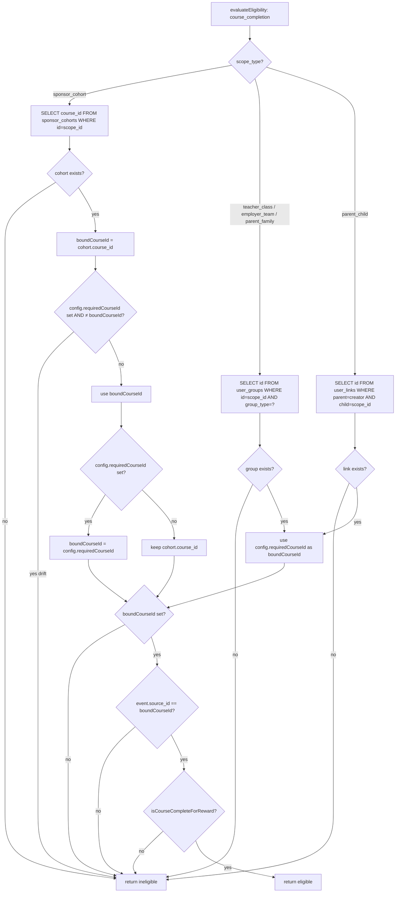

# W04-R2 Specification: Fail Closed on Deleted Reward Scope

Date: 2026-10-31
Branch: codex/w04-r2
Prompt: docs/release/CLAUDE-SERVER-W04-R2-PROMPT.md
Depends on: W04-R1 (#124, aaf0bec)

## 1. Problem Statement

After a `course_completion` reward is activated, the scope entity (e.g. `sponsor_cohort` row) may be deleted post-activation. In W04-R1, `evaluateEligibility()` only performs a scope lookup for `sponsor_cohort` — to extract `course_id`. If the cohort row is absent:

- `cohort?.course_id ?? null` → `boundCourseId = null`
- The F3 conflict check is skipped (`null && ...` is falsy)
- `config.requiredCourseId` overwrites `boundCourseId`
- Consumer returns `eligible` using config as a substitute authority

This violates the W04-R1 contract: "Missing/deleted scope or course and malformed config must fail closed."

Note: `rewards.scope_id` has **no FK** to `sponsor_cohorts`. Deleting a cohort with `PRAGMA foreign_keys=ON` succeeds without FK violation (only `cohort_members` and `cohort_status_log` cascade). The DB does not enforce scope existence after activation — the application must.

For `teacher_class`/`employer_team`/`parent_family` scopes backed by `user_groups`, and for `parent_child` backed by `user_links`, the same issue exists: the consumer does not check whether the scope entity still exists before accepting `config.requiredCourseId`.

## 2. Policy Definitions

| Concept | Definition |
|---------|-----------|
| **Scope authority** | The live scope entity (cohort row, class group row, parent-child link) that granted the reward creator permission to create the reward. Must exist at consumption time for eligibility to proceed. |
| **Audience snapshot** | The set of student IDs captured at activation time (`reward_audience_snapshots`). Immutable — preserves WHO is eligible. Does NOT substitute for scope authority. |
| **Config binding** | `eligibility_config.requiredCourseId` — can disambiguate or validate a live scope's course. Cannot resurrect a deleted scope's authority. |
| **Fail closed** | On deleted scope: return `'ineligible'`. Do not auto-release. Do not move money. Write an `ineligible` audit event. |

### Scope Resolution Policy (course_completion rewards)

1. For `sponsor_cohort`: Look up `sponsor_cohorts`. If absent → `ineligible`. If present: use `cohort.course_id` as `boundCourseId`. If `config.requiredCourseId` differs from `boundCourseId` → `ineligible` (drift).
2. For `teacher_class`/`employer_team`/`parent_family`: Look up `user_groups`. If absent → `ineligible`. Use `config.requiredCourseId` as `boundCourseId` (required; validated at activation).
3. For `parent_child`: Look up `user_links`. If absent → `ineligible`. Use `config.requiredCourseId` as `boundCourseId`.
4. No `boundCourseId` derivable after scope check → `ineligible`.
5. Event course ≠ `boundCourseId` → `ineligible`.
6. DB proof of completion absent → `ineligible`.

## 3. Required Test Matrix (20 rows)

| ID | Scenario | Before fix | After fix | Notes |
|----|----------|-----------|----------|-------|
| F3-U-5 | sponsor_cohort deleted (FK ON), config.requiredCourseId present | RED (eligible → WRONG) | GREEN (pending) | FK check confirms no DB violation |
| F3-U-6 | teacher_class group deleted (FK OFF), config.requiredCourseId present | RED (eligible → WRONG) | GREEN (pending) | user_groups has FK from user_group_members |
| ARFL-3 | sponsor_cohort deleted, auto_release=true | RED (money moves) | GREEN (no money, pending) | No release txn, funder reserved unchanged |
| F1-H-5 | SQLite TEMP trigger forces outbox INSERT failure | RED (500 + no rollback) | GREEN (500 + rollback + retry works) | Proves transaction atomicity |
| F3-U-1 | binding drift (cohort updated) → ineligible | GREEN (preserved) | GREEN (preserved) | Existing test must keep passing |
| F3-U-2 | matching cohort/config → eligible | GREEN (preserved) | GREEN (preserved) | Existing test must keep passing |
| F3-U-3 | cohort-only binding (no config) → eligible | GREEN (preserved) | GREEN (preserved) | Existing test must keep passing |
| F3-U-4 | teacher_class with config → eligible | GREEN (preserved) | GREEN (preserved) | Scope exists → positive case |
| F1-H-1 | staff-mark completes final lesson → eligible | GREEN (preserved) | GREEN (preserved) | - |
| F1-H-2 | staff-mark partial → not eligible | GREEN (preserved) | GREEN (preserved) | - |
| F1-H-3 | learner-vs-reviewer identity | GREEN (preserved) | GREEN (preserved) | - |
| F1-H-4 | unauthorized staff role → 403 | GREEN (preserved) | GREEN (preserved) | - |
| F2-H-1 | submission approval → eligible | GREEN (preserved) | GREEN (preserved) | - |
| F2-H-2 | submission partial → not eligible | GREEN (preserved) | GREEN (preserved) | - |
| F2-H-5 | grade_approved + course_completion | GREEN (preserved) | GREEN (preserved) | - |
| ARFL-1 | staff-mark + auto-release → money moves | GREEN (preserved) | GREEN (preserved) | - |
| ARFL-2 | submission-approval + auto-release → money moves | GREEN (preserved) | GREEN (preserved) | - |
| W04-E-1 | full end-to-end eligible path | GREEN (preserved) | GREEN (preserved) | - |
| W04-B-5 | cohort activation no config | GREEN (preserved) | GREEN (preserved) | - |
| W04-B-7 | activation: cohort deleted → COURSE_NOT_FOUND | GREEN (preserved) | GREEN (preserved) | - |

## 4. TDD Checklist (12 items)

- [ ] 1. Write corrected F3-U-5: deleted cohort + FK ON + foreign_key_check clean → allocation stays pending
- [ ] 2. Run F3-U-5 → RED (current code returns eligible)
- [ ] 3. Write F3-U-6: deleted teacher_class group → allocation stays pending
- [ ] 4. Run F3-U-6 → RED (current code returns eligible)
- [ ] 5. Write ARFL-3: deleted cohort + auto_release → no money, pending allocation
- [ ] 6. Run ARFL-3 → RED
- [ ] 7. Write F1-H-5: SQLite trigger → 500 + rollback proof + retry
- [ ] 8. Run F1-H-5 → RED (no trigger yet; tests stub still)
- [ ] 9. Implement `if (!cohort) return 'ineligible'` and user_groups/user_links checks
- [ ] 10. Run all new tests → GREEN
- [ ] 11. Run full suite → existing tests still pass (48 original tests)
- [ ] 12. TypeScript build passes

## 5. Files Changed

- `LMS-Server/src/services/rewards/rewardEligibilityService.ts` — scope existence checks
- `LMS-Server/src/__tests__/reward-course-completion.test.ts` — F3-U-5 fix, F3-U-6, ARFL-3, F1-H-5

## 6. Limitations and Out of Scope

- Historical already-eligible records are NOT reversed. The fix is forward-only.
- employer_team/parent_family: implementation adds `user_groups` check; tests not added in this unit (analogous policy, same code path).
- parent_child: implementation adds `user_links` check; tests not added in this unit.
- Production migration not in scope. The fix takes effect on next deploy.
- `evaluateEligibility` is only reached for active rewards. A reward with deleted scope will remain in `active` state (no FK cascade) and continue to produce `ineligible` results.
