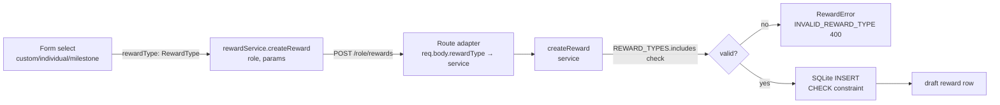

# W05 — Reward Type Alignment Spec

Date: 2026-10-31
Branch: codex/w05-reward-type-alignment
Scope: S3/W05 only

---

## Problem

The canonical SQLite `rewards.reward_type` CHECK constraint permits exactly:

```
individual | milestone | course_completion | grade | custom
```

`RewardDashboard.tsx` currently offers `custom`, `completion`, `achievement` — two of which are NOT in the DB enum.  Neither `createReward()` in the backend nor the route adapters perform any runtime membership validation before the SQLite INSERT fires. An unrecognized value triggers an unhandled SQLite constraint violation → raw 500 instead of a controlled 400 with a stable domain code.

---

## Canonical Types

| Value | Label | Scope prerequisites at creation |
|---|---|---|
| `individual` | Individual Achievement | none |
| `milestone` | Milestone | none |
| `custom` | Custom | none |
| `course_completion` | Course Completion | requires `eligibilityConfig.requiredCourseId` or sponsor_cohort scope (course auto-bound from cohort); not supplied by current form |
| `grade` | Grade | requires grade eligibility config; not supplied by current form |

**Form exposure**: Only `individual`, `milestone`, and `custom` are exposed in the creation form. `course_completion` and `grade` are valid DB values and can be created via direct API calls with appropriate `eligibilityConfig`, but the current UI form lacks the required course/grade config fields. These types are documented here as a follow-up item (W06 discriminator work).

---

## Required Changes

### Backend

1. **`rewardTypes.ts`** — Export `REWARD_TYPES` constant and `RewardType` type; narrow `RewardRow.reward_type` to `RewardType`.

2. **`rewardErrors.ts`** — Add `INVALID_REWARD_TYPE` to `REWARD_ERROR_CODES`.

3. **`rewardService.ts`** — Add runtime type membership validation at the start of `createReward()`:
   - Reject non-string, empty/blank, differently-cased, padded, and unlisted values
   - Throw `RewardError('INVALID_REWARD_TYPE', ..., 400)`
   - Validation fires before idempotency checks, currency validation, scope check
   - Invalid types must not insert any reward/snapshot/allocation/financial/outbox records

### Frontend

4. **`rewardService.ts`** — Export `REWARD_TYPES` constant and `RewardType` type; narrow `CreateRewardParams.rewardType` to `RewardType`; keep `Reward.reward_type: string` for forward-compatible display.

5. **`RewardDashboard.tsx`** — Fix creation select:
   - Remove invalid `completion` and `achievement` options
   - Add `individual` and `milestone` canonical options
   - Default remains `custom`

6. **`RewardComponents.test.tsx`** — Replace `reward_type: 'completion'` fixture with a valid canonical value.

---

## Contract Diagram



---

## Validation Ordering

Validation in `createReward()` fires in this order:
1. **Type membership** (`INVALID_REWARD_TYPE` 400) — NEW
2. Currency validation (`UNSUPPORTED_CURRENCY` 400)
3. Amount parsing (`INVALID_AMOUNT` 400)
4. Max recipients validation (`INVALID_RECIPIENT_COUNT` 400)
5. Scope validation (`SCOPE_DENIED` 403)
6. Idempotency check (existing record replay or `IDEMPOTENCY_CONFLICT` 409)
7. DB INSERT

---

## Test Matrix

| ID | Scenario | Route | Input | Expected |
|---|---|---|---|---|
| W5-T1 | invalid type `completion` | POST /sponsor/rewards | `rewardType: 'completion'` | 400 INVALID_REWARD_TYPE |
| W5-T2 | invalid type `achievement` | POST /sponsor/rewards | `rewardType: 'achievement'` | 400 INVALID_REWARD_TYPE |
| W5-T3 | missing type | POST /sponsor/rewards | `rewardType: undefined` | 400 INVALID_REWARD_TYPE |
| W5-T4 | empty string | POST /sponsor/rewards | `rewardType: ''` | 400 INVALID_REWARD_TYPE |
| W5-T5 | whitespace padded | POST /sponsor/rewards | `rewardType: ' custom'` | 400 INVALID_REWARD_TYPE |
| W5-T6 | wrong case | POST /sponsor/rewards | `rewardType: 'Custom'` | 400 INVALID_REWARD_TYPE |
| W5-T7 | number type | POST /sponsor/rewards | `rewardType: 123` | 400 INVALID_REWARD_TYPE |
| W5-T8 | valid `custom` | POST /sponsor/rewards | `rewardType: 'custom'` | 201 draft |
| W5-T9 | valid `individual` | POST /sponsor/rewards | `rewardType: 'individual'` | 201 draft |
| W5-T10 | valid `milestone` | POST /sponsor/rewards | `rewardType: 'milestone'` | 201 draft |
| W5-T11 | valid `course_completion` | POST /sponsor/rewards | `rewardType: 'course_completion'` | 201 draft |
| W5-T12 | valid `grade` | POST /sponsor/rewards | `rewardType: 'grade'` | 201 draft |
| W5-T13 | employer route invalid | POST /employer/rewards | `rewardType: 'completion'` | 400 INVALID_REWARD_TYPE |
| W5-T14 | teacher route invalid | POST /teacher/rewards | `rewardType: 'achievement'` | 400 INVALID_REWARD_TYPE |
| W5-T15 | parent route invalid | POST /parent/rewards | `rewardType: 'completion'` | 400 INVALID_REWARD_TYPE |
| W5-T16 | direct service call invalid | `createReward()` | `rewardType: 'invalid'` | RewardError INVALID_REWARD_TYPE |
| W5-T17 | direct service call null | `createReward()` | `rewardType: null` | RewardError INVALID_REWARD_TYPE |
| W5-T18 | invalid type: no DB record | POST /sponsor/rewards | `rewardType: 'completion'` | rewards table unchanged |
| W5-T19 | replay same valid type | POST /sponsor/rewards | same idempotencyKey + type | 200 idempotent |
| W5-T20 | replay different valid type | POST /sponsor/rewards | same key, different type | 409 IDEMPOTENCY_CONFLICT |

---

## Acceptance Criteria

- [ ] `REWARD_TYPES` exported from `rewardTypes.ts`; `RewardRow.reward_type` narrowed to `RewardType`
- [ ] `INVALID_REWARD_TYPE` in `REWARD_ERROR_CODES`
- [ ] `createReward()` rejects all non-canonical values before any DB write
- [ ] All 4 creation routes return 400 + `INVALID_REWARD_TYPE` for `completion` and `achievement`
- [ ] Frontend select offers only canonical values; `custom` is default
- [ ] Frontend submits exact canonical string values unchanged
- [ ] `RewardComponents.test.tsx` fixture uses a valid canonical type
- [ ] W01–W04 tests remain passing
- [ ] Backend and frontend TypeScript builds clean
