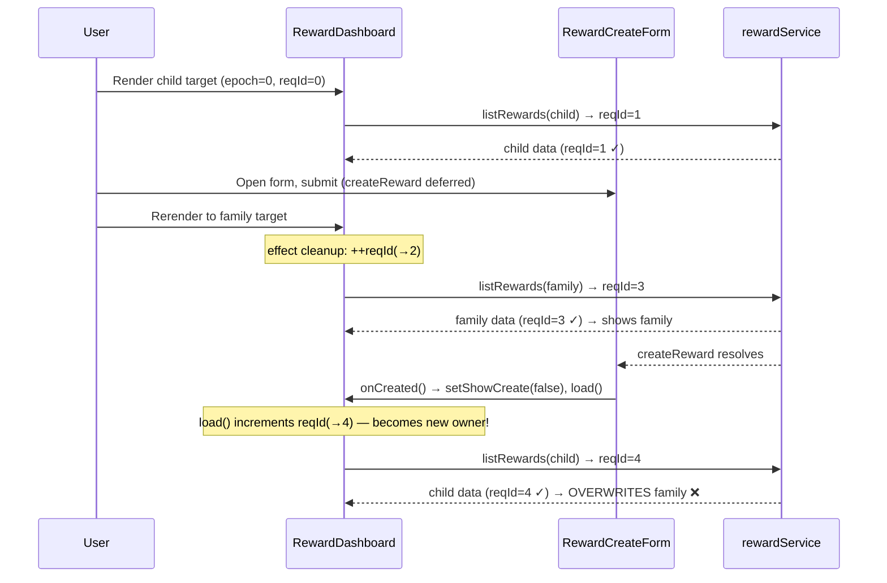
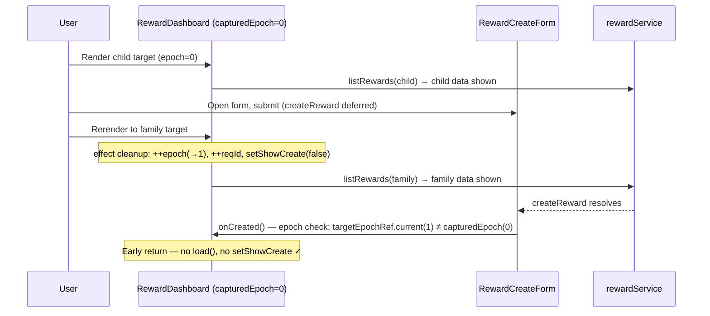

# W06-R2 — Create-completion and operation ownership guard

Date: 2026-10-31
Status: IMPLEMENTING
Spec ID: W06-R2
Preceding: W06-R1 (`2026-10-31-W06-R1-stale-response-guard.md`)

---

## Problem

W06-R1 added a `reqIdRef` monotonic counter that guards **list-response** state commits.
It does not guard **callback initiation**: a callback that _starts_ a new `load()` call
increments the counter and becomes the new "owner", superseding any in-flight valid
current-target request.

### Exact reproduction

1. Render `RewardDashboard` with `role="parent"`, `scopeId="shared-scope"`, `targetType="child"`.
   Initial list resolves with child data.
2. Open New Reward form. Fill amount. Click Create. `createReward` promise is deferred.
3. Rerender with `targetType="family"`, same `scopeId`. Family list resolves immediately.
   Dashboard shows family data (reqId N+2, family load owner).
4. Resolve deferred child create successfully.
5. `RewardCreateForm.handleSubmit` captured `onCreated` from the T0 (child) render.
   `onCreated` calls `setShowCreate(false)` and `load()` — the OLD child `load()` closure.
6. Old child `load()` increments `reqIdRef.current` (becomes N+3, new owner) and fetches
   child list. Stale child data replaces family data in the UI.

The original create submitted the correct payload (child target, original scopeId).
No unauthorized backend mutation occurred. The defect is purely UI-side: old-target
completion hijacked the request-generation counter and replaced valid current state.

### Additional affected paths

- `performAction` success/error/finally: old operation's `finally` always calls
  `setActionLoading(null)`, which can clear a newer current-target operation's spinner.
  Target change does not currently clear `actionLoading`, leaving stuck spinners.
- `onCreated` `setShowCreate(false)`: old callback can close the new target's form.
- `toggleAllocations` catch path: error handler runs unconditionally after target switch.
- A→B→A revisit: textual `targetKey` equality incorrectly grants old callback ownership
  of the new visit.

---

## Root cause

`reqIdRef` guards state **commits** only. Any callback that calls `load()` directly
(rather than via the normal `useEffect`) can increment the counter and become the new
owner. Guarding only the write site is insufficient when initiators can also modify
the generation.

---

## Solution: target epoch

Add `targetEpochRef` — a monotonic counter incremented **only** in `useEffect` cleanup
(i.e., on target change or unmount). Unlike `reqIdRef` (which increments every `load()`
call), the epoch only changes when the target identity changes.

Callbacks capture `myEpoch = targetEpochRef.current` at invocation time. Before
triggering `load()`, state mutation, or spinner change, they check
`targetEpochRef.current === myEpoch`. If the epoch changed, the callback is from a
prior target visit and is silently dropped.

For `onCreated` specifically, the epoch is captured at **parent render time**
(`capturedEpoch = targetEpochRef.current`) so the inline arrow function closes over
the epoch from its render, not from when the user clicked.

### A→B→A distinction

Because the epoch increments at every target change (including returning to A),
`capturedEpoch=0` from the first A visit cannot match `targetEpochRef.current=2`
after A→B→A, even though the textual `targetKey` is identical.

---

## Affected sites

| Site | Guard | Notes |
|---|---|---|
| `load()` entry/response | `reqIdRef` (W06-R1, unchanged) | Still correct |
| `onCreated` → `load()` call | epoch guard on `capturedEpoch` | **Primary fix** |
| `onCreated` → `setShowCreate(false)` | same epoch guard (return early) | Prevents closing new target's form |
| `performAction` → `load()` | epoch AND targetKey guard | Also guards A→B→A |
| `performAction` → `setError` | epoch AND targetKey guard | Prevents stale error in new target |
| `performAction` → `setActionLoading(null)` in `finally` | epoch guard | Prevents old finally clearing new op's spinner |
| `toggleAllocations` → `setExpanded` success | existing `prev[id]==='loading'` + epoch guard | Success already largely guarded by load's `setExpanded({})` |
| `toggleAllocations` → `setExpanded` catch | epoch guard (new) | Error path was unguarded |
| `useEffect` cleanup | increment epoch; `setShowCreate(false)`; `setActionLoading(null)` | Clear stale form+spinner on target change |

### Sites confirmed safe (no guard needed)

| Site | Reason |
|---|---|
| `toggleAllocations` collapse path | Synchronous; no async state from prior target |
| `setState('empty')` early-return in `load()` | Safe desired state; no network call |
| `onClose` form callback | Synchronous; no load triggered |

---

## Implementation checklist

- [ ] Add `targetEpochRef = useRef(0)` after `targetKeyRef`
- [ ] Add `capturedEpoch = targetEpochRef.current` render-time snapshot
- [ ] `useEffect` cleanup: `++targetEpochRef.current; setShowCreate(false); setActionLoading(null);`
- [ ] `onCreated`: early-return if `targetEpochRef.current !== capturedEpoch`
- [ ] `toggleAllocations`: capture `myEpoch`; epoch-guard success and catch state writes
- [ ] `performAction`: capture `myEpoch`; add epoch check alongside `targetKey` check for load/error; epoch-only check for `finally`
- [ ] Remove redundant `setActionLoading(null)` before `return` in refund early-path (finally handles it)

---

## Test matrix (W6R2-FE-1 through W6R2-FE-9)

| ID | Scenario | Expected (GREEN) | RED before fix? |
|---|---|---|---|
| FE-1 | Child create deferred → switch to family → old create resolves | Family rows shown; stale child reload blocked | YES |
| FE-2 | Family create deferred → switch to child → old create resolves | Child rows shown; stale family reload blocked | YES |
| FE-3 | Old create resolves while new list is still pending | New list result wins (both resolve orders tested) | YES |
| FE-4 | A→B→A: old first-visit create resolves on second visit | Second-visit rows shown; old reload blocked by epoch | YES |
| FE-5 | Old create fails after switch | No error shown in new dashboard | PASS (already correct) |
| FE-6 | New-target form open+create pending when old create finishes | New form stays open; old create doesn't close it | YES |
| FE-7 | toggleAllocations result arrives after switch | Old alloc result not applied to new target | PASS (already guarded) |
| FE-8 | Form open when target changes | Form closes automatically on target change | YES |
| FE-9 | performAction spinner: A→B→A | No stuck spinner; old finally doesn't clear new op's spinner | YES |

All 29 W06-R1 tests (#129) must continue passing.

---

## Sequence diagrams

### Old create hijacks counter (BEFORE fix)

### With epoch guard (AFTER fix)

