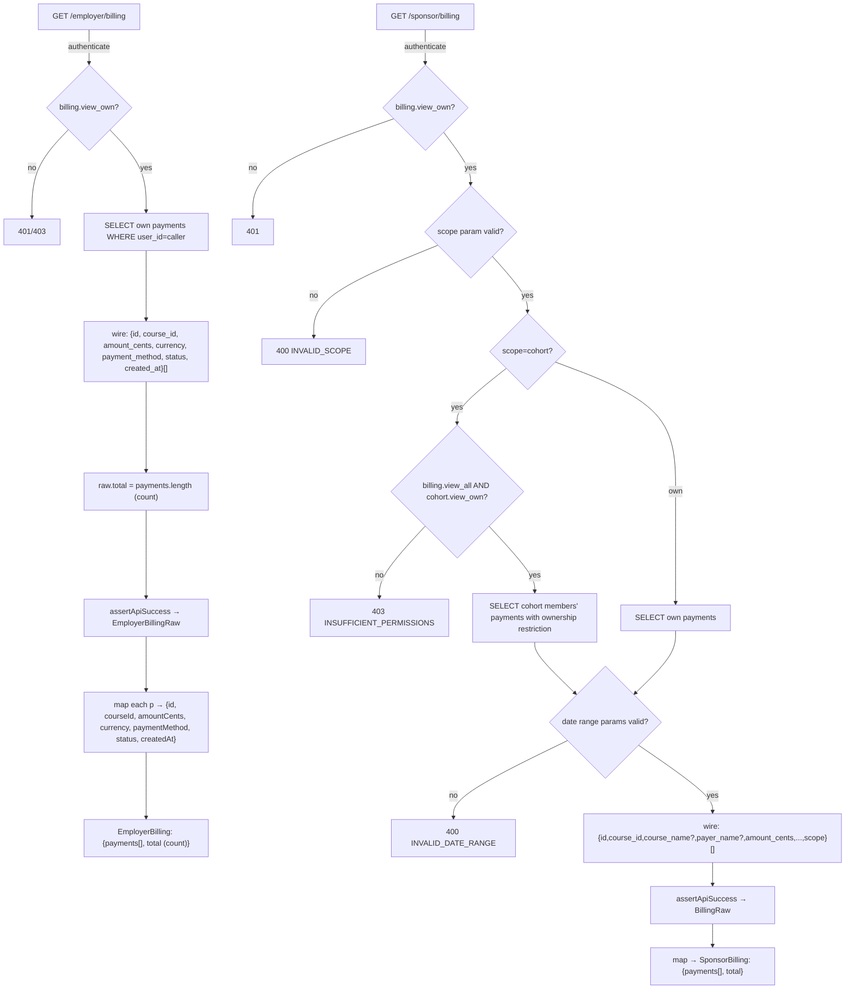

# W07 — Billing DTO and permission-contract reconciliation

Date: 2026-10-31
Status: MERGED — 60fb174 on main (2026-10-31)
Spec ID: W07
Preceding: W06-R3 (`2026-10-31-W06-R3-blocked-refund-epoch.md`)

---

## Problem

Three concrete contract gaps in the sponsor and employer billing surfaces:

1. **`employerService.getBilling` — DTO mismatch (critical)**: The service returns the
   raw server object verbatim (`res.data.data`) with no snake-to-camel mapping. The
   `EmployerBilling` interface declares `paymentId`, `amountCents`, `createdAt`,
   `totalSpent`; the server returns `id`, `amount_cents`, `created_at`, `total`. Every
   field except `currency` and `status` is `undefined` at runtime. Additionally,
   `totalSpent` misnames a result-count as a monetary total — mixing currencies/statuses
   is not defined financial semantics.

2. **`sponsorService.getBilling` — skips `assertApiSuccess`**: Reads `res.data.data`
   directly, unlike every other method in the same file that uses `assertApiSuccess`. A
   server error response (`success: false`) is silently passed as billing data instead
   of thrown as an `ApiRequestError`.

3. **Sponsor billing route — missing `error.code`**: Three error responses in the
   sponsor billing route omit the `code` field from the error envelope:
   - `parseSponsorDateRange`: invalid/reversed dates → `{error:{message:...}}` only
   - Invalid `scope` value → `{error:{message:...}}` only
   - Cohort permission denied → `{error:{message:...}}` only
   The established envelope is `{success:false,error:{code,message}}`.

---

## Discrepancy classification

| # | Location | Discrepancy | Classification |
|---|---|---|---|
| D1 | `employerService.getBilling` | No mapper; `paymentId`/`amountCents`/`createdAt`/`totalSpent` vs wire `id`/`amount_cents`/`created_at`/`total` | **Client mismatch** — wire fields all `undefined`; `totalSpent` semantics wrong |
| D2 | `sponsorService.getBilling` | Uses `res.data.data` instead of `assertApiSuccess` | **Inconsistent error handling** — silent failure on `success:false` response |
| D3 | `GET /sponsor/billing` (date error) | `{error:{message:...}}` — no `code` | **Inconsistent error envelope** — all other route errors include `code` |
| D4 | `GET /sponsor/billing` (invalid scope) | `{error:{message:...}}` — no `code` | **Inconsistent error envelope** |
| D5 | `GET /sponsor/billing` (cohort permission) | `{error:{message:...}}` — no `code` | **Inconsistent error envelope** |
| D6 | `SponsorBilling` type | `scope` field from server response not declared | **Intentional omission** — frontend tracks scope locally; no consumer reads it from service; no fix needed |
| D7 | Employer billing: no `course_name` join | Sponsor billing JOINs; employer does not | **Intended scope difference** — employer billing is own-only; no payer-name join appropriate; not a defect |
| D8 | Parent/teacher billing: no `total` field | Sponsor/employer both return `total` | **Deferred** — parent/teacher not in W07 scope; track as FOLLOW-UP(parent-teacher-billing-total) |
| D9 | No `EmployerBillingPanel` component | No counterpart to `SponsorBillingPanel.tsx` | **Deferred** — W08 scope (portal action scoping); employer billing UI is placeholder |

---

## Solution

### Fix 1: `employerService.getBilling` (D1)

Add `EmployerBillingRaw` internal interface; add snake-to-camel mapper; fix `EmployerBilling`
interface to match mapped output.

**Server wire shape** (from `GET /employer/billing`):
```
{success:true, data:{payments:[{id,course_id,amount_cents,currency,payment_method,status,created_at}], total}}
```

**Corrected `EmployerBilling` interface:**
```typescript
export interface EmployerBilling {
  payments: Array<{
    id: string;
    courseId: string;
    amountCents: number;
    currency: string;
    paymentMethod: string;
    status: string;
    createdAt: string;
  }>;
  total: number;        // count of own payments; NOT a monetary aggregate
}
```

`totalSpent` removed — it is not a valid aggregation (multiple currencies, mixed statuses including refunded/pending/failed). The server `total` field is `payments.length` (count).

**Corrected mapper:**
```typescript
async getBilling(): Promise<EmployerBilling> {
  const res = await api.get<ApiResponse<EmployerBillingRaw>>('/employer/billing');
  const raw = assertApiSuccess(res, 'Failed to load billing history');
  return {
    payments: raw.payments.map(p => ({
      id: p.id,
      courseId: p.course_id,
      amountCents: p.amount_cents,
      currency: p.currency,
      paymentMethod: p.payment_method,
      status: p.status,
      createdAt: p.created_at,
    })),
    total: raw.total,
  };
}
```

### Fix 2: `sponsorService.getBilling` (D2)

Replace `res.data.data` with `assertApiSuccess(res, 'Failed to load billing history')`.
The `BillingRaw` type is already correct; only the extraction call changes.

### Fix 3: Sponsor billing error codes (D3/D4/D5)

Add stable codes:

| Site | Before | After |
|---|---|---|
| `parseSponsorDateRange` invalid/reversed dates | `{error:{message:'Use valid YYYY-MM-DD dates with From before To.'}}` | `{error:{code:'INVALID_DATE_RANGE',message:'Use valid YYYY-MM-DD dates with From before To.'}}` |
| Invalid `scope` value | `{error:{message:'scope must be own or cohort'}}` | `{error:{code:'INVALID_SCOPE',message:'scope must be own or cohort'}}` |
| Cohort permission denied | `{error:{message:'Cohort billing access is required'}}` | `{error:{code:'INSUFFICIENT_PERMISSIONS',message:'Cohort billing access is required'}}` |

`parseSponsorDateRange` is also called by `/sponsor/impact-report`. The code addition is
additive only; existing impact-report tests must not break. Impact-report test coverage for
the date-error code is added as part of D3 fix.

---

## Request → permission → query → wire → adapter flow



---

## Wire DTO matrix

### Employer billing wire (unchanged)

| Field | Type | Notes |
|---|---|---|
| `id` | `string` | Payment UUID |
| `course_id` | `string` | |
| `amount_cents` | `number` | Integer minor units |
| `currency` | `string` | ISO 4217 |
| `payment_method` | `string` | enum: manual/waived/paystack/stellar_xlm/stellar_usdc |
| `status` | `string` | enum: pending/confirmed/waived/failed/refunded |
| `created_at` | `string` | ISO timestamp |

### Employer billing client (`EmployerBilling`) — after fix

| Field | Type | Notes |
|---|---|---|
| `id` | `string` | Mapped from `id` |
| `courseId` | `string` | Mapped from `course_id` |
| `amountCents` | `number` | Mapped from `amount_cents` |
| `currency` | `string` | Pass-through |
| `paymentMethod` | `string` | Mapped from `payment_method` |
| `status` | `string` | Pass-through |
| `createdAt` | `string` | Mapped from `created_at` |
| `total` | `number` | Count of payments (not monetary sum) |

### Sponsor billing wire (unchanged)

| Field | Type | Scope | Notes |
|---|---|---|---|
| `id` | `string` | own+cohort | |
| `course_id` | `string` | own+cohort | |
| `course_name` | `string\|null` | own+cohort | LEFT JOIN — nullable |
| `payer_name` | `string\|null` | cohort | LEFT JOIN — nullable; own-scope has caller's name, not exposed upstream |
| `amount_cents` | `number` | own+cohort | |
| `currency` | `string` | own+cohort | |
| `payment_method` | `string` | own+cohort | |
| `status` | `string` | own+cohort | |
| `created_at` | `string` | own+cohort | |
| `scope` | `'own'\|'cohort'` | response root | Echoed; not captured in client type |

---

## Error codes

| Route | Condition | HTTP | code |
|---|---|---|---|
| `GET /sponsor/billing` | Invalid/reversed date params | 400 | `INVALID_DATE_RANGE` |
| `GET /sponsor/billing` | scope param ≠ 'own'/'cohort' | 400 | `INVALID_SCOPE` |
| `GET /sponsor/billing` | scope=cohort without billing.view_all+cohort.view_own | 403 | `INSUFFICIENT_PERMISSIONS` |
| `GET /employer/billing` | No token / invalid token | 401 | (existing authenticate middleware) |
| `GET /employer/billing` | Missing billing.view_own | 403 | (existing requirePermission) |

---

## Implementation checklist

- [x] Commit spec (this file)
- [x] Write RED tests:
  - [x] W7-FE-1: employer adapter passes wire response → all fields `undefined`/`totalSpent` appears
  - [x] W7-FE-2: sponsor adapter with `success:false` response → does NOT throw
  - [x] W7-BE-1: sponsor billing errors return `error.code`
- [x] Apply Fix 1 (employer mapper)
- [x] Apply Fix 2 (sponsor assertApiSuccess)
- [x] Apply Fix 3 (sponsor route error codes)
- [x] Verify all W7 tests GREEN + no regressions
- [x] Independent review
- [x] PR + CI + merge
- [x] Update planning branch documentation

---

## Evidence

| Field | Value |
|---|---|
| Baseline main SHA | `22ec76f` (W06-R3 spec closure) |
| Spec commit | `d9337cf` docs(W07): spec for billing DTO and permission-contract reconciliation |
| Fix commit | `e123717` fix(W07): reconcile billing DTO, client mapper, and error-code contract |
| RED | W7-FE-1 FAIL (paymentId/totalSpent undefined); W7-FE-3 FAIL (TypeError not ApiRequestError); W7-FE-6 FAIL (same); W7-BE-1a/b FAIL (no INVALID_DATE_RANGE); W7-BE-2 FAIL (no INVALID_SCOPE); W7-BE-3 FAIL (no INSUFFICIENT_PERMISSIONS — fixed test setup) |
| GREEN | 27 new tests pass; 193 BE / 56 FE files all pass; tsc clean; Vite build clean |
| PR | #132 |
| CI candidate | 41230762143 — Backend 5m36s PASS, Frontend 52s PASS, E2E 1m13s PASS, Offline 1m23s PASS |
| Merge SHA | `60fb174` (2026-10-31T18:50Z) |
| CI main | 41231333646 — 4/4 PASS |
