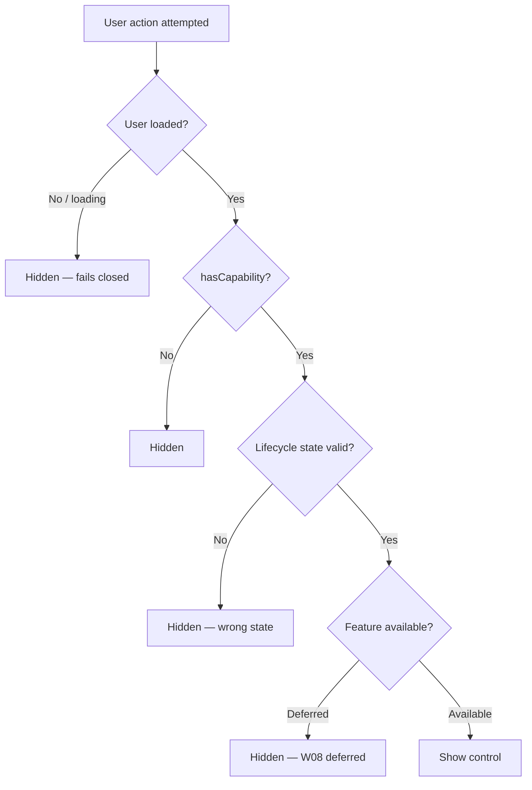

# W08-R1 — Gate portal actions on current effective capabilities

Date: 2026-10-31
Status: IN_PROGRESS
Spec ID: W08-R1
Preceding: W08 (`2026-10-31-W08-portal-action-scoping.md`)
Baseline: `7945500` (main after W08 docs, 2026-10-31)

---

## Problem

Independent post-merge testing of W08 (#133) on `88212bd` found two capability-gating failures using actual rendered components and synthetic auth context (Node 22.18.0, Vitest 4.1.12):

1. **Sponsor read-only affordance** — A sponsor workspace user with only `reward.view_assigned` (no `reward.create`, `reward.activate`, or `reward.cancel`) still sees "New Reward", "Activate", and "Cancel" buttons on a funded reward. `RewardDashboard` selects controls from the `ACTIONS` status map and the `canRefund` boolean alone; it does not consult current effective capabilities.

2. **Teacher without group.create** — A teacher workspace user with `group.manage` and `student.view_assigned` but **without** `group.create` still sees the "New Class" button. `TeacherDashboard` shows the button unconditionally. The same gap exists in `EmployerDashboard` for "New Team" (both endpoints require `group.create`).

W08 removed placeholder nav links, deferred routes, and the dead Fund button. These are correct. This revision gates the remaining mutation controls — reward creation, lifecycle actions, and group creation — on current effective user capabilities, without re-enabling any deferred feature.

---

## Control → Capability → Availability Matrix

| Control | Component | Required Capability | Lifecycle Gate | Notes |
|---------|-----------|-------------------|----------------|-------|
| New Reward button | `RewardDashboard` | `reward.create` | Always (feature available) | Hidden when user lacks cap or is unknown/loading |
| Activate button | `RewardDashboard` | `reward.activate` | `funded` status only | Filter from ACTIONS |
| Cancel button | `RewardDashboard` | `reward.cancel` | `funded`, `active` status | Filter from ACTIONS |
| Approve button | `RewardDashboard` | `reward.approve` | `eligible_pending_approval` | Filter from ACTIONS |
| Release button (allocation) | `RewardDashboard` | `reward.release` | allocation `eligible` status | Inline allocation row |
| Refund button (allocation) | `RewardDashboard` | `reward.refund` AND `canRefund` | allocation `released` status | Both gates must pass |
| New Class button | `TeacherDashboard` | `group.create` | Feature available | POST /teacher/classes requires `group.create` |
| New Team button | `EmployerDashboard` | `group.create` | Feature available | POST /employer/teams requires `group.create` |
| Fund button | `RewardDashboard` | — | REMOVED (W08) | `platform_credit` unconditionally rejected; deferred |
| Billing nav/pages | Layout/App.tsx | — | REMOVED (W08) | Deferred; redirected |
| Analytics/Wallets/Groups nav | Layout/App.tsx | — | REMOVED (W08) | Deferred |

**Not in scope:**
- D20: Platform credit / external funding providers — backend unchanged
- D17–D19: Deferred billing/analytics/wallet/group UI
- D21: Per-child reward panel
- D22: course-grade-form-inputs
- W09 and later: general loading/error states

---

## Capability → Availability flow



---

## Backend verification

Backend route permission requirements (verified in `LMS-Server/src/routes/`):

| Route | Permission |
|-------|-----------|
| `POST /*/rewards` | `reward.create` |
| `POST /*/rewards/:id/activate` | `reward.activate` |
| `POST /*/rewards/:id/cancel` | `reward.cancel` |
| `POST /*/rewards/:id/approve` | `reward.approve` |
| `POST /*/rewards/:id/allocations/:id/release` | `reward.release` |
| `POST /*/rewards/:id/allocations/:id/refund` | `reward.refund` |
| `POST /teacher/classes` | `group.create` |
| `POST /employer/teams` | `group.create` |

Role default grants (from `database.ts` migration):
- **sponsor**: `reward.create/activate/cancel/approve/release/refund/view_assigned` (full set incl. refund)
- **teacher**: `reward.create/activate/cancel/approve/release/view_assigned` + `group.create/manage` (no refund)
- **employer**: same as teacher
- **parent**: `reward.create/activate/cancel/approve/release/view_assigned` + no `group.create` (no refund)

---

## Solution

### Fix 1: `RewardDashboard.tsx`

Add module-level action→capability map:
```typescript
const ACTION_CAPABILITY: Record<string, string> = {
  activate: 'reward.activate',
  cancel:   'reward.cancel',
  approve:  'reward.approve',
};
```

In `RewardCreateForm`: call `useAuth()`, check `hasCapability(user, 'reward.create')` at submit entry.

In `RewardDashboard` component:
- `const { user } = useAuth()`
- `const canCreate = hasCapability(user, 'reward.create')`
- Effect: close create form when `canCreate` becomes false
- Gate "New Reward" button on `canCreate`
- Filter ACTIONS row buttons: `(ACTIONS[r.status] ?? []).filter(a => hasCapability(user, ACTION_CAPABILITY[a.key] ?? ''))`
- Gate Release: `hasCapability(user, 'reward.release')`
- Gate Refund: `canRefund && hasCapability(user, 'reward.refund')`
- Guard `performAction` at call site: check capability before starting async call

### Fix 2: `TeacherDashboard.tsx`

- Import `hasCapability` from `../utils/authorization`
- `const canCreateClass = hasCapability(user, 'group.create')`
- Effect: close form when `canCreateClass` becomes false
- Gate "New Class" button on `canCreateClass`
- Guard `handleCreateClass` at entry

### Fix 3: `EmployerDashboard.tsx`

Same pattern as Fix 2 for "New Team" / `group.create`.

### Fix 4: Update existing test fixtures

`RewardComponents.test.tsx` renders `RewardDashboard` without `useAuth` mock — add mock with full reward permissions so existing 41 tests pass.

`portal-action-scoping-w08.test.tsx`:
- W8-REWARD-3: add `reward.activate` + `reward.cancel` to fixture
- W8-CLASS-1: add `group.create` to teacher fixture
- W8-TEAM-1: add `group.create` to employer fixture

---

## Behavioral TDD plan

### Test file: `LMS-Frontend/src/__tests__/capability-gating-w08r1.test.tsx`

| ID | Requirement | RED (before fix) | GREEN (after fix) |
|----|-------------|-----------------|-------------------|
| W8R1-SPONSOR-1 | Sponsor with only reward.view_assigned sees no New Reward button | button present → fail | absent → pass |
| W8R1-SPONSOR-2 | Same user sees no Activate/Cancel for funded reward | buttons present → fail | absent → pass |
| W8R1-TEACHER-GC-1 | Teacher without group.create sees no New Class button | button present → fail | absent → pass |
| W8R1-EMPLOYER-GC-1 | Employer without group.create sees no New Team button | button present → fail | absent → pass |
| W8R1-TEACHER-GC-2 | Teacher WITH group.create sees New Class button and can submit | passes already | passes |
| W8R1-EMPLOYER-GC-2 | Employer WITH group.create sees New Team button and can submit | passes already | passes |
| W8R1-MATRIX-1 | reward.view_assigned only: no New Reward, no action buttons (any status) | fail for New Reward | pass |
| W8R1-MATRIX-2 | reward.create only: New Reward visible, no action buttons | fails (action buttons shown) | pass |
| W8R1-MATRIX-3 | reward.activate only: no New Reward; Activate shown for funded; no Cancel | fails | pass |
| W8R1-MATRIX-4 | reward.cancel only: no New Reward; Cancel shown; no Activate | fails | pass |
| W8R1-MATRIX-5 | reward.approve only: Approve shown for eligible_pending_approval | passes if status-gated | pass |
| W8R1-MATRIX-6 | reward.release only: Release shown for eligible allocation | fails (no auth check) | pass |
| W8R1-MATRIX-7 | reward.refund + canRefund: Refund shown for released allocation | fails (no auth check) | pass |
| W8R1-MATRIX-8 | canRefund=true but no reward.refund: no Refund button | fails | pass |
| W8R1-LOADING-1 | Unknown/loading user: no mutation controls shown | fails (shown) | pass |
| W8R1-REVOKE-1 | Revoke reward.create while create form open — form closes | fails | pass |
| W8R1-REVOKE-2 | Revoke group.create while class form open — form closes | fails | pass |
| W8R1-REVOKE-3 | Revoke capability before submit — service not called | fails | pass |
| W8R1-BACKEND-1 | HTTP POST /teacher/rewards with reward.create → 201; without → 403 | (integration) | pass |
| W8R1-BACKEND-2 | HTTP POST /teacher/classes with group.create → 200; without → 403 | (integration) | pass |
| W8R1-COMPAT-1 | Sponsor with full caps: all expected buttons present (non-regression) | passes | passes |
| W8R1-COMPAT-2 | canRefund prop + reward.refund: Refund appears; canRefund=false: absent | passes | passes |

---

## Implementation checklist

- [ ] Commit spec (this file)
- [ ] Write RED tests
- [ ] Apply Fix 1 (RewardDashboard capability gating)
- [ ] Apply Fix 2 (TeacherDashboard group.create gate)
- [ ] Apply Fix 3 (EmployerDashboard group.create gate)
- [ ] Apply Fix 4 (update existing test fixtures)
- [ ] Verify all W8R1 tests GREEN + no regressions
- [ ] Independent review
- [ ] PR + CI + merge
- [ ] Update planning branch documentation

---

## Evidence (to be filled post-implementation)

| Field | Value |
|-------|-------|
| Baseline main SHA | `7945500` (docs after W08 merge) |
| Spec commit | TBD |
| RED commit | TBD |
| Fix commit | TBD |
| RED | TBD |
| GREEN | TBD |
| PR | TBD |
| CI candidate | TBD |
| Merge SHA | TBD |
| CI main | TBD |
