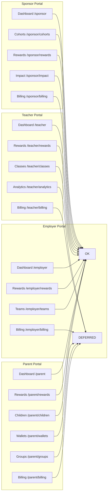

# W08 — Truthful portal availability and capability-scoped actions

Date: 2026-10-31
Status: IN_PROGRESS
Spec ID: W08
Preceding: W07 (`2026-10-31-W07-billing-dto-reconciliation.md`)

---

## Problem

Four categories of affordance/route mismatch in the Teacher, Parent, Employer, and shared Reward portals:

1. **Deferred nav links** — `Layout.tsx` `navigationMap` includes 6 links to pages that render placeholder text. Placeholder-linked routes in `App.tsx` respond to GET requests with a full dashboard component that makes real API calls and shows "will appear here" content instead of redirecting to an implemented destination.

2. **Dead buttons** — `TeacherDashboard.tsx` "New Class" and `EmployerDashboard.tsx` "New Team" buttons have no `onClick` handler. Both corresponding backend routes exist and are fully implemented.

3. **Fund button always fails** — `RewardDashboard.tsx` `ACTIONS` map offers a "Fund" button for `draft` and `pending_funding` reward states. The only funding method wired (`platform_credit`) is unconditionally rejected server-side (`INSUFFICIENT_CREDIT`). Portal users also lack `reward.manage` permission, causing `SCOPE_DENIED` before reaching the credit check.

4. **Parent rewards blank on no groups** — `ParentDashboard.tsx` wraps the `section === 'rewards'` block in an outer `groups.length > 0` guard. When a parent has no family groups, navigating to `/parent/rewards` renders a completely blank content area instead of the intended "Create a family group first" message.

---

## Discrepancy classification

| # | Control | Location | Backend | Frontend verdict | Classification |
|---|---------|----------|---------|-----------------|----------------|
| D1 | "Billing" nav link | employer `navigationMap` | `GET /employer/billing` EXISTS (W07) | Page is placeholder only | **DEFERRED** — remove nav link, redirect deep link |
| D2 | "Wallets" nav link | parent `navigationMap` | No wallet route | Placeholder | **DEFERRED** |
| D3 | "Groups" nav link | parent `navigationMap` | No groups UI route | Placeholder | **DEFERRED** |
| D4 | "Billing" nav link | parent `navigationMap` | No parent billing route | Placeholder | **DEFERRED** |
| D5 | "Analytics" nav link | teacher `navigationMap` | `GET /teacher/analytics` EXISTS | Placeholder | **DEFERRED** |
| D6 | "Billing" nav link | teacher `navigationMap` | `GET /teacher/billing` EXISTS | Placeholder | **DEFERRED** |
| D7 | Fund button (draft/pending_funding) | `RewardDashboard` `ACTIONS` | `platform_credit` always `INSUFFICIENT_CREDIT`; portal roles get `SCOPE_DENIED` first | Always shown | **REMOVE** — deferred funding workflow |
| D8 | New Class button (no `onClick`) | `TeacherDashboard` | `POST /teacher/classes` EXISTS; `teacherService.createClass(name)` EXISTS | No handler | **WIRE** — minimum wiring to implemented route |
| D9 | New Team button (no `onClick`) | `EmployerDashboard` | `POST /employer/teams` EXISTS; `employerService.createTeam(name)` EXISTS | No handler | **WIRE** — minimum wiring to implemented route |
| D10 | Parent rewards blank on no groups | `ParentDashboard` | N/A | `groups.length > 0` outer guard swallows section | **FIX** — remove outer guard; inner "Create a family group" message must show |
| D11–D16 | `/employer/billing`, `/parent/wallets`, `/parent/groups`, `/parent/billing`, `/teacher/analytics`, `/teacher/billing` routes | `App.tsx` | — | Render dashboard with placeholder; make API calls | **REDIRECT** to base workspace path |

**Not in scope:**
- D17: Billing UI feature for employer/parent/teacher — backend adapters preserved; UI deferred to later sprint
- D18: Analytics UI for teacher — backend route preserved; UI deferred
- D19: Wallets/Groups UI for parent — deferred
- D20: Platform credit / external funding providers — deferred; no new capability grants
- D21: Per-child reward panel — deferred (W08 classifies only)
- D22: FOLLOW-UP(course-grade-form-inputs) — deferred

---

## Navigation availability diagram



---

## Solution

### Fix 1: `Layout.tsx` — Remove 6 deferred nav items

Remove from `navigationMap`:
- `employer`: `{ name: 'Billing', path: '/employer/billing', icon: CreditCard }`
- `parent`: `{ name: 'Wallets', path: '/parent/wallets', icon: Wallet }`, `{ name: 'Groups', path: '/parent/groups', icon: Users }`, `{ name: 'Billing', path: '/parent/billing', icon: CreditCard }`
- `teacher`: `{ name: 'Analytics', path: '/teacher/analytics', icon: BarChart2 }`, `{ name: 'Billing', path: '/teacher/billing', icon: CreditCard }`

Sponsor nav items remain unchanged.

### Fix 2: `App.tsx` — Redirect deferred routes

Replace deferred route element from `<ProtectedRoute allowedRole="X"><Layout><Dashboard /></Layout></ProtectedRoute>` to `<ProtectedRoute allowedRole="X"><Navigate to="/X" replace /></ProtectedRoute>` for each:

| Route | Redirect target |
|-------|----------------|
| `/employer/billing` | `/employer` |
| `/parent/wallets` | `/parent` |
| `/parent/groups` | `/parent` |
| `/parent/billing` | `/parent` |
| `/teacher/analytics` | `/teacher` |
| `/teacher/billing` | `/teacher` |

The `ProtectedRoute` workspace check is preserved: unauthorized users (wrong workspace) still see `AccessDenied`. Authorized users are redirected to their base dashboard. No API calls are made in the deferred path.

### Fix 3: `RewardDashboard.tsx` — Remove Fund button

Remove `draft` and `pending_funding` keys from the `ACTIONS` constant. Rewards in these states have no action buttons until a funded workflow is implemented.

```typescript
// Before
const ACTIONS = {
  draft:                     [{ key: 'fund', label: 'Fund', icon: DollarSign }],
  pending_funding:           [{ key: 'fund', label: 'Fund', icon: DollarSign }],
  funded:                    [{ key: 'activate', ... }, { key: 'cancel', ... }],
  active:                    [{ key: 'cancel', ... }],
  eligible_pending_approval: [{ key: 'approve', ... }],
};

// After
const ACTIONS = {
  funded:                    [{ key: 'activate', ... }, { key: 'cancel', ... }],
  active:                    [{ key: 'cancel', ... }],
  eligible_pending_approval: [{ key: 'approve', ... }],
};
```

The backend `POST .../rewards/:id/fund` endpoint and `rewardFundingVerifier` are not modified.

### Fix 4: `TeacherDashboard.tsx` — Wire New Class button

Add `creating` and `newClassName` state. When the "New Class" button is clicked, show an inline form (text input + submit + cancel). On submit, call `teacherService.createClass(name)` and reload the dashboard. Error shown inline.

Remove the dead `section === 'analytics'` and `section === 'billing'` rendering blocks (dead code after App.tsx redirects; no analytics or billing content to show).

### Fix 5: `EmployerDashboard.tsx` — Wire New Team button

Same pattern: add `creating`/`newTeamName` state; inline form on button click; call `employerService.createTeam(name)` and reload.

Remove the `section === 'billing'` rendering block (dead after App.tsx redirect).

### Fix 6: `ParentDashboard.tsx` — Fix rewards blank on no groups

Remove the outer `groups.length > 0` guard on the rewards section. The inner ternary already shows the "Create a family group first" message when `groups.length === 0`.

```tsx
// Before
{section === 'rewards' && groups.length > 0 && (
  <div className="space-y-6">
    {groups.length > 0 ? groups.map(...) : <p>Create a family group first...</p>}
  </div>
)}

// After
{section === 'rewards' && (
  <div className="space-y-6">
    {groups.length > 0 ? groups.map(...) : <p>Create a family group first to manage rewards.</p>}
  </div>
)}
```

Also remove the dead `section === 'wallets'`, `section === 'groups'`, `section === 'billing'` rendering blocks.

### Fix 7: `phase-g-frontend.test.tsx` — Update stale nav assertions

Update `G-NAV-2`, `G-NAV-3`, `G-NAV-4` to remove assertions for deferred items:
- `G-NAV-2` (employer): remove `Billing` assertion
- `G-NAV-3` (parent): remove `Wallets`, `Groups`, `Billing` assertions
- `G-NAV-4` (teacher): remove `Analytics`, `Billing` assertions

---

## Behavioral TDD plan

### Test file: `LMS-Frontend/src/__tests__/portal-action-scoping-w08.test.tsx`

| ID | Requirement | RED (before fix) | GREEN (after fix) |
|----|-------------|-----------------|-------------------|
| W8-NAV-1 | Employer nav has no Billing link | `queryByText('Billing')` present → fail | absent → pass |
| W8-NAV-2 | Parent nav has no Wallets/Groups/Billing links | present → fail | absent → pass |
| W8-NAV-3 | Teacher nav has no Analytics/Billing links | present → fail | absent → pass |
| W8-NAV-4 | Sponsor nav intact: Dashboard/Cohorts/Rewards/Impact/Billing | passes already | passes |
| W8-NAV-5 | Employer nav retains: Dashboard/Rewards/Teams | passes already | passes |
| W8-NAV-6 | Teacher nav retains: Dashboard/Rewards/Classes | passes already | passes |
| W8-NAV-7 | Parent nav retains: Dashboard/Rewards/Children | passes already | passes |
| W8-ROUTE-1 | /employer/billing redirects → /employer; no "Billing data will appear here" | placeholder renders → fail | redirected → pass |
| W8-ROUTE-2 | /parent/wallets redirects → /parent; no placeholder | renders → fail | redirected → pass |
| W8-ROUTE-3 | /parent/groups redirects → /parent; no placeholder | renders → fail | redirected → pass |
| W8-ROUTE-4 | /teacher/analytics redirects → /teacher; no placeholder | renders → fail | redirected → pass |
| W8-ROUTE-5 | /teacher/billing redirects → /teacher; no placeholder | renders → fail | redirected → pass |
| W8-REWARD-1 | No Fund button for draft reward | button present → fail | absent → pass |
| W8-REWARD-2 | No Fund button for pending_funding reward | button present → fail | absent → pass |
| W8-REWARD-3 | Activate/Cancel present for funded reward (unchanged) | passes already | passes |
| W8-REWARD-4 | performAction('fund', ...) cannot be called via rendered UI after removal | triggerable → fail | no path to trigger → pass |
| W8-CLASS-1 | New Class button click triggers createClass with user-entered name | no onClick → fail | service called → pass |
| W8-TEAM-1 | New Team button click triggers createTeam with user-entered name | no onClick → fail | service called → pass |
| W8-PARENT-1 | Parent rewards section shows "Create a family group" when groups empty | blank → fail | message shown → pass |
| W8-MULTI-1 | Multi-role user (employer+teacher) sees correct nav per workspace | verify per workspace | passes |
| W8-REVOKE-1 | Capability revocation rerender: pending op guard preserved (W06 stale guard) | existing tests | passes |

---

## Implementation checklist

- [ ] Commit spec (this file)
- [ ] Write RED tests (W8-NAV-1/2/3, W8-ROUTE-1/2/3/4/5, W8-REWARD-1/2, W8-CLASS-1, W8-TEAM-1, W8-PARENT-1)
- [ ] Apply Fix 1 (remove deferred nav items from Layout.tsx)
- [ ] Apply Fix 2 (redirect deferred routes in App.tsx)
- [ ] Apply Fix 3 (remove Fund from ACTIONS in RewardDashboard.tsx)
- [ ] Apply Fix 4 (wire New Class button in TeacherDashboard.tsx; remove dead sections)
- [ ] Apply Fix 5 (wire New Team button in EmployerDashboard.tsx; remove dead section)
- [ ] Apply Fix 6 (fix parent rewards blank in ParentDashboard.tsx; remove dead sections)
- [ ] Apply Fix 7 (update phase-g-frontend.test.tsx stale nav assertions)
- [ ] Verify all W8 tests GREEN + no regressions
- [ ] Independent review
- [ ] PR + CI + merge
- [ ] Update planning branch documentation

---

## Evidence (to be filled post-implementation)

| Field | Value |
|-------|-------|
| Baseline main SHA | `60fb174` (W07 merge) |
| Spec commit | TBD |
| Fix commit | TBD |
| RED | TBD |
| GREEN | TBD |
| PR | TBD |
| CI candidate | TBD |
| Merge SHA | TBD |
| CI main | TBD |
