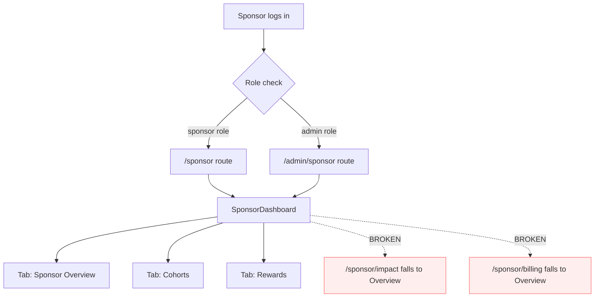
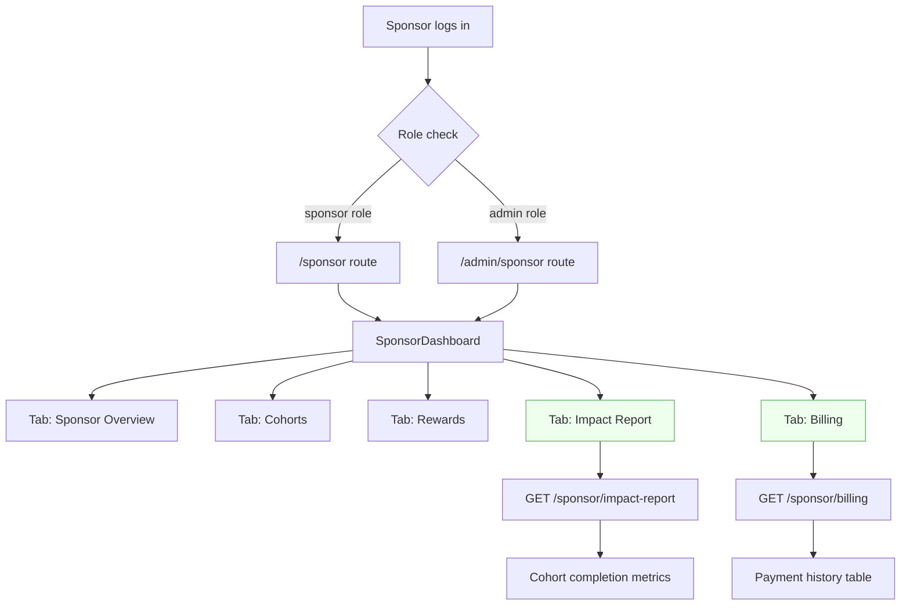
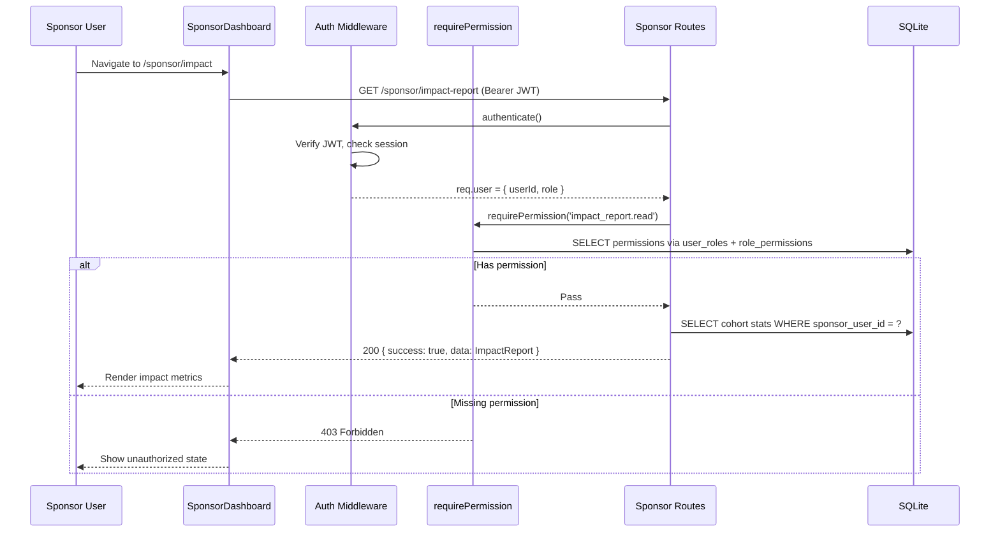
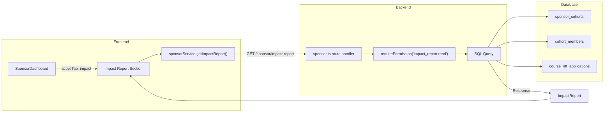
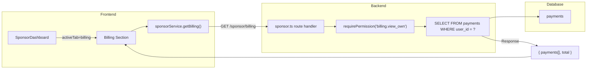
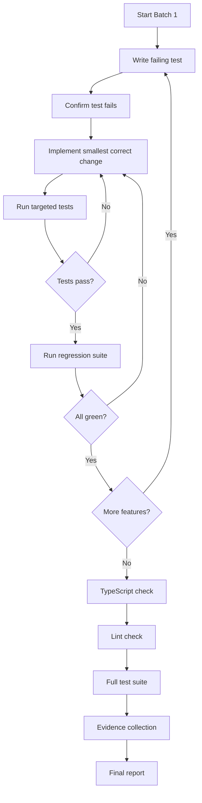

# Deliverable 3 Batch 1 — Sponsor Portal UI Completion

**Date:** 2026-10-15
**Status:** REVIEW REQUESTED
**Branch:** `feat/deliverable-3-batch1`
**Depends on:** Deliverable 2 RBAC (MERGED), Phase 11 C3 Cohorts (MERGED), Phase 22 C4 Enhancements (MERGED)

---

## Problem Statement

The sponsor portal backend is complete — 14 sponsor-scoped endpoints, 560-line cohort route file, 649-line cohort service, full RBAC with 24 sponsor permissions. However, two frontend tabs are missing from `SponsorDashboard.tsx`:

1. **Impact Report** — backend `GET /sponsor/impact-report` returns cohort completion data, but no frontend tab renders it.
2. **Billing/Payment History** — backend `GET /sponsor/billing` returns payment history, but no frontend tab renders it.

Additionally:
- Tab routing is broken: `/sponsor/impact` and `/sponsor/billing` both fall through to the "overview" tab.
- A notification query in `cohorts.ts:498` references the wrong table name (`cohorts` instead of `sponsor_cohorts`).
- `SponsorPortal.tsx` is orphaned (never wired into routes) and needs a deprecation marker.

---

## Current State

### SponsorDashboard.tsx (416 lines)

Three tabs implemented:
- **Sponsor Overview** — course analytics grouped by sponsor label, per-student drill-down, CSV export
- **Cohorts** — spending summary, full CohortManagement component (CRUD, bulk ops, invite, reminders)
- **Rewards** — RewardDashboard per cohort

Tab routing only recognizes `/rewards`:
```typescript
const initialTab = location.pathname.includes('/rewards') ? 'rewards' as const : 'overview' as const;
```

### Sidebar Navigation (Layout.tsx)

```
sponsor: [
  { name: 'Dashboard',     path: '/sponsor',         icon: LayoutDashboard },
  { name: 'Rewards',       path: '/sponsor/rewards',  icon: Gift },
  { name: 'Impact Report', path: '/sponsor/impact',   icon: BarChart2 },
  { name: 'Billing',       path: '/sponsor/billing',  icon: CreditCard },
]
```

### Backend Endpoints (Already Implemented)

| Endpoint | Permission | Response |
|---|---|---|
| `GET /sponsor/dashboard` | `cohort.view_own` | Own cohort stats (totalCohorts, activeCohorts, totalMembers, cohorts[]) |
| `GET /sponsor/impact-report` | `impact_report.read` | Completion metrics per cohort (no PII) |
| `GET /sponsor/billing` | `billing.view_own` | Payment history (id, course_id, amount_cents, currency, status, created_at) |

### RBAC (role_sponsor — 24 permissions)

Key permissions for Batch 1:
- `cohort.view_own` — dashboard access
- `impact_report.read` — impact report access
- `billing.view_own` — billing access (note: defined as `billing.view_all` in seed but route uses `billing.view_own`)

---

## Proposed Changes

### Change 1: Fix Tab Routing

**File:** `LMS-Frontend/src/pages/SponsorDashboard.tsx`

Extend `initialTab` to recognize all four sidebar paths:

```typescript
// BEFORE
const initialTab = location.pathname.includes('/rewards') ? 'rewards' as const : 'overview' as const;

// AFTER
function getInitialTab(pathname: string): 'overview' | 'cohorts' | 'rewards' | 'impact' | 'billing' {
  if (pathname.includes('/rewards')) return 'rewards';
  if (pathname.includes('/impact')) return 'impact';
  if (pathname.includes('/billing')) return 'billing';
  return 'overview';
}
const initialTab = getInitialTab(location.pathname);
```

Extend the `activeTab` state type:
```typescript
const [activeTab, setActiveTab] = useState<'overview' | 'cohorts' | 'rewards' | 'impact' | 'billing'>(initialTab);
```

Add tab buttons for Impact and Billing in the tab bar.

### Change 2: Impact Report Tab

**File:** `LMS-Frontend/src/pages/SponsorDashboard.tsx`

New tab content section rendering when `activeTab === 'impact'`. Calls `sponsorService.getImpactReport()` (already defined in `sponsorService.ts`).

**Display:**
- Summary cards: Total Students, Completed, Certificates Issued, Completion Rate
- Per-cohort table: Cohort Name, Members, Completed, Certificates, Rate

**States:**
- Loading: spinner
- Error: error banner with retry
- Empty: "No cohort data yet" message
- Data: summary cards + table

### Change 3: Billing/Payment History Tab

**File:** `LMS-Frontend/src/pages/SponsorDashboard.tsx`

New tab content section rendering when `activeTab === 'billing'`. Calls `sponsorService.getBilling()` (already defined in `sponsorService.ts`).

**Display:**
- Summary: total payments count
- Payment table: Date, Amount, Currency, Method, Status (badge)

**States:**
- Loading: spinner
- Error: error banner with retry
- Empty: "No payment history" message
- Data: payment table with status badges

### Change 4: Fix Cohort Notification Bug

**File:** `LMS-Server/src/routes/cohorts.ts` (line ~498)

```typescript
// BEFORE (bug)
const cohortInfo = queryOne<{ name: string }>('SELECT name FROM cohorts WHERE id = ?', [cohortId]);

// AFTER (fix)
const cohortInfo = queryOne<{ name: string }>('SELECT name FROM sponsor_cohorts WHERE id = ?', [cohortId]);
```

### Change 5: Deprecate SponsorPortal.tsx

**File:** `LMS-Frontend/src/pages/SponsorPortal.tsx`

Add deprecation JSDoc comment. Do not delete or wire into routes.

---

## Mermaid Diagrams

### Sponsor Portal User Journey (Current State)



### Sponsor Portal User Journey (Proposed State)



### Sponsor RBAC Authorization Flow



### Impact Report Data Flow



### Billing History Data Flow



### Batch 1 Implementation and Verification Loop



---

## Test Matrix

| ID | Test | Type | File |
|---|---|---|---|
| D3B1-01 | SponsorDashboard renders Impact Report tab button | frontend unit | SponsorDashboard.test.tsx |
| D3B1-02 | SponsorDashboard renders Billing tab button | frontend unit | SponsorDashboard.test.tsx |
| D3B1-03 | /sponsor/impact routes to Impact Report tab | frontend unit | SponsorDashboard.test.tsx |
| D3B1-04 | /sponsor/billing routes to Billing tab | frontend unit | SponsorDashboard.test.tsx |
| D3B1-05 | Impact Report renders loading state | frontend unit | SponsorDashboard.test.tsx |
| D3B1-06 | Impact Report renders cohort metrics with data | frontend unit | SponsorDashboard.test.tsx |
| D3B1-07 | Impact Report renders empty state | frontend unit | SponsorDashboard.test.tsx |
| D3B1-08 | Impact Report renders error state with retry | frontend unit | SponsorDashboard.test.tsx |
| D3B1-09 | Billing tab renders loading state | frontend unit | SponsorDashboard.test.tsx |
| D3B1-10 | Billing tab renders payment history with data | frontend unit | SponsorDashboard.test.tsx |
| D3B1-11 | Billing tab renders empty state | frontend unit | SponsorDashboard.test.tsx |
| D3B1-12 | Billing tab renders error state with retry | frontend unit | SponsorDashboard.test.tsx |
| D3B1-13 | Cohort invite notification uses sponsor_cohorts table | backend unit | cohort-notification-fix.test.ts |
| D3B1-14 | Cohort notification resolves actual cohort name | backend unit | cohort-notification-fix.test.ts |
| D3B1-15 | Sponsor cannot access admin analytics endpoints | backend integration | sponsor-boundary.test.ts |
| D3B1-16 | Unauthorized user gets 401 on sponsor endpoints | backend integration | sponsor-boundary.test.ts |
| D3B1-17 | No mutating billing operations exist on sponsor routes | backend unit | sponsor-boundary.test.ts |

---

## Evidence Plan

| # | Evidence | Method |
|---|---|---|
| 1 | Frontend tests pass (D3B1-01 through D3B1-12) | `npx vitest run --reporter=verbose` |
| 2 | Backend tests pass (D3B1-13 through D3B1-17) | `npx jest --no-cache` |
| 3 | TypeScript zero errors | `npx tsc --noEmit` |
| 4 | Lint clean | `npx eslint src/` or project lint command |
| 5 | No new POST/PUT/PATCH/DELETE billing routes | `grep` evidence |
| 6 | SponsorPortal.tsx deprecated | Code review |
| 7 | Regression: all existing tests pass | Full test suite run |

---

## Affected Files

### Modified Files

| File | Change |
|---|---|
| `LMS-Frontend/src/pages/SponsorDashboard.tsx` | Add Impact + Billing tabs, fix routing |
| `LMS-Frontend/src/pages/SponsorPortal.tsx` | Add @deprecated JSDoc |
| `LMS-Server/src/routes/cohorts.ts` | Fix `cohorts` -> `sponsor_cohorts` table reference |

### New Files

| File | Purpose |
|---|---|
| `LMS-Frontend/src/__tests__/pages/SponsorDashboardTabs.test.tsx` | 12 frontend tests |
| `LMS-Server/src/__tests__/cohort-notification-fix.test.ts` | 2 backend tests for bug fix |
| `LMS-Server/src/__tests__/sponsor-boundary-d3.test.ts` | 3 RBAC boundary tests |
| `docs/deliverable-3/batch-1-developer-spec.md` | This document |

### Unchanged (Safety Confirmation)

- LMS-Mobile/ — untouched (Deliverable 1 scope)
- AmmaWallet containers — untouched
- RBAC seed data — untouched
- Role hierarchy — untouched
- Reward system — untouched
- Payment processing — untouched

---

## Out of Scope (Deferred to Batch 2)

| Item | Reason |
|---|---|
| Date-range filter UI controls | Product decision: Batch 2 |
| Drop-off analysis rendering | Product decision: Batch 2 |
| CSV export UI for impact/billing | Product decision: Batch 2 |
| Unused service method cleanup | Product decision: Batch 2 |
| SponsorPortal.tsx deletion | Product decision: later cleanup batch |
| New backend endpoints | Batch 1 uses existing endpoints only |
| Payment mutations | Read-only by design |
| Admin vs sponsor view differentiation | Batch 2 scope |

---

## Rollback

- `git revert <commit>` removes all changes
- No database migration — no schema changes
- No environment variable changes
- Existing functionality unchanged

---

## Review Tracking

| Field | Value |
|---|---|
| **PR** | [#63](https://github.com/SM-Web-Systems/lms-crypto-production/pull/63) |
| **Review requested** | 2026-10-15 |
| **Reviewers** | `clschalkwyk`, `smwebsystems` |
| **Current status** | Awaiting human review |
| **Final human approval** | Pending |

### Review Comments and Resolutions

_No review comments received yet._

<!-- 
Update this section as review comments are received:

| Comment | Reviewer | File/Line | Resolution | Status |
|---|---|---|---|---|
| (comment summary) | (reviewer) | (location) | (resolution) | Resolved/Pending |
-->
