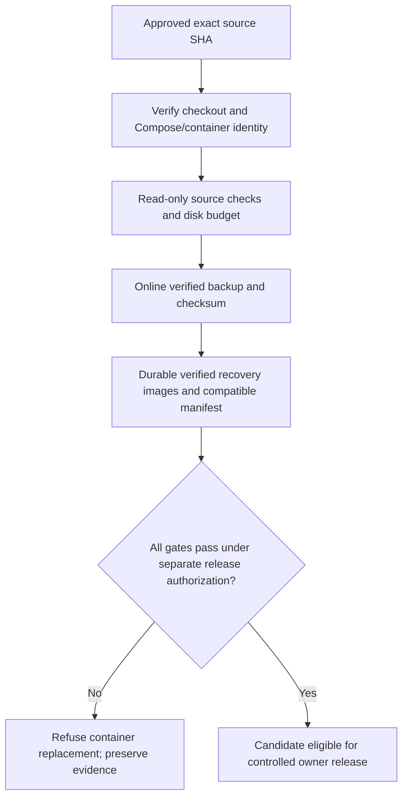

# AUTH-13 laptop release-safety assessment

Assessed 2026-10-24 against main `47fe4f92e09e9c949ae80e6c22d1cd600898126b`. This task is laptop development only. The original checkout is clean at `f30d86f` and is preserved. Isolated worktrees use explicit Git because the desktop worktree helper could not resolve this nested repository's `origin/main`. No root AGENTS.md exists; mobile-only guidance is outside this scope. Python 3.13, Node 22.18, npm 11.11, Git Bash and GitHub CLI are available; Docker is unavailable. Available coding tools support isolated subprocess tests and independent subagents; Claude-specific engineering skills are not assumed.

## Confirmed repository findings

| ID | Priority | Evidence/root cause | Required acceptance | Ownership |
| --- | --- | --- | --- | --- |
| RS-01 | P0 | deploy.yml defaults to an older checkout and runs unrestricted git pull; deploy.sh trusts its directory and only warns about dirty files | Explicit repository/path/project/container identity; exact approved SHA; no automatic pull/checkout; mismatch stops before container mutation | deployment guardrails |
| RS-02 | P0 | deploy.sh hardcodes a volume path and skips missing DB backup; only checks file size | Discover mounted volume identity, mandatory accessible source, online SQLite backup, required tables/integrity/hash, restrictive unique artifacts and disk checks; never initialize/restore source | deployment guardrails |
| RS-03 | P0 | previous-images.txt stores untagged image IDs; image prune may delete them; rollback tagging failures suppressed | Verify running images, retain immutable IDs with unique persistent tags, verify all tags, immutable complete manifests, no prune, atomic pointer publication | rollback safety |
| RS-04 | P0 | automatic rollback ignores AUTH-13 schema, authorization and composite webhook identity changes | Unknown/incompatible recovery refuses replacement; no database restore; explicit reviewed compatibility bound to source/target image and DB contract; validate actual recovered identity/health | rollback safety |
| RS-05 | P1 | cron reads mutable checkout scripts; CSV/deadman behavior changes with checkout; health monitor does not gate expected SHA or aggregate reconciliation evidence | Immutable script bundle/handoff; preserve history; expected SHA checks; sanitized aggregate reconciliation counts with bounded alerts and submission failures visible | monitoring transition |
| RS-06 | P1 | older readiness docs call Wallet #2 closed (GitHub says open draft), mix test counts and overstate rollback/monitoring readiness | New handoff supersedes operational claims, uses exact commits/CI and separates local tests from operator acceptance | handoff |
| RS-07 | follow-up | post-migration FK validation warns on every violation while migrations disable FK enforcement; legacy NOT NULL completion timestamp remains | Separate synthetic migration tests and reviewed compatibility policy; no production row repair in deployment scripts | documented application follow-up |

Historical server reports identify `/home/webadmin/lms-crypto-production` as Compose's working directory and `/home/webadmin/web-stack/html/LMS-AmmaWallet` as an older checkout. Neither path/runtime/image state is live-verified here. Reported production remains `6763f4e`; AUTH-13 is merged, not production-verified. Missing rollback images, volume identity, cron and retention must be reverified by the server owner. CI at baseline passed backend/frontend/offline/E2E; backend log reports 1813 passed and one protected-copy skip, web 515, E2E 73. Wallet #2 remains an open draft. Latest recorded web audit reports three moderate build findings and zero production findings; no current audit is inferred from an older seven-finding report.

## Development outcome, 2026-10-24

RS-01/02 are addressed by PR #87 (`1c433dc`); RS-03/04 by dependent PR #89 (`4a58732`); RS-05/06 by PR #88 and its handoff. The combined code candidate is `212e0faf45a40bb39b19306b8b2e5c0bb3248a02`, independently reviewed with no remaining P0/P1 finding and all four CI jobs passed in run `40093580080`. Locally, API 1813 passed/one protected-copy skip, web 515, E2E 73 and combined offline 110 passed/one Windows POSIX permission skip (111 total); builds, bootstrap, synthetic WAL restore, audits and shell/smoke checks passed. No production condition is inferred from these results.

RS-07 is partly contained by the release gate's exact FK-violation tuple fingerprint, which rejects newly introduced/changed violations without repairing rows. The application's broader warning-only FK behavior and legacy completion migration design remain separate follow-up work. Historical production image/schema/financial compatibility remains unknown and NO-GO for automated execution. Real Docker/UID/mounts, protected-copy migration/restore, retention, SMTP receipt, cron transition, Wallet #2 and devices remain owner gates.

No PR was merged. Automatic approval review rejected the attempted #87 merge because immediate exact-head review/protection/current-main invariants were insufficiently verified. Main remains the baseline. The original checkouts are preserved; only isolated review branches were changed. The final handoff and PR descriptions bind exact reviewed commits, CI and remaining acceptance. Do not start unrelated AUTH-14 features before these release gates are resolved.

## Implementation design

Keep three focused PRs, deployment → rollback as a dependent pair, monitoring separately reviewable. Use Python standard-library orchestration for structured Docker/Git responses, SQLite online backups, strict JSON manifests and atomic writes; Bash entrypoints remain small and fail closed. No shell eval or printed subprocess/configuration output. Commands in tests are fake Git/Docker/HTTP interfaces; databases are synthetic temporary files. Existing grep-only script checks must be replaced/updated with actual behavioral coverage, not preserved as false proof.

The workflow may only run manually; merging must never deploy. It validates the workflow's approved source SHA and requires an already prepared exact server checkout. It does not git pull/checkout the live directory. Server preparation and immutable monitoring installation require a separately authorized operator procedure. The phase-one execution path must remain blocked until the complete recovery eligibility gate is implemented and independently reviewed.

No automatic DB restore, image prune, server SSH, real email/payment/chain call, customer data download, cron installation or container changes are part of laptop execution. Local Docker coverage is absent and must stay an owner acceptance gate.

