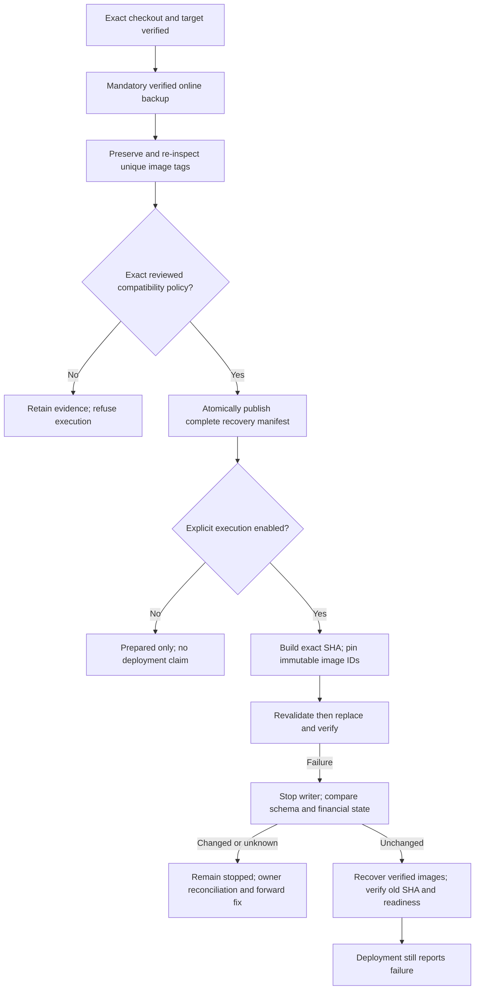

# AUTH-13 rollback preservation and guarded release review

Assessed on the laptop on 2026-10-24. This branch depends on deployment guardrails commit `1c433dc`. No server, real Docker, customer database, provider, SSH, email or production endpoint was used. Docker is unavailable locally; all replacement and HTTP behavior below was simulated using a fake Docker command interface and synthetic SQLite files.

## Independent review of phase one

The rollback reviewer independently inspected exact phase-one head `1c433dc`, including source and final regression changes. Its stale-checkout bootstrap, desired database configuration, masked Git failure and hidden critical-script modifications findings were addressed. No remaining P0/P1 issue was identified in that commit's explicitly blocked, no-container-replacement scope. The reviewer's earlier pre-final run was 28 tests, 27 passed and one Windows POSIX-permission skip. Phase one's final 32 focused / 57 total run is implementation-agent evidence, not an independent rerun. Linux CI and owner Docker acceptance remain separate gates.

## Recovery contract

`release_recovery.py` shares the read-only target and mandatory online-backup gates from `release_preflight.py`. State resides in a private `release-state` directory beneath the explicitly configured private backup directory, outside the checkout and source volume. An OS-owned nonblocking lock covers backup, capture, pointer publication, build, replacement and recovery. Unique tagged image references, immutable JSON evidence and completed backup files are retained; the scripts perform no image prune or database restore.

Each retained API/web image must actually exist at its full `sha256` image ID. A unique recovery tag is created and inspected back to that exact ID. Capture evidence is stored even if recovery eligibility is unknown. Only a fully verified manifest can atomically replace `current-recovery.json`; its checksum, complete target context, policy digest, backup checksum and exact image/tag identities are rechecked before use. Prepublication tag/capture/write failures leave the prior pointer intact. If directory synchronization fails after atomic replacement, the command fails and the owner must inspect durability; any published pointer still references a complete verified manifest. A recovery manifest is not a database migration reversal.

Eligibility requires a separately reviewed private version-one JSON policy with these exact fields:

| Field | Meaning |
| --- | --- |
| `version` | `1` |
| `review_reference` | Independent review evidence identifying this specific transition |
| `repository`, `project`, `database` | Exact approved repository, Compose project and discovered volume/path metadata |
| `source_sha`, `target_sha` | Exact 40-character source image revision and approved checkout revision |
| `images` | Exact previous `api` and `web` image IDs |
| `compose_sha256` | Hash of the resolved desired Compose configuration; secrets remain private |
| `schema_sha256` | Full application SQLite structure plus `user_version` fingerprint |
| `financial_state_sha256` | Deterministic digest of complete payment and webhook-event rows, without exposing row values |
| `foreign_key_violation_count`, `foreign_key_violations_sha256` | Exact reviewed pre-existing violation count and tuple-set fingerprint |

No production policy is supplied or generated. A `review_reference` is evidence to be supplied by the owner after actual review; it is not a cryptographic signature or an automatic approval. Unknown, unlabelled or mixed historical images, absent/mismatched policy fields and changed schema/financial state are NO-GO. There is no force flag. The historically reported `6763f4e` to AUTH-13 transition has no established compatibility policy and remains **NO-GO for this automated executor** pending a separately reviewed server recovery procedure.

The financial equality gate intentionally refuses automatic recovery after any new payment write, webhook marker, changed refund evidence or payment status. This avoids pretending an older webhook implementation understands newer composite identities or reconciliation evidence. Such a refusal requires manual provider reconciliation and an approved forward fix. It never deletes a marker or restores an older database.

Foreign-key violations are fingerprinted as a deterministic private hash of all `PRAGMA foreign_key_check` tuples, plus a count. Existing unchanged violations can pass; a new violation or changed violation set fails post-release and recovery checks. No orphan row is repaired or removed by release tooling. This contains the existing application's warning-only post-migration validation without modifying application source.

## Explicit modes and verification

The wrappers run Python with `-I -S`, ignoring `PYTHONPATH` and user site imports. Every executable helper/wrapper is checked against its approved Git blob by both preflight and the workflow's trusted bootstrap before code is executed or imported. Future images include final-stage OCI revision labels.

`DEPLOY_DRY_RUN=1` performs read-only checks and creates no backup, state, tag or pointer. With execution omitted/default `0`, preparation can create verified recovery evidence but returns `RECOVERY_PREPARED_DEPLOYMENT_DISABLED`, never `DEPLOYMENT_VERIFIED`. A missing compatibility policy returns nonzero after retaining safe evidence. Actual execution requires literal `DEPLOY_EXECUTE=1`, an explicit safe `DEPLOY_BASE_URL`, all other required target configuration and the exact policy. GitHub's manual workflow has an `execute` boolean defaulting to false; merging does not run it.

The guarded executor supplies the approved `BUILD_SHA` explicitly as a build environment and build argument, verifies built OCI revisions, pins the resulting immutable image IDs in a private Compose override, then uses `up --no-build --pull never`. It rechecks checkout/configuration, running old image identity and the source schema/financial contract before the build and again before replacement. It stops the two validated container IDs and verifies they stopped before its final database snapshot, closing the application's ordinary writer race. Unknown context refuses before any stop. Nested database/sidecar mounts are rejected so the backed-up named-volume file cannot be shadowed. Successful evidence records requested, checked-out, built, health and deployed SHA stages. Actual container images, project/service/mount identity, Docker health, API SHA/database readiness, unauthenticated course-route protection and frontend HTML availability are verified. HTTP checks use explicit URLs, no credentials, no redirects and no environment proxy.

On failure, deployment remains failed even if recovery succeeds. The recovery path verifies retained images/context, stops API/web and proves both stopped before its final database snapshot. Only exact unchanged schema, full financial state and foreign-key evidence permit old-image replacement. Known validated services are stopped on incompatible or failed recovery. Unknown runtime context or a Docker stop failure is nonzero and cannot prove a stopped state; the owner must inspect actual services. A cleanly stopped WAL database may have no WAL/SHM files; only this verified stopped-writer case uses SQLite immutable read mode, with absence and source-digest checks. Active WAL always uses the normal consistent reader.

Recovery recognizes only the exact retained images or recorded candidate images and exact recorded private Compose overlays. It never accepts arbitrary runtime overlays. Successful replacement leaves an explicit overlay label; the ordinary next-deployment preflight deliberately refuses that non-base context until the owner reviews and reconciles it. Do not silently retag/recreate containers to make this gate pass.

## Regression evidence and limitations

TDD reproduced missing recovery implementation, unknown runtime-image/overlay acceptance, clean-WAL reading and a false successful release after a newly introduced FK orphan. The fixes cover missing/corrupt manifests and backups, wrong tags, partial preservation, atomic pointer failure, unknown revisions, exact policy fields, schema/financial mutations after stop, source preservation, lock contention, wrong actual images, failed Docker replacement, API SHA/database/frontend failures, all SHA stages, build-time state changes and recovery failure propagation. Every Docker and HTTP interaction in these tests is fake.

Local pre-final full suite: `python -B -m unittest discover -s scripts/tests -q` — 92 tests, 91 passed and one Windows POSIX permission skip in 105.862 seconds. Independent review then reproduced a runtime database identity gap: recovery did not recheck the actual API working directory, `DATABASE_PATH` or `VITEST`. Three added tests first produced seven failing assertions/subcases. A shared runtime validator now protects initial preflight, repeated context checks and readiness/recovery. Safety stop may omit only this DB environment/working-directory check to contain a known bad candidate; all project/name/service/checkout/overlay/mount gates still apply, and exact inspected IDs are stopped and verified. Manual recovery/config drift refuses before mutation. The final focused command `python -B -m unittest discover -s scripts/tests -p test_release_recovery.py -q` passed **37 tests** in 4.632 seconds. Final combined offline regression, exact-head independent review and CI are recorded in the handoff.

Before any separately authorized release, the server owner must establish sole-writer/quiesced-ingress conditions, validate the actual checkout/project/mounts and Docker version, inspect recovery-image availability and retention, verify restrictive permissions/available space and run a protected-copy migration/restore rehearsal. Other database writers are unsupported by the automatic equality gate. External `docker image prune -a` or manual tag deletion can still destroy recovery assets and must be excluded by the owner's retention policy. Backups and tags are never automatically expired here; retention capacity requires owner management. Real Docker behavior, production routing, protected data compatibility and physical devices remain unverified from this laptop.

