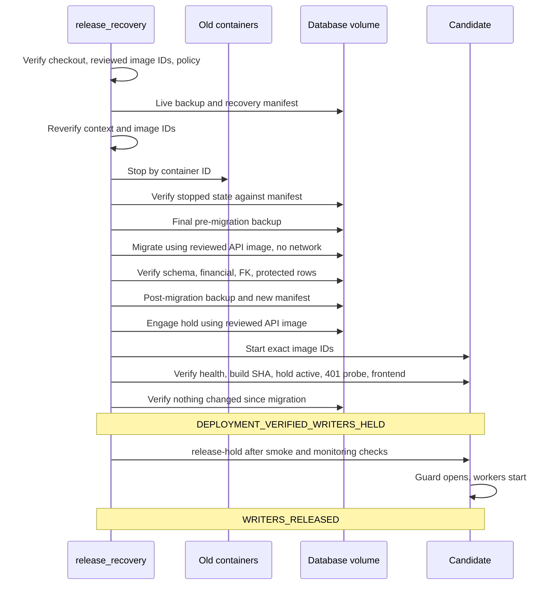

# AUTH-14 held release

How a release binds to reviewed images and keeps writers held from migration to resumption. Hashes and row data stay in private release state.

## Reviewed image binding

Deployment no longer builds. `scripts/build-candidate.sh` builds at the exact checkout SHA, tags `<project>-<service>:candidate-<sha>` and prints the image IDs. Those IDs go through review and rehearsal, then into the recovery policy as `candidate_images`.

`deploy` refuses unless both IDs exist, match the policy, and carry the approved SHA as their revision label. It checks before and after capture, immediately before stopping production, and again on the running containers. Containers start with `--no-build --pull never` from an overlay that names the IDs, so moving `latest` has no effect. Rollback uses the source image IDs in the policy, retained under recovery tags.

## Writer inventory

| Writer | Control during the release | Queued work |
|---|---|---|
| Old image: requests, callbacks, reward scheduler, email retry, deletion finalization | Stopped by verified container ID. The AUTH-13 image has no hold, so stopping is its only control. | Stays in the database |
| Candidate: all HTTP routes, including webhooks and internal network callers | `writerHoldGuard` runs before every route and returns 503 with `Retry-After` | Paystack events stay with the provider, which retries non-200 responses |
| Candidate: reward scheduler, email retry worker, deletion scheduler and its startup run | Not started until release; each tick also checks the hold | Stays in the database |
| Host cron: `lms-data-check`, `backup_lms_db` | Only run read queries and backups, but `sudo sqlite3` opens the database as root and can create sidecars on a stopped database. Start only with at least 30 minutes before the next 00:00, 03:00, 06:00, 12:00 or 18:00 run. A collision fails closed, which after migration means a halted outage. | None |
| Stellar payment monitor | Defined but never started | None |
| Candidate import-time schema statements in `config/database.ts` | Run at start, before any hold check. Written to be no-ops on an existing database. Deploy fails if the schema or any protected row changes across the held start. | None |
| Amma SSO callback | Browser redirect refused during the outage; the user signs in again | No durable event |

Only `/health`, `/api/v1/health` and a credential-free `GET /api/v1/courses` pass the guard. That probe returns 401 before any database access. `/healthz` is refused because its readiness probe writes. The hold is a file beside the database, so it travels with the volume, and production ignores any override of its path. An unreadable hold state counts as held.

## Sequence

## Failure handling

| Point of failure | Result | Services |
|---|---|---|
| Before stopping | Refused | Old image keeps running |
| After stopping, before migration | Rollback to source image IDs | Old image restored and verified |
| Migration fails and the database is exactly unchanged | Rollback to source image IDs | Old image restored and verified |
| Migration changed anything unexpected, post-migration checks fail, or a timed-out migration container cannot be confirmed gone | `DEPLOYMENT_HALTED_AFTER_MIGRATION_SERVICES_STOPPED` | Stopped until the owner decides |
| Candidate fails after migration | Rollback onto the migrated schema, only if schema, financial and FK state match the post-migration backup | Old image restored and verified, or stopped if refused |
| `release-hold` checks fail before releasing | Refused | Candidate stays held |
| Releasing or its verification fails | `WRITER_RELEASE_UNCONFIRMED`: assume writers may be running. Rerun `release-hold`, which finishes a transient failure or confirms a release that already happened. | Candidate running, rollback refused |

`prepare` never moves the recovery pointer, and `deploy` moves it only at the stop, so preparation and any refusal before then leave the source's overlay proof intact.

Rolling back means the old image runs with no hold, so its writers resume. Rehearsal shows it works on the migrated schema, and keeps schema, financial and FK state. On the rehearsal copy it wrote only `scheduler_tick_log` rows, but on live data its deletion finalization, email retry and reward workers also resume. The migrated schema is not downgraded. Rollback is refused as soon as a release has been attempted, because candidate writes can exist that the recovery contract cannot see. From that point the only way is forward.

After a rollback, the hold file stays on the volume, where the old image ignores it. `validate_target` then refuses a retry because the pointer names the failed candidate while the old image runs. Retrying therefore needs a separately reviewed procedure written for that situation, not a rerun.

Restoring the final pre-migration backup is never automatic. It discards anything written after that backup, so it needs an owner decision and reconciliation.

## Policy

A migrating release's policy adds `candidate_images` and `migration.pre_schema_sha256`. `schema_sha256` is the post-migration schema. Values come from a fresh backup of live data and a migrated copy of it, and are reviewed before the window. The window checks them against live state and changes nothing: any mismatch before migration stops the release while the old image can still run.

`protected_content_sha256` covers every row except the two migration receipts in `system_config`. It is compared only inside the held window, because open service changes rows constantly. It covers the preserved orphan record.

No release gate or flag controls reward funding, which is a permission-checked user action. This release does not change it, and after release those routes behave as they do today.

## Operating it

1. Fast-forward the active checkout to the exact merged SHA, confirming it is clean.
2. Run `scripts/build-candidate.sh` and record the image IDs.
3. Review and rehearse those exact IDs on a fresh copy, then write the private policy.
4. Run `scripts/deploy.sh` with `DEPLOY_EXECUTE=1` and `DEPLOY_RECOVERY_POLICY` set.
5. Run smoke checks and move monitoring to the new SHA.
6. Run `scripts/release-hold.sh` with `DEPLOY_EXECUTE=1`.

## Known limits

- Paystack retry behavior comes from the provider's documentation and was not exercised here. The rehearsal ran with no network.
- The hold protects the candidate from its first start. Engaging it on an already running API does not wait for requests in progress, so the release flow only ever engages it while services are stopped.
- Login, session and learning checks need writes, so they can only run after release.
