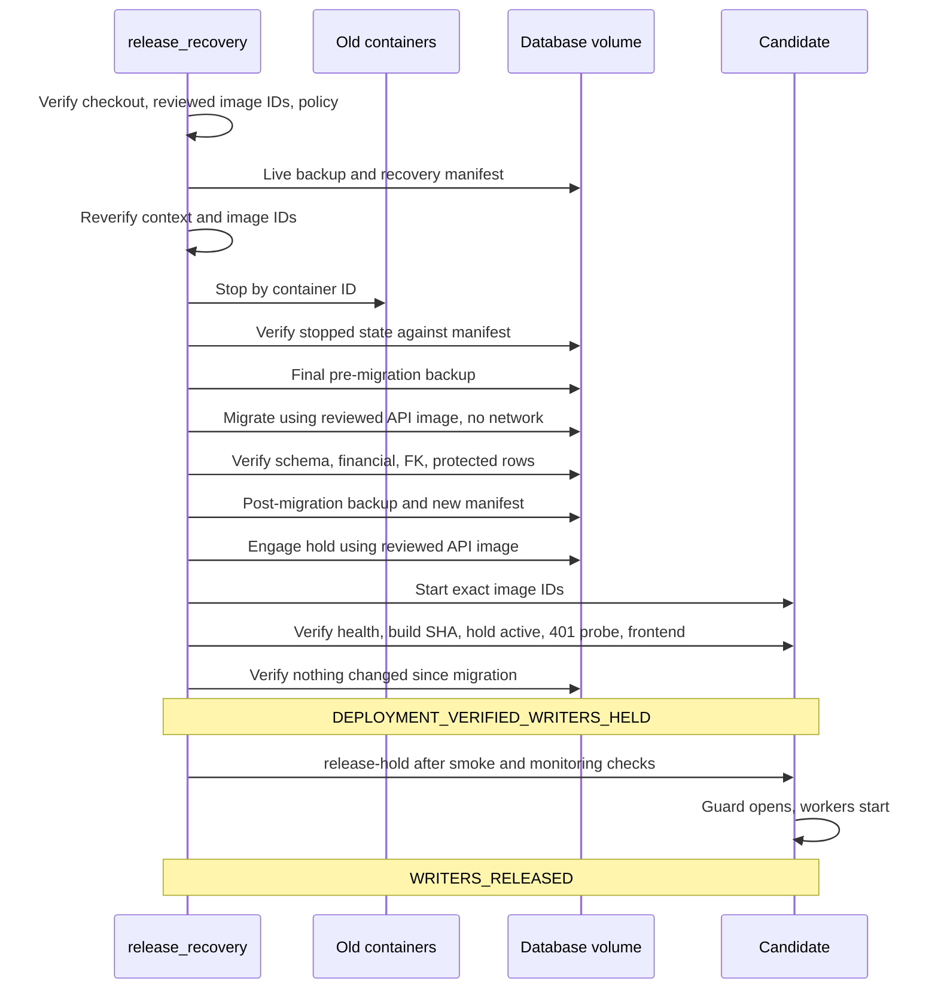

# AUTH-14 held release

How a release binds to reviewed images and keeps writers held from migration to resumption. Hashes and row data stay in private release state.

## Reviewed image binding

Deployment no longer builds. `scripts/build-candidate.sh` builds at the exact checkout SHA, tags `<project>-<service>:candidate-<sha>` and prints the image IDs. Those IDs go through review and rehearsal, then into the recovery policy as `candidate_images`.

`deploy` refuses unless both IDs exist, match the policy, and carry the approved SHA as their revision label. It checks before and after capture, immediately before stopping production, and again on the running containers. Containers start with `--no-build --pull never` from an overlay that names the IDs, so moving `latest` has no effect. Rollback uses the source image IDs in the policy, retained under recovery tags.

## Writer inventory

| Writer | Control during the release | Queued work |
|---|---|---|
| Old image: requests, callbacks, reward scheduler, email retry, deletion finalization | Stopped by verified container ID. The AUTH-13 image has no hold, so stopping is its only control. | Stays in the database |
| Candidate: all HTTP routes, including webhooks and internal network callers | `writerHoldGuard` runs before every route and returns 503 with `Retry-After` | Paystack events stay with the provider, which retries non-200 responses |
| Candidate: reward scheduler, email retry worker, deletion scheduler and its startup run | Not started until release; each tick also checks the hold | Stays in the database |
| Host cron: `lms-data-check`, `backup_lms_db` | Read-only, but they can create sidecars on a stopped database, so avoid the window around 00:00, 03:00, 06:00, 12:00 and 18:00 | None |
| Stellar payment monitor | Defined but never started | None |
| Amma SSO callback | Browser redirect refused during the outage; the user signs in again | No durable event |

Only health routes and a credential-free `GET /api/v1/courses` pass the guard. That probe returns 401 before any database access. The hold is a file on the database volume, so it travels with the data. An unreadable hold state counts as held.

## Sequence

## Failure handling

| Point of failure | Result | Services |
|---|---|---|
| Before stopping | Refused | Old image keeps running |
| After stopping, before migration | Rollback to source image IDs | Old image restored and verified |
| Migration fails and the database is exactly unchanged | Rollback to source image IDs | Old image restored and verified |
| Migration changed anything unexpected, or post-migration checks fail | `DEPLOYMENT_HALTED_AFTER_MIGRATION_SERVICES_STOPPED` | Stopped until the owner decides |
| Candidate fails after migration | Rollback onto the migrated schema, only if schema, financial and FK state match the post-migration backup | Old image restored and verified, or stopped if refused |
| `release-hold` checks fail | Refused | Candidate stays held |

Rolling back means the old image runs with no hold, so its writers resume. Rehearsal shows it works on the migrated schema, keeps schema, financial and FK state, and may update rows through its normal startup and workers. The migrated schema is not downgraded.

Restoring the final pre-migration backup is never automatic. It discards anything written after that backup, so it needs an owner decision and reconciliation.

## Policy

A migrating release's policy adds `candidate_images` and `migration.pre_schema_sha256`. `schema_sha256` is the post-migration schema. Values come from a fresh backup of live data and a migrated copy of it, and are reviewed before the window. The window checks them against live state and changes nothing: any mismatch before migration stops the release while the old image can still run.

`protected_content_sha256` covers every table except `system_config`, which holds the release receipts. It is compared only inside the held window, because open service changes rows constantly. It covers the preserved orphan record.

## Operating it

1. Fast-forward the active checkout to the exact merged SHA, confirming it is clean.
2. Run `scripts/build-candidate.sh` and record the image IDs.
3. Review and rehearse those exact IDs on a fresh copy, then write the private policy.
4. Run `scripts/deploy.sh` with `DEPLOY_EXECUTE=1` and `DEPLOY_RECOVERY_POLICY` set.
5. Run smoke checks and move monitoring to the new SHA.
6. Run `scripts/release-hold.sh` with `DEPLOY_EXECUTE=1`.

## Known limits

- Paystack retry behavior comes from the provider's documentation and was not exercised here. The rehearsal ran with no network.
- The hold protects the candidate from its first start. Engaging it on an already running API does not wait for requests in progress, so the release flow only ever engages it while services are stopped.
- Login, session and learning checks need writes, so they can only run after release.
