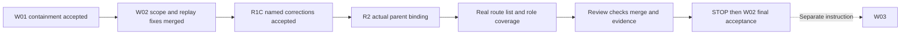
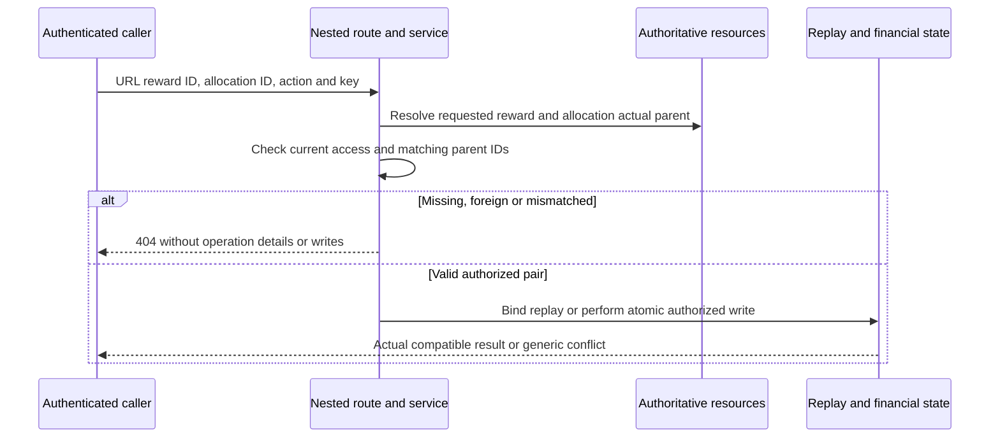

# Verified W02-R1C acceptance and bounded W02-R2 prompt

Date: 2026-10-29. **Accept the named W02-R1C amount/type/currency, funding-source/reference and access-order corrections at `88db657a`. Next unit: W02-R2 only.** W02 remains PARTIALLY_FIXED until nested-parent binding and effective route/list coverage pass final acceptance. W03/W04 and deployment remain excluded.

Independent review of this acceptance record and bounded R2 prompt: **PASS — no accuracy or boundary corrections needed**. This approves the named R1C corrections and the next-stage scope, not W02-R2 implementation or overall W02 closure.

Repository: [SM-Web-Systems/lms-crypto-production](https://github.com/SM-Web-Systems/lms-crypto-production). Documentation branch: `codex/platform-wiring-audit`. Authoritative planning branch: `codex/staged-rollout-plan` (PR #103). These are branches in this repository, not separate repositories. Read documents without merging the unrelated documentation/RBAC base stack.

## Verified evidence

- [PR #113](https://github.com/SM-Web-Systems/lms-crypto-production/pull/113): head `28ce83a1043c55e443ed3ed87d7a52774b5383f6`, base `87a9f40bbe6a1b9d2225b0cc35271f5e408094de`, merge `88db657ab46732e0dc9f50cfa6a0e5d78dc5b819`.
- [PR CI 40860417566](https://github.com/SM-Web-Systems/lms-crypto-production/actions/runs/40860417566) and [main CI 40861303452](https://github.com/SM-Web-Systems/lms-crypto-production/actions/runs/40861303452): all four jobs SUCCESS. The main run's head SHA is the exact merge above. Main backend job `123404928847`: **185 files passed; 1,953 tests passed, one skipped (1,954 total)**. All 34 replay-binding tests passed; the hosted dependency-security suite passed.
- Exact-merge local focused verification: `reward-idempotency-binding.test.ts`, `reward-cross-owner.test.ts`, `rbac-sponsor-isolation.test.ts`: **3 files, 73 tests passed**.
- The [independent acceptance harness](../audits/2026-10-29-w02-r1c-pr113.probe.ts.txt) verifies changed amount, changed funding source/reference, opaque whitespace identity, a genuine default-equivalent creation retry and genuine funding replay without extra financial entries. Real authenticated HTTP controls for foreign/missing resources return 404 for both matching and conflicting previously used keys.
- The harness used isolated exact-source extraction, matching source fingerprints and dependency lock, Node v22.18.0, tsx, synthetic credentials and role-only users, `DATABASE_PATH=:memory:`, `VITEST=true`, `NODE_ENV=test` and a local test HTTP listener. No production data, provider calls, live migration or deployment was involved. The `.txt` probe records both passing controls and observed contract limits; do not copy its observation assertions into intended-behavior CI tests without defining the supported contract.
- Planning branch verified at `a4c63331ac6a58ef8b3db02bf118a241f61ae6da`. INDEX/EVIDENCE record the merge and completed main CI. **Small ledger correction:** TASKS still says the post-merge main run is “in progress” in the R1C subsection. Update that stale line during R2 reconciliation; the CI itself is confirmed complete.
- Independent source review accepts the named C1/C2 corrections, with the explicit creation-retry limitation below. The earlier [PR #112 review](SERVER-HANDOVER-W02-R1-PR112-REVIEW.md) remains historical evidence; its amount/funding/access-order examples are now repaired.

## Explicit creation-retry contract and spec correction

Creation replay currently binds scope, amount, reward type and currency. It deliberately returns the **first accepted configuration** if a retry changes `maxRecipients`, `autoRelease`, `eligibilityConfig`, `expiresAt` or `description`. It does not update those stored settings. Funding replay separately binds source type and opaque reference in addition to resource/action.

AI acceptance decision for this bounded resource-access work: retain that narrower creation-retry contract and document/test it honestly. This accepts the named R1C fixes, **not equality of every creation parameter**. No unauthorized mutation or new credit was demonstrated by the excluded options; an incompatible optional-setting retry receives the original configuration in its response. A future requirement for whole-request equality must be its own explicit change, not silently inferred or claimed complete here.

Correct the inaccurate rationale in `LMS-Server/docs/specs/w02-r1c-intent-binding-access-order-spec.md:66–67`: `maxRecipients` is financially meaningful because funding exposure is amount multiplied by the recipient count (`rewardService.ts:197–198,401–402`); `autoRelease` determines manual approval versus automatic release. Eligibility and expiry also affect execution. Calling these fields configurable does not establish that any update endpoint exists. Describe first-accepted-value semantics instead of saying these controls have no financial impact.

The exact-merge probe confirms cap 1 retried as cap 5 returns cap 1, and a later actual reservation remains 10M rather than the new request's 50M. Automatic-release true retried as false retains true; eligibility/expiry changes likewise retain their stored values. The authenticated creation endpoint returns its existing 201 response and original configuration. Keep these semantics visible in developer/API documentation and characterization coverage; do not tell callers their changed settings were applied. This is a documented compatibility limit, not W03 allocation-cap remediation or provider enablement.

## Remaining W02-R2 requirements

### F2 — Bind nested allocation actions to the requested reward

The exposed sponsor/teacher/parent/employer release/refund handlers still pass only `allocId`, ignoring URL `:id`. See the [PR #111 review](SERVER-HANDOVER-W02-PR111-REVIEW.md) and its actual HTTP reproduction. An owned allocation can currently be acted on beneath a mismatched foreign reward URL; actual-parent authorization prevents that example from proving foreign-allocation takeover.

Resolve the requested reward and actual allocation parent, authorize them under current policy, and require their IDs to match **before either replay or mutation**. Cover every action/prefix that actually exists; do not invent missing parent/teacher refund endpoints just for matrix symmetry. Ensure the check survives shared service calls and transactional write boundaries. Trusted internal callers must retain explicit safe paths; do not add a public optional-context or skip-authorization bypass.

Fail closed for missing actual parents. Replay currently uses `if (parentReward && ...)` in `releaseAllocation`/`refundAllocation`; a missing parent must not skip access checks and return an allocation. This belongs to the parent-binding repair. Synthetic legacy-orphan fixtures may disable FK enforcement only while creating their test data; restore it before the action. Do not weaken real FKs or startup validation.

For callers with endpoint permission, unavailable/mismatched/foreign nested resources should follow a consistent non-disclosing 404 contract before key conflicts or financial effects. Preserve unauthenticated/missing-endpoint-permission errors. A valid authorized parent/allocation with incompatible operation/key intent should retain the controlled generic 409. Missing-parent checks must also protect intended administrative reads/replays, without inventing new global lifecycle-write privileges.

### F3 — Make route/list evidence effective

Replace raw getter/`validateScope()` imitations with actual authenticated HTTP requests to the application routers. Cover reward detail, allocations, transactions and lists for sponsor, teacher, parent family/child and employer scopes; include legitimate owners, unrelated users, intended global admin reads, ordinary recipients, multi-role users and revoked ownership/links. Use the existing recipient-safe endpoints and DTOs rather than granting students management access.

Fix the list test's native `.js` `require` path with a normal import and precise domain-error/status assertions. The previously observed `MODULE_NOT_FOUND` is not a meaningful authorization RED. Validate current list behavior consistently against the approved spec; an owned query filter alone is insufficient. Preserve existing established fresh-write policy rather than changing all 403s globally.

Use role-only fixtures with asserted effective assignments/permissions; remove incidental instructor roles from lecturer-backed fixtures. Assert response privacy and unchanged reward/allocation/account/ledger state after denied nested actions. Demonstrate that route tests fail when the actual guards are removed, then pass when restored. Preserve R1/R1C retry guarantees, accepted first-configuration semantics and W01 safeguards.

## Bounded checklist and stage diagram

- [x] Verify #113 merge, exact main CI, focused suite and named correction controls.
- [x] Accept named R1C fixes with the explicit optional-setting retry contract.
- [ ] R2 spec/plan/Mermaid and independent AI design review.
- [ ] R2 RED/GREEN nested-parent and real route/list/role-only tests.
- [ ] Correct retry spec rationale and stale TASKS CI line; retain historical receipts.
- [ ] Independent code/security review, required fresh CI, Claude merge and resulting main verification.
- [ ] Reconcile W02 requirement/evidence matrix; record remaining gaps honestly.
- [ ] Stop after R2. Final W02 acceptance must precede a separate W03 instruction.





## Paste into Claude — W02-R2 only

```text
Continue W02-R2 ONLY: nested reward/allocation binding and effective route/list coverage.

Repository: https://github.com/SM-Web-Systems/lms-crypto-production.git
Read docs/release/CLAUDE-SERVER-W02-R2-PROMPT.md from documentation branch
codex/platform-wiring-audit. This is a branch within this repository, not a
repository name. Retrieve documents without merging their unrelated base stack.
Authoritative planning branch: codex/staged-rollout-plan, PR #103.

Verified baseline main: 88db657ab46732e0dc9f50cfa6a0e5d78dc5b819 (#113).
Planning: a4c6333. Revalidate current refs/CI; preserve newer fixes. The named
R1C amount/type/currency, source/reference and access-order corrections are
accepted. W02 remains PARTIALLY_FIXED until R2 and final acceptance. W01
containment remains accepted; do not reopen it absent a reproduced regression.

Read this handover, the earlier W02/PR111/PR112 reviews, current code and staged
ledgers. Preserve the explicit first-accepted-configuration retry contract.
Correct the R1C spec's inaccurate maxRecipients/autoRelease rationale and add
clear compatibility characterization; do not claim full request equality or
silently broaden replay behavior. Fix TASKS' stale main-CI-in-progress line.

Use using-superpowers, find-skills, brainstorming, writing-plans,
executing-plans and/or subagent-driven-development, test-driven-development,
systematic-debugging, verification-before-completion, using-git-worktrees,
requesting-code-review and receiving-code-review. Use Ponytail, Caveman and
Ripwire with honest availability evidence. Do not install unreviewed production
hooks/proxies/scripts or claim unavailable tools ran. AI handles approvals;
Claude handles merges after independent review and fresh required checks.

Use an isolated codex/ worktree/branch from verified main. Commit a focused
developer spec and bite-sized checkbox plan covering caller/resource mapping,
route/service interfaces, current RBAC, actual-parent requirements, replay
ordering, privacy/errors/DTOs, admin/recipient/internal compatibility,
transaction boundaries, rollback and a requirement-to-test matrix. Add Mermaid
authorization/resource, nested-action sequence and stage dependency diagrams.
Obtain independent AI design review, resolve valid findings and continue.

F2: Trace every exposed release/refund route in sponsor/teacher/parent/employer.
Resolve/authorize requested reward and actual allocation parent; require IDs
to match before replay or mutation. Ensure shared service/transaction paths
enforce the invariant rather than trusting a previous route lookup. Missing
actual parents fail closed even on replay; no `if(parent &&...)` authorization
skip. Preserve trusted internal/worker calls without fictitious actors or
caller-controlled skipAuth/optional-context bypasses. Do not create new action
endpoints solely to make role coverage symmetrical.

F3: Replace route imitations with real authenticated HTTP tests and role-only
fixtures that assert effective RBAC. Fix native require/import-error list test;
use normal imports and exact domain-error/status assertions. Exercise detail,
allocation, transaction and list reads across all existing scope types, with
owners, foreign IDs, missing IDs, multi-role users, revoked ownership/links,
intended admin reads and safe recipient views. No student management grants.

RED/GREEN matrix: matching parent/own allocation positives; owned allocation
under another owned, foreign or missing URL parent; foreign allocation under
owned parent; absent actual parent; fresh and replay keys for each exposed
action/prefix. Include valid-resource incompatible-key409, denied nested404,
endpoint permission401/403 and response privacy. Denials must leave resources,
accounts and ledger unchanged. Include authorized retries and unchanged first
creation settings; preserve W01 and R1/R1C financial/idempotency safeguards.
Import/runner failures do not count as RED. Prove actual guard removal causes
the relevant route regressions to fail, then restore and verify GREEN.

Implement the smallest complete R2 fix. Preserve established operation-specific
admin/fresh-write policy; no blanket global admin lifecycle-write expansion,
new tenancy subsystem, optional-setting replay redesign, W03 cap implementation,
W04 eligibility changes or provider enablement. Document real unresolved gaps.

Run focused RED/GREEN, affected reward/RBAC/worker tests and build plus required
fresh candidate CI. Independent code/security review must assess exact head,
every exposed nested action, replay order, missing-parent refusal and effective
HTTP coverage. Fix valid findings and re-review. Claude may merge only after
recorded AI approval and passing required checks. Verify resulting main CI;
pending verification requires CHECKPOINTED rather than predicted completion.

Commit/push accurate authoritative INDEX/TASKS/EVIDENCE on their planning branch.
Record exact head/base/merge, test counts/skips, RED/GREEN, independent review,
main CI and retained capability limits. Compare final work against the full
original W02 requirement matrix; do not mark W02 FIXED with unresolved criteria.

Use /loop only with verified syntax and only for this bounded design/test/review/
CI run. Cancel stale monitors at the boundary. Save spec/task state, evidence,
SHAs and a precise resume action before credit/context exhaustion. Resolve
routine technical approvals through AI; checkpoint for indispensable missing
facts rather than guessing or repeatedly requesting human sign-off.

STOP after W02-R2 with UNIT_COMPLETE or CHECKPOINTED and a final-assessment
handover. No automatic W03/W04, unrelated merge, deployment, live migration,
real funding, provider enablement or progression into another stage.
```
