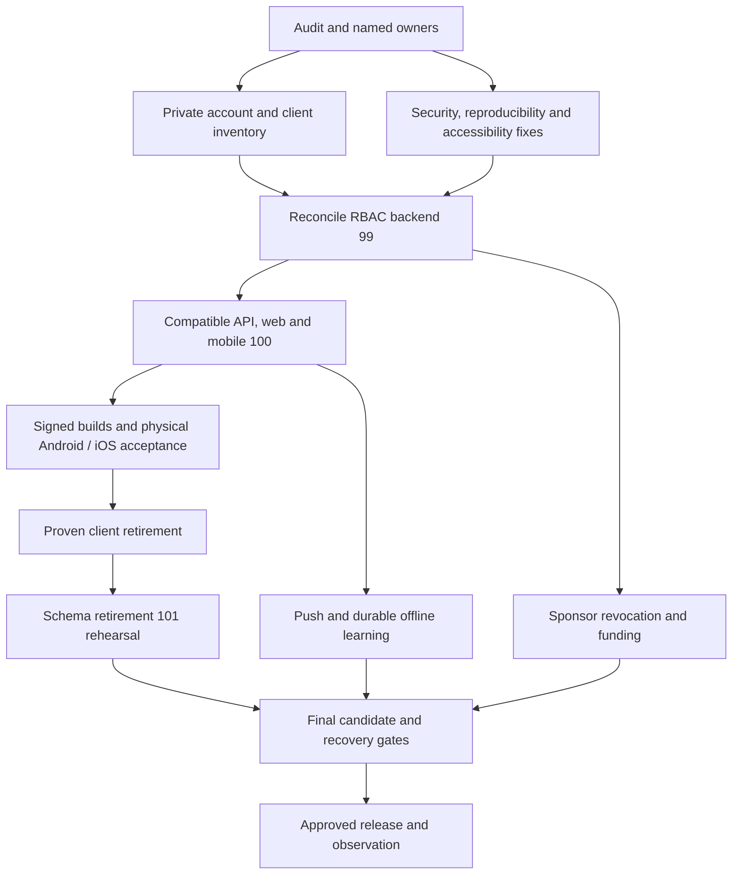

# LMS completion plan — 5 November 2026

Status: implementation plan committed; remediation and release acceptance remain open.

Baseline: main `e1929c2c401511a793d03526391a3bb9e8d96ac1`. Evidence: [audit](../audits/2026-11-05-lms-completion/AUDIT.md). Execution state: [task backlog](LMS-COMPLETION-BACKLOG-2026-11-05.json). Entry point: [completion status](LMS-COMPLETION-STATUS.md).

## Direction and completion commitment

Finish the existing LMS through small, independently reviewable changes. Reuse the implemented RBAC migration chain; make current server grants plus resource scope the sole authority; retain native student learning with explicit web handoffs for other workspaces; finish funding through verified, reconciled ledger operations. Do not introduce a second identity authority, parallel permission system or replacement LMS.

This plan includes every gap in the audit, including push and durable offline learning. Those two are later product milestones, not reasons to declare the current audit closed. A narrower launch can be approved with named residual tasks, but that does not mean “all outstanding tasks complete.” An unavailable funding method, a waived advisory or a filled attestation template also does not close its underlying implementation/acceptance task.

A task is complete only when its implementation, meaningful passing tests and relevant operator/device/provider evidence are linked in the backlog. This documentation commit closes audit capture only. It does not claim to fix the 13 RBAC targets or approve a migration, deployment, device build or financial operation.

## Architecture decisions

1. **One identity and authorization path.** AmmaWallet verifies identity; the LMS owns its explicit role assignments and resource scopes. User identity, learner profile, RBAC role and workspace are distinct. An operation needs the current capability AND its course/cohort/tenant/family/ownership scope. Custom powerful roles do not automatically become canonical platform administrators.
2. **Server-authoritative sessions and clients.** Login and `/auth/me` return consistent effective context. Tokens bind identity and authorization version; clients render returned workspaces/capabilities without inferring authority from legacy text. Role changes, logout and revocation cannot resurrect prior account state. Mobile-to-web handoffs carry no bearer token.
3. **Expand, migrate, contract.** Add compatible contracts and explicit provisioning first; accept inventory and old-client retirement evidence; remove schema compatibility last. Never recreate revoked grants from legacy labels. Preserve AUTH-14 writer controls, completion evidence, FK checks, financial invariants and image/schema compatibility.
4. **Verified money movement.** Keep the current XLM/stroops reward accounting. Provider callbacks are signals to verify, not permission to credit. Funding uses integer amounts, immutable intents, unique evidence consumption, transactional reservations/ledger writes and a durable outbox. Course tuition and reward funding remain separate domains.
5. **Native scope stays coherent.** Continue student learning and account controls in native screens; sponsor/admin/teaching/family/employer workspaces use the responsive web portal. A native sponsor-dashboard rewrite is not required to close this audit. Push/offline capabilities extend the native student app.
6. **Evidence belongs to an exact candidate.** Each result identifies source SHA, lockfiles and, where relevant, image IDs, schema, binary hash, provider target and device. A JavaScript export is not a signed binary or physical-device result.

## Delivery sequence and gates

Implementation tracks can proceed independently when their dependencies permit; this is not an instruction to create parallel agents. Proposed owner roles below must be mapped to actual people at kickoff.

| Wave | Work | Exit gate |
|---|---|---|
| 0 — Establish control | Publish audit/backlog; identify named owners, staging targets, devices, provider accounts and private evidence locations | Versioned baseline and resources recorded; no invented acceptance |
| 1 — Remove immediate defects | Reproducible fixtures, writer-hold portability, dependency cleanup, phone accessibility and deterministic tests | Relevant Linux/Windows regressions pass; mobile high/critical findings zero |
| 2 — Finish RBAC | Inventory → reconcile #99 → compatible #100 → installed-client acceptance → reconcile #101 | 13 ordinary target assertions pass; migration and recovery contracts accepted |
| 3 — Finish sponsor/provider behavior | Actual revocation lifecycle, quantitative reports, browser acceptance, account/provider integration and funding | Owned data reconciles; supported sources verified end-to-end; unsupported paths remain unavailable until implemented |
| 4 — Prove native operation | Pinned signed builds, physical Android/iOS, review and distribution/upgrade checks | Every required group has reviewed evidence from the correct binary |
| 5 — Complete remaining mobile features | Push delivery and durable offline learning/progress | Device tests pass, including isolation, process kill, retry and revocation |
| 6 — Release and close | Final candidate validation, exact-image/protected-copy rehearsal, approved releases, observation and evidence reconciliation | Final release gates pass; every backlog row has closure evidence |

Waves 1 and sponsor fixture design can begin immediately. Account inventory can start while code is being reconciled, but no cutover may bypass its decisions. Wave 4 may validate the compatible RBAC client before schema retirement; any later change affecting native behavior requires a new pinned binary and rerun acceptance. Final release validation covers the finished Wave 5 product.

The critical dependency path is:

## Wave 1: make the baseline trustworthy

### Reproducible tests and platform behavior

- Export fixtures using raw Git blobs or an export configuration that preserves exact bytes. Record source and lockfile hashes. The audit's initial CRLF export caused fixture failures; its corrected migration retest passed those groups. The public API health contract is `/api/v1/health`; smoke/monitor checks must validate JSON and build SHA, not accept an HTML HTTP 200.
- Replace newline-sensitive SQL fixture removal with deliberately constructed old-schema fixtures or tested newline-independent fixture generation. Preserve strict production DDL validation. Run the fixture tests against LF and CRLF input.
- Fix `isWriterHoldActive()` so an `ENOENT` is treated as “no hold” only after validating the containing directory exists and is a usable directory. Missing, non-directory, unreadable and ambiguous parent states count as held. Keep production paths derived from the database location. Document TOCTOU limits and rely on stopping old writers before engaging/releasing the candidate hold; do not claim this helper locks in-flight requests.
- Preserve the real Windows invalid-parent regression and Linux behavior checks. Do not skip the test or simply return false on every filesystem error.

### Dependencies

Resolve the 9 mobile high findings first, then the 25 moderate/9 low mobile and 5 moderate API findings. Web was clean at the audit baseline; it must remain clean.

Inspect direct/transitive occurrence and runtime versus tooling exposure. Use reviewed compatible refreshes where possible. If Expo 54 cannot resolve a remaining chain, create a dedicated coherent Expo/Router/React Native upgrade candidate, follow the repository's versioned Expo documentation requirements and rebuild native binaries. Keep EAS package/config pins aligned. Do not force arbitrary majors into incompatible dependency APIs or treat a lower audit threshold as remediation.

Acceptance requires a fresh full-graph audit with no unresolved findings for final all-gaps completion. An external patch dependency must be recorded with an owner and next review; it remains open even if a limited release accepts the risk. Repeat offline tooling/profile validation, normal native tests/typechecks and both exports on each changed graph; signed-build/device acceptance follows for the selected candidate.

### Accessibility and test reliability

Give Search, Logout and other icon-only controls stable accessible names independent of CSS visibility. Check focus, modal closure, phone navigation, scrollable sponsor tabs/tables and keyboard access at 320/390/768px. Retain text labels at wider widths.

For cold failures, fix unresolved promises/mock isolation in session tests and fixture/server/route readiness in E2E. Use condition-based readiness, a built-web E2E lane and isolated seeded databases. Keep one real login-through-UI test plus permission-boundary cases. Require three consecutive fresh-process passes at standard deadlines with retries disabled. A focused warm pass or permanently increased timeout is not the closure criterion.

## Wave 2: complete RBAC with the existing implementation

Current PR status was refreshed while preparing this plan:

| Step | Existing work | Current fact | Required action |
|---|---|---|---|
| Inventory | #98, merged | Production account/client decisions are not supplied by local tests | Run finalized private snapshot inventory and review exceptions |
| Backend | [#99](https://github.com/SM-Web-Systems/lms-crypto-production/pull/99), head `360aa01` | Open, conflicts reported; base is still the old inventory branch | Reconcile/retarget against current main and review actual resolved diff |
| Clients | [#100](https://github.com/SM-Web-Systems/lms-crypto-production/pull/100), head `9bb88b0` | Open on #99's branch | Reconcile after backend; preserve backward compatibility until retired clients are proven |
| Schema | [#101](https://github.com/SM-Web-Systems/lms-crypto-production/pull/101), head `b8015e2` | Open on #100's branch | Reconcile last; rehearse offline contraction and compatible recovery |

Mergeability against an old parent does not establish readiness against current main. Earlier PR CI is historical evidence, not a replacement for new exact-candidate checks. Reuse and review these implementations rather than copying whole stale branches over current release/migration code.

### Inventory and policy

Use a consistent finalized snapshot and the existing read-only inventory tool; keep account-level details private. Review zero/multiple/custom grants, deliberate revocations, canonical administrators, deletion state, learner-profile links and resource ownership. Record actual deployed schema, legacy endpoint usage and installed client versions. Do not “repair” a legacy/RBAC disagreement by unioning legacy privileges into live grants.

The 13 mandatory target contracts are:

| Contract group | Required behavior | Count |
|---|---|---|
| Teaching eligibility | Current instructor and delegated teaching capabilities work; legacy lecturer text without grants does not | 3 |
| Certificate self-application | All self-applicants need current learning eligibility plus enrollment, including legacy admin/lecturer labels; zero-grant applicants denied | 3 |
| Broadcast audiences | Current sponsor/instructor/enhanced-student grants determine distinct recipients | 3 |
| Learner profile in login | Multi-role password login resolves the actual learner ID independently of legacy text | 1 |
| Initial provisioning | Wallet student/instructor creation and public registration assign explicit server-selected grants without the legacy trigger | 3 |

Convert expected-failure targets to ordinary assertions as each behavior lands. Preserve caller capability/scope checks, transactional user/grant/profile creation, audit, last-admin/escalation safeguards and session invalidation. Repeat restart/SSO scenarios to prove revoked grants do not return.

### Compatibility and contraction

First release compatible effective-context/role-summary contracts and explicit provisioning; keep temporarily required response compatibility derived only from current RBAC. Then deliver web/mobile role badges, current learner membership and supported messaging behavior. Accept previous installed binaries and establish minimum supported builds before contracting schema.

After client retirement evidence, rehearse the exact #101 successor migration on a protected copy of the actual supported post-AUTH-14 source schema. Retained grants, sessions/history, values, FK baseline, completion evidence and schema objects must match the reviewed contract. Prove refusal on unknown/drifted schemas and old-image/new-schema pairs. No grant inference, trigger resurrection, live initialization or stale-backup replacement is a migration strategy.

There may be compatible backend, client and schema releases rather than one large deployment. Every intermediate release uses the exact-candidate/recovery procedure below. Task LMS-014 covers implementation/rehearsal; live contraction happens only inside an authorized release window. After v2 writes, recovery requires a proven v2-compatible image or an explicitly reconciled restore decision.

## Wave 3: finish sponsor and provider workflows

### Authorization and report truth

Replace the misleading SPNS-E2E-10 scope-only claim with a lifecycle test: sponsor can read owned cohort/impact/billing/receipt; administrator revokes the relevant grant or ownership through a real supported action; the same session and a fresh login then lose the affected access. Accept 401/session invalidation or a scoped 403 according to the current contract, never a stale authorized response. Another sponsor's access must remain unchanged. Test ownership change and role revocation separately where both affect access.

Build independent expected SQL/ledger totals for fixtures containing multiple cohorts, overlapping learner membership, multiple courses, partial/full/zero completion, certificates, member versus sponsor payments, multiple currencies, refunds and date boundaries. Deduplicate within defined cohort/report semantics; never add different currencies into one unlabeled total. Define UTC storage and explicit report date/timezone boundaries, inclusive/exclusive range semantics, and their CSV equivalents. Verify downloaded files and authorization, including CSV formula safety and receipts.

Execute the existing manual pack on pinned staging in Chrome, Firefox and Safari; cover keyboard/screen reader, phone widths, empty/error/retry, filtering and downloads. Compare API/UI/CSV totals against independent expectations. Signed-off representative staging evidence closes this work; deterministic laptop examples alone do not.

### Concrete funding solution

Preserve the existing reward ledger, unique-reference constraints, ownership checks, reservations and outbox. Add a durable funding-intent/verification/settlement workflow rather than bypassing the current safe refusals.

- **Intent:** bind reward, owning actor, source, provider transaction identity, network, destination, asset/currency and integer amount. Define expiry and immutable server-owned metadata; client-supplied amount/email/reference alone is not proof.
- **Verification and commit:** verify outside the SQLite write transaction; inside one transaction re-read authoritative ownership/permissions/state/amount, consume the unique evidence, reserve available backing, append ledger entries and persist outbox work. Retries/restarts/reordered webhooks must converge on one outcome. Track “received,” “awaiting settlement,” “verified,” “funded,” “failed” and “reconciliation required” with explicit transitions mapped onto existing reward states.
- **Stellar:** implement the missing verifier for a successful finalized operation on the exact configured network, native asset, approved recipient and required stroops. Bind the operation to the intent and consume its identity uniquely; do not credit the same transaction/operation twice or accept a transaction hash merely because it exists. Check relevant confirmations/finality and provider timeout/retry behavior before credit. Start on testnet.
- **Platform credit:** add audited, independently authorized, backed credit provisioning with available/reserved/consumed accounting. No balance may be created by trusting a caller or funded twice; preserve separation from the existing independently authorized admin-grant path.
- **Company reserve:** use the verified Stellar backing and independently approved platform credit flow for company-funded learner rewards and bounded smart-contract fee support. Cap the pilot budget, verify each backing deposit, reserve against approved obligations and reconcile allocations and distributions against the reserve. Paystack course payments stay separate from reward balances.
- **Availability:** return server capability/availability metadata so portal funding controls explain actual source availability. This improves truthfulness but does not close an unimplemented funding task.

The owner identified SM Web Systems as the company treasury and provided a treasury wallet and operations contact privately. Keep registration and contact details in restricted operations records. Keep the treasury wallet separate from the LMS direct-funding receiver. The direct-funding flow can display its configured receiver to authorized funders. Stellar Mainnet exposes account balances and transaction history. [Stellar account API](https://developers.stellar.org/docs/data/apis/horizon/api-reference/resources/accounts)

Rehearse contract deployment and invocation on Stellar Testnet. Before a real-XLM pilot, confirm wallet control, independent initiation and approval, pilot budget and per-learner limits, and an approved reconciliation procedure. Have qualified South African counsel review the actual grant and fee-support flow before enabling it. [Stellar networks](https://developers.stellar.org/docs/networks) · [Stellar transaction fees](https://developers.stellar.org/docs/learn/fundamentals/fees-resource-limits-metering) · [FIC crypto service provider guidance](https://www.fic.gov.za/accountable-institut/crypto-asset-service-providers/)

Defer Paystack-to-XLM conversion beyond the MVP. Reopen it only with an approved execution and custody arrangement, written Paystack confirmation for the exact flow and applicable legal review. A later integration must prove XLM delivery separately from fiat payment, preserve the accepted quote and fees, and reconcile expiry, refunds, reversals and duplicate callbacks. [Paystack eligibility](https://support.paystack.com/en/articles/2127042) · [Paystack South Africa terms](https://paystack.com/za/terms)

Separately validate the existing course-payment flow, authenticated checkout, signed/duplicated/reordered webhooks, refunds, receipts and reconciliation in a provider sandbox. Verify Wallet SSO, verified email, CAPTCHA/2FA and recovery with authorized staging accounts and captured email/SMS arrangements. A production enablement receipt remains distinct from sandbox or mocked tests.

## Wave 4: physical devices and distribution

Use signed Android ARM-capable and iOS installed builds, not the local x86 emulator debug APK, Expo Go or JavaScript exports. Prepare reachable authorized staging endpoints and the exact `lmsmobile` callback scheme; record app SHA, build ID, artifact hash, API/Wallet SHA, device/model/OS, tester and time.

On **both physical Android and physical iOS**, execute every current acceptance group:

1. Wallet SSO, cancellation, verified-identity recovery, CAPTCHA and configured second factor.
2. Warm/cold callback lifecycle, PKCE/state, replay/forgery, app kill and foreground.
3. Session restart, offline/503 storage retry, expiry/revocation and delayed logout/login races.
4. Role and multi-role workspace handoffs, including denied/pending-deletion cases and no token in web URLs.
5. Authored text/image/document/audio/video/YouTube, quiz and assignment behavior.
6. Resume/progress persistence, acknowledged completion, failure/retry and submission idempotency.
7. Account/session/export/deletion/cancellation controls with disposable accounts.
8. Certificates, document/share permissions, OS back behavior, keyboard/safe area, large text, TalkBack/VoiceOver.

Use the current [acceptance guide](mobile-device-acceptance-followup.md) and [report template](../../LMS-Mobile/acceptance/device-report.template.json). Run the completeness checker against the approved app SHA; an independent reviewer must inspect actual evidence. Its `hardware_verified:false` output is an attestation-completeness result, not hardware verification.

Test upgrade from the actual supported previous build and document the minimum-build condition used by RBAC contraction. Keep signing keys/provider credentials outside Git. Record approved distribution artifacts and revoke obsolete test artifacts. Windows cannot substitute for macOS/Xcode/iOS signing/device acceptance.

## Wave 5: finish push and durable offline learning

### Push

Server and native implementation have local validation receipts. Signed builds, APNs and FCM configuration, physical devices and the RBAC and Wallet acceptance dependencies remain open. [LMS-050](LMS-050-PUSH-NOTIFICATIONS.md)

Add the SDK-compatible Expo notifications client with APNs/FCM configured for signed builds, plus a server delivery adapter and durable event outbox. Bind registration to user + installation, authenticate updates and remove/rebind tokens on logout/account switch. Reauthorize resource access when a notification is opened. Use minimal nonsensitive payloads, provider receipts, deduplication, backoff and invalid-token cleanup. Denied permission must not break the app.

Acceptance includes foreground/background/terminated app, token rotation, multiple devices, account switching, revocation, duplicate delivery, provider outage and deep links on both physical platforms. Store success events and delivery evidence separately from business-operation acknowledgement.

### Offline content and progress

The gated server lease and progress contract, native encrypted storage and the queue have local validation. Owner policy and signed physical-device acceptance remain open. [LMS-051](LMS-051-OFFLINE-LEARNING.md)

Use a versioned per-account cache and a durable local queue, rather than the mounted reader's in-memory retry list. Scope records by identity, course/lesson and content version. Protect private storage using platform-backed keys and a reviewed compatible storage/encryption implementation; do not invent cryptography. Clear or quarantine the previous account's data on sign-out/switch.

Each queued progress mutation carries a stable idempotency key and relevant content/enrollment version; the server reauthorizes on sync. Merge progress with explicit monotonic rules and acknowledged completion. Passing quizzes, instructor approval, minting and financial actions remain server-authoritative. Persist “pending sync,” retries and terminal denial visibly; never display final completion from an unacknowledged write.

Offline authorization has an unavoidable revocation delay. Use an explicit bounded server-issued offline-access lease; the owner must approve its TTL/content policy before enablement. Expired/unknown leases block protected cached content. On reconnection, current server revocation wins and prohibited data/work is cleared or denied. Do not promise instantaneous offline revocation.

Test airplane mode, process kill/reboot, content version replacement, enrollment/role revocation, expired session/lease, conflicting or duplicated progress, account switch, low storage and eventual successful sync on physical Android/iOS. LMS-051 remains open until this durable behavior is accepted.

## Wave 6: candidate, migration and release control

Apply this procedure to each intermediate RBAC release and again to the final complete product:

1. Pin reviewed source and lockfiles. Require a full ordinary backend run, web/native tests, E2E, typechecks/builds/bundles, dependency audits and monitoring/recovery checks on the final candidate. Run Windows portability and Linux production lanes; a focused rerun alone cannot certify the whole final release. Retire every authorization `it.fails`; explain each platform/private-input skip and run the private-input checks where their evidence exists.
2. For release acceptance, require clean first-pass cold tests as specified above; do not erase initial failures when recording retries. Record new signed binaries and rerun all required physical groups after final feature/contract changes.
3. On the server, verify real deployed images/schema/volumes/writers/configuration read-only. Inventory seed/default account state privately; do not test known passwords against production. Take a consistent private WAL-safe backup and prove restoration and recoverability outside the host.
4. Build and preserve exact candidate/recovery image IDs with revision/schema labels. Rehearse all required migrations and old/new image/schema combinations against protected copies, with real providers disabled. Validate integrity/FKs, retained financial/completion history, writer-hold behavior and recovery refusal paths. No production initialization or unexplained historical-row deletion.
5. Produce the exact policy, compatibility review, final writer-control procedure, maintenance plan and recovery/reconciliation decision tree. Monitor state and log limits must follow the approved release identity. Do not use a “prepare” mode as a supposedly read-only inspection.
6. Only at an authorized maintenance window: quiesce every writer, create/verify the final backup, execute only rehearsed migrations and image transitions, verify the held state, then run the approved release/unhold procedure. Live provider actions/signing/charges are separate explicit operational steps with the relevant owner.
7. Verify JSON health/build/images, auth/session/revocation, role/scope boundaries, courses/progress, sponsor totals/downloads and configured provider behavior. Observe the new SHA with an agreed 24-hour monitor window. Rehearse failure handling; refuse an incompatible rollback rather than forcing old code onto a contracted schema.
8. Link implementation and evidence to every task; update current status and mark older October CI/role handovers historical. Review the disposition of draft #62 and documentation #102/#103 without blindly merging planning branches.

No secrets, real account inventory, production snapshots, financial customer rows, signing material or bearer-token traces belong in this Git evidence folder. Public closure records reference private receipts by safe IDs and hashes.

## Ownership, prerequisites and first actions

Proposed accountable roles: delivery lead for sequencing and evidence; API lead for policy/data/funding; web lead for portal/accessibility; mobile lead for dependencies/native/push/offline; QA for independent acceptance; platform owner for private inventory, signing/provider targets, images/backups and authorized releases. Names and operational access remain to be assigned; this plan does not pretend they are already allocated.

Record at kickoff:

- Named owners and a common review/merge process for #99–#101.
- Reachable staging LMS/Wallet plus synthetic course/sponsor/student/staff accounts and mail/SMS capture.
- Physical Android and iOS testers/devices and macOS/signing capability.
- Protected-snapshot inventory and supported installed-client records.
- Treasury control, approval, limits and reconciliation for LMS-033, and offline lease and content policy for LMS-051.
- Private evidence storage, off-host recoverability, release/monitoring owner and maintenance authority.

Start with separate reviewable changes for **LMS-002 + LMS-003**, **LMS-004**, **LMS-006**, and **LMS-007**; prepare LMS-010 inventory in the same period. Draft LMS-020/021 tests before reconciling the revocation behavior so they constrain the implementation. Then reconcile #99 against the actual current main and continue through the gated sequence.

Do not attach fixed completion dates until owners, devices, staging and settlement inputs are assigned. Track engineering completion, staged acceptance and production release as separate milestones; external prerequisites remain visible instead of being silently marked done.

## Complete work breakdown

The JSON backlog is the state authority; this initial table is a reading view. Dependencies describe closure requirements, not a ban on preparing an independent test/spec early.

| ID | Deliverable | Proposed accountable role | Closure dependencies | Initial state |
|---|---|---|---|---|
| LMS-001 | Preserve audit and establish current evidence index | Delivery lead | — | Audit captured |
| LMS-002 | Make audit and migration fixtures reproducible across platforms | API + QA | LMS-001 | Open |
| LMS-003 | Fix Windows writer-hold invalid-path handling | API + Platform | LMS-002 | Open |
| LMS-004 | Resolve mobile high/critical dependency findings | Mobile | LMS-001 | Open |
| LMS-005 | Resolve remaining API/mobile moderate and low advisories | API + Mobile | LMS-004 | Complete. [Verified local and hosted audit gates](LMS-005-REMAINING-ADVISORIES.md). |
| LMS-006 | Fix mobile web accessible names and navigation usability | Web + QA | LMS-001 | Open |
| LMS-007 | Stabilize cold mobile session and admin E2E tests | QA + API + Mobile | LMS-002 | Open |
| LMS-010 | Complete private production account/schema/client inventory | Platform owner | LMS-001 | Open |
| LMS-011 | Reconcile and implement RBAC backend cutover (#99) | API | LMS-010, LMS-003 | Open |
| LMS-012 | Reconcile and implement RBAC web/mobile contracts (#100) | Web + Mobile | LMS-011, LMS-004 | Open |
| LMS-013 | Prove client retirement and schema-recovery readiness | Platform + Mobile + QA | LMS-012, LMS-043 | Open |
| LMS-014 | Reconcile and rehearse legacy schema retirement (#101) | API + Platform | LMS-013, LMS-061 | [Synthetic rehearsal passed](LMS-014-SCHEMA-RETIREMENT-REHEARSAL.md). v2 compiled rehearsal passed. Installed-client retirement and protected-copy acceptance remain open. |
| LMS-020 | Implement real sponsor access-revocation lifecycle coverage | API + QA | LMS-011 | Open |
| LMS-021 | Build quantitative sponsor reporting and billing acceptance pack | API + Web + QA | LMS-001 | Open |
| LMS-022 | Execute sponsor staging and cross-browser/accessibility acceptance | QA | LMS-006, LMS-020, LMS-021, LMS-012 | Open |
| LMS-023 | Verify integrated Wallet/account and course-payment providers | API + QA + Platform | LMS-012, LMS-030 | Open |
| LMS-030 | Implement durable reward funding intents and availability contract | API | LMS-011 | Open |
| LMS-031 | Implement Stellar funding verification | API + Platform | LMS-030 | Open |
| LMS-032 | Implement backed platform-credit provisioning | API + Platform | LMS-030 | Open |
| LMS-033 | Accept company-funded MVP treasury and rewards | API + Platform + Product owner | LMS-030, LMS-031, LMS-032 | Treasury details supplied privately. Operating controls and acceptance are open. Paystack conversion is deferred. |
| LMS-034 | Accept complete reward funding lifecycle | QA + Platform | LMS-031, LMS-032, LMS-033, LMS-023 | Open |
| LMS-040 | Prepare pinned signed mobile acceptance builds | Mobile + Platform | LMS-004, LMS-007, LMS-012, LMS-023 | Open |
| LMS-041 | Run physical Android acceptance | QA + Mobile | LMS-040 | Open |
| LMS-042 | Run physical iOS acceptance | QA + Mobile | LMS-040 | Open |
| LMS-043 | Approve installed-client compatibility and distribution | Mobile + QA + Platform | LMS-041, LMS-042 | Open |
| LMS-050 | Complete push notifications | Mobile + API | LMS-012, LMS-023 | In progress. Server and native validated locally. Signed device acceptance open. |
| LMS-051 | Complete durable offline learning and progress sync | Mobile + API | LMS-012, LMS-030 | In progress. Server and native validated locally. Owner policy and signed device acceptance open. |
| LMS-060 | Run complete reconciled release-candidate validation | QA + Delivery lead | LMS-002, LMS-003, LMS-005, LMS-006, LMS-007, LMS-014, LMS-022, LMS-034, LMS-043, LMS-050, LMS-051 | Open |
| LMS-061 | Rehearse exact images, migrations and recoverability | Platform owner | LMS-010, LMS-011 | Open |
| LMS-062 | Execute guarded release and observation | Platform owner | LMS-060, LMS-061 | Open |
| LMS-063 | Reconcile historical documentation and close completion ledger | Delivery lead + QA | LMS-062 | Open |

## Definition of all outstanding work complete

Validate the committed packet offline with `python docs/release/verify_lms_completion.py` from the repository root. This checks the task dependency graph, required closure-evidence paths, local document links and committed evidence hashes. It does not run the application tests or verify external/device attestations.

Every backlog task is closed with implementation reference, exact-candidate passing checks, appropriate staging/device/provider evidence, an accountable reviewer and release record. The 13 RBAC targets pass normally; the dependency graph has no unresolved findings; all promised funding paths, native device flows, push and offline behavior work as specified; production migration/recovery and observation have receipts. Remaining provider/device inputs or accepted temporary restrictions stay recorded as outstanding. Documentation and local tests alone do not satisfy this definition.
