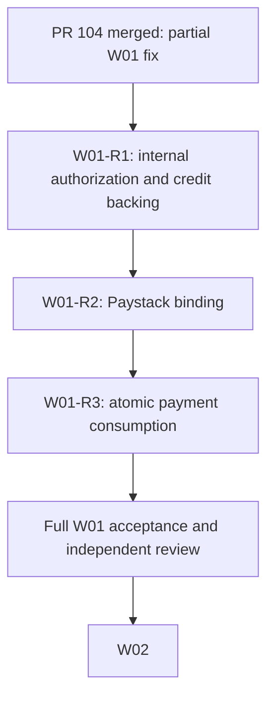

# S2/W01 review correction and bounded repair handover

Date: 2026-10-27. Review decision: **CHANGES_REQUIRED — W01 partially fixed**.

This is a laptop review of the reported W01 completion, not a production exposure assessment. Claude owns server execution and merges. The owner has delegated approvals to AI; the [bounded-stage controller](CLAUDE-SERVER-AI-APPROVAL-STAGE-CONTROLLER.md) still applies. Do not start W02 until the remaining W01 acceptance criteria are satisfied.

## Reviewed evidence

- [PR #104](https://github.com/SM-Web-Systems/lms-crypto-production/pull/104) is merged. Head: `3088cb1e65536bc2e4dd1866754c7fd2a795dff2`; base: `5668fd8deea8531196e9c7e0a19ff55afb744de1`; merge: `115d8c4f836a059aff733bb4cdeaabc9750963f2`.
- [CI run 40476416544](https://github.com/SM-Web-Systems/lms-crypto-production/actions/runs/40476416544) has four successful jobs. Backend job `122095642490` reports **180 files passed; 1,827 tests passed, one skipped**. `dependency-security.test.ts` passed all three tests. The reported one-failure description does not describe this hosted run; any separate local failure needs its own evidence.
- Approved W01 spec reviewed at planning commit `fca5d08b1472c873582298d0511327b1301bc7db`, [PR #103](https://github.com/SM-Web-Systems/lms-crypto-production/pull/103). It explicitly requires Paystack amount/currency/status verification, sufficient platform credit and preventing reference reuse across rewards.
- Established internal-funding policy: [reward foundation spec, section 5](../superpowers/specs/2026-08-13-reward-foundation-spec.md), especially lines 486–515: `reward.manage`, independent authorization for internal sources, audit evidence and confirmed payment evidence for Paystack.

Stellar denial, rejecting synchronous Paystack funding and rejecting unknown source types are useful changes. They do not close the following requirements. Do not blindly revert the merged improvement.

## Blocking findings

| Repair unit | Priority | Evidence on merged source | Required outcome |
| --- | --- | --- | --- |
| W01-R1: internal-source authorization and backing | P1 | [`rewardFundingVerifier.ts:62`](https://github.com/SM-Web-Systems/lms-crypto-production/blob/115d8c4f836a059aff733bb4cdeaabc9750963f2/LMS-Server/src/services/rewards/rewardFundingVerifier.ts#L62) and lines 110–114 pass through `platform_credit` / `admin_grant`. [`sponsor.ts:275`](https://github.com/SM-Web-Systems/lms-crypto-production/blob/115d8c4f836a059aff733bb4cdeaabc9750963f2/LMS-Server/src/routes/sponsor.ts#L275) requires only `reward.fund`. Funding then credits/reserves the ledger without the required independent grant authorization or credit backing. | Enforce policy in the shared service for sync/async and every route. Require independently authorized, auditable grants and atomically consume/reserve approved available credit. Unsupported backing must fail closed. |
| W01-R2: Paystack payment binding | P1 | [`rewardFundingVerifier.ts:139`](https://github.com/SM-Web-Systems/lms-crypto-production/blob/115d8c4f836a059aff733bb4cdeaabc9750963f2/LMS-Server/src/services/rewards/rewardFundingVerifier.ts#L139) accepts any result with `status === 'success'`. Expected amount/currency, payment ownership and the intended obligation are absent from the verifier context. | Match authoritative payment evidence to the funding obligation, including expected amount, currency and ownership under the established policy. Do not compare fiat minor units directly with XLM stroops or invent an exchange rate; unsupported settlement fails closed. |
| W01-R3: atomic reference consumption | P1 | [`rewardFundingVerifier.ts:89`](https://github.com/SM-Web-Systems/lms-crypto-production/blob/115d8c4f836a059aff733bb4cdeaabc9750963f2/LMS-Server/src/services/rewards/rewardFundingVerifier.ts#L89) checks reuse before awaiting the provider. [`rewardService.ts:191`](https://github.com/SM-Web-Systems/lms-crypto-production/blob/115d8c4f836a059aff733bb4cdeaabc9750963f2/LMS-Server/src/services/rewards/rewardService.ts#L191) then proceeds to the write transaction without an atomic reference claim/recheck. Distinct idempotency keys do not protect one provider payment from concurrent consumption. | After provider verification, atomically validate/claim the payment and commit state/ledger changes. Exactly one of concurrent competing rewards may consume it. Preserve legitimate retries and rollback. Any constraint/migration must account for existing duplicates and restore compatibility. Keep network awaits outside SQLite transactions. |

The earlier advisory labels do not override these acceptance criteria. A1 and A4 are blocking omissions. A3 is more than an optional index: the current async flow has a reuse race. A2 (information disclosure) and A5 (duplicated interface) can remain separately tracked follow-ups unless further evidence changes their severity.

The planning spec also names `reward.admin_grant`, which does not exist in this reviewed server. Reconcile it with the established `reward.manage` and independent-authorizer policy before implementation. Adding a new permission name alone would not enforce that policy.

## Verification limits and reproduction packet

Independent AI source/spec review confirmed all three blockers. No production database, deployed image, real provider transaction or live account was tested, and merged status does not establish deployed exposure.

Independent review of this handover and its R1 prompt: **spec compliance PASS; technical quality PASS; no actionable findings**. This approves the review packet's accuracy and bounded instructions, not W01 implementation readiness. Relative links resolve and Markdown fences balance; the Mermaid source has not been renderer-tested.

The [three proposed characterization probes](../audits/2026-10-27-w01-handoff-review.probe.test.ts.txt) are inert documentation. Their assertions deliberately expect vulnerable behavior: role-only sponsor self-credit over HTTP, a mismatched one-unit Paystack payment funding an XLM reward, and concurrent reuse of one reference. A passing probe would demonstrate a defect, not security acceptance.

Local test attempt: extracted server source at merge `115d8c4`, with a junction to the installed dependency tree; its package lock matches the existing candidate and dependency declarations are unchanged. Used an in-memory database and mocked Paystack verification. Vitest failed before executing tests: first `EPERM` renaming its temporary SSR cache, then `Cannot find module .../LMS-Server/stream` from `vitest/dist/module-evaluator.js`. **Zero probes executed; no dynamic reproduction result is claimed.** Run these characterizations in a clean isolated server/CI workspace before repair, then invert them into meaningful acceptance tests. Do not copy production secrets or use a live database.

## Stage ledger correction

Claude should update the authoritative staged index/tasks/evidence on the planning branch:

- Preserve the #104 merge receipt and successful CI evidence.
- Replace W01 Fixed / S2-T01 complete with **PARTIALLY_FIXED / CHANGES_REQUIRED**.
- Add W01-R1, R2 and R3 with the requirements above, review evidence and dependencies. Keep W02 pending W01 closure.
- Correct the hosted test count and distinguish any independently evidenced local failure.
- Record that this review and packet do not mutate server state or prove production exploitation.



R1, R2 and R3 are bounded work units, not permission requests. The next run executes **R1 only**. Cross-cutting decisions discovered in R1 should be recorded for R2/R3 without starting their implementations. W01 remains partial until all criteria pass.

## Paste into Claude: next bounded unit

```text
Execute S2/W01-R1 only. The owner delegates all approvals to AI; Claude handles merges. Do not start W02, W01-R2 or W01-R3, and do not deploy, migrate production, change live configuration or perform real funding.

Read SERVER-HANDOVER-W01-REVIEW-AND-REPAIR.md from codex/platform-wiring-audit, the staged index/tasks/evidence, W01 spec and reward foundation section 5. Fetch the handover as a document without merging its unrelated base stack. Verify current full main/planning SHAs and reconcile changes since merge 115d8c4f836a059aff733bb4cdeaabc9750963f2. Preserve the PR #104 receipt; reopen W01 as PARTIALLY_FIXED / CHANGES_REQUIRED and record R1–R3. Hosted run 40476416544 reports 1827 passed, one skipped, not one failure.

Use the required Superpowers workflow and Ponytail, Caveman and Ripwire. Check availability and record limitations honestly. Reuse existing specs, correct the nonexistent reward.admin_grant requirement against established reward.manage + independent-authorizer policy, then write a focused R1 developer spec, task checklist and authorization/accounting sequence diagram. Obtain independent AI review of this focused design before coding. Do not invent a credit store or silently preserve unsupported self-credit; where a trusted grant/credit mechanism cannot be established, reject that path and document the unavailable behavior. Do not widen scope to new financial features.

Use an isolated branch/worktree from verified current main and a synthetic database. First reproduce the internal-source gap with a role-only sponsor lacking reward.manage and no approved backing. Write RED acceptance tests before the repair. Enforce internal funding policy in shared service paths, sync and async, not only router middleware. Cover sponsor/parent/teacher/employer routes as applicable, direct service calls, independent authorizer versus creator, revoked permissions, required audit evidence, insufficient/zero credit, exact exposure boundaries, duplicate retries, rollback and atomic credit consumption. Trace every caller. Tests needing a funded reward must use legitimate independent authorization/backing; do not add test-only bypasses or retain self-grant fixtures merely to keep old tests green.

Implement the smallest complete R1 repair. Run focused tests, affected reward suites and required CI/build checks. Obtain independent spec and security review; fix and re-review actionable findings. AI may approve only the exact R1 candidate supported by fresh evidence. Claude may merge an independently complete R1 repair after its gates pass, while W01 remains partial for R2/R3. Green CI alone is not acceptance. Do not reclassify unmet requirements as non-blocking advisories.

Checkpoint the selected unit, branch/head/base, spec decision, RED/GREEN evidence, command results, AI verdict, CI IDs and merge receipt if any. Commit/push authoritative ledger updates. If budget becomes tight, preserve a clean resumable checkpoint and stop launching work; never fabricate completion. Do not create a broader /loop or continue automatically past this unit.

Return UNIT_COMPLETE, UNIT_BLOCKED or CHECKPOINTED, with remaining R2/R3 obligations and exact resume action. STOP at W01-R1's boundary without a routine approval question.
```
