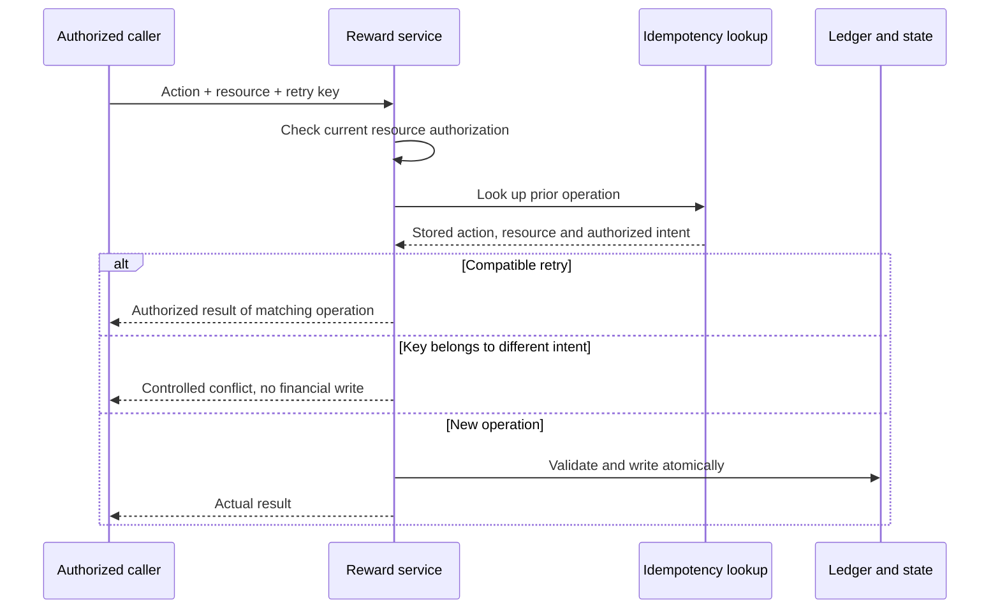
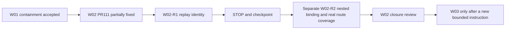

# W02 PR #111 review and bounded correction handover

Date: 2026-10-29. **CHANGES_REQUIRED — W02 is partially fixed, not closed. Next unit: W02-R1 idempotency binding only.** W01 security containment remains accepted. Do not start W03/W04 or deploy.

Follow-up: PR #112 merged at `87a9f40b` and repairs the original three F1 examples. The [PR #112 verification and W02-R1C prompt](SERVER-HANDOVER-W02-R1-PR112-REVIEW.md) is the current next action: complete canonical-intent binding and access-before-replay. F2/F3 remain for W02-R2. The missing planning receipt noted below is now recorded at `faaefc3`; retain this earlier record as historical evidence.

Independent review of this evidence packet and bounded correction prompt: **PASS — no corrections needed**. This approves the accuracy and scope of the handover, not the incomplete W02 implementation.

Repository: [SM-Web-Systems/lms-crypto-production](https://github.com/SM-Web-Systems/lms-crypto-production). Documentation branch: `codex/platform-wiring-audit`. Authoritative planning branch: `codex/staged-rollout-plan`, PR #103. These are branches inside this repository, not repository names. Read this document without merging the unrelated RBAC/documentation base stack.

## Verified baseline and working changes

- [PR #111](https://github.com/SM-Web-Systems/lms-crypto-production/pull/111): merged; feature head `e3ac6d39629cddfd3f86a62e4ca66fbce5103000`, base `1a5326ac1ed2608f11e23d330d4a763ad977798b`, merge/current main `211c556cd1bb6c0586c58d6cd52edebd9425cd28` at review time.
- [Post-merge CI 40828311942](https://github.com/SM-Web-Systems/lms-crypto-production/actions/runs/40828311942): all four jobs SUCCESS. Backend job `123296381883`: **184 files passed; 1,919 tests passed, one skipped (1,920 total)**. The dependency-security suite passes in this hosted run. A separately reported local proxy-addr failure is not a hosted failure or evidence of W02 correctness.
- In actual authenticated HTTP controls on the exact merge, teacher, parent and employer reward detail/allocation/transaction GETs each returned 200 to the scope owner and 404 to an unrelated actor: **18 requests**. The sponsor foreign-parent GET control also returned 404.
- Source review confirms scope checks were added before several lifecycle/replay returns. These close real exposure paths; retain them while correcting the remaining gaps.
- Independent source review agrees with F1–F3 below. This record does not accept the whole W02 stage merely because CI is green.

## Findings still requiring correction

### F1 — P2: retry keys are not bound to the operation and resource

Exact source: `LMS-Server/src/services/rewards/rewardIdempotencyService.ts:12–17`; `rewardService.ts:74–83,119–128,255–264,316–325,512–521,601–611,674–684`.

The transaction lookup checks only key presence. The caller then returns the requested reward/allocation without matching the stored transaction's action or resource. Checking scope on that requested row does not establish that the previous operation performed this request.

Reproduced with actual merged services and synthetic data:

1. Fund reward A using key K; fund draft reward B using K. The call returns B in `draft`, without B funding ledger entries, as though this were a successful retry.
2. Release an eligible allocation using K; refund that same allocation using K. Refund returns the still-`released` allocation without a refund transaction. This is a cross-action collision, not a completed refund.
3. Create a reward in owned scope A using K; create in owned scope B using K. The call returns the reward from A. Both scopes are authorized, but the returned resource does not match the new request.

Bind replay to action, reward/allocation identity, relevant immutable request intent and the authorized context. Reject incompatible reuse with a controlled conflict after appropriate access checks; preserve genuine compatible retries, financial atomicity and legitimate internal authorizer/owner policy. Do not blindly require every replay actor to equal a historical funding admin, nor let a key substitute for current authorization. Examine sync/async funding, creation, cancellation, release/refund and trusted expiry callers. Scope the repair to retry identity; do not implement W03/W04.

### F2 — P2: nested action URLs ignore the reward parent

Exact source: `routes/sponsor.ts:343–348,358–363`, `routes/teacher.ts:299–301`, `routes/parent.ts:347–349`, `routes/employer.ts:401–406,416–421`.

Handlers pass only `allocId`; URL `:id` is unused. An actual authenticated sponsor request to `/sponsor/rewards/<foreign reward>/allocations/<own allocation>/release` returns 200 and releases the owned allocation even though GET on the URL's parent reward returns 404. Missing or mismatched parent IDs therefore do not constrain the action.

The service does authorize the allocation's actual parent. **This reproduction does not demonstrate takeover of a foreign allocation.** It demonstrates broken nested-resource binding required by the W02 handover. Enforce parent identity/access and `allocation.reward_id === requestedRewardId` before mutation or replay; preserve actual-parent authorization at the service boundary. Cover every exposed release/refund prefix and both fresh and replayed keys.

### F3 — P2: route/list test evidence does not prove the claimed behavior

Exact source: `src/__tests__/reward-cross-owner.test.ts:363–478,660–664`.

The tests labelled route-layer call raw getters and `validateScope()` directly; they never exercise route middleware, status codes or response DTOs. They would remain green if the new route checks were removed. Existing sponsor HTTP tests cover that prefix, but do not establish coverage of the new teacher/parent/employer handlers.

The list test wraps native `require('../services/rewards/rewardService.js')` and the intended call in a generic `toThrow()`. A diagnostic using the same Vitest configuration confirms the exception is **`MODULE_NOT_FOUND`**, not `SCOPE_DENIED`; the list operation is never reached. Replace it with a normal import and exact domain-error assertions. Add real authenticated route tests and positive controls. Use role-only fixtures: the current lecturer fixtures also receive `role_instructor` through the schema trigger; remove incidental roles or assert the exact effective permission set.

Retain a test matrix for ordinary roles, recipients, intended admin access, multi-role users, revoked ownership/links, lists, missing/foreign IDs, nested mismatch and retries. Do not claim every existing fixture or raw internal getter is a vulnerability; distinguish trusted internal calls from public endpoints.

### Planning receipts are still missing remotely

At review time `codex/staged-rollout-plan` remains `1639379a4bb5164393708b67e67ebdc182674cc0`: INDEX says W02 pending, TASKS says S2-T02 TODO, and EVIDENCE lacks the #111 merge receipt. Reconcile the authoritative ledgers as **PARTIALLY_FIXED / CHANGES_REQUIRED**, preserving #111's working changes and this review. Do not mark merged implementation as unmerged, or mark W02 FIXED before correction acceptance.

## Evidence and policy limits

- [Runtime reproductions and route controls](../audits/2026-10-29-w02-pr111.probe.ts.txt) ran against an isolated extraction of exact merge `211c556c` with Node v22.18.0, installed lock-compatible dependencies, tsx, `DATABASE_PATH=:memory:`, `VITEST=true`, `NODE_ENV=test` and synthetic credentials. Source blob fingerprints matched the reviewed merge. HTTP listeners were local; no real provider, account, server or database was used.
- [List import diagnostic](../audits/2026-10-29-w02-list-import.probe.test.ts.txt): same candidate's Vitest configuration. Focused merged W02 suite + existing sponsor isolation + diagnostic: **3 files, 40 tests passed**. The isolated verbose diagnostic confirmed the precise `MODULE_NOT_FOUND` error. Diagnostic assertions establish current defects; convert them to intended-behavior RED/GREEN regressions rather than copying vulnerability-accepting assertions into production CI.
- These probes are inert `.txt` artifacts. To reproduce, copy into an isolated exact-source extraction with test dependencies, set synthetic test environment values and run with tsx/Vitest. Never point them at production. They are not a claim of full platform or device acceptance.
- Existing spec preserves scope-validated fresh write behavior and global administrative reads. Do not infer a blanket global admin lifecycle-write permission from `reward.manage` read bypasses. Document consistent operation-specific replay access under the established policy. Resolve the older spec's read/list status wording explicitly; do not silently turn all denials into empty success or broaden privileges.
- W01 safeguards remain in scope for regression protection. Paystack reward funding, Stellar verification and platform-credit provisioning remain unavailable as previously documented. Do not enable them here.

## Staged correction checklist

- [x] Verify #111 merge and actual main CI.
- [x] Independently reproduce F1/F2 on exact merged source, with working route controls.
- [x] Verify the list test's actual exception and inspect route-test limitations.
- [ ] Reconcile INDEX/TASKS/EVIDENCE with #111 and this review.
- [ ] **W02-R1 only:** focused developer spec, TDD, replay identity repair, independent review, fresh checks, merge and ledger receipt. Stop at this boundary.
- [ ] **W02-R2, separate run:** nested binding and effective route/list/role-only coverage, regression matrix, independent review, fresh checks and merge.
- [ ] W02 closure assessment against the original prompt, corrected specs and exact merged evidence. Only then recommend W03; do not auto-start it.





## Paste into Claude — W02-R1 only

```text
Continue W02-R1 ONLY: bind reward idempotency to the actual operation/resource.

Repository: https://github.com/SM-Web-Systems/lms-crypto-production.git
Read docs/release/SERVER-HANDOVER-W02-PR111-REVIEW.md from documentation branch
codex/platform-wiring-audit. That is a branch within this repository, not a
repository name. Retrieve documents without merging their unrelated base stack.
Use the authoritative planning branch codex/staged-rollout-plan (PR #103).

Verified review baseline: main 211c556cd1bb6c0586c58d6cd52edebd9425cd28,
PR #111 merged, main CI green: 1919 passed / 1 skipped. W02 is PARTIALLY_FIXED,
CHANGES_REQUIRED. Revalidate live refs/checks and preserve newer work. W01
security containment remains accepted; do not reopen it absent a regression.

Read the findings/probes in this handover, the prior CLAUDE-SERVER-W02-PROMPT.md,
the planning W02 spec and current ledgers. Reconcile the missing #111 receipt
and review disposition before claiming further progress. Preserve history.

Use using-superpowers, find-skills, brainstorming, writing-plans,
executing-plans and/or subagent-driven-development, test-driven-development,
systematic-debugging, verification-before-completion, using-git-worktrees,
requesting-code-review and receiving-code-review. Use Ponytail, Caveman and
Ripwire with honest availability records. Do not claim absent tools ran or
install unreviewed production hooks/proxies. AI handles approvals; Claude
handles merges after independent review and fresh required checks.

Create/update a focused W02-R1 developer spec and iterative checkbox plan:
actual callers, current RBAC/resource policy, operation/identity fields,
trusted internal callers, genuine retry semantics, conflicting reuse,
legacy-row compatibility, error/privacy contract, transaction boundaries
and a requirement-to-test matrix. Include Mermaid retry/resource diagrams.
Get independent AI design review, resolve findings and proceed autonomously.

First reproduce RED for all three F1 examples: funding A's key on B, refund
using a release key, creation in B using A's key. Also cover cancellation,
different allocations, changed request intent, foreign actors, genuine same
operation retries, sync/async funding and permission/ownership changes.
Use real authenticated HTTP tests for representative exposed replay paths,
not a hand-written imitation of route checks. Static imports and precise
domain errors are required; import/runner failures do not count as RED.
Use synthetic SQLite and role-only fixtures with effective permissions
asserted; internal grants require an independent authorized admin.

Implement the smallest coherent replay repair in shared services. A key
alone must not establish success or access. Authorize actual resources,
match stored action/reward/allocation and relevant canonical request intent,
and reject incompatible key reuse with a controlled conflict. Preserve
legitimate retries, atomic financial writes and W01 reference guards. Enforce
necessary replay checks inside the relevant write boundary, including after
async verification. Do not adopt a caller-controlled skipAuth bypass or
indiscriminately require the historical funding admin for all owner reads.
Keep the established operation-specific admin/system policy explicit.

Run focused RED/GREEN, affected reward/RBAC/worker tests, build and required
fresh candidate CI. Obtain independent code/security review of exact head;
fix valid findings and re-review before Claude merges. Verify resulting
main CI, then commit/push accurate planning ledgers with merge/test receipts.
No predicted passes. Pending checks mean CHECKPOINTED, not UNIT_COMPLETE.

F2 nested-parent binding and broader F3 route/list evidence are tracked for
W02-R2, a separate run. Correct evidence in the R1 tests you touch, but do not
claim those remaining criteria are solved. W02 remains PARTIALLY_FIXED until
R2 and final acceptance. No blanket administrative write-policy expansion.

Use /loop only with verified syntax and only for this unit's bounded
design/test/review/CI loop. Stop/cancel stale monitors at the boundary. Save
spec/tasks, exact SHAs, evidence, remaining findings and precise resume action
before credit/context exhaustion. A genuine blocker should yield a durable
checkpoint, not guesses or repeated human technical-approval prompts.

STOP after W02-R1 with UNIT_COMPLETE or CHECKPOINTED. Recommend W02-R2 only.
No W02-R2 execution, W03/W04, unrelated merge, deployment, live migration,
real funding, production enablement or automatic next-stage progression.
```
