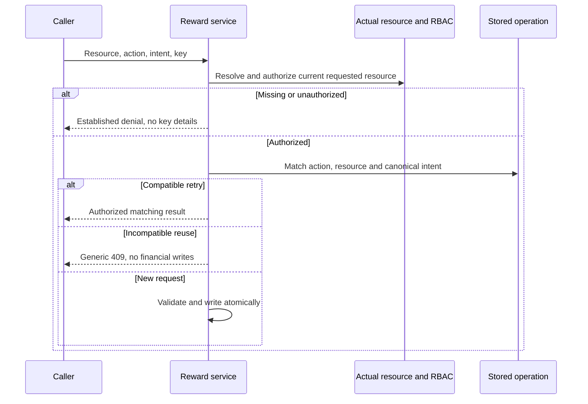

# W02-R1 PR #112 verification and bounded completion correction

Date: 2026-10-29. **CHANGES_REQUIRED for R1 acceptance.** PR #112 is merged and fixes the three original F1 examples, but two explicit requirements of the R1 handover remain. Next unit: **W02-R1C only**, then stop. W02-R2 remains separate. W01 containment remains accepted; W03/W04 and deployment are excluded.

Independent review of this evidence packet and bounded correction prompt: **PASS — no corrections needed**. This approves the handover's accuracy and scope, not the still-incomplete R1 acceptance criteria.

Repository: [SM-Web-Systems/lms-crypto-production](https://github.com/SM-Web-Systems/lms-crypto-production). Documentation branch: `codex/platform-wiring-audit`. Planning branch: `codex/staged-rollout-plan`, PR #103. Branch names are not repository names. Retrieve these documents without merging the unrelated documentation/RBAC base stack.

## Confirmed merge, CI and receipts

- [PR #112](https://github.com/SM-Web-Systems/lms-crypto-production/pull/112): feature head `95b605a05ae35c357c6e92cb0550b6dba652da9f`; base `211c556cd1bb6c0586c58d6cd52edebd9425cd28`; merge `87a9f40bbe6a1b9d2225b0cc35271f5e408094de`.
- [PR CI 40844990098](https://github.com/SM-Web-Systems/lms-crypto-production/actions/runs/40844990098) and [main CI 40845800635](https://github.com/SM-Web-Systems/lms-crypto-production/actions/runs/40845800635): four jobs SUCCESS in each. Main backend job `123352851851`: **185 files passed; 1,937 tests passed, one skipped (1,938 total)**, including 18 new R1 tests. The hosted dependency-security suite passes; the reported local proxy-addr failure is not a hosted failure.
- Authoritative planning branch verified at `faaefc3c2480ebd8de09942628dee5e2f2cd725f`: INDEX/TASKS/EVIDENCE record #111 and #112, W02 PARTIALLY_FIXED and R2 pending. This resolves the missing #111 receipt noted in the preceding review. Preserve those receipts; add this correction disposition rather than removing merged history.
- The task UI's final checkbox remains in progress in the pasted report, but the merge and ledger commits are independently confirmed. A task checkbox alone neither proves nor disproves acceptance.

## What now works

Exact merged-source controls confirm:

1. Funding reward B with reward A's key rejects with `IDEMPOTENCY_CONFLICT` 409 through both sync and async entry points. A genuine same-intent retry succeeds without another funding/reservation pair.
2. Refunding with a release key rejects with 409. Genuine release and refund retries work, with exactly one refund transaction.
3. Creating in scope B with scope A's key rejects with 409; a compatible same-scope creation retry returns its original reward.

Keep those fixes and their tests. This review does not reopen W01 or claim that #112 creates a new financial-credit bypass.

## C1 — P2: canonical request intent is still not bound

Exact merged file: `LMS-Server/src/services/rewards/rewardService.ts:74–88,124–138,265–278,330–343`.

Creation replay compares only scope type/ID. A same-owner, same-scope, same-key create request changing amount from `10000000` to `20000000` returns the old reward with amount `10000000` instead of a conflict. Other creation-defining fields are also not compared. Funding replay compares reward ID and stored transaction type, but ignores stored funding source type/reference: an `admin_grant` request replayed as `stellar` with a different reference returns the existing funded reward.

These are responses to incompatible requests, **not new ledger writes or newly enabled Stellar funding**. Nevertheless, the [R1 handover](SERVER-HANDOVER-W02-PR111-REVIEW.md) explicitly required matching relevant immutable/canonical request intent and testing changed intent. PR #112's test `reward-idempotency-binding.test.ts:156–157` and HTTP test around `459–467` generate a new reference while labelling it a genuine retry, preserving the incomplete contract.

Complete a focused contract for creation and funding. Define which persisted immutable fields establish request identity, their canonical defaults/units and any intentionally non-binding fields. Compare compatible persisted fields or use a narrowly justified durable mechanism; do not add an unrelated generic idempotency framework. For funding, include source type and exact normalized reference identity. Preserve W01's opaque case/whitespace semantics: nonempty references are not trimmed or lowercased; empty/absent values follow the existing null normalization. Do not invent fiat settlement or credit provisioning policy.

Document legacy-row and mutable-state behavior. Compare the original intent rather than treating a later lifecycle status as a changed creation request. Preserve legitimate historical authorized retries; an unprovable legacy binding must have explicit safe behavior instead of a silent bypass. Do not require every owner replay/read to use the historical funding admin merely to simplify actor matching.

## C2 — P2: key conflicts precede current resource authorization

Exact merged file: `rewardService.ts:124–138,265–278,330–343,530–543,623–637,700–714`.

The added binding comparisons throw before looking up and authorizing the requested reward/allocation. Actual authenticated sponsor HTTP reproduction: an unrelated actor requests a foreign reward's fund endpoint; using that reward's matching key returns 404, while using a known key from another reward returns `IDEMPOTENCY_CONFLICT` 409 before scope authorization. Missing targets can likewise receive key-conflict responses instead of their normal not-found result.

This exposes key/resource-association information and violates the required access-before-replay order. It does not return another owner's reward payload. Authorize the actual requested resource (and actual allocation parent) before emitting replay metadata/conflicts; preserve the established operation-specific API contract for endpoint permission, missing and foreign resources. An authorized request with incompatible reuse should still receive a generic 409 without private prior-operation details. Cover sync, async and post-verification paths; trusted system expiry must remain supported without a fictitious actor or public bypass switch.

Do not turn this into a blanket change of all fresh-write error statuses or global admin write privileges. The earlier spec preserves scope-validated fresh writes; make the replay contract explicit and consistent with its existing 404 privacy behavior.

## Independent evidence and remaining scope

The [exact-merge harness](../audits/2026-10-29-w02-r1-pr112.probe.ts.txt) ran from an isolated extraction of merge `87a9f40b`, with matching source fingerprints and dependency lock, Node v22.18.0, tsx, synthetic users/roles/credentials, `DATABASE_PATH=:memory:`, `VITEST=true` and `NODE_ENV=test`. Actual services and a local Express router with real authentication/RBAC middleware exercised the controls and C1/C2 reproductions. There were no production accounts, database files, provider calls or deployments. The diagnostic asserts observed defects; convert these cases to intended-behavior RED/GREEN tests rather than copying vulnerability-accepting assertions into CI.

Focused local verification on the same extraction: `reward-idempotency-binding.test.ts`, `reward-cross-owner.test.ts` and `rbac-sponsor-isolation.test.ts`: **3 files, 57 tests passed**. This confirms the existing tests remain green alongside the independently reproduced acceptance gaps; it does not prove C1/C2 repaired.

Independent source review confirms the three original examples are repaired and C1/C2 remain explicit R1 acceptance gaps. Detailed developer spec/RED/GREEN evidence for the correction must be committed, not inferred from a successful test count.

Still pending independently:

- **W02-R2/F2:** nested release/refund URL parent binding, all exposed prefixes and replay/fresh paths.
- **W02-R2/F3:** actual authenticated route coverage, reliable list-denial test and role-only fixtures. Avoid incidental `role_instructor` from legacy lecturer fixtures.
- **W02 closure:** corrected contracts and complete original requirement/test matrix against exact merged evidence.
- **W03/W04:** allocation limits and eligibility. Not authorized in this unit.

Paystack reward funding, Stellar verification and platform-credit provisioning remain unavailable under the accepted W01 containment posture. Do not enable them during these corrections.

## Bounded task sequence

- [x] Verify #112 merge, both CI runs and planning receipts.
- [x] Verify original three F1 examples repaired with genuine-retry controls.
- [x] Reproduce C1/C2 on exact merged source; independent source review agrees.
- [ ] **W02-R1C only:** spec/plan, RED, minimal intent/access-order fix, GREEN, independent review, fresh CI, Claude merge, post-merge checks and accurate ledgers. Stop here.
- [ ] W02-R2 in a separate run; no automatic continuation.
- [ ] Final W02 acceptance before any recommendation to begin W03.



## Paste into Claude — W02-R1C only

```text
Continue W02-R1C ONLY: complete request-intent binding and access-before-replay.

Repository: https://github.com/SM-Web-Systems/lms-crypto-production.git
Read docs/release/SERVER-HANDOVER-W02-R1-PR112-REVIEW.md from documentation
branch codex/platform-wiring-audit. This is a branch within the named repo,
not a repository. Read docs without merging unrelated RBAC/documentation work.
Authoritative planning branch: codex/staged-rollout-plan, PR #103.

Review baseline: main 87a9f40bbe6a1b9d2225b0cc35271f5e408094de, PR #112 merged;
planning faaefc3. Revalidate current refs/CI and avoid duplicating newer fixes.
Preserve #111/#112 and accepted W01 containment. W02 stays PARTIALLY_FIXED.
Record that the original three F1 examples are fixed but R1 acceptance needs
the two explicit corrections C1/C2; W02-R2 remains pending separately.

Use using-superpowers, find-skills, brainstorming, writing-plans,
executing-plans and/or subagent-driven-development, test-driven-development,
systematic-debugging, verification-before-completion, using-git-worktrees,
requesting-code-review and receiving-code-review. Use Ponytail, Caveman and
Ripwire with honest availability records. Do not claim missing tools ran or
install unreviewed production hooks/proxies/scripts.

AI owns approvals; Claude executes merges after independent review and fresh
required checks. Resolve routine design choices from evidence without human
sign-off prompts. Missing indispensable facts remain explicit checkpoints.

Use an isolated codex/ branch/worktree from verified main. Commit a focused
developer spec and iterative checkbox plan before implementation. Include
actual callers/interfaces, operation-specific current RBAC, canonical intent
fields/defaults, original-versus-current state, legacy compatibility, error
privacy and a requirement-to-test matrix. Draw Mermaid resource/replay and
stage diagrams. Get independent AI design review and resolve findings.

C1: Bind creation replay to relevant persisted immutable request intent,
including amount and other creation-defining parameters under an explicit
contract. Bind funding replay to source type and normalized reference as
well as resource/action. Preserve opaque W01 reference identity. Distinguish
omitted/default-equivalent values from incompatible reuse. Review whether
other actions have relevant immutable intent, and document intentionally
non-binding audit/display fields. Avoid a broad idempotency-framework rewrite
or unneeded schema changes. If durable fields are essential, specify and test
a compatible upgrade rather than assuming all legacy rows have new metadata.

C2: Resolve and authorize the current requested resource and actual allocation
parent before revealing replay conflicts/results. Apply this to sync, async
and post-verification paths. Unauthorized/missing target responses must not
vary with stored key association. Keep authorized incompatible reuse as a
generic 409. Preserve established endpoint permission errors, original scoped
fresh writes, operation-specific admin policy and trusted worker expiry.
Do not broaden global administrative write permissions or add skipAuth flags.

TDD: RED must reproduce changed-amount creation, changed-source/reference
funding, and foreign/missing resource replay conflicts occurring before access
checks. Add real authenticated HTTP cases with role-only fixtures, genuine
same-intent retries, default-equivalent inputs, exact opaque references,
ownership/permission changes and unchanged state/accounts/ledger on rejection.
Use correct imports and exact domain-error/status/DTO assertions. Runner or
import failures do not count as RED. Replace tests that generate a new payment
reference while calling the request a genuine identical funding retry.

Implement the smallest complete C1/C2 fix. Run focused RED/GREEN, affected
reward/RBAC/worker suites, build and required fresh CI. Preserve the original
#112 collision regressions and all W01 funding/startup guards. Get independent
code/security review of exact head; resolve valid findings and re-review.
Claude may merge only with recorded AI approval and passing required checks;
verify resulting main CI and commit/push accurate authoritative ledger receipts.

Use /loop only with verified syntax for this bounded design/test/review/CI
unit. Cancel stale monitors at the boundary. Save spec/tasks, SHAs, evidence,
remaining work and an exact resume action before credit/context exhaustion.
Pending verification means CHECKPOINTED, not an unqualified completion claim.

STOP after W02-R1C. Report actual controls, correction evidence, merged head,
CI and limitations. W02-R2/F2/F3 remain for a separate run, then final W02
acceptance. No W02-R2 execution, W03/W04, unrelated merge, deployment, live
migration, provider enablement, real funding or automatic next-stage work.
```
