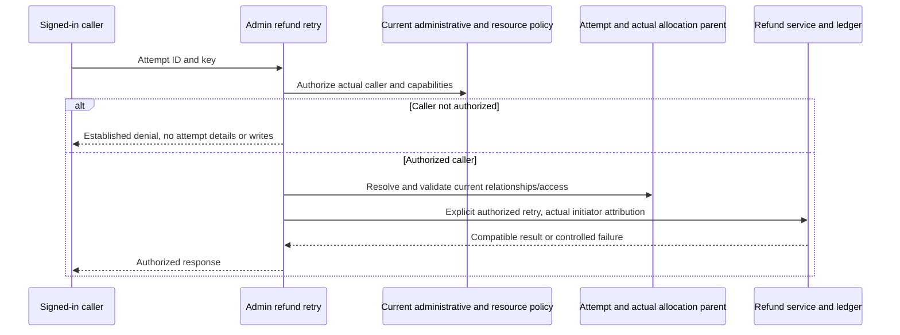

# W02-R2 PR #114 verification and refund-retry correction

Date: 2026-10-29. **CHANGES_REQUIRED — W02 cannot yet be closed.** The new nested-parent checks and effective route/list tests are verified, but an exposed administrative refund-retry caller still authorizes the stored original owner instead of the authenticated user. Next bounded unit: **W02-R2C only**. No W03/W04 or deployment.

Repository: [SM-Web-Systems/lms-crypto-production](https://github.com/SM-Web-Systems/lms-crypto-production). Documentation branch: `codex/platform-wiring-audit`. Authoritative planning branch: `codex/staged-rollout-plan` (PR #103). These are branches within this repository. Read the handovers without merging their unrelated RBAC/documentation base stack.

## Verified working changes and CI

- [PR #114](https://github.com/SM-Web-Systems/lms-crypto-production/pull/114): head `f49174efe0785a2d542e2efe112d57b758f6f39d`, base `88db657ab46732e0dc9f50cfa6a0e5d78dc5b819`, merge `1229bd97d6399dd8807ae8936d4a47917a806f91`.
- [PR CI 40869264008](https://github.com/SM-Web-Systems/lms-crypto-production/actions/runs/40869264008) and [main CI 40870444455](https://github.com/SM-Web-Systems/lms-crypto-production/actions/runs/40870444455): all four jobs SUCCESS. The main run's head SHA is the exact merge above. Backend job `123435812623`: **186 files passed; 1,990 tests passed, one skipped (1,991 total)**. All 37 new nested-parent tests passed; the hosted dependency-security suite passed.
- Exact-merge local affected suites: nested-parent, idempotency-binding, cross-owner, sponsor isolation, refund-admin, student-view and orchestration: **7 files, 139 tests passed**.
- Required `requestedRewardId` is checked on fresh release/refund and their replay branches. Missing actual parent rewards now fail closed on replay. All **eight** production call sites pass a parent: six ordinary route handlers, administrative retry and internal auto-release. Some reports count seven; the code has eight.
- The replacement HTTP tests exercise actual routes; the list test now uses a normal import and exact `SCOPE_DENIED` assertion. The R1C spec's optional-setting rationale and the earlier stale TASKS CI line are corrected. Retain the accepted first-configuration retry limitation from the [R2 prompt](CLAUDE-SERVER-W02-R2-PROMPT.md).
- Planning head verified at `c2ef80e2bc9c85636dc6e4fb051ad1c4811430e0`: merge receipts and successful CI are recorded, but W02 is prematurely marked FIXED. Reconcile to **PARTIALLY_FIXED / CHANGES_REQUIRED**, preserving the verified #111–#114 changes and receipt history.

## P1 — Administrative refund retry substitutes a historical actor for caller authorization

Exact merged source:

- `LMS-Server/src/routes/adminRewards.ts:87–118`: retry requires only `reward.refund`, loads an arbitrary refund-attempt ID, inspects its status and calls `refundAllocation` with `attempt.attempted_by_user_id`.
- `LMS-Server/src/routes/adminRewards.ts:150–151`: success returns the foreign attempt, including resource and historical actor information.
- `LMS-Server/src/config/database.ts:1041–1052`: ordinary sponsors have `reward.refund`; they do not have the separate administrative `reward.refund_review` capability.
- `LMS-Server/src/app.ts:251`: the admin-rewards router is mounted with a rate limiter, not an additional administrative authorization guard. An `/admin` prefix does not establish caller authority.

The new parent binding verifies the allocation belongs to the stored reward. It does not authorize the real user who requested the retry. Passing the stored original actor lets that user's scope satisfy the downstream check on behalf of an unrelated caller.

### Exact-merge dynamic reproduction

The [synthetic HTTP probe](../audits/2026-10-29-w02-r2-pr114-refund-retry.probe.ts.txt) creates two role-only sponsors, one student and an independent funding admin. The unrelated sponsor has `reward.refund`, lacks `reward.refund_review` and `reward.manage`, and fails the actual reward-scope check.

1. Owner creates/funds/activates a one-recipient reward and releases it. The synthetic recipient balance is drained; an actual owner `refundAllocation` call creates a blocked attempt.
2. Unrelated sponsor: GET refund-attempt list returns 403; GET the foreign reward returns 404.
3. Synthetic recipient balance is restored to model funds becoming available. No real deposit or provider is used.
4. Unrelated sponsor POSTs a known foreign attempt ID to `/api/v1/admin/rewards/refund-attempts/:id/retry`. **Response: 200** with the foreign attempt. The foreign allocation becomes `refunded` and recipient funds move back to the funder.
5. The refund ledger entry records the original owner as the actor, while the attempt records the unrelated caller as resolver. A subsequent request exposes the resolved-state branch as `ALREADY_RESOLVED` 409.

This is a demonstrated foreign financial mutation and response disclosure, conditional on a known attempt ID and sufficient restored recipient balance. It is not merely a mismatched URL or a hypothetical identifier leak. The defect predates #114; it remains in one of the production callers that W02 was required to trace and that #114 updated.

The probe ran against exact merged source fingerprints with lock-compatible dependencies, Node v22.18.0, tsx, synthetic credentials, `DATABASE_PATH=:memory:`, `VITEST=true`, `NODE_ENV=test` and local HTTP listeners. It uses the real router, authentication, RBAC and financial services. The production app mount was inspected separately and adds no missing admin guard. No production accounts, database, provider calls or server changes occurred. The `.txt` probe asserts the current defect; convert it to intended-denial RED/GREEN tests rather than retaining vulnerability-accepting assertions in CI.

## Bounded repair and acceptance criteria

- Authorize the **authenticated caller** under the existing administrative-review and refund policy before attempt lookup/status disclosure/replay/mutation. `reward.refund` alone is insufficient for this administrative retry flow; `reward.refund_review` is an existing distinct capability. Apply any established administrator identity/resource constraints explicitly, without inventing a legacy-role or token-label bypass.
- Do not substitute `attempted_by_user_id` for actual caller authority. Preserve that field as history. If a narrowly authorized administrative operation needs privileged execution, make it explicit and validated at the service boundary, with the actual initiating actor recorded correctly. Do not grant every normal `refundAllocation` caller global access or add caller-controlled `skipAuth` options.
- Validate the attempt -> reward -> allocation relationship and current access before either resolved-state response or idempotent return. Preserve #114 parent binding/missing-parent refusal and R1/R1C operation/intent guards.
- Deny an unrelated role-only sponsor even with a known valid attempt ID, used key, resolved attempt or available recipient funds. Denied requests must leave allocations, accounts, ledger, attempts and audit records unchanged; no foreign DTO/status leakage.
- Preserve an intended authorized admin retry with a role-only original sponsor, rather than fixtures where the sponsor is also an administrator. Verify actual actor attribution, correct monetary movement, insufficient-balance behavior and no double refund on retry. Test current authorization revocation/demotion according to the existing policy.
- Review adjacent administrative attempt list/resolve/retry reads only for consistency with that established policy. Do not expand this into a new administrative subsystem, UI work or W03/W04.

Independent source review confirms this blocker and accepts the ordinary nested-parent/list repairs. A successful existing refund-admin test is not sufficient evidence: its sponsor fixture is itself legacy `admin`, and its negative retry test covers an ordinary student without `reward.refund`, not an unrelated sponsor who has it.

## Checklist and authority diagram

- [x] Verify #114/main CI, merged source, eight production callers and 139 affected tests.
- [x] Independently reproduce unrelated-sponsor refund retry on exact source.
- [ ] Reconcile authoritative W02 status and preserve #114 receipts.
- [ ] W02-R2C focused spec/plan, RED/GREEN, independent review, fresh CI, Claude merge and main verification.
- [ ] Final W02 closure review; do not begin W03 without a separate bounded instruction.



## Paste into Claude — W02-R2C only

```text
Continue W02-R2C ONLY: fix authenticated-caller authorization on admin refund retry.

Repository: https://github.com/SM-Web-Systems/lms-crypto-production.git
Read docs/release/SERVER-HANDOVER-W02-R2-PR114-REVIEW.md from documentation
branch codex/platform-wiring-audit. This is a branch within the repo, not a
repository name. Retrieve docs without merging their unrelated base stack.
Authoritative planning branch: codex/staged-rollout-plan, PR #103.

Verified main: 1229bd97d6399dd8807ae8936d4a47917a806f91 (#114); planning c2ef80e.
Revalidate current refs/CI; preserve newer fixes. Named W01/R1/R1C and ordinary
R2 parent/list repairs remain accepted. W02 is PARTIALLY_FIXED/CHANGES_REQUIRED
because a real administrative retry caller still permits cross-owner refunds.
Reconcile the premature FIXED ledger entry without erasing merge history.

Use using-superpowers, find-skills, brainstorming, writing-plans,
executing-plans and/or subagent-driven-development, test-driven-development,
systematic-debugging, verification-before-completion, using-git-worktrees,
requesting-code-review and receiving-code-review. Use Ponytail, Caveman and
Ripwire with honest availability evidence. Do not claim absent tools ran or
install unreviewed production hooks/proxies/scripts. AI owns approvals;
Claude handles merges after independent review and fresh required checks.

Use an isolated codex/ worktree/branch from verified main and synthetic SQLite.
Read the reproduction and current admin/permission policy before coding.
Commit a focused developer spec and iterative checkbox TDD plan covering:
authenticated initiator versus historical owner, administrative capabilities,
current resource access, attempt/reward/allocation binding, status/replay
privacy, actor attribution, compatibility, errors, transaction boundaries and
an exact requirement-to-test matrix. Include Mermaid authority/resource and
retry sequence diagrams. Obtain independent AI design review; resolve valid
findings and continue autonomously.

First reproduce RED using a role-only sponsor who has reward.refund but lacks
reward.refund_review/reward.manage and foreign scope. Create the blocked attempt
through actual services; restore only synthetic recipient balance. The real
authenticated HTTP retry must deny without refunding or returning foreign data.
Use normal imports and precise assertions; runner/import errors are not RED.

Implement actual-caller authorization before attempt status, replay or mutation.
Use existing administrative refund/review capabilities and applicable current
administrator/resource policy. Do not rely on the /admin prefix, legacy role,
stale token or historical attempted_by_user_id. Preserve historical owner data,
but never use it as a substitute for the caller's authority. If authorized admin
execution needs a dedicated service path, keep it narrow, validate authority
there and record the actual initiating actor. No global owner-refund bypass,
caller-controlled skipAuth flag or broad new admin-write privilege.

Retain attempt -> actual reward/allocation checks, missing-parent refusal and
R1/R1C replay resource/action/source/reference binding. Test unrelated sponsor
denial with fresh/used keys, blocked/resolved/missing attempts and restored
funds; denied requests must leave accounts, allocations, ledger, attempts and
audit rows unchanged. No foreign attempt DTO or status disclosure.

Preserve intended authorized administrative retries with role-only actors and
an ordinary original owner. Cover successful/still-blocked/authorized-resolved
behavior, current revocation/demotion, real actor attribution and no duplicate
financial refund. Inspect adjacent attempt list/resolve paths for consistency
with the same existing policy, without inventing a new administrative subsystem.

Run focused RED/GREEN, affected refund/reward/RBAC/worker suites, build and
required fresh candidate CI. Independent code/security review must include the
actual authenticated role-only sponsor reproduction and legitimate admin
positive, not only a service call under the original owner's ID. Fix valid
findings and re-review. Claude merges only the reviewed exact head with passing
required checks; verify resulting main CI. No predicted passes.

Commit/push accurate INDEX/TASKS/EVIDENCE with exact SHAs, RED/GREEN, test counts
and skips, review and merge/main-CI receipts. Correct minor eight-caller/four-PR
counts where earlier ledgers miscounted; retain the accepted optional-setting
first-configuration contract and disabled provider/credit capabilities.

Use /loop only with verified syntax for this bounded design/test/review/CI unit.
Cancel stale monitors at the boundary. Save spec/tasks, evidence, SHAs, remaining
work and an exact resume action before credit/context exhaustion. Missing
indispensable facts or pending checks mean CHECKPOINTED, not guessed approval.
Resolve routine technical decisions through AI rather than repeated human gates.

STOP after W02-R2C. Provide UNIT_COMPLETE or CHECKPOINTED and a final W02
closure-assessment handover. Do not begin W03/W04, deploy, run live migrations,
use real funding, enable providers, merge unrelated work or auto-start another
unit. Do not mark W02 FIXED until this actual-caller defect is verified repaired.
```
