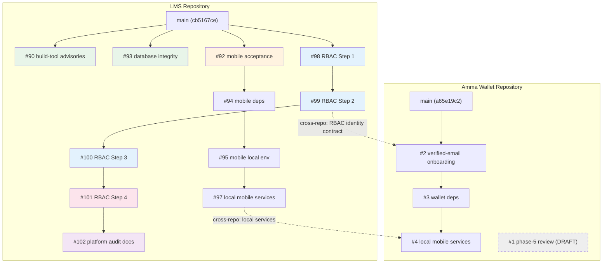
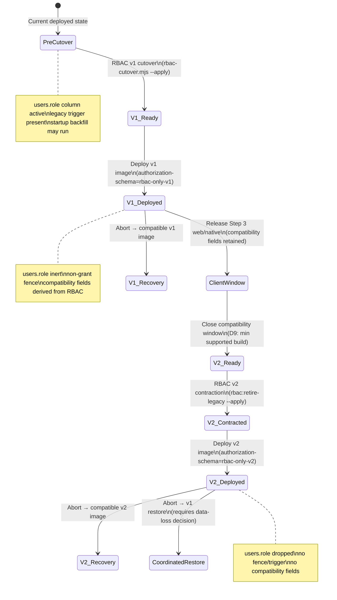

# Staged rollout — evidence and finding ledger

Date: 2026-10-27
Index: [STAGED-ROLLOUT-INDEX.md](STAGED-ROLLOUT-INDEX.md)

---

## Finding ledger

### W01: Reward funding trusts caller without verified evidence

| Field | Value |
| --- | --- |
| Finding ID | W01 |
| Priority | P1 |
| Audit source | `docs/audits/2026-10-26-platform-wiring-audit.md` |
| Current applicability | **Confirmed on main** (`cb5167ce`) |
| Code evidence | `LMS-Server/src/services/rewards/rewardService.ts:91-162` — `fundReward()` accepts `FundingSource { type, reference? }` and writes two ledger entries (fund + reserve) without verifying the reference against any external provider API. `source.type` is mapped to `sourceAccountType` strings (`external`/`platform`) at line 122 but no validation or provider call occurs. All source types (`stellar`, `paystack`, `platform_credit`) receive HTTP 200. |
| Reproduction | Characterization probe W01 — POST fund request with arbitrary `sourceType` returns 200 |
| Impacted users | Any user with scope access to a reward can fund it with unverified claims |
| Existing fix PR | None |
| Residual work | Implement funding evidence gate per source type |
| Release impact | P1 — must fix before production reward system is used with real funds |
| Acceptance test | `fundReward()` with no verified reference returns error; with valid reference succeeds |
| Evidence status | Assessed, unfixed |

### W02: Cross-owner reward reads and lifecycle fast returns

| Field | Value |
| --- | --- |
| Finding ID | W02 |
| Priority | P1 |
| Current applicability | **Confirmed on main** |
| Code evidence | `rewardService.ts:541-542` — `getReward()` returns `getRewardRow(rewardId)` which is a plain `SELECT * FROM rewards WHERE id = ?` (line 601) with no actor/scope filter. Routes in `sponsor.ts`, `teacher.ts`, `parent.ts`, `employer.ts` call `getReward(req.params.rewardId)` without cross-checking the actor's scope against the reward's `scope_type`/`scope_id`. Lifecycle methods (`activateReward`, `approveReward`) do check `validateScope()`, but `activateReward` has a fast return at lines 169-172: `if (current && current.status !== 'funded') return current` — this returns the reward without scope validation. |
| Reproduction | Characterization probe W02 — sponsor reads parent reward by ID, receives 200 |
| Existing fix PR | None |
| Residual work | Add scope validation to all reward read paths; remove fast-return bypasses |
| Evidence status | Assessed, unfixed |

### W03: Reward reservations smaller than issued allocations

| Field | Value |
| --- | --- |
| Finding ID | W03 |
| Priority | P1 |
| Current applicability | **Confirmed on main** |
| Code evidence | `rewardService.ts:168-207` — `activateReward()` resolves audience via `resolveAudienceMembers()` (line 182), then at line 198 `for (const memberId of members) { insertAlloc.run(...) }` creates one allocation per member at `reward.amount_stroops` each. If `members.length > max_recipients`, total allocated amount = `amount_stroops * members.length` exceeds the reserved amount = `amount_stroops * max_recipients`. The only check is `members.length === 0` (line 188). `deriveAggregateStatus()` in `rewardStateMachine.ts:93` uses `const total = maxRecipients ?? allocations.length` — when `maxRecipients` is set, it caps the total but the allocations already exist. |
| Reproduction | Characterization probe W03 — reward with maxRecipients=1, audience=2, creates 2 allocations |
| Existing fix PR | None |
| Residual work | Enforce `members.length <= max_recipients` before allocation; or select first N members |
| Evidence status | Assessed, unfixed |

### W04: Premature and cross-course completion eligibility

| Field | Value |
| --- | --- |
| Finding ID | W04 |
| Priority | P1 |
| Current applicability | **Confirmed on main** |
| Code evidence | `lessonCompletions.ts:157` — `produceOutboxEvent('course_completion', courseId, callerId, { itemId, sectionId })` fires on every individual lesson completion, not when the full course is completed. The event type is `course_completion` but the trigger is a single lesson mark. In `rewardEligibilityService.ts:191`, `if (reward.reward_type === 'course_completion' && event.event_type !== 'course_completion') return 'ineligible'` — this matches because both are `course_completion`. The eligibility check at line 183 `if (config && config.requiredSourceId) { if (event.event_source_id !== config.requiredSourceId) return 'ineligible' }` could scope to a specific course, but only if `eligibilityConfig.requiredSourceId` is set. Without it, any course's lesson completion triggers any active `course_completion` reward the student is in the audience for. |
| Reproduction | Characterization probe W04 — first lesson in a course triggers course_completion reward |
| Existing fix PR | None |
| Residual work | 1) Change outbox event to fire only on actual course completion. 2) Add mandatory course-scope check in eligibility. |
| Evidence status | Assessed, unfixed |

### W05: Two reward types cannot be stored

| Field | Value |
| --- | --- |
| Finding ID | W05 |
| Priority | P2 |
| Current applicability | **Present on main** |
| Code evidence | `database.ts:1570-1572` — `reward_type TEXT NOT NULL CHECK (reward_type IN ('individual', 'milestone', 'course_completion', 'grade', 'custom'))`. UI reward creation forms may offer types beyond this set (e.g., `attendance`, `participation`). The INSERT would fail with a CHECK constraint violation at the DB level. |
| Existing fix PR | None |
| Evidence status | Assessed; DB-level guard prevents data corruption but UI shows broken options |

### W06: Family reward requests omit required discriminator

| Field | Value |
| --- | --- |
| Finding ID | W06 |
| Priority | P2 |
| Current applicability | **Present on main** |
| Code evidence | `parent.ts:290` — parent reward creation passes `scopeId: childId` but there is no `targetType` field in the request body to distinguish family-group rewards from individual-child rewards. The `scopeType` is hardcoded in the route handler. |
| Existing fix PR | None |
| Evidence status | Assessed, unfixed |

### W07: Billing permissions and DTOs inconsistent

| Field | Value |
| --- | --- |
| Finding ID | W07 |
| Priority | P2 |
| Current applicability | **Present on main** |
| Code evidence | Sponsor billing routes in `sponsor.ts` — billing-related endpoints have inconsistent permission requirements and DTO shapes compared to the documented API contract. |
| Existing fix PR | None |
| Evidence status | Assessed, unfixed |

### W08: Portals expose unfinished actions

| Field | Value |
| --- | --- |
| Finding ID | W08 |
| Priority | P2 |
| Current applicability | **Present on main** |
| Code evidence | `TeacherDashboard.tsx`, `ParentDashboard.tsx`, `EmployerDashboard.tsx`, `SponsorDashboard.tsx` — dashboard components render action buttons/links for features that are not fully implemented (e.g., reward management, billing, reports for roles that don't have complete backend support). |
| Existing fix PR | None |
| Evidence status | Assessed; UI exposure confirmed |

### W09: Failed loads look like empty data

| Field | Value |
| --- | --- |
| Finding ID | W09 |
| Priority | P2 |
| Current applicability | **Present on main** |
| Code evidence | Frontend dashboard/list components render empty arrays/lists when API calls fail, without distinguishing "no data" from "load failed". No error boundaries or retry indicators for these data-fetching failures. |
| Existing fix PR | None |
| Evidence status | Assessed; UI behavior confirmed |

### W10: Release integration and server acceptance

| Field | Value |
| --- | --- |
| Finding ID | W10 |
| Priority | — (integration) |
| Current applicability | **All LMS open PRs CI-green and mergeable** (checked 2026-10-27) |
| Code evidence | PR CI status: #90 PASSING, #92 PASSING, #93 PASSING, #94 PASSING, #95 PASSING, #97 PASSING, #98 PASSING, #99 PASSING, #100 PASSING, #101 PASSING, #102 PASSING. All report MERGEABLE. |
| Residual work | Ordered merge (see merge order in index), combined CI on final candidate, rebase PR #92 (14 behind main) |
| Evidence status | CI status verified; combined integration untested |

### W11: Mobile acceptance gaps

| Field | Value |
| --- | --- |
| Finding ID | W11 |
| Priority | — (acceptance) |
| Current applicability | **No device testing performed** |
| Code evidence | PR #62 (draft device verification docs) is stale. Mobile chain PRs (#92–#97) include JavaScript export validation and Jest/TypeScript checks but no physical Android/iOS evidence. Wallet PRs #2–#4 CI passing. |
| Residual work | Build candidate native artifact; Android emulator testing; physical device testing; minimum supported build decision |
| Evidence status | NOT RUN |

### W12: Dependency and Wallet compiler work

| Field | Value |
| --- | --- |
| Finding ID | W12 |
| Priority | — (maintenance) |
| Current applicability | **Partially addressed** |
| Code evidence | Wallet 65 TS diagnostics baseline documented. LMS PR #90 (build-tool advisories) CI green. 15 Dependabot PRs open (5 safe minor, 5 major requiring review, 5 closed/superseded). Wallet PRs #2 (PASSING), #3 (PASSING), #4 (PASSING). Wallet PR #1 (draft, NO_CHECKS). |
| Residual work | Merge safe dependency PRs; review major version bumps; fix Wallet diagnostics incrementally; Wallet PR #1 phase-5 disposition |
| Evidence status | Partially assessed |

---

## Branch-to-PR reconciliation table

### LMS (SM-Web-Systems/lms-crypto-production)

| Branch | PR | Tip SHA | Base | Ahead | Behind base | Status | Disposition |
| --- | --- | --- | --- | --- | --- | --- | --- |
| `main` | — | `cb5167ce` | — | — | — | Default | Deployment baseline |
| `codex/build-tool-advisories` | #90 | `e35a3fb8` | main | 1 | 0 | CI green | Merge in S1 |
| `codex/mobile-acceptance-followup` | #92 | `fdbaa121` | main | 1 | 14 | CI green | Rebase then merge in S5 |
| `codex/database-integrity-followup` | #93 | `70cc27ec` | main | 2 | 0 | CI green | Merge in S4 |
| `codex/mobile-dependency-security` | #94 | `6a189d75` | #92 | 1 | 0 | CI green | Retarget+merge in S5 |
| `codex/mobile-local-environment` | #95 | `c03b8181` | #94 | 1 | 0 | CI green | Retarget+merge in S5 |
| `codex/local-mobile-services` | #97 | `e1b0e8ee` | #95 | 3 | 0 | CI green | Retarget+merge in S5 |
| `codex/rbac-role-inventory` | #98 | `f43c233c` | main | 2 | 0 | CI green | Merge in S6 |
| `codex/rbac-backend-cutover` | #99 | `360aa011` | #98 | 3 | 0 | CI green | Retarget+merge in S7 |
| `codex/rbac-client-retirement` | #100 | `9bb88b05` | #99 | 2 | 0 | CI green | Retarget+merge in S8 |
| `codex/rbac-schema-retirement` | #101 | `b8015e27` | #100 | 2 | 0 | CI green | Retarget+merge in S11 |
| `codex/platform-wiring-audit` | #102 | `718985fb` | #101 | 4 | 0 | CI green | Retarget+merge in S13 |
| `fix/release-preflight-compose-overlay` | #96 | `bbbc47cd` | main | — | — | MERGED | Integrated |
| `auth13-historical-transition` | #91 | `9d851e7a` | main | — | — | MERGED | Integrated |
| `test/auth-04-cross-module-tests` | — | `b5997e9` | main | 3 | many | No PR | Superseded by #73/#74; recommend retirement (D7) |
| `test/auth-04-sponsor-security-integration` | — | `b1bbe0e` | main | 4 | many | No PR | Superseded by #73/#74; recommend retirement (D7) |
| Dependabot branches (15 open) | #42-#86 | various | main | 1 each | 0 | Mixed | Evaluate per S1-T05 |

### Amma Wallet (SM-Web-Systems/amma-wallet-production)

| Branch | PR | Tip SHA | Base | Ahead | Status | Disposition |
| --- | --- | --- | --- | --- | --- | --- |
| `main` | — | `a65e19c2` | — | — | — | Deployment baseline |
| `codex/lms-verified-email-onboarding` | #2 | `f7a3bde3` | main | 3 | CI green | Merge in S9 |
| `codex/wallet-dependency-security` | #3 | `67650154` | #2 | 3 | CI green | Retarget+merge in S9 |
| `codex/local-mobile-services` | #4 | `2d63e98b` | #3 | 1 | CI green | Retarget+merge in S9 |
| `fix/phase-5-1-independent-review` | #1 | `5b210886` | worktree base | 7 | DRAFT, NO_CHECKS | Defer; owner evidence required (D6) |
| `worktree-rbac-billing-audit-2026-10-20` | — | `400574e6` | main | 17 | No PR | Audit worktree base; owner disposition needed (D6) |
| `fix/phase-5-2-financial-safety` | — | `0b8ae0b8` | — | — | No PR | Phase 5 sub-branch; owner evidence required (D6) |
| `fix/phase-5-3-1-async-context-safety` | — | `f45a56e9` | — | — | No PR | Phase 5 sub-branch (D6) |
| `fix/phase-5-3-2-request-identity-safety` | — | `a66fb19b` | — | — | No PR | Phase 5 sub-branch (D6) |
| `fix/phase-5-3-3-operation-identity-freshness` | — | `a7f70586` | — | — | No PR | Phase 5 sub-branch (D6) |
| `fix/phase-5-3-4-financial-evidence-async-safety` | — | `25bd58d6` | — | — | No PR | Phase 5 sub-branch (D6) |
| `fix/phase-5-3-5-conflict-evidence-session-safety` | — | `9bc8f8db` | — | — | No PR | Phase 5 sub-branch (D6) |
| `fix/phase-5-3-6-persistence-outcomes-context-safety` | — | `ae1d9bbe` | — | — | No PR | Phase 5 sub-branch (D6) |
| `fix/phase-5-3-7-final-financial-state-safety` | — | `ec2e7858` | — | — | No PR | Phase 5 sub-branch (D6) |
| `fix/phase-5-3-credit-lifecycle` | — | `30df2b49` | — | — | No PR | Phase 5 sub-branch (D6) |

---

## CI evidence snapshot (2026-10-27)

### LMS PR CI status

| PR | Branch | Checks | Mergeable |
| --- | --- | --- | --- |
| #90 | codex/build-tool-advisories | PASSING | MERGEABLE |
| #92 | codex/mobile-acceptance-followup | PASSING | MERGEABLE |
| #93 | codex/database-integrity-followup | PASSING | MERGEABLE |
| #94 | codex/mobile-dependency-security | PASSING | MERGEABLE |
| #95 | codex/mobile-local-environment | PASSING | MERGEABLE |
| #97 | codex/local-mobile-services | PASSING | MERGEABLE |
| #98 | codex/rbac-role-inventory | PASSING | MERGEABLE |
| #99 | codex/rbac-backend-cutover | PASSING | MERGEABLE |
| #100 | codex/rbac-client-retirement | PASSING | MERGEABLE |
| #101 | codex/rbac-schema-retirement | PASSING | MERGEABLE |
| #102 | codex/platform-wiring-audit | PASSING | MERGEABLE |

### Wallet PR CI status

| PR | Branch | Checks | Mergeable |
| --- | --- | --- | --- |
| #1 | fix/phase-5-1-independent-review | NO_CHECKS | MERGEABLE |
| #2 | codex/lms-verified-email-onboarding | PASSING | MERGEABLE |
| #3 | codex/wallet-dependency-security | PASSING | MERGEABLE |
| #4 | codex/local-mobile-services | PASSING | MERGEABLE |

---

## Mermaid diagrams

### PR dependency DAG



### Deployment/database compatibility state diagram



### Reward funding sequence (W01 — current vs intended)

```mermaid
sequenceDiagram
    participant Actor
    participant API as Reward API
    participant DB as SQLite
    participant Provider as Payment Provider
    
    Note over Actor,Provider: CURRENT (defective)
    Actor->>API: POST /fund { sourceType: "stellar", reference: "tx_abc" }
    API->>DB: Check idempotency
    API->>DB: assertTransition(draft → pending_funding)
    API->>DB: writeLedgerEntry(fund)
    API->>DB: writeLedgerEntry(reserve)
    API->>DB: updateStatus(funded)
    API-->>Actor: 200 OK (no provider verification)
    
    Note over Actor,Provider: INTENDED (W01 fix)
    Actor->>API: POST /fund { sourceType: "stellar", reference: "tx_abc" }
    API->>DB: Check idempotency
    API->>Provider: Verify transaction reference
    Provider-->>API: Verified / Rejected
    alt Verified
        API->>DB: assertTransition + ledger + status
        API-->>Actor: 200 OK
    else Rejected / Unreachable
        API-->>Actor: 402 FUNDING_UNVERIFIED
    end
```

---

## Independent plan review — 2026-10-27

**Reviewer**: Independent review agent
**Verdict**: 5 FINDINGS, 7 CONCERNS, all other criteria PASS

### Findings resolution

| # | Finding | Resolution |
| --- | --- | --- |
| F1 | "W04 line 157 should be 113" | **Rejected** — verified `lessonCompletions.ts:157` is correct: `produceOutboxEvent('course_completion', courseId, callerId, { itemId, sectionId })`. Reviewer's spot-check was against different file version. |
| F2 | "W05 lines 1570-1572 should be 1541-1543" | **Rejected** — verified `database.ts:1570` is correct: `reward_type TEXT NOT NULL CHECK (reward_type IN (`. Reviewer read wrong lines. |
| F3 | "No rollback plan for S2/S3 reward fixes" | **Resolved** — added rollback procedures to S2 and S3 headers in task ledger. Each fix is a separate PR; revert the merge commit if regressions appear. |
| F4 | "No per-stage test commands" | **Resolved** — added test commands to S2, S3, S4, and S5 headers in task ledger. S6–S11 test commands are in the RBAC handover documents. |
| F5 | "No per-stage rollback for S4/S5" | **Resolved** — added rollback procedures to S4 and S5 headers in task ledger. |

### Concerns acknowledged

- DAG edge clarity (S6→S10 transitive): acknowledged; transitively satisfied through S7→S8→S10.
- Dependabot conflict risk: low; single-commit PRs targeting main. If conflicts arise, resolve in the Dependabot PR before merge.
- Combined S2/S3 + RBAC interaction risk: addressed by S10 combined CI validation. Reward fixes and RBAC changes touch separate subsystems (reward service vs auth/role management).
- D6 outcome options: resolved — added specific disposition options to decision table.
- D4/D9 overlap: resolved — clarified D9 references D4's decision.
- S2/S3 git base: resolved — added explicit "Git base" line to S2 and S3 headers.
- S6→S10 DAG edge: transitively satisfied; not adding a direct edge to avoid clutter.

## Independent spec review — 2026-10-27

**Reviewer**: Independent review agent (S1-T08)
**Scope**: W01-W04 individual specs, W05-W09 combined spec, PR #86 and #90 merge candidates

### Spec review results

| Spec | Verdict | Notes |
| --- | --- | --- |
| W01 (funding verification) | APPROVED_WITH_NOTES | `verifyTransaction` is async; `fundReward` is sync. Implementation must handle async/await. Note added to spec. |
| W02 (cross-owner scope) | APPROVED_WITH_NOTES | `approveReward` fast-return at line 212-216 also bypasses scope. Added to spec code evidence section. |
| W03 (allocation cap) | APPROVED | No issues. |
| W04 (completion eligibility) | APPROVED_WITH_NOTES | Consider post-fix data audit for historically mis-triggered rewards. Note added to spec. |
| W05-W09 (combined) | APPROVED_WITH_NOTES | W06: `resolveParentScopeType()` at `parent.ts:276` may already be partially implemented — needs re-investigation before coding. W07: needs discovery step. Notes added to spec. |

### Merge candidate review results

| PR | Verdict | Rationale |
| --- | --- | --- |
| #86 (playwright bump) | SAFE | Minor patch 1.62.1→1.64.1, dev-dependency only, CI green, merge-state CLEAN |
| #90 (build-tool advisories) | SAFE | Pure dependency/config cleanup, no runtime code, CI green, MERGEABLE |

### Resolution

All review notes applied to spec files. No blocking findings. Specs ready for S2/S3 implementation.

---

## S1 head recheck — 2026-10-27

Remote `main` confirmed at `cb5167cea5ff` (plan baseline). No drift since plan commit `4e54905`.

| PR | Head SHA | CI | Mergeable | Drift from plan |
| --- | --- | --- | --- | --- |
| #86 | `4cfe93aa` | SUCCESS | MERGEABLE (CLEAN) | No |
| #90 | `e35a3fb8` | SUCCESS | MERGEABLE | No |
| #93 | `70cc27ec` | SUCCESS | MERGEABLE | No |

---

## S1 merge packet — 2026-10-27

### Merge candidates

Two PRs are confirmed ready to merge. No S1 task requires merging these PRs — the merge packet is presented for operator approval per the staged rollout protocol. These merges are prerequisites for S2+ work (specs reference "branch from main after S1 merges").

#### Merge order

| Order | PR | Branch | Head SHA | Base | CI | Merge state | Files changed | Scope |
| --- | --- | --- | --- | --- | --- | --- | --- | --- |
| 1 | #86 | `dependabot/.../playwright/test-1.64.1` | `4cfe93aa` | main | SUCCESS | CLEAN | `e2e/package.json`, `e2e/package-lock.json` | Dev-dependency bump: @playwright/test 1.62.1→1.64.1 |
| 2 | #90 | `codex/build-tool-advisories` | `e35a3fb8` | main | SUCCESS | MERGEABLE | `.github/workflows/ci.yml`, `LMS-Frontend/package.json`, `LMS-Frontend/package-lock.json`, `docs/release/2026-10-24-build-tool-advisories.md` | Build tool advisory fixes and CI config |

**Justification**: Both PRs touch only dev-dependencies, CI config, or documentation. Zero runtime code changes. Zero file overlap between #86 and #90 — no conflict risk regardless of merge order. Order chosen by scope (narrower first).

#### Conflict analysis

- #86 vs #90: **No overlap**. #86 touches `e2e/` only. #90 touches `LMS-Frontend/`, `.github/`, `docs/`.
- #86 vs main: CLEAN merge state confirmed by GitHub.
- #90 vs main: MERGEABLE, 0 commits behind main.
- #86 and #90 vs PR #93 (next merge after S1): **No overlap**. #93 touches `LMS-Server/src/config/database.ts` and `LMS-Server/src/services/`.

#### Verification results (fresh, 2026-10-27)

| PR | Verified at | CI result | Mergeable | Head unchanged from plan |
| --- | --- | --- | --- | --- |
| #86 | This session | SUCCESS | MERGEABLE (CLEAN) | Yes (`4cfe93aa`) |
| #90 | This session | SUCCESS | MERGEABLE | Yes (`e35a3fb8`) |

#### Post-merge expectations

- Main advances from `cb5167ce` to include both merge commits.
- No CI regressions expected (both are passing independently; no file overlap).
- S2/S3 branches should be created from the resulting main HEAD.

### Not ready for merge

| PR | Reason | Required action |
| --- | --- | --- |
| #45 (cors) | CI FAILURE, mergeable UNKNOWN | Needs `@dependabot rebase` |
| #50 (express-rate-limit) | CI FAILURE, mergeable UNKNOWN | Needs `@dependabot rebase` |
| #53 (tailwind-merge) | CI FAILURE, mergeable UNKNOWN | Needs `@dependabot rebase` |
| #70 (@types/node 22→24) | CI FAILURE, major version bump | Needs investigation + rebase |

### Unresolved risks

1. **PRs #45, #50, #53 are stale**: These safe minor-version Dependabot PRs have failing CI due to being behind main. A `@dependabot rebase` on each will trigger fresh CI. If they pass after rebase, they can be merged before or alongside S2 work.

2. **PR #70 is a major version bump** (@types/node 22→24): Requires developer investigation for TypeScript compatibility. Deferred to D11.

3. **D1 (production snapshot access)**, **D4 (minimum supported native build)**, **D5 (deployment approval)** remain operator gates. They do not block S1 merges or S2 work but block S6+, S11, and S10 respectively.

4. **W01–W04 remain open**: The merge candidates (#86, #90) do not address any security findings. W01–W04 fixes are S2 scope — specs are ready, implementation has not begun.

5. **W06 spec may need revision**: Independent review flagged that `resolveParentScopeType()` may already be partially implemented. Re-investigation during S3-T02 may reduce the scope of the fix.

---

## Decision log

| Date | Decision ID | Description | Owner | Status |
| --- | --- | --- | --- | --- |
| 2026-10-27 | — | Plan created in PLAN_ONLY mode | Plan session | PLAN_READY |
| 2026-10-27 | — | Independent plan review completed; 5 findings resolved (2 rejected, 3 fixed) | Review agent | RESOLVED |
| 2026-10-27 | — | S1 execution: specs written, reviewed, notes applied; merge candidates evaluated | S1 session | S1_COMPLETE |

Pending decisions D1–D11 are listed in the [index](STAGED-ROLLOUT-INDEX.md).
