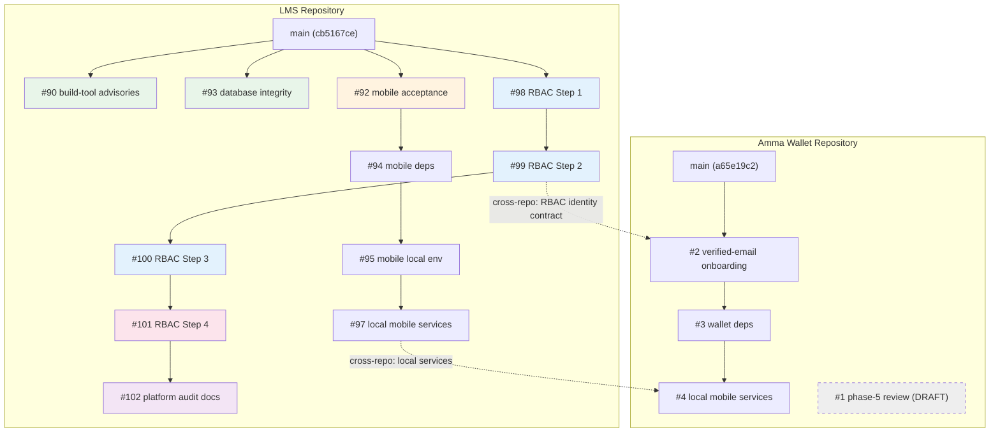
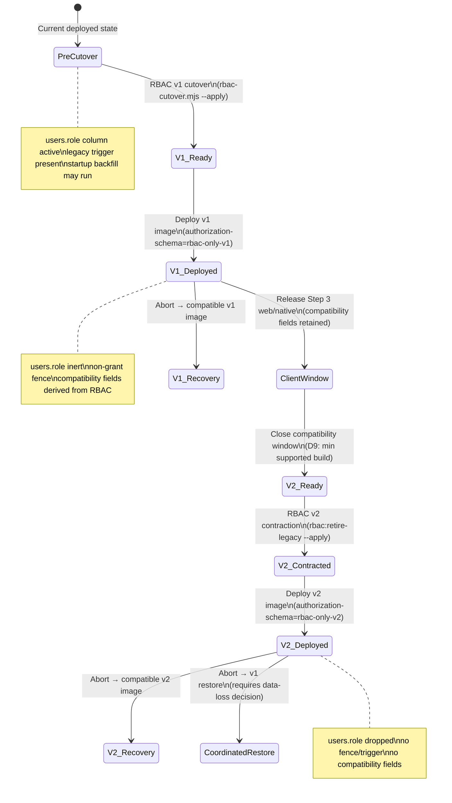

# Staged rollout — evidence and finding ledger

Date: 2026-10-28
Index: [STAGED-ROLLOUT-INDEX.md](STAGED-ROLLOUT-INDEX.md)

---

## Finding ledger

### W01: Reward funding trusts caller without verified evidence

| Field | Value |
| --- | --- |
| Finding ID | W01 |
| Priority | P1 |
| Audit source | `docs/audits/2026-10-26-platform-wiring-audit.md` |
| Current applicability | **Confirmed on main** (`cb5167ce`) |
| Code evidence | `LMS-Server/src/services/rewards/rewardService.ts:91-162` — `fundReward()` accepts `FundingSource { type, reference? }` and writes two ledger entries (fund + reserve) without verifying the reference against any external provider API. `source.type` is mapped to `sourceAccountType` strings (`external`/`platform`) at line 122 but no validation or provider call occurs. All source types (`stellar`, `paystack`, `platform_credit`) receive HTTP 200. |
| Reproduction | Characterization probe W01 — POST fund request with arbitrary `sourceType` returns 200 |
| Impacted users | Any user with scope access to a reward can fund it with unverified claims |
| Existing fix PR | **#104 MERGED** at `115d8c4f836a` (2026-10-27); **#105 MERGED** at `8096b9b` (2026-10-28, R1 correction); **#107 MERGED** at `17d93f0` (2026-10-28, R2 Paystack binding); **#108 MERGED** at `7a23f88` (2026-10-28, R3 atomic reference consumption); **#109 MERGED** at `a929836` (2026-10-28, R3C correction — F1/F2/F3); **#110 MERGED** at `1a5326ac` (2026-10-28, R3D strict final validation) |
| Residual work | Stellar Horizon client deferred separately (fail-closed is correct security posture). A1 (Paystack amount/currency cross-check — gated by R2 currency mismatch). A5 (FundingSource interface duplication — cosmetic, non-security). Paystack reward funding operationally unavailable (R2 containment only; enablement requires settlement policy, obligation binding, and ownership verification). |
| Release impact | P1 — **FIXED (security containment)** — funding verification gate + internal authorization + Paystack binding enforced; atomic reference consumption with three-layer defense (pre-check, in-transaction, UNIQUE index); pre-R3 upgrade path validated (F1 legacyUniqueExemptions); opaque reference identity consistent with historical data (F2); genuine acceptance regressions (F3). External sources fail closed. |
| Acceptance test | `fundReward()` with no verified reference returns FUNDING_UNVERIFIED (402); Paystack async path verifies transaction; stellar denied; cross-reward reference reuse returns DUPLICATE_REFERENCE (409); internal sources require `reward.manage` + independent authorizer; grant ownership = creator; transaction-time recheck catches TOCTOU; DB-level UNIQUE prevents concurrent reference consumption; error messages do not leak reward IDs; pre-R3 databases upgrade successfully; reference identity is opaque (no trimming) |
| Evidence status | **FIXED (security containment)** — PRs #104, #105, #106, #107, #108, #109, #110 merged (25 R1 + 12 R2 + 25 R3 tests; 183 files, 1892 passed, 0 failures, 0 regressions). R3C correction (PR #109) resolved upgrade blocker (F1), reference identity (F2), and test coverage (F3). R3D (PR #110) resolved post-migration exemption gap and added async/rollback regressions. A2/A3 advisories resolved. Stellar Horizon deferred (fail-closed, correct security posture). Paystack operationally unavailable (R2 containment). |

#### W01-R1: Internal funding authorization and credit backing

| Field | Value |
| --- | --- |
| Sub-finding ID | W01-R1 |
| Handover source | `docs/release/SERVER-HANDOVER-W01-REVIEW-AND-REPAIR.md` at `223b262`; correction handover `SERVER-HANDOVER-W01-R1-PR105-REVIEW.md` at `8c1b8cb` |
| Problem | PR #104 left internal sources passing through without `reward.manage` or conflict-of-interest enforcement. Initial fix at `385e512` had two defects: F1 (admin became funder instead of creator) and F2 (no transaction-time recheck against TOCTOU). |
| Spec | `docs/superpowers/specs/2026-10-27-W01-R1-internal-funding-authorization.md` (revised with F1/F2 invariants) |
| Branch | `codex/w01r1-internal-funding-authorization` at `550bd9a` (corrected) |
| PR | **#105 — MERGED** at `8096b9b` (2026-10-28) |
| Implementation | `rewardFundingVerifier.ts`: `FundingAuthorizationContext` + exported `verifyInternalAuthorization()`. `rewardService.ts`: `isInternalSource()` helper; **F1**: `funderId = creator` for internal sources (financial beneficiary = creator, admin = audit actor); **F2**: `verifyInternalAuthorization()` called inside write transaction bodies before financial mutation. |
| Files changed | 2 core (`rewardFundingVerifier.ts`, `rewardService.ts`), 1 new test file, 3 existing test files updated (lifecycle, orchestration, internal-funding-auth) |
| Test evidence | 25 R1 tests: 11 authorization + 8 F1 ownership + 4 F2 pre-call revocation + 2 genuine interleaving; 1854 total (181 files). RED on `385e512`, GREEN on `8096b9b`. |
| Closure C1 | PR #106 (`codex/w01r1-interleaving-regressions` at `51928fd`) — 2 genuine async TOCTOU regression tests |
| Independent review | Initial: APPROVED (10/10); Correction review: APPROVED; Merge verification: `SERVER-HANDOVER-W01-R1-MERGE-VERIFICATION.md` at `ef87773` |
| Error codes | `SCOPE_DENIED` (403, no reward.manage), `CONFLICT_OF_INTEREST` (403, actor = creator), `INSUFFICIENT_CREDIT` (402, platform_credit fail-closed) |
| Resolves advisory | A4 (platform_credit balance check spec gap) — now fails closed unconditionally |
| CI (corrected) | #105 PR run `40641432181`, #105 main run `40641989352` (SUCCESS); #106 PR run `40644680249`, #106 main run `40645163963` (SUCCESS); all 4 jobs SUCCESS per run. Main at `fa187b8` after #106 merge. |
| Evidence status | **MERGED** — PR #105 merged at `8096b9b`; C1 interleaving regressions merged via PR #106 at `fa187b8`. R2 (Paystack binding) and R3 (atomic consumption) pending. Stellar Horizon client deferred separately. |

#### W01-R2: Paystack payment binding (corrected identity)

| Field | Value |
| --- | --- |
| Sub-finding ID | W01-R2 |
| Scope | Paystack payment binding: status verification, amount/currency binding, ownership verification, intended-funding-obligation validation. Advisory A1 (Paystack amount/currency cross-check). |
| Currency gap | Rewards are XLM stroops; Paystack operates in fiat (USD/ZAR). No settlement/quote policy exists. Paystack funding of XLM rewards fails closed with `FUNDING_CURRENCY_MISMATCH` (402). **Operational Paystack reward funding is unavailable.** Enablement requires: returned-reference matching, trusted confirmed payment/reward-obligation binding, correct minor-unit conversion/quote policy, ownership and post-await obligation revalidation. The exported `verifyPaystackBinding` helper does not compare the returned reference, its `rewardId` context is unused, and the service does not revalidate a changed obligation after provider verification. |
| Dependencies | R1 merged ✓, C1 merged ✓ |
| Spec | `docs/superpowers/specs/2026-10-28-W01-R2-paystack-payment-binding.md` |
| Plan | `docs/superpowers/plans/2026-10-28-W01-R2-tdd-plan.md` |
| Branch | `codex/w01r2-paystack-payment-binding` at `0dce716` |
| PR | **#107 — MERGED** at `17d93f0` (2026-10-28) |
| Implementation | `rewardFundingVerifier.ts`: `PaystackBindingContext` interface, exported `verifyPaystackBinding()` with ordered checks (status → currency settlement → amount → ownership). `hasCurrencySettlementPath()` returns true only for direct currency match. `rewardService.ts`: `fundRewardAsync()` builds binding context from reward's authoritative DB row. `paystackService.ts`: extended with `customer.email`. `rewardErrors.ts`: 3 new error codes. |
| Tests | 12 new R2 tests + 4 existing updated; 182 files, 1866 passed / 1 skipped / 1867 total, 0 regressions. All 25 R1 tests preserved. |
| Independent review | Spec review: APPROVED_WITH_NOTES (6 findings resolved). Code review: APPROVED_WITH_NOTES (dead import fixed). |
| Error codes | `FUNDING_CURRENCY_MISMATCH` (402), `FUNDING_AMOUNT_MISMATCH` (402), `FUNDING_OWNERSHIP_MISMATCH` (403) |
| CI | PR run `40705200669` (SUCCESS); cleanup run `40705436715` (SUCCESS); main post-merge run `40706452331` (SUCCESS) |
| Evidence status | **MERGED** — PR #107 merged at `17d93f0`. R3 (atomic consumption) pending. W01 remains PARTIALLY_FIXED. |

#### W01-R3: Atomic payment-reference consumption (corrected identity)

| Field | Value |
| --- | --- |
| Sub-finding ID | W01-R3 |
| Scope | Atomic payment-reference consumption: one verified payment cannot fund competing rewards concurrently. Includes concurrent competing requests, same-operation retries, rollback correctness, provider-appropriate reference identity. Advisory A3 (no DB-level UNIQUE on funding_reference). |
| Previous incorrect label | Was labeled "Stellar Horizon client" at `b62e923`. Corrected per original handover `SERVER-HANDOVER-W01-REVIEW-AND-REPAIR.md` definition. |
| Structural gap (resolved) | `checkReferenceNotReused()` was a sequential application-level check (SELECT then INSERT in separate statements). Under concurrent requests, two transactions could both pass the check before either writes. Resolved by three-layer defense: (1) outer pre-check optimization, (2) `checkReferenceInTransaction()` inside write transaction, (3) partial UNIQUE index `idx_reward_txn_fund_ref_unique` as authoritative DB-level enforcement. |
| Dependencies | R2 complete ✓ (R3 builds on R2's verified binding) |
| Spec | `docs/superpowers/specs/2026-10-28-W01-R3-atomic-reference-consumption.md` |
| Plan | `docs/superpowers/plans/2026-10-28-W01-R3-tdd-plan.md` |
| Branch | `codex/w01r3-atomic-reference-consumption` at `b852d5c` |
| PR | **#108 — MERGED** at `7a23f88` (2026-10-28) |
| Implementation | `database.ts`: migration with duplicate detection + partial UNIQUE index creation. `schema.sql`: index for test DB init. `rewardFundingVerifier.ts`: `normalizeReference()`, `checkReferenceInTransaction()`, `isFundingReferenceConstraintViolation()`, A2 fix (no reward ID leak). `rewardService.ts`: three-layer defense in both `fundReward()` and `fundRewardVerified()` transaction bodies. |
| Tests | 15 new R3 tests (T01-T13 with sub-tests) in `reward-atomic-reference.test.ts`; 183 files, 1882 passed, 0 failures, 0 regressions. All 25 R1 + 12 R2 tests preserved. |
| Independent review | Spec review: APPROVED. Code review: APPROVED. |
| CI | PR run `40716729026` (SUCCESS, 4 jobs); main post-merge run `40717848878` (SUCCESS, 4 jobs) |
| Advisories resolved | A2 (DUPLICATE_REFERENCE no longer leaks reward ID), A3 (DB-level UNIQUE on funding_reference) |
| Error codes | `DUPLICATE_REFERENCE` (409, reference already consumed — generic message, no reward ID) |
| Post-merge review | `docs/release/SERVER-HANDOVER-W01-R3-PR108-REVIEW.md` at `0d304dd` on `codex/platform-wiring-audit` — 3 findings: R3-F1 (P1, upgrade blocker), R3-F2 (P2, reference identity), R3-F3 (P2, test coverage). Local probes confirmed F1 and F2. |
| R3-F1 | Pre-R3 database rejected before `ensureRewardTables()` migration. `databaseBootstrap.ts` validates keys from `schema.sql` (which includes R3 UNIQUE index) against the opened database. Pre-R3 databases lack the index → startup refuses before migration can add it. |
| R3-F2 | `normalizeReference()` trims nonblank references; historical writer stored verbatim. Raw UNIQUE index does not enforce trimmed identity. Spec says opaque (no trim) but implementation trims. |
| R3-F3 | Tests overstate coverage: T01 sequential not concurrent; T02/T06 use nonexistent reward IDs; T04 no injected failure; T11 checks already-created schema; T12 creates one ref and asserts no duplicates. |
| Evidence status | **MERGED (corrected)** — PR #108 merged at `7a23f88`; R3C correction PR #109 merged at `a929836`. F1 (upgrade blocker) fixed via `legacyUniqueExemptions` + `required-schema.json`. F2 (reference identity) fixed via opaque `normalizeReference()`. F3 (test coverage) fixed with 21 genuine regression tests (was 15). CI: PR #109 run `40728271331` SUCCESS; post-merge run `40729467144` SUCCESS. |

#### W01-R3D: Strict final-constraint validation

| Field | Value |
| --- | --- |
| Sub-finding ID | W01-R3D |
| Scope | Post-migration validation gap: `legacyUniqueExemptions` applied unconditionally in `validateKeys()`, disabling strict UNIQUE enforcement after migrations. `required-schema.json` `keys.reward_transactions.unique` lacked partial UNIQUE signature. `required.indexes` checked name only, not UNIQUE status. |
| Dependencies | R3C merged ✓ (PR #109 at `a929836`) |
| Spec | `docs/superpowers/specs/2026-10-28-W01-R3D-strict-final-validation-spec.md` |
| Handover | `docs/release/SERVER-HANDOVER-W01-R3C-PR109-REVIEW.md` at `564b2e8` on `codex/platform-wiring-audit` |
| Branch | `codex/w01r3d-strict-final-validation` at `e13c702` |
| PR | **#110 — MERGED** at `1a5326ac` (2026-10-28) |
| Implementation | `databaseBootstrap.ts`: `validateKeys()` now accepts `afterMigrations = false` parameter; `legacyUniqueExemptions` applied only when `!afterMigrations`; baseline call site passes flag; required.keys call site passes `true`. `required-schema.json`: added partial UNIQUE signature `["WHERE funding_reference IS NOT NULL AND transaction_type = 'fund'", "funding_reference"]` to `keys.reward_transactions.unique`. |
| Tests | 4 new tests (T17-T20) in `reward-atomic-reference.test.ts`: T17 (post-migration rejects same-name non-UNIQUE index), T18 (post-migration rejects wrong-definition same-name index), T19 (concurrent `fundRewardAsync()` — one succeeds, one fails DUPLICATE_REFERENCE), T20 (injected post-fund rollback — transaction rolls back, reference freed, state/accounts clean). 25 total R3 tests (was 21); 183 files, 1892 passed, 0 failures, 0 regressions. |
| Independent review | Spec review: APPROVED_WITH_NOTES. Code review: APPROVED (7/7 checklist PASS). |
| CI | PR run `40736862787` (SUCCESS, 4 jobs); main post-merge run `40738034939` (pending verification) |
| R3C-F1 resolution | Post-migration `validateKeys(db, table, contract, true)` now enforces full UNIQUE signature (exemption not applied). `required.keys.reward_transactions.unique` includes partial UNIQUE. A same-named non-UNIQUE index fails because `keys()` only returns `i.unique` in `actual.unique`. |
| R3C-F2 resolution | T19 (async competing `fundRewardAsync()`) and T20 (injected post-fund rollback with state/accounts proof) close remaining test gaps from R3C-F2. |
| Evidence status | **MERGED** — PR #110 merged at `1a5326ac`. All R3C findings resolved. W01 repair chain complete (R1+R2+R3+R3C+R3D). |

#### Deferred: Stellar Horizon integration

| Field | Value |
| --- | --- |
| Scope | Stellar transaction verification via Horizon API client. Currently fails closed with FUNDING_UNVERIFIED (402) — correct security posture. |
| Reason deferred | Not a security repair — Stellar's fail-closed behavior is the intended R1 outcome. Integration is a feature addition, not a vulnerability fix. Separate from W01 repair chain. |
| Evidence status | **DEFERRED** — no timeline, not blocking W01 closure |

### W02: Cross-owner reward reads and lifecycle fast returns

| Field | Value |
| --- | --- |
| Finding ID | W02 |
| Priority | P1 |
| Current applicability | **FIXED on main** |
| Code evidence | Original: `rewardService.ts` `getReward()` plain SELECT with no actor/scope filter; routes lacked validateScope; fast-returns bypassed scope. See original spec. |
| Reproduction | Characterization probe W02 — sponsor reads parent reward by ID (PR #111); idempotency key cross-reuse (PR #112); incomplete intent + access-before-replay order (PR #113); nested action URL ignores reward parent (PR #114); admin retry substitutes historical owner for caller auth (PR #115) |
| Existing fix PRs | **#111 MERGED** `211c556c` (2026-10-28), **#112 MERGED** `87a9f40b` (2026-10-29), **#113 MERGED** `88db657a` (2026-10-29), **#114 MERGED** `1229bd97` (2026-10-29), **#115 MERGED** `5cc386f` (2026-10-29) |
| Residual work | None — W02 repair chain complete |
| Evidence status | **FIXED** — W02 repair chain complete (PRs #111–#115, 107 new tests, 1999 passed, 0 regressions)

#### W02 PR #111 merge receipt

| Field | Value |
| --- | --- |
| PR | [#111](https://github.com/SM-Web-Systems/lms-crypto-production/pull/111) |
| Branch | `codex/w02-cross-owner-scope` |
| Feature commit | `e3ac6d3` |
| Merge commit | `211c556c` |
| Tests | 28 new (reward-cross-owner.test.ts), 5 updated (rbac-sponsor-isolation.test.ts); 1919 total passed |
| CI | Run 40827839081 — 4/4 PASS; post-merge main 40828311942 — SUCCESS |
| Review | Independent AI review: APPROVED |
| Review disposition | CHANGES_REQUIRED (F1 replay binding, F2 nested parent, F3 route evidence — see SERVER-HANDOVER-W02-PR111-REVIEW.md) |

#### W02-R1 PR #112 merge receipt

| Field | Value |
| --- | --- |
| PR | [#112](https://github.com/SM-Web-Systems/lms-crypto-production/pull/112) |
| Branch | `codex/w02r1-replay-binding` |
| Feature commit | `95b605a` |
| Merge commit | `87a9f40b` |
| Tests | 18 new (reward-idempotency-binding.test.ts); 1937 total passed (+18 from #111 baseline) |
| CI | Run 40844990098 — 4/4 PASS; post-merge main 40845800635 — SUCCESS |
| Review | Independent AI review: APPROVED (P2-1 null guard, P2-2 token role — both applied before merge) |
| Fixes | F1.1 cross-reward fund binding; F1.2 cross-action release/refund binding; F1.3 cross-scope create binding; F1.4 cross-reward cancel; F1.5/F1.6 cross-allocation release/refund; expireReward defense-in-depth |
| Review disposition | CHANGES_REQUIRED — C1 (incomplete intent binding) and C2 (access-before-replay order) remain; see SERVER-HANDOVER-W02-R1-PR112-REVIEW.md at `d610f32` |

#### W02-R1C PR #113 merge receipt

| Field | Value |
| --- | --- |
| PR | [#113](https://github.com/SM-Web-Systems/lms-crypto-production/pull/113) |
| Branch | `codex/w02r1c-intent-access-order` |
| Feature commit | `28ce83a` |
| Merge commit | `88db657a` |
| Tests | 16 new (reward-idempotency-binding.test.ts C1/C2 groups); 1953 total passed (+16 from #112 baseline); 1 pre-existing proxy-addr skip |
| CI | Run 40860417566 — 4/4 PASS (Backend 5m7s, Frontend 50s, Offline 1m29s, E2E 1m26s); post-merge main run 40861303452 — SUCCESS (4/4: Offline 58s, Frontend 45s, Backend 3m56s, E2E 1m20s) |
| Review | Independent AI review: APPROVED (no P1 findings) |
| Fixes | C1: `createReward` binds to `amount_stroops + reward_type + currency_code`; `fundReward` binds to `funding_source_type + funding_reference` (opaque, W01 identity preserved). C2: all fast-return paths (fund×3, cancel, release, refund, expire) resolve+authorize before revealing binding; unauthorized/missing → established 404. Fix 3 genuine-retry tests (R1-F1-1c, R1-HTTP-1, W02-G-7) that previously generated new references on replay. |

#### W02-R2 PR #114 merge receipt

| Field | Value |
| --- | --- |
| PR | [#114](https://github.com/SM-Web-Systems/lms-crypto-production/pull/114) |
| Branch | `codex/w02r2-nested-parent-binding` |
| Feature commit | `f49174e` |
| Merge commit | `1229bd97d6399dd8807ae8936d4a47917a806f91` |
| Merged at | 2026-10-29T12:05:26Z |
| Spec | `LMS-Server/docs/specs/w02-r2-nested-parent-binding-spec.md` |
| Tests | 37 new (reward-nested-parent.test.ts); W02-R-1–R-8 replaced with real HTTP tests; W02-L-1 fixed; 1990/1991 total passed (1 pre-existing proxy-addr skip) |
| CI | PR run 40869264008 — 4/4 PASS (Backend 5m21s); post-merge main run 40870444455 — SUCCESS (4/4: Frontend 1m7s, Backend 4m59s, Offline 1m19s, E2E 1m29s) |
| Review | Independent AI review: APPROVED (no P1/P2 findings) |
| F2 fixes | `releaseAllocation` and `refundAllocation` take new required 4th param `requestedRewardId`; replay path fails closed on missing parent, checks `allocation.reward_id === requestedRewardId` → 404 before scope/admin check; fresh write path checks parent match → 404 before scope check; 7 production callers updated (sponsor×2, teacher×1, parent×1, employer×2, rewardEligibilityService×1, adminRewards×1); 8 existing test files updated |
| F3 fixes | W02-R-1–R-8 replaced with real HTTP supertest tests; W02-L-1 fixed (MODULE_NOT_FOUND → direct ESM import) |
| Admin caller | `adminRewards.ts` retry route (missed in original spec) updated: passes `attempt.reward_id` from `reward_refund_attempts` table as 4th arg |
| Review disposition | CHANGES_REQUIRED per SERVER-HANDOVER-W02-R2-PR114-REVIEW.md — admin retry caller auth (P1) remaining |

#### W02-R2C PR #115 merge receipt

| Field | Value |
| --- | --- |
| PR | [#115](https://github.com/SM-Web-Systems/lms-crypto-production/pull/115) |
| Branch | `codex/w02-r2c` |
| Feature commit | `b1ef80e847b0cea22f78c9d991e97c36b91db423` |
| Merge commit | `5cc386f594f87fd068a42fc3390523c3f7c925e1` |
| Merged at | 2026-10-29 |
| Spec | `docs/specs/W02-R2C-admin-refund-retry-caller-auth.md` |
| Tests | 8 new (reward-admin-refund-caller-auth.test.ts); 1999 total passed, 0 regressions, TSC clean |
| CI | PR run 40894071751 — 4/4 PASS; post-merge main run 40895057757 — SUCCESS (4/4) |
| Review | Independent Opus review: APPROVED (no blocking findings) |
| Defect | `requirePermission('reward.refund')` (sponsor capability) + `attempt.attempted_by_user_id` as actorId → unrelated sponsor with known attempt ID could refund foreign allocation |
| Fix 1 | `adminRewards.ts:89` — `requirePermission('reward.refund_review')` (admin-only; sponsors denied before DB lookup) |
| Fix 2 | `adminRewards.ts:115` — pass `actorId` (authenticated caller) not `attempted_by_user_id`; historical field preserved |
| Fix 3 | `rewardService.ts:778` — `reward.manage` bypass on `refundAllocation` fresh write path, consistent with replay path |
| RED evidence | RETRY-CALLER-1: unrelated sponsor 409 (not 403) pre-fix; RETRY-CALLER-2: unrelated sponsor 200 (not 403) with restored funds; RETRY-CALLER-3: 409 ALREADY_RESOLVED disclosed; RETRY-CALLER-4: 404 (not 403) on unknown ID |
| Actor attribution | `resolved_by_user_id` = adminId ✓; `attempted_by_user_id` = original sponsor preserved ✓; audit `actor_user_id` = adminId ✓; ledger `actor_user_id` = adminId ✓ |
| W02 closure | All five repair units (#111, #112, #113, #114, #115) merged. W02 FIXED. |

#### W02 Closure Follow-Up PR #116 receipt

| Field | Value |
| --- | --- |
| PR | [#116](https://github.com/SM-Web-Systems/lms-crypto-production/pull/116) |
| Branch | `codex/w02-closure-follow-up` |
| Merge commit | `e306cf9` |
| Merged at | 2026-10-30 |
| Tests | 7 new (reward-refund-retry-error-contract.test.ts); 2006 total passed, 0 regressions, TSC clean |
| CI | PR run 41004888708 — 4/4 PASS; post-merge main run 41005306755 — SUCCESS (4/4) |
| Review | Independent Opus review: APPROVED (all 7 points) |
| F1 | `adminRewards.ts` retry handler missing try-catch for `RewardError` → HTTP 500 on inconsistent `attempt.reward_id`; fix: `handleRewardError` + try-catch (established `sponsor.ts` pattern) |
| F2 | `reward.refund_review` grants global attempt visibility (consistent with list endpoint — no scope filter); 409/404 responses on retry are expected and non-disclosing; mutation requires `reward.manage` or scope ownership; `reward.refund_review`-only foreign retry → 403 SCOPE_DENIED (not 500) after fix |
| Main HEAD | `e306cf9` (W02 fully closed, no residual defects) |

### W03: Reward reservations smaller than issued allocations

| Field | Value |
| --- | --- |
| Finding ID | W03 |
| Priority | P1 |
| Current applicability | **FIXED** — PR #117, merge commit `655e11c` (2026-10-30) |
| Code evidence | `rewardService.ts` — `activateReward()` created one allocation per audience member with no cap check. Funding reserved `amount_stroops * (max_recipients ?? 1)`; activation could allocate multiples. Also: null cap accepted as unlimited (prior spec error); `createReward` stored invalid max_recipients; `deriveAggregateStatus` phantom denominator stranded below-cap rewards. |
| Spec | `docs/superpowers/specs/2026-10-30-W03-allocation-cap-revised.md` (supersedes 2026-10-27; resolves null-cap contradiction) |
| Branch | `codex/w03-allocation-cap` at `fe14174` |
| PR | [#117](https://github.com/SM-Web-Systems/lms-crypto-production/pull/117) — merged `655e11c` (2026-10-30) |
| Tests | 26 new (reward-allocation-cap.test.ts); 2032 total passed, 0 regressions, TSC clean |
| CI | PR run 41011071843 — 4/4 PASS; post-merge main run 41011716903 — SUCCESS (4/4) |
| Review | Independent Opus review: APPROVED WITH FINDINGS — monetary safety, atomicity, D2 completeness confirmed; 3 low/informational findings resolved |
| D1 | `activateReward`: `effectiveCap = max_recipients ?? 1`; `members.length > effectiveCap` → `AUDIENCE_EXCEEDS_CAP` (400); atomic rollback |
| D2 | `createReward`: rejects 0/negative/fractional/non-numeric/> MAX_RECIPIENTS → `INVALID_RECIPIENT_COUNT` (400); null allowed |
| D3 | `deriveAggregateStatus`: removed maxRecipients param; uses `allocations.length`; fixes below-cap fund stranding |
| Null-cap policy | null = effective cap 1 (matches `?? 1` funding formula); null ≠ unlimited (prior spec corrected) |
| Reproduction | Characterization probe W03 — reward with maxRecipients=1, audience=2: 2 allocations (RED confirmed) |
| Residual | Legacy already-activated overallocated rewards not corrected — operator assessment required |
| Evidence status | **FIXED** — PR #117 merged `655e11c`; post-merge 4/4 CI SUCCESS |

#### W03 PR #117 receipt

| Field | Value |
| --- | --- |
| PR | [#117](https://github.com/SM-Web-Systems/lms-crypto-production/pull/117) |
| Branch | `codex/w03-allocation-cap` |
| Reviewed head | `fe14174` |
| Merge commit | `655e11c` |
| Merged at | 2026-10-30 |
| Tests | 26 new; 2032 total, 0 regressions, TSC clean |
| CI | PR run 41011071843 — 4/4 PASS; post-merge main run 41011716903 — SUCCESS (4/4) |
| Review | Independent Opus: APPROVED WITH FINDINGS (all resolved) |
| Main HEAD | `655e11c`

#### W03-R1: Reconcile unused reservation on below-cap completion

| Field | Value |
| --- | --- |
| Sub-finding ID | W03-R1 |
| Problem | After W03 (#117), `activateReward` creates only `audience.length` allocations. Funding reserved `amount * cap` stroops. Releasing all allocations returns only `audience * amount` to funder — `(cap - audience) * amount` permanently stranded in `funder.reserved`. `processExpiredRewards` skips `released` rewards (returns `{processed:0}`) — no reconciliation path. |
| Spec | `docs/superpowers/specs/2026-10-30-W03-R1-reservation-reconciliation.md` |
| Branch | `codex/w03-r1-reservation-reconciliation` at `fa18f2d` |
| PR | [#118](https://github.com/SM-Web-Systems/lms-crypto-production/pull/118) — merged `5b3c180` (2026-10-30) |
| Tests | 19 new (reward-reservation-reconciliation.test.ts); 2051 total passed, 0 regressions, TSC clean |
| CI | PR run 41020058620 — 4/4 PASS (Backend 5m12s, Frontend 1m7s, Offline 1m12s, E2E 1m11s); post-merge main `5b3c180` |
| Review | Independent Opus: APPROVED — 1 HIGH (schema migration for existing prod DBs — documented in spec §9 Limitations), 1 MEDIUM (cancel/expire precondition comments — addressed in commit `fa18f2d` before merge) |
| Implementation | New `release_unused` transaction type: funder.reserved → funder.available. `updateRewardAggregateStatus` atomically calls `reconcileUnusedReservation()` on `released` transition. Remaining reserved computed from per-reward ledger history: `SUM(reserve) - SUM(release+cancel+expire+release_unused)`. Idempotency key `release-unused-{rewardId}` with UNIQUE constraint. Cancel/expire formulas unchanged (unreachable from `released`). |
| Files | `rewardTypes.ts` (add `release_unused`), `database.ts` + `schema.sql` (CHECK constraint), `rewardLedger.ts` (handle case), `rewardService.ts` (reconciliation logic), new test file, new spec |
| All W03 tests | 26 W03 tests (#117) pass unmodified |
| Evidence status | **MERGED** — PR #118 merged `5b3c180`; W03 + W03-R1 fully closed |

#### W03 PR #118 receipt (W03-R1)

| Field | Value |
| --- | --- |
| PR | [#118](https://github.com/SM-Web-Systems/lms-crypto-production/pull/118) |
| Branch | `codex/w03-r1-reservation-reconciliation` |
| Reviewed head | `fa18f2d` |
| Merge commit | `5b3c180` |
| Merged at | 2026-10-30 |
| Tests | 19 new; 2051 total, 0 regressions, TSC clean |
| CI | PR run 41020058620 — 4/4 PASS; post-merge main HEAD `5b3c180` |
| Review | Independent Opus: APPROVED (HIGH: schema migration note → spec §9; MEDIUM: precondition comments → applied pre-merge) |
| Main HEAD | `5b3c180`

#### W03-R2: Existing-ledger CHECK constraint upgrade for release_unused

| Field | Value |
| --- | --- |
| Sub-finding ID | W03-R2 |
| Problem | `CREATE TABLE IF NOT EXISTS` in W03-R1 is a no-op on existing tables. Databases initialized under #117 still carry old `reward_transactions` CHECK constraints lacking `'release_unused'`. `reconcileUnusedReservation()` fails with `SqliteError: CHECK constraint failed: transaction_type IN ('fund', 'reserve', 'release', 'cancel', 'refund', 'expire')`. |
| Spec | `docs/superpowers/specs/2026-10-30-W03-R2-ledger-check-upgrade.md` |
| Branch | `codex/w03-r2-ledger-check-upgrade` at `9f6ed5d` |
| PR | [#119](https://github.com/SM-Web-Systems/lms-crypto-production/pull/119) — merged `bc3e0df` (2026-10-30) |
| Tests | 35 new (reward-txn-check-migration.test.ts, all 12 spec requirements); 2086 total passed, 0 regressions, TSC clean |
| CI | PR run 41037935927 — 4/4 PASS; post-merge main HEAD `bc3e0df` |
| Review | Independent Opus: APPROVED — 8/8 criteria PASS; LOW partial-swap detection gap addressed pre-merge |
| Implementation | `src/scripts/migrateRewardTxnCheck.ts`: `--plan`/`--apply` offline migration, full table reconstruction in single transaction, `detectSchemaVersion()` fingerprint detection, partial-swap detection. `databaseBootstrap.ts`: `validateDatabase()` preflight refuses pre-W03-R2 schema. `package.json`: `db:migrate-reward-txn-check` script. |
| Evidence status | **MERGED** — PR #119 merged `bc3e0df`. Three post-merge defects (F1 comment bypass, F2 silent object loss, F3 post-commit validation) corrected by W03-R3 PR #120 — see entry below. |

#### W03-R3: Migration validation corrections (F1/F2/F3)

| Field | Value |
| --- | --- |
| Sub-finding ID | W03-R3 |
| Problem | Three independently reproduced defects in W03-R2 migration (`migrateRewardTxnCheck.ts`, `databaseBootstrap.ts`) found after PR #119 merged at `bc3e0df`. **F1**: `detectSchemaVersion` used `sql.includes("'release_unused'")` — a SQL comment `/* 'release_unused' */` in an otherwise pre-W03-R2 DDL causes function to return `'target'`, marking an un-upgraded schema as already migrated. Same bypass present in `databaseBootstrap.validateDatabase`. **F2**: `applyUpgrade` hardcodes exactly 4 `CREATE INDEX` statements; any additional operator-added indexes or triggers on `reward_transactions` are silently dropped without warning. **F3**: `applyUpgrade` ran `PRAGMA foreign_key_check` **after** the `migrate()` commit; if pre-existing FK violations exist, operation reports failure but database already has `reward_transactions` at target schema + migration receipt written — an irreversible partial state. |
| Spec | `docs/superpowers/specs/2026-10-30-W03-R3-migration-corrections.md` |
| Branch | `codex/w03-r3-migration-corrections` at reviewed head |
| PR | [#120](https://github.com/SM-Web-Systems/lms-crypto-production/pull/120) — merged `fc59ec2` (2026-10-30) |
| Tests | 20 new (19 W03-R3 behavioral + 1 Opus MEDIUM _new-only partial-swap); 2103 total passed (1 pre-existing skip), 0 regressions, TSC clean |
| CI | PR run 41047876413 — 4/4 PASS; post-merge CI run 41048706028 — 4/4 PASS; post-merge main HEAD `fc59ec2` |
| Review | Independent Opus: APPROVED — 3 LOW (normalizeDdl comment, legacy_alter_table OFF, error message wording), 1 MEDIUM (untested _new-only partial-swap) — all addressed pre-merge |
| Implementation | **F1 fix**: `normalizeDdl()` strips block/line comments and collapses whitespace before pattern matching; `detectSchemaVersion()` requires both target multi-token patterns (or both source patterns + zero `'release_unused'` tokens) rather than single substring. `databaseBootstrap.ts` imports `detectSchemaVersion` rather than reimplementing the check. **F2 fix**: `inventoryDependencies()` queries `sqlite_master` for non-autoindex indexes, triggers (by tbl_name), and views (by SQL LIKE); refuses with actionable diagnostic before any mutation if unknown objects found. **F3 fix**: Pre-migration `foreign_key_check` + `integrity_check` + `inventoryDependencies` all run before PRAGMAs; post-reconstruction checks AND receipt write moved inside `conn.transaction()` block so any failure auto-rolls back with no receipt written. |
| Evidence status | **MERGED** — PR #120 merged `fc59ec2`. Two further defects reproduced post-merge (F1 permissive-OR accepted as target, F2 extra source CHECK silently removed) — corrected by W03-R4 PR #121, see entry below. |

#### W03-R4: Authoritative complete-schema validation (F1 permissive OR, F2 extra CHECK)

| Field | Value |
| --- | --- |
| Sub-finding ID | W03-R4 |
| Problem | Two defects reproduced after W03-R3 merged at `fc59ec2`. **F1**: `detectSchemaVersion` substring match accepted `CHECK (... OR 1=1)` appended to target DDL as `'target'`; constraint was permissive (SQLite accepted any `transaction_type` value); migration no-oped leaving DB with broken constraint. **F2**: Source DDL with extra `CHECK (amount_stroops < 1000)` still matched source patterns; migration proceeded and silently dropped the extra CHECK. |
| Spec | `docs/superpowers/specs/2026-10-30-W03-R4-authoritative-schema-validation.md` |
| Branch | `codex/w03-r4-authoritative-schema-validation` at `9c77ea5` |
| PR | [#121](https://github.com/SM-Web-Systems/lms-crypto-production/pull/121) — merged `2f1c951` (2026-10-30) |
| Tests | 26 new (COMPAT-F4 group: F1/F2 chain, 9 structural mutations, tokenization, index drift, repo fixture); 80 migration tests total; 2130/2131 full suite (1 pre-existing dependency-security), TSC clean |
| CI | PR run 41071872186 — 4/4 PASS; post-merge main run 41073011635 — 4/4 PASS |
| Review | Independent Sonnet: APPROVED — 5 LOW (IF NOT EXISTS in string literal latent, missing unit tests for string-literal `--` protection and unterminated block comment, multiline index implicit coverage, receipt value cosmetic), 0 CRITICAL/HIGH/MEDIUM |
| Implementation | **F1/F2 fix**: `canonicalizeDdl()` token-aware comment stripping (preserves string literals and double-quoted identifiers verbatim; suppresses pending space before `)` so comment-removed DDL round-trips to canonical form); `extractTableBody()` extracts column/constraint body between first `(` and last `)` — table-name-agnostic, handles `"reward_transactions"` quoting after ALTER TABLE RENAME. `CANONICAL_SOURCE_BODY`/`CANONICAL_TARGET_BODY` pre-computed at module load. `detectSchemaVersion()` uses exact body comparison — any deviation (OR 1=1, extra CHECK, column reorder, nullability drift, FK drift) returns `'unknown'`. `inventoryDependencies()` extended to full index DDL comparison via `SUPPORTED_INDEX_CANONICAL` map; wrong column/uniqueness/predicate triggers pre-mutation refusal. `INSERT INTO ... SELECT` replaced with explicit 23-column list. |
| Evidence status | **MERGED** — PR #121 merged `2f1c951`; two further defects reproduced post-merge (F1 STRICT suffix silently removed, F2 IF NOT EXISTS rewrites string literal) — corrected by W03-R5 PR #122, see entry below. |

#### W03-R5: Full-statement validation — table options and literal semantics (F1 STRICT suffix, F2 IF NOT EXISTS literal)

| Field | Value |
| --- | --- |
| Sub-finding ID | W03-R5 |
| Problem | Two defects reproduced after W03-R4 merged at `2f1c951`. **F1**: `detectSchemaVersion` called `extractTableBody(canonicalizeDdl(row.sql))`; `extractTableBody` discards everything after the last `)`. A STRICT table stored as `CREATE TABLE reward_transactions (...) STRICT` had ` STRICT` stripped before body comparison; body matched canonical source → returned `'source'` → migration proceeded → STRICT enforcement silently removed. **F2**: `canonicalizeDdl` ended with `result.replace(/\bIF\s+NOT\s+EXISTS\s+/gi, '')` applied to the full result including preserved string literal content. `DEFAULT 'IF NOT EXISTS XLM' CHECK (currency_code IN ('IF NOT EXISTS XLM'))` was rewritten to `DEFAULT 'XLM' ...` → body falsely matched canonical source → migration considered unnecessary. |
| Spec | `docs/superpowers/specs/2026-10-30-W03-R5-full-statement-validation.md` |
| Branch | `codex/w03-r5-full-statement-validation` at `752c6b7` |
| PR | [#122](https://github.com/SM-Web-Systems/lms-crypto-production/pull/122) — merged `a58bf844` (2026-10-30) |
| Tests | 18 new (COMPAT-F5-STRICT: 8, COMPAT-F5-LITERAL: 5, COMPAT-F5-IFLITERAL: 5); 98 migration tests total; 2148 full suite, TSC clean |
| CI | PR run 41080960636 — 4/4 PASS; post-merge main run 41082051339 — 4/4 PASS |
| Review | Independent Opus: APPROVED — CRITICAL none, HIGH none; MEDIUM-3 combined STRICT+WITHOUT ROWID suffix test added pre-merge; LOW-4 extractTableBody docstring updated; other LOW findings (no-paren consistency, minimal test DDL isolation, validateDatabase assertion specificity) accepted |
| Implementation | **F1 fix**: `detectSchemaVersion` checks `canonical.slice(lastParen + 1).trim()` before body extraction; any non-empty suffix (STRICT, WITHOUT ROWID, or combinations) → `'unknown'`. Eliminates `extractTableBody()` call from detection path (inline extraction used instead). **F2 fix**: post-loop global `IF NOT EXISTS` regex removed from `canonicalizeDdl`; replaced by pre-scan mini-scanner on the statement header (text before first `(`) that handles double-quoted identifiers verbatim and leaves body string literals untouched. |
| Evidence status | **MERGED** — PR #122 merged `a58bf844`; W03 fully closed (#117 + W03-R1 #118 + W03-R2 #119 + W03-R3 #120 + W03-R4 #121 + W03-R5 #122) |

#### W03 PR #119 receipt (W03-R2)

| Field | Value |
| --- | --- |
| PR | [#119](https://github.com/SM-Web-Systems/lms-crypto-production/pull/119) |
| Branch | `codex/w03-r2-ledger-check-upgrade` |
| Reviewed head | `9f6ed5d` |
| Merge commit | `bc3e0df` |
| Merged at | 2026-10-30 |
| Tests | 35 new; 2086 total, 0 regressions, TSC clean |
| CI | PR run 41037935927 — 4/4 PASS; post-merge main HEAD `bc3e0df` |
| Review | Independent Opus: APPROVED (8/8 criteria PASS; LOW: partial-swap detection → addressed pre-merge) |
| Main HEAD | `bc3e0df`

#### W03 PR #120 receipt (W03-R3)

| Field | Value |
| --- | --- |
| PR | [#120](https://github.com/SM-Web-Systems/lms-crypto-production/pull/120) (`fix(migration): W03-R3 — correct comment-bypass, dependency inventory, and transaction boundary`) |
| Branch | `codex/w03-r3-migration-corrections` |
| Reviewed head | reviewed head (pre-merge) |
| Merge commit | `fc59ec2` |
| Merged at | 2026-10-30 |
| Tests | 20 new; 2103 total (1 pre-existing skip), 0 regressions, TSC clean |
| CI | PR run 41047876413 — 4/4 PASS; post-merge main run 41048706028 — 4/4 PASS |
| Review | Independent Opus: APPROVED (3 LOW, 1 MEDIUM — all addressed pre-merge) |
| Main HEAD | `fc59ec2`

#### W03 PR #121 receipt (W03-R4)

| Field | Value |
| --- | --- |
| PR | [#121](https://github.com/SM-Web-Systems/lms-crypto-production/pull/121) (`fix(W03-R4): authoritative complete-schema validation for reward_transactions migration`) |
| Branch | `codex/w03-r4-authoritative-schema-validation` |
| Reviewed head | `9c77ea5` |
| Merge commit | `2f1c951` |
| Merged at | 2026-10-30 |
| Tests | 26 new; 2130/2131 (1 pre-existing dependency-security), TSC clean |
| CI | PR run 41071872186 — 4/4 PASS; post-merge main run 41073011635 — 4/4 PASS |
| Review | Independent Sonnet: APPROVED (5 LOW, 0 CRITICAL/HIGH/MEDIUM) |
| Main HEAD | `2f1c951`

#### W03 PR #122 receipt (W03-R5)

| Field | Value |
| --- | --- |
| PR | [#122](https://github.com/SM-Web-Systems/lms-crypto-production/pull/122) (`fix(W03-R5): full-statement validation — preserve table options and literal semantics`) |
| Branch | `codex/w03-r5-full-statement-validation` |
| Reviewed head | `752c6b7` |
| Merge commit | `a58bf844` |
| Merged at | 2026-10-30 |
| Tests | 18 new; 2148 total, 0 regressions, TSC clean |
| CI | PR run 41080960636 — 4/4 PASS; post-merge main run 41082051339 — 4/4 PASS |
| Review | Independent Opus: APPROVED (0 CRITICAL/HIGH, 1 MEDIUM addressed, LOW accepted) |
| Main HEAD | `a58bf844`

### W04: Premature and cross-course completion eligibility

| Field | Value |
| --- | --- |
| Finding ID | W04 |
| Priority | P1 |
| Current applicability | **Confirmed on main** |
| Code evidence | `lessonCompletions.ts:157` — `produceOutboxEvent('course_completion', courseId, callerId, { itemId, sectionId })` fires on every individual lesson completion, not when the full course is completed. The event type is `course_completion` but the trigger is a single lesson mark. In `rewardEligibilityService.ts:191`, `if (reward.reward_type === 'course_completion' && event.event_type !== 'course_completion') return 'ineligible'` — this matches because both are `course_completion`. The eligibility check at line 183 `if (config && config.requiredSourceId) { if (event.event_source_id !== config.requiredSourceId) return 'ineligible' }` could scope to a specific course, but only if `eligibilityConfig.requiredSourceId` is set. Without it, any course's lesson completion triggers any active `course_completion` reward the student is in the audience for. |
| Reproduction | Characterization probe W04 — first lesson in a course triggers course_completion reward |
| Existing fix PR | None |
| Residual work | 1) Change outbox event to fire only on actual course completion. 2) Add mandatory course-scope check in eligibility. |
| Evidence status | Assessed, unfixed |

### W05: Two reward types cannot be stored

| Field | Value |
| --- | --- |
| Finding ID | W05 |
| Priority | P2 |
| Current applicability | **Present on main** |
| Code evidence | `database.ts:1570-1572` — `reward_type TEXT NOT NULL CHECK (reward_type IN ('individual', 'milestone', 'course_completion', 'grade', 'custom'))`. UI reward creation forms may offer types beyond this set (e.g., `attendance`, `participation`). The INSERT would fail with a CHECK constraint violation at the DB level. |
| Existing fix PR | None |
| Evidence status | Assessed; DB-level guard prevents data corruption but UI shows broken options |

### W06: Family reward requests omit required discriminator

| Field | Value |
| --- | --- |
| Finding ID | W06 |
| Priority | P2 |
| Current applicability | **Present on main** |
| Code evidence | `parent.ts:290` — parent reward creation passes `scopeId: childId` but there is no `targetType` field in the request body to distinguish family-group rewards from individual-child rewards. The `scopeType` is hardcoded in the route handler. |
| Existing fix PR | None |
| Evidence status | Assessed, unfixed |

### W07: Billing permissions and DTOs inconsistent

| Field | Value |
| --- | --- |
| Finding ID | W07 |
| Priority | P2 |
| Current applicability | **Present on main** |
| Code evidence | Sponsor billing routes in `sponsor.ts` — billing-related endpoints have inconsistent permission requirements and DTO shapes compared to the documented API contract. |
| Existing fix PR | None |
| Evidence status | Assessed, unfixed |

### W08: Portals expose unfinished actions

| Field | Value |
| --- | --- |
| Finding ID | W08 |
| Priority | P2 |
| Current applicability | **Present on main** |
| Code evidence | `TeacherDashboard.tsx`, `ParentDashboard.tsx`, `EmployerDashboard.tsx`, `SponsorDashboard.tsx` — dashboard components render action buttons/links for features that are not fully implemented (e.g., reward management, billing, reports for roles that don't have complete backend support). |
| Existing fix PR | None |
| Evidence status | Assessed; UI exposure confirmed |

### W09: Failed loads look like empty data

| Field | Value |
| --- | --- |
| Finding ID | W09 |
| Priority | P2 |
| Current applicability | **Present on main** |
| Code evidence | Frontend dashboard/list components render empty arrays/lists when API calls fail, without distinguishing "no data" from "load failed". No error boundaries or retry indicators for these data-fetching failures. |
| Existing fix PR | None |
| Evidence status | Assessed; UI behavior confirmed |

### W10: Release integration and server acceptance

| Field | Value |
| --- | --- |
| Finding ID | W10 |
| Priority | — (integration) |
| Current applicability | **All LMS open PRs CI-green and mergeable** (checked 2026-10-27) |
| Code evidence | PR CI status: #90 PASSING, #92 PASSING, #93 PASSING, #94 PASSING, #95 PASSING, #97 PASSING, #98 PASSING, #99 PASSING, #100 PASSING, #101 PASSING, #102 PASSING. All report MERGEABLE. |
| Residual work | Ordered merge (see merge order in index), combined CI on final candidate, rebase PR #92 (14 behind main) |
| Evidence status | CI status verified; combined integration untested |

### W11: Mobile acceptance gaps

| Field | Value |
| --- | --- |
| Finding ID | W11 |
| Priority | — (acceptance) |
| Current applicability | **No device testing performed** |
| Code evidence | PR #62 (draft device verification docs) is stale. Mobile chain PRs (#92–#97) include JavaScript export validation and Jest/TypeScript checks but no physical Android/iOS evidence. Wallet PRs #2–#4 CI passing. |
| Residual work | Build candidate native artifact; Android emulator testing; physical device testing; minimum supported build decision |
| Evidence status | NOT RUN |

### W12: Dependency and Wallet compiler work

| Field | Value |
| --- | --- |
| Finding ID | W12 |
| Priority | — (maintenance) |
| Current applicability | **Partially addressed** |
| Code evidence | Wallet 65 TS diagnostics baseline documented. LMS PR #90 (build-tool advisories) CI green. 15 Dependabot PRs open (5 safe minor, 5 major requiring review, 5 closed/superseded). Wallet PRs #2 (PASSING), #3 (PASSING), #4 (PASSING). Wallet PR #1 (draft, NO_CHECKS). |
| Residual work | Merge safe dependency PRs; review major version bumps; fix Wallet diagnostics incrementally; Wallet PR #1 phase-5 disposition |
| Evidence status | Partially assessed |

---

## Branch-to-PR reconciliation table

### LMS (SM-Web-Systems/lms-crypto-production)

| Branch | PR | Tip SHA | Base | Ahead | Behind base | Status | Disposition |
| --- | --- | --- | --- | --- | --- | --- | --- |
| `main` | — | `cb5167ce` | — | — | — | Default | Deployment baseline |
| `codex/build-tool-advisories` | #90 | `e35a3fb8` | main | 1 | 0 | CI green | Merge in S1 |
| `codex/mobile-acceptance-followup` | #92 | `fdbaa121` | main | 1 | 14 | CI green | Rebase then merge in S5 |
| `codex/database-integrity-followup` | #93 | `70cc27ec` | main | 2 | 0 | CI green | Merge in S4 |
| `codex/mobile-dependency-security` | #94 | `6a189d75` | #92 | 1 | 0 | CI green | Retarget+merge in S5 |
| `codex/mobile-local-environment` | #95 | `c03b8181` | #94 | 1 | 0 | CI green | Retarget+merge in S5 |
| `codex/local-mobile-services` | #97 | `e1b0e8ee` | #95 | 3 | 0 | CI green | Retarget+merge in S5 |
| `codex/rbac-role-inventory` | #98 | `f43c233c` | main | 2 | 0 | CI green | Merge in S6 |
| `codex/rbac-backend-cutover` | #99 | `360aa011` | #98 | 3 | 0 | CI green | Retarget+merge in S7 |
| `codex/rbac-client-retirement` | #100 | `9bb88b05` | #99 | 2 | 0 | CI green | Retarget+merge in S8 |
| `codex/rbac-schema-retirement` | #101 | `b8015e27` | #100 | 2 | 0 | CI green | Retarget+merge in S11 |
| `codex/platform-wiring-audit` | #102 | `718985fb` | #101 | 4 | 0 | CI green | Retarget+merge in S13 |
| `fix/release-preflight-compose-overlay` | #96 | `bbbc47cd` | main | — | — | MERGED | Integrated |
| `auth13-historical-transition` | #91 | `9d851e7a` | main | — | — | MERGED | Integrated |
| `test/auth-04-cross-module-tests` | — | `b5997e9` | main | 3 | many | No PR | Superseded by #73/#74; recommend retirement (D7) |
| `test/auth-04-sponsor-security-integration` | — | `b1bbe0e` | main | 4 | many | No PR | Superseded by #73/#74; recommend retirement (D7) |
| Dependabot branches (15 open) | #42-#86 | various | main | 1 each | 0 | Mixed | Evaluate per S1-T05 |

### Amma Wallet (SM-Web-Systems/amma-wallet-production)

| Branch | PR | Tip SHA | Base | Ahead | Status | Disposition |
| --- | --- | --- | --- | --- | --- | --- |
| `main` | — | `a65e19c2` | — | — | — | Deployment baseline |
| `codex/lms-verified-email-onboarding` | #2 | `f7a3bde3` | main | 3 | CI green | Merge in S9 |
| `codex/wallet-dependency-security` | #3 | `67650154` | #2 | 3 | CI green | Retarget+merge in S9 |
| `codex/local-mobile-services` | #4 | `2d63e98b` | #3 | 1 | CI green | Retarget+merge in S9 |
| `fix/phase-5-1-independent-review` | #1 | `5b210886` | worktree base | 7 | DRAFT, NO_CHECKS | Defer; owner evidence required (D6) |
| `worktree-rbac-billing-audit-2026-10-20` | — | `400574e6` | main | 17 | No PR | Audit worktree base; owner disposition needed (D6) |
| `fix/phase-5-2-financial-safety` | — | `0b8ae0b8` | — | — | No PR | Phase 5 sub-branch; owner evidence required (D6) |
| `fix/phase-5-3-1-async-context-safety` | — | `f45a56e9` | — | — | No PR | Phase 5 sub-branch (D6) |
| `fix/phase-5-3-2-request-identity-safety` | — | `a66fb19b` | — | — | No PR | Phase 5 sub-branch (D6) |
| `fix/phase-5-3-3-operation-identity-freshness` | — | `a7f70586` | — | — | No PR | Phase 5 sub-branch (D6) |
| `fix/phase-5-3-4-financial-evidence-async-safety` | — | `25bd58d6` | — | — | No PR | Phase 5 sub-branch (D6) |
| `fix/phase-5-3-5-conflict-evidence-session-safety` | — | `9bc8f8db` | — | — | No PR | Phase 5 sub-branch (D6) |
| `fix/phase-5-3-6-persistence-outcomes-context-safety` | — | `ae1d9bbe` | — | — | No PR | Phase 5 sub-branch (D6) |
| `fix/phase-5-3-7-final-financial-state-safety` | — | `ec2e7858` | — | — | No PR | Phase 5 sub-branch (D6) |
| `fix/phase-5-3-credit-lifecycle` | — | `30df2b49` | — | — | No PR | Phase 5 sub-branch (D6) |

---

## CI evidence snapshot (2026-10-27)

### LMS PR CI status

| PR | Branch | Checks | Mergeable |
| --- | --- | --- | --- |
| #90 | codex/build-tool-advisories | PASSING | MERGEABLE |
| #92 | codex/mobile-acceptance-followup | PASSING | MERGEABLE |
| #93 | codex/database-integrity-followup | PASSING | MERGEABLE |
| #94 | codex/mobile-dependency-security | PASSING | MERGEABLE |
| #95 | codex/mobile-local-environment | PASSING | MERGEABLE |
| #97 | codex/local-mobile-services | PASSING | MERGEABLE |
| #98 | codex/rbac-role-inventory | PASSING | MERGEABLE |
| #99 | codex/rbac-backend-cutover | PASSING | MERGEABLE |
| #100 | codex/rbac-client-retirement | PASSING | MERGEABLE |
| #101 | codex/rbac-schema-retirement | PASSING | MERGEABLE |
| #102 | codex/platform-wiring-audit | PASSING | MERGEABLE |

### Wallet PR CI status

| PR | Branch | Checks | Mergeable |
| --- | --- | --- | --- |
| #1 | fix/phase-5-1-independent-review | NO_CHECKS | MERGEABLE |
| #2 | codex/lms-verified-email-onboarding | PASSING | MERGEABLE |
| #3 | codex/wallet-dependency-security | PASSING | MERGEABLE |
| #4 | codex/local-mobile-services | PASSING | MERGEABLE |

---

## Mermaid diagrams

### PR dependency DAG



### Deployment/database compatibility state diagram



### Reward funding sequence (W01 — current vs intended)

```mermaid
sequenceDiagram
    participant Actor
    participant API as Reward API
    participant DB as SQLite
    participant Provider as Payment Provider
    
    Note over Actor,Provider: CURRENT (defective)
    Actor->>API: POST /fund { sourceType: "stellar", reference: "tx_abc" }
    API->>DB: Check idempotency
    API->>DB: assertTransition(draft → pending_funding)
    API->>DB: writeLedgerEntry(fund)
    API->>DB: writeLedgerEntry(reserve)
    API->>DB: updateStatus(funded)
    API-->>Actor: 200 OK (no provider verification)
    
    Note over Actor,Provider: INTENDED (W01 fix)
    Actor->>API: POST /fund { sourceType: "stellar", reference: "tx_abc" }
    API->>DB: Check idempotency
    API->>Provider: Verify transaction reference
    Provider-->>API: Verified / Rejected
    alt Verified
        API->>DB: assertTransition + ledger + status
        API-->>Actor: 200 OK
    else Rejected / Unreachable
        API-->>Actor: 402 FUNDING_UNVERIFIED
    end
```

---

## Independent plan review — 2026-10-27

**Reviewer**: Independent review agent
**Verdict**: 5 FINDINGS, 7 CONCERNS, all other criteria PASS

### Findings resolution

| # | Finding | Resolution |
| --- | --- | --- |
| F1 | "W04 line 157 should be 113" | **Rejected** — verified `lessonCompletions.ts:157` is correct: `produceOutboxEvent('course_completion', courseId, callerId, { itemId, sectionId })`. Reviewer's spot-check was against different file version. |
| F2 | "W05 lines 1570-1572 should be 1541-1543" | **Rejected** — verified `database.ts:1570` is correct: `reward_type TEXT NOT NULL CHECK (reward_type IN (`. Reviewer read wrong lines. |
| F3 | "No rollback plan for S2/S3 reward fixes" | **Resolved** — added rollback procedures to S2 and S3 headers in task ledger. Each fix is a separate PR; revert the merge commit if regressions appear. |
| F4 | "No per-stage test commands" | **Resolved** — added test commands to S2, S3, S4, and S5 headers in task ledger. S6–S11 test commands are in the RBAC handover documents. |
| F5 | "No per-stage rollback for S4/S5" | **Resolved** — added rollback procedures to S4 and S5 headers in task ledger. |

### Concerns acknowledged

- DAG edge clarity (S6→S10 transitive): acknowledged; transitively satisfied through S7→S8→S10.
- Dependabot conflict risk: low; single-commit PRs targeting main. If conflicts arise, resolve in the Dependabot PR before merge.
- Combined S2/S3 + RBAC interaction risk: addressed by S10 combined CI validation. Reward fixes and RBAC changes touch separate subsystems (reward service vs auth/role management).
- D6 outcome options: resolved — added specific disposition options to decision table.
- D4/D9 overlap: resolved — clarified D9 references D4's decision.
- S2/S3 git base: resolved — added explicit "Git base" line to S2 and S3 headers.
- S6→S10 DAG edge: transitively satisfied; not adding a direct edge to avoid clutter.

## Independent spec review — 2026-10-27

**Reviewer**: Independent review agent (S1-T08)
**Scope**: W01-W04 individual specs, W05-W09 combined spec, PR #86 and #90 merge candidates

### Spec review results

| Spec | Verdict | Notes |
| --- | --- | --- |
| W01 (funding verification) | APPROVED_WITH_NOTES | `verifyTransaction` is async; `fundReward` is sync. Implementation must handle async/await. Note added to spec. |
| W02 (cross-owner scope) | APPROVED_WITH_NOTES | `approveReward` fast-return at line 212-216 also bypasses scope. Added to spec code evidence section. |
| W03 (allocation cap) | APPROVED | No issues. |
| W04 (completion eligibility) | APPROVED_WITH_NOTES | Consider post-fix data audit for historically mis-triggered rewards. Note added to spec. |
| W05-W09 (combined) | APPROVED_WITH_NOTES | W06: `resolveParentScopeType()` at `parent.ts:276` may already be partially implemented — needs re-investigation before coding. W07: needs discovery step. Notes added to spec. |

### Merge candidate review results

| PR | Verdict | Rationale |
| --- | --- | --- |
| #86 (playwright bump) | SAFE | Minor patch 1.62.1→1.64.1, dev-dependency only, CI green, merge-state CLEAN |
| #90 (build-tool advisories) | SAFE | Pure dependency/config cleanup, no runtime code, CI green, MERGEABLE |

### Resolution

All review notes applied to spec files. No blocking findings. Specs ready for S2/S3 implementation.

---

## S1 head recheck — 2026-10-27

Remote `main` confirmed at `cb5167cea5ff` (plan baseline). No drift since plan commit `4e54905`.

| PR | Head SHA | CI | Mergeable | Drift from plan |
| --- | --- | --- | --- | --- |
| #86 | `4cfe93aa` | SUCCESS | MERGEABLE (CLEAN) | No |
| #90 | `e35a3fb8` | SUCCESS | MERGEABLE | No |
| #93 | `70cc27ec` | SUCCESS | MERGEABLE | No |

---

## S1 merge packet — 2026-10-27

### Merge candidates

Two PRs are confirmed ready to merge. No S1 task requires merging these PRs — the merge packet is presented for operator approval per the staged rollout protocol. These merges are prerequisites for S2+ work (specs reference "branch from main after S1 merges").

#### Merge order

| Order | PR | Branch | Head SHA | Base | CI | Merge state | Files changed | Scope |
| --- | --- | --- | --- | --- | --- | --- | --- | --- |
| 1 | #86 | `dependabot/.../playwright/test-1.64.1` | `4cfe93aa` | main | SUCCESS | CLEAN | `e2e/package.json`, `e2e/package-lock.json` | Dev-dependency bump: @playwright/test 1.62.1→1.64.1 |
| 2 | #90 | `codex/build-tool-advisories` | `e35a3fb8` | main | SUCCESS | MERGEABLE | `.github/workflows/ci.yml`, `LMS-Frontend/package.json`, `LMS-Frontend/package-lock.json`, `docs/release/2026-10-24-build-tool-advisories.md` | Build tool advisory fixes and CI config |

**Justification**: Both PRs touch only dev-dependencies, CI config, or documentation. Zero runtime code changes. Zero file overlap between #86 and #90 — no conflict risk regardless of merge order. Order chosen by scope (narrower first).

#### Conflict analysis

- #86 vs #90: **No overlap**. #86 touches `e2e/` only. #90 touches `LMS-Frontend/`, `.github/`, `docs/`.
- #86 vs main: CLEAN merge state confirmed by GitHub.
- #90 vs main: MERGEABLE, 0 commits behind main.
- #86 and #90 vs PR #93 (next merge after S1): **No overlap**. #93 touches `LMS-Server/src/config/database.ts` and `LMS-Server/src/services/`.

#### Verification results (fresh, 2026-10-27)

| PR | Verified at | CI result | Mergeable | Head unchanged from plan |
| --- | --- | --- | --- | --- |
| #86 | This session | SUCCESS | MERGEABLE (CLEAN) | Yes (`4cfe93aa`) |
| #90 | This session | SUCCESS | MERGEABLE | Yes (`e35a3fb8`) |

#### Post-merge expectations

- Main advances from `cb5167ce` to include both merge commits.
- No CI regressions expected (both are passing independently; no file overlap).
- S2/S3 branches should be created from the resulting main HEAD.

### Not ready for merge

| PR | Reason | Required action |
| --- | --- | --- |
| #45 (cors) | CI FAILURE, mergeable UNKNOWN | Needs `@dependabot rebase` |
| #50 (express-rate-limit) | CI FAILURE, mergeable UNKNOWN | Needs `@dependabot rebase` |
| #53 (tailwind-merge) | CI FAILURE, mergeable UNKNOWN | Needs `@dependabot rebase` |
| #70 (@types/node 22→24) | CI FAILURE, major version bump | Needs investigation + rebase |

### Unresolved risks

1. **PRs #45, #50, #53 are stale**: These safe minor-version Dependabot PRs have failing CI due to being behind main. A `@dependabot rebase` on each will trigger fresh CI. If they pass after rebase, they can be merged before or alongside S2 work.

2. **PR #70 is a major version bump** (@types/node 22→24): Requires developer investigation for TypeScript compatibility. Deferred to D11.

3. **D1 (production snapshot access)**, **D4 (minimum supported native build)**, **D5 (deployment approval)** remain operator gates. They do not block S1 merges or S2 work but block S6+, S11, and S10 respectively.

4. **W01–W04 remain open**: The merge candidates (#86, #90) do not address any security findings. W01–W04 fixes are S2 scope — specs are ready, implementation has not begun.

5. **W06 spec may need revision**: Independent review flagged that `resolveParentScopeType()` may already be partially implemented. Re-investigation during S3-T02 may reduce the scope of the fix.

---

## S1 merge execution — 2026-10-27

### AI delegation

Approvals delegated to AI per `docs/release/CLAUDE-SERVER-AI-APPROVAL-STAGE-CONTROLLER.md`. Independent AI review required for each merge candidate. Technical evidence gates preserved; AI approval cannot substitute for missing external evidence.

### PR #86 merge receipt

| Field | Value |
| --- | --- |
| PR | #86 (`build(deps-dev): bump @playwright/test from 1.62.1 to 1.64.1 in /e2e`) |
| Pre-merge main | `cb5167cea5ffec8d985da6d51d9bc0e1f28ed9c3` |
| Head SHA | `4cfe93aa9c99224285a7c53c337008eedbd83389` |
| AI review verdict | APPROVED — dev-dependency only, all 4 CI checks SUCCESS, merge state CLEAN, zero file overlap with all other PRs |
| Merge commit | `c9e9c0945cf5db91da304edd8b10a1e3a391d0ce` |
| Post-merge main | `c9e9c0945cf5db91da304edd8b10a1e3a391d0ce` |
| Branch | Retained (Dependabot auto-deletes) |

### PR #90 merge receipt

| Field | Value |
| --- | --- |
| PR | #90 (`fix(deps): resolve frontend parser findings and enforce build-tool audit gate`) |
| Pre-merge main | `c9e9c0945cf5db91da304edd8b10a1e3a391d0ce` (after #86) |
| Head SHA | `e35a3fb80b6e5dbe5879f311df92183bd27b06a3` |
| Reassessment | MERGEABLE, CLEAN after main moved (post-#86). All 4 CI checks SUCCESS. Zero file overlap with #86. |
| AI review verdict | APPROVED — security advisory fix (GHSA-rj75-hqrm-r3gf), CI tightening, CSS SHA256 identity proof, no runtime code changes |
| Merge commit | `5668fd8deea8531196e9c7e0a19ff55afb744de1` |
| Post-merge main | `5668fd8deea8531196e9c7e0a19ff55afb744de1` |
| Branch | Retained |

### D7 branch retention decision

| Branch | Commits | Content | Decision |
| --- | --- | --- | --- |
| `test/auth-04-cross-module-tests` | 3 | AUTH-04/05 review docs | **RETAIN** — superseded by #73/#74 but serves as audit trail |
| `test/auth-04-sponsor-security-integration` | 4 | AUTH-04 review | **RETAIN** — same rationale |

No branch deletion performed in S1. Future disposition deferred to owner convenience.

### Post-merge CI verification

CI triggered on merge commit `5668fd8d`. Checks in progress at time of recording:
- Backend Tests: in_progress
- Frontend Tests & Build: in_progress  
- Offline Monitoring and Restore: in_progress

CI results should be verified at S2 start. If any check fails, the merge itself is not the cause (both PRs had independent CI SUCCESS and zero file overlap), but investigation would be required before branching S2 work from this main.

---

## Decision log

| Date | Decision ID | Description | Owner | Status |
| --- | --- | --- | --- | --- |
| 2026-10-27 | — | Plan created in PLAN_ONLY mode | Plan session | PLAN_READY |
| 2026-10-27 | — | Independent plan review completed; 5 findings resolved (2 rejected, 3 fixed) | Review agent | RESOLVED |
| 2026-10-27 | — | S1 execution: specs written, reviewed, notes applied; merge candidates evaluated | S1 session | S1_COMPLETE |
| 2026-10-27 | — | AI approval delegation per CLAUDE-SERVER-AI-APPROVAL-STAGE-CONTROLLER.md | Owner | ACTIVE |
| 2026-10-27 | D7 | LMS test/auth-04 branches: RETAIN without deletion | AI retention decision | RESOLVED |
| 2026-10-27 | — | PR #86 AI-approved and merged to main at `c9e9c094` | AI review + Claude execution | MERGED |
| 2026-10-27 | — | PR #90 AI-approved and merged to main at `5668fd8d` | AI review + Claude execution | MERGED |
| 2026-10-27 | — | S1 stage complete; S2/W01 recorded as next unit | S1 session | STAGE_COMPLETE |

| 2026-10-27 | — | S2/W01: PR #104 created, AI security review APPROVED (5 advisories, none blocking), CI ALL PASS, merged to main at `115d8c4f` | AI review + Claude execution | MERGED |
| 2026-10-27 | — | S2/W01 unit complete; next unit: S2/W02 (cross-owner reward scope checks) | S2 session | UNIT_COMPLETE |

| 2026-10-28 | — | S2/W01-R2: PR #107 created, AI spec review APPROVED_WITH_NOTES (6 findings resolved), AI code review APPROVED_WITH_NOTES (dead import fixed), CI ALL PASS, merged to main at `17d93f0` | AI review + Claude execution | MERGED |
| 2026-10-28 | — | S2/W01-R2 unit complete; W01 PARTIALLY_FIXED; next unit: **R3 only** (W02 remains pending W01 security closure) | R2 session | UNIT_COMPLETE |
| 2026-10-28 | — | S2/W01-R3: PR #108 created, AI spec review APPROVED, AI code review APPROVED, CI ALL PASS, merged to main at `7a23f88` | AI review + Claude execution | MERGED |
| 2026-10-28 | — | ~~S2/W01-R3 unit complete; W01 FIXED (security containment)~~ **SUPERSEDED** — R3 CHANGES_REQUIRED per `SERVER-HANDOVER-W01-R3-PR108-REVIEW.md` (F1 upgrade blocker, F2 reference identity, F3 test coverage) | R3 session | SUPERSEDED |
| 2026-10-28 | — | ~~S2/W01-R3: CHANGES_REQUIRED~~ **SUPERSEDED** — R3C correction PR #109 merged at `a929836`. F1/F2/F3 all resolved. | R3 correction session | SUPERSEDED |
| 2026-10-28 | — | S2/W01-R3C: PR #109 merged at `a929836`. F1 legacyUniqueExemptions, F2 opaque reference identity, F3 genuine regressions. 21 R3 tests, 1888 total, 0 failures. W01 security containment complete. | R3C session | MERGED |
| 2026-10-28 | — | W01 FIXED (security containment): R1 internal auth ✓, R2 Paystack binding ✓, R3+R3C atomic reference ✓. 6 PRs (#104-#109), 58 new tests + C1 interleaving. Stellar deferred (fail-closed). Paystack operationally unavailable (R2 containment). | W01 assessment | FIXED |
| 2026-10-29 | — | S2/W02: PR #111 merged `211c556c` (route/scope checks, 404 contract, 28 tests); PR #112 merged `87a9f40b` (replay binding F1, 18 tests). W02-R1 accepted. CHANGES_REQUIRED per SERVER-HANDOVER-W02-R1-PR112-REVIEW.md: C1 incomplete intent binding, C2 access-before-replay order. | W02-R1 session | MERGED |
| 2026-10-29 | — | S2/W02-R1C: PR #113 merged `88db657a` (intent/access-order C1+C2, 16 tests, 1953 total). C1: createReward binds amount/type/currency; fundReward binds source+reference. C2: all fast-return paths authorize before revealing binding. Genuine-retry tests corrected (R1-F1-1c, R1-HTTP-1, W02-G-7). Independent AI review APPROVED. Post-merge main CI SUCCESS (run 40861303452, 4/4). W02-R2 remains pending. | W02-R1C session | MERGED |
| 2026-10-29 | — | S2/W02-R2: PR #114 merged `1229bd97` (nested parent binding + real HTTP tests, 37 new tests, 1990 total). F2: releaseAllocation/refundAllocation take requestedRewardId; replay fails closed; 7 callers updated. F3: W02-R-1–R-8 replaced with real HTTP supertest tests; W02-L-1 MODULE_NOT_FOUND fixed. Independent AI review APPROVED. Post-merge main CI SUCCESS (run 40870444455, 4/4). CHANGES_REQUIRED per SERVER-HANDOVER-W02-R2-PR114-REVIEW.md — admin retry caller auth (P1) remaining. | W02-R2 session | CHANGES_REQUIRED |
| 2026-10-29 | — | S2/W02-R2C: PR #115 merged `5cc386f` (admin refund retry caller auth, 8 new tests, 1999 total). Fix: requirePermission('reward.refund_review') + pass actorId + reward.manage bypass on fresh refund path. RED tests confirmed failing on main; GREEN passing after fix. Independent Opus review APPROVED. Post-merge main CI SUCCESS (run 40895057757, 4/4). W02 FIXED — repair chain complete (#111, #112, #113, #114, #115). | W02-R2C session | UNIT_COMPLETE |
| 2026-10-30 | — | S2/W03-R1: PR #118 merged `5b3c180` (reconcile unused reservation on below-cap completion, 19 new tests, 2051 total). New `release_unused` transaction type; reconciliation fires atomically at `released` transition; remaining reserved computed from per-reward ledger history; idempotency via UNIQUE constraint. All 26 W03 tests pass unmodified. Independent Opus APPROVED (HIGH: schema migration note in spec §9; MEDIUM: precondition comments applied pre-merge). CI run 41020058620 — 4/4 PASS. W03 + W03-R1 FIXED — stranded reservation path closed. | W03-R1 session | UNIT_COMPLETE |
| 2026-10-30 | — | S2/W03-R2: PR #119 merged `bc3e0df` (existing-ledger CHECK constraint upgrade, 35 new tests, 2086 total). Offline migration script with plan/apply modes, full reconstruction in single transaction, fingerprint-based schema detection, partial-swap guard. `validateDatabase()` preflight refuses pre-W03-R2 databases. Independent Opus APPROVED (8/8 criteria PASS; LOW partial-swap gap addressed pre-merge). CI run 41037935927 — 4/4 PASS. W03 fully closed (PR #117 + W03-R1 PR #118 + W03-R2 PR #119). Main HEAD `bc3e0df`. | W03-R2 session | UNIT_COMPLETE |
| 2026-10-30 | — | S2/W03-R3: Three post-merge defects in W03-R2 independently reproduced and corrected. F1: `normalizeDdl()` comment-strip + exact multi-token pattern match replaces substring bypass. F2: `inventoryDependencies()` inventories non-autoindex indexes/triggers/views and refuses before mutation if unknown objects found. F3: pre-migration FK/integrity checks moved before PRAGMAs; post-reconstruction checks + receipt write moved inside `conn.transaction()` block for atomic rollback. PR #120 merged `fc59ec2`, 20 new tests (19 W03-R3 + 1 Opus MEDIUM _new-only), 2103 total, 0 regressions, TSC clean. Independent Opus APPROVED (3 LOW, 1 MEDIUM — all addressed pre-merge). PR CI run 41047876413 — 4/4 PASS; post-merge CI run 41048706028 — 4/4 PASS. W03 fully closed (PR #117 + #118 + #119 + #120). Main HEAD `fc59ec2`. | W03-R3 session | UNIT_COMPLETE |
| 2026-10-30 | — | S2/W03-R4: Two post-merge defects in W03-R3 independently reproduced and corrected. F1: `detectSchemaVersion` substring match accepted `CHECK (... OR 1=1)` appended to target DDL as `'target'` — constraint was permissive, migration no-oped leaving broken constraint. F2: Source DDL with extra `CHECK (amount_stroops < 1000)` still matched source patterns; migration proceeded and silently dropped the extra CHECK. Fix: replace substring matching with exact canonicalized-DDL body comparison; `canonicalizeDdl()` token-aware (string literals + identifiers preserved verbatim; pendingSpace suppresses space before `)`); `extractTableBody()` extracts body between first/last parens; `CANONICAL_SOURCE_BODY`/`CANONICAL_TARGET_BODY` pre-computed at module load; `SUPPORTED_INDEX_CANONICAL` map for full index DDL comparison; explicit 23-column INSERT SELECT. PR #121 merged `2f1c951`, 26 new tests (COMPAT-F4), 80 migration tests total, 2130/2131 full suite (1 pre-existing), TSC clean. Independent Sonnet APPROVED (5 LOW, 0 CRITICAL/HIGH/MEDIUM). PR CI run 41071872186 — 4/4 PASS; post-merge CI run 41073011635 — 4/4 PASS. Main HEAD `2f1c951`. | W03-R4 session | UNIT_COMPLETE |
| 2026-10-30 | — | S2/W03-R5: Two post-merge defects in W03-R4 independently reproduced and corrected. F1: `detectSchemaVersion` called `extractTableBody(canonicalizeDdl(row.sql))`; `extractTableBody` discards suffix after last `)` — STRICT table's ` STRICT` suffix stripped before comparison, body matched canonical source, migration proceeded and silently removed STRICT enforcement. F2: `canonicalizeDdl` post-loop global `IF NOT EXISTS` regex fired on full result including preserved string literals — `DEFAULT 'IF NOT EXISTS XLM'` rewritten to `DEFAULT 'XLM'`, producing false body match. F1 fix: suffix check `canonical.slice(lastParen + 1).trim() !== ''` → `'unknown'` before body extraction. F2 fix: post-loop regex removed; pre-scan mini-scanner strips IF NOT EXISTS from statement header only (before first `(`), double-quoted identifiers in header preserved verbatim. PR #122 merged `a58bf844`, 18 new tests (COMPAT-F5-STRICT 8, COMPAT-F5-LITERAL 5, COMPAT-F5-IFLITERAL 5), 98 migration tests total, 2148 full suite, TSC clean. Independent Opus APPROVED (0 CRITICAL/HIGH, 1 MEDIUM addressed, LOW accepted). PR CI run 41080960636 — 4/4 PASS; post-merge CI run 41082051339 — 4/4 PASS. Main HEAD `a58bf844`. | W03-R5 session | UNIT_COMPLETE |

Pending decisions D1–D6, D8–D11 are listed in the [index](STAGED-ROLLOUT-INDEX.md).

---

## S2/W01 merge receipt

| Field | Value |
| --- | --- |
| PR | #104 (`fix(rewards): W01 — add funding verification gate before reward state transition`) |
| Pre-merge main | `5668fd8deea8531196e9c7e0a19ff55afb744de1` |
| Branch SHA | `3088cb1e65536bc2e4dd1866754c7fd2a795dff2` |
| Merge method | Squash |
| Merge commit | `115d8c4f836a059aff733bb4cdeaabc9750963f2` |
| Merged at | 2026-10-27T08:59:19Z |
| Post-merge main | `115d8c4f836a059aff733bb4cdeaabc9750963f2` |
| CI run | `40476416544` — Backend Tests PASS, Frontend Tests & Build PASS, E2E Tests PASS, Offline Monitoring PASS |
| AI security review | APPROVED — 5 advisories (A1: Paystack amount/currency cross-check missing [Medium], A2: DUPLICATE_REFERENCE leaks reward ID [Low], A3: no DB-level UNIQUE on funding_reference [Low], A4: platform_credit balance check spec gap [Low, pre-existing], A5: FundingSource interface duplication [Info]) |
| Test results | 14 new W01 tests PASS; 233 existing reward tests PASS; 1827/1828 full backend PASS (1 pre-existing failure: dependency-security.test.ts IPv6 subnet test — fails on clean main too) |
| Files changed | NEW: `src/services/rewards/rewardFundingVerifier.ts`, `src/__tests__/reward-funding-verification.test.ts`; MODIFIED: `src/services/rewards/rewardService.ts`, `src/services/rewards/rewardErrors.ts`, `src/routes/sponsor.ts`, `src/routes/employer.ts`, `src/routes/teacher.ts`, `src/routes/parent.ts` |
| Branch | Retained |
| Deploy impact | None — merge does not trigger production deployment; no deploy.sh changes |

## S2/W01-R3 merge receipt

| Field | Value |
| --- | --- |
| PR | #108 (`fix(rewards): W01-R3 — atomic payment-reference consumption`) |
| Pre-merge main | `17d93f0` (post-R2) |
| Branch SHA | `b852d5c` |
| Merge method | Squash |
| Merge commit | `7a23f8829684bc031b0f9a9641bf9b881e170395` |
| Merged at | 2026-10-28 |
| Post-merge main | `7a23f8829684bc031b0f9a9641bf9b881e170395` |
| PR CI run | `40716729026` — Backend Tests PASS, Frontend Tests & Build PASS, E2E Tests PASS, Offline Monitoring PASS |
| Post-merge CI run | `40717848878` — Backend Tests PASS, Frontend Tests & Build PASS, E2E Tests PASS, Offline Monitoring PASS |
| AI review | Spec review: APPROVED. Code review: APPROVED. |
| Test results | 15 new R3 tests PASS; 183 files, 1882 total, 0 failures, 0 regressions |
| Files changed | MODIFIED: `src/config/database.ts`, `database/schema.sql`, `src/services/rewards/rewardFundingVerifier.ts`, `src/services/rewards/rewardService.ts`; NEW: `src/__tests__/reward-atomic-reference.test.ts` |
| Advisories resolved | A2 (DUPLICATE_REFERENCE no longer leaks reward ID), A3 (DB-level UNIQUE on funding_reference) |
| Branch | Retained |
| Deploy impact | None — merge does not trigger production deployment |

## S2/W01-R3C merge receipt

| Field | Value |
| --- | --- |
| PR | #109 (`fix(rewards): W01-R3C — correction: upgrade path, reference identity, test coverage`) |
| Pre-merge main | `7a23f8829684bc031b0f9a9641bf9b881e170395` (post-R3) |
| Branch SHA | `014435703d1a44b86cc4bc3ee6e90d94f969f0b9` |
| Merge method | Squash |
| Merge commit | `a929836334d39246ef8def2c38497319e6ea98fb` |
| Merged at | 2026-10-28 |
| Post-merge main | `a929836334d39246ef8def2c38497319e6ea98fb` |
| PR CI run | `40728271331` — Backend Tests PASS, Frontend Tests & Build PASS, E2E Tests PASS, Offline Monitoring PASS |
| Post-merge CI run | `40729467144` — Backend Tests PASS, Frontend Tests & Build PASS, E2E Tests PASS, Offline Monitoring PASS |
| AI review | Spec review: APPROVED_WITH_NOTES (notes incorporated). Code review: APPROVED (6/6 checklist PASS). |
| Test results | 21 R3 tests (was 15); 183 files, 1888 total, 0 failures, 0 regressions |
| F1 fix | `legacyUniqueExemptions` in `databaseBootstrap.ts`; `idx_reward_txn_fund_ref_unique` in `required-schema.json` |
| F2 fix | `normalizeReference()` — opaque identity: empty → null, all other values exact (no trim) |
| F3 fix | T02/T06 valid IDs + specific assertions; T04 genuine rollback; T08 whitespace exact; T11 real upgrade; T12 real duplicates; T14 opaque identity; T15 F1 exemption; T16 required-schema |
| Files changed | MODIFIED: `src/config/databaseBootstrap.ts`, `database/required-schema.json`, `src/services/rewards/rewardFundingVerifier.ts`, `src/__tests__/reward-atomic-reference.test.ts` |
| Branch | Retained |
| Deploy impact | None — merge does not trigger production deployment |

### W01 repair chain summary

| Unit | PR | Merge SHA | Tests added | Scope |
| --- | --- | --- | --- | --- |
| W01 (base) | #104 | `115d8c4f` | 14 | Funding verification gate: Stellar denied, Paystack async, reference reuse check |
| R1 | #105 | `8096b9b` | 23 (11+8+4) | Internal authorization: reward.manage, conflict-of-interest, grant ownership, TOCTOU recheck |
| C1 | #106 | `fa187b8` | 2 | Interleaving regression: async TOCTOU proof |
| R2 | #107 | `17d93f0` | 12 | Paystack binding: status, currency, amount, ownership; fail-closed for XLM+fiat |
| R3 | #108 | `7a23f88` | 15 | Atomic reference consumption: UNIQUE index, three-layer defense, normalization, A2 fix |
| R3C | #109 | `a929836` | +6 (21 total R3) | R3 correction: F1 legacyUniqueExemptions, F2 opaque identity, F3 genuine regressions |
| **Total** | **6 PRs** | — | **72 tests** | **W01 security containment complete** |
