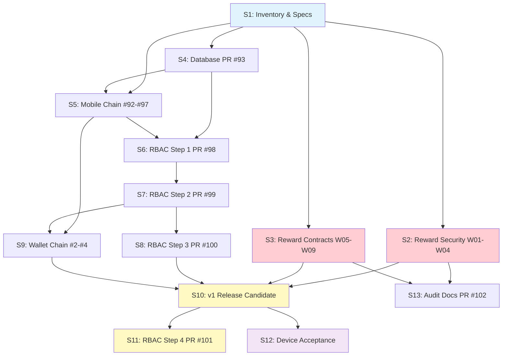

# Staged rollout index

Date: 2026-10-27
Plan status: **S2_IN_PROGRESS** — W01 merged, W02 next
Plan branch: `codex/staged-rollout-plan`
Recommended first stage: **S1** (inventory, specification and independent dependency work)

## Baselines

| Component | Ref | SHA | Notes |
| --- | --- | --- | --- |
| LMS main | `origin/main` | `115d8c4f836a` | Last merged: PR #104 (W01 funding verification gate); prior: PR #90, #86 |
| RBAC candidate | `codex/rbac-schema-retirement` (PR #101 head) | `b8015e27eae1` | Stacked: #98→#99→#100→#101 on main |
| Platform audit | `codex/platform-wiring-audit` (PR #102 head) | `718985fb9f39` | Documentation only; stacked on #101 |
| Database follow-up | `codex/database-integrity-followup` (PR #93) | `70cc27ec5c3d` | Independent of RBAC chain |
| Mobile chain | `codex/local-mobile-services` (PR #97 head) | `e1b0e8ee19bf` | Stacked: #92→#94→#95→#97; #92 is 14 behind main |
| Build-tool advisories | PR #90 | `e35a3fb80b6e` | **MERGED** to main at `5668fd8d` |
| Wallet main | `main` | `a65e19c202f2` | Last: resolve 7 LOW audit findings |
| Wallet chain | `codex/local-mobile-services` (PR #4 head) | `2d63e98b7070` | Stacked: #2→#3→#4 on main |
| Wallet Phase 5 | `fix/phase-5-1-independent-review` (PR #1) | `5b210886c6c3` | Draft; base is `worktree-rbac-billing-audit-2026-10-20` |

## Discovery limits

- No local Amma Wallet clone on this host; assessed via `gh` API only.
- Wallet `fix/phase-5-2-*` through `fix/phase-5-3-*` branches (9 branches) have no PRs. Their relationship to PR #1 is undetermined — owner evidence required.
- LMS branches `test/auth-04-cross-module-tests` and `test/auth-04-sponsor-security-integration` have no PR. They contain historical AUTH-04/05 review docs (3–4 commits each); content appears superseded by merged PRs #73/#74. Recommend retirement after owner confirmation.
- Mobile PR #92 is 14 commits behind main. Rebase required before merge.
- PR #62 (draft device verification docs) is stale; owner decision needed.
- No production image/container SHA verified. Deployed state assumed to match `main` HEAD.
- No physical-device or installed-client evidence available. Marked NOT RUN throughout.

## Tool and skill inventory

| Tool/Skill | Status | Source | Notes |
| --- | --- | --- | --- |
| ripwire | **Available** v0.5.0 | `/home/webadmin/.local/bin/ripwire` | Full codebase mapping and impact analysis |
| Ponytail | **Not installed** | DietrichGebert/ponytail | Record as missing; manual smallest-change discipline applied |
| Caveman | **Not installed** | JuliusBrussee/caveman | Record as missing; concise-update discipline applied manually |
| using-superpowers | **Not loadable** | obra/superpowers | No Claude skill registry on this host |
| find-skills | **Not loadable** | vercel-labs/skills | No Claude skill registry on this host |
| brainstorming | **Not loadable** | — | Applied manually via structured analysis |
| writing-plans | **Not loadable** | — | Applied manually; plans written per conventions |
| test-driven-development | **Not loadable** | — | TDD discipline applied manually in stage specs |
| systematic-debugging | **Not loadable** | — | Debugging protocol documented in stage specs |
| verification-before-completion | **Not loadable** | — | Verification checklist included per stage |
| using-git-worktrees | **Applied** | — | PR #102 worktree at `/home/webadmin/pr102-worktree` |

Missing tools do not block planning. Ponytail and Caveman should be evaluated for installation before execution stages begin. Do not install unreviewed tools on production without operator approval.

## Finding ledger summary

See [STAGED-ROLLOUT-EVIDENCE.md](STAGED-ROLLOUT-EVIDENCE.md) for the complete finding-by-finding ledger.

| Finding | Priority | Status on main | Fix PR | Residual work |
| --- | --- | --- | --- | --- |
| W01 | P1 | **Fixed** — funding verification gate (PR #104 merged at `115d8c4f`); **R1 IN_REVIEW** — internal funding authorization enforced (`codex/w01r1-internal-funding-authorization` at `385e512`) | #104 MERGED; R1 branch pushed | A1-A3,A5 carried forward; A4 addressed by R1 (platform_credit fails closed) |
| W02 | P1 | **Vulnerable** — reward reads lack cross-owner checks; lifecycle has fast-return bypasses | None | Add universal resource-owner scope checks |
| W03 | P1 | **Vulnerable** — `activateReward()` creates allocations for all audience members regardless of `max_recipients` | None | Enforce allocation cap vs reservation invariant |
| W04 | P1 | **Vulnerable** — lesson completion fires `course_completion` outbox event (line 157) per lesson, not per course | None | Make eligibility source-bound to actual course completion |
| W05 | P2 | **Present** — DB enum allows `individual, milestone, course_completion, grade, custom`; UI may offer types outside this set | None | Align UI choices with DB enum |
| W06 | P2 | **Present** — parent reward routes use `childId` as `scopeId` but no family discriminator in the request body | None | Add family/child discriminator to parent reward API |
| W07 | P2 | **Present** — billing route/DTO inconsistencies confirmed in sponsor routes | None | Align billing permissions and DTOs |
| W08 | P2 | **Present** — portal dashboards (Teacher/Parent/Employer) expose action buttons for unfinished features | None | Scope portal actions to implemented capabilities |
| W09 | P2 | **Present** — failed API loads render as empty lists rather than error states | None | Add truthful error/loading states |
| W10 | — | **Integration** — all LMS open PRs CI-green and mergeable; RBAC chain, mobile chain, DB PR need ordered merge | PRs #90–#102 | Ordered merge, rebase #92, combined CI validation |
| W11 | — | **Not started** — no physical device or installed-client acceptance performed | PR #62 (draft) | Device testing, supported-build matrix, fleet gate |
| W12 | — | **Partially addressed** — Wallet has 65 TS diagnostics baseline; dependency PRs open | Wallet #2-#4, LMS #90 | Fix Wallet diagnostics incrementally; merge dependency PRs |

## Stages

| Stage ID | Purpose | Prerequisites | Permitted operations |
| --- | --- | --- | --- |
| **S1** | Inventory, specification and independent dependency merge | None | ~~Read-only assessment, spec writing, safe dependency PR merges (#90, Dependabot)~~ **COMPLETE** — PRs #86 and #90 merged; specs written and reviewed |
| **S2** | Reward security remediation (W01–W04) | S1 specs reviewed | Isolated development, TDD, review branch/PR |
| **S3** | Reward contracts and portal completion (W05–W09) | S2 merged or independent | Isolated development, TDD, review branch/PR |
| **S4** | Database integrity merge and validation (PR #93) | S1 | Merge after revalidation; no schema migration |
| **S5** | Mobile chain rebase, merge and local validation (#92→#94→#95→#97) | S4 merged (shared main baseline) | Rebase, merge, CI validation |
| **S6** | RBAC Step 1 — inventory and policy test acceptance (PR #98) | S4, S5 for clean main baseline | Merge to main; production snapshot required from operator |
| **S7** | RBAC Step 2 — backend cutover rehearsal and merge (PR #99) | S6 accepted | Merge; protected-copy rehearsal (operator) |
| **S8** | RBAC Step 3 — client contracts merge and compatibility window (PR #100) | S7 merged | Merge; client build; compatibility testing |
| **S9** | Wallet chain merge and LMS+Wallet integration (#2→#3→#4) | S5 (local-services for testing), S7 (RBAC backend) | Wallet merges; cross-repo integration test |
| **S10** | Combined release candidate — v1 deployment batch | S6–S9 merged; combined CI green | Build images; deployment manifest; operator approval for merge to production |
| **S11** | RBAC Step 4 — schema contraction (PR #101) | S10 deployed; Step 3 compatibility window closed; installed-client acceptance | Protected-copy contraction; v2 deployment (separate approval) |
| **S12** | Mobile device acceptance and fleet gate (W11) | S10 deployed; candidate native build | Physical device testing; minimum supported build decision |
| **S13** | Platform audit documentation merge (PR #102) | S2–S3 fixes merged; ledger updated | Documentation PR merge |

### Stage dependency DAG

### Merge order (GitHub integration)

1. **Independent of RBAC chain** (can proceed in parallel):
   - ~~PR #90 (build-tool advisories) → main~~ **MERGED** (`5668fd8d`)
   - ~~PR #86 (playwright bump) → main~~ **MERGED** (`c9e9c094`)
   - PR #93 (database integrity) → main
   - Stale Dependabot PRs (#45 cors, #50 express-rate-limit, #53 tailwind-merge) → need `@dependabot rebase` then merge
   - PR #70 (@types/node) → needs investigation (major version bump)
2. **Mobile chain** (sequential after #93 merges for clean baseline):
   - PR #92 (rebase onto current main first) → main
   - PR #94 → retarget to main after #92 merges → main
   - PR #95 → retarget to main after #94 → main
   - PR #97 → retarget to main after #95 → main
3. **RBAC chain** (sequential):
   - PR #98 → main
   - PR #99 → retarget to main after #98 → main
   - PR #100 → retarget to main after #99 → main
4. **Wallet chain** (sequential):
   - Wallet PR #2 → main
   - Wallet PR #3 → retarget to main after #2 → main
   - Wallet PR #4 → retarget to main after #3 → main
5. **Post-v1 deployment**:
   - PR #101 (RBAC Step 4) → main (after v1 deployed and compatibility window closed)
   - PR #102 (audit docs) → retarget to main after #101 merges

### Deployment/client release order

1. **Pre-deployment preparation**: Merge all S1–S9 work. Build candidate LMS image with `authorization-schema=rbac-only-v1`.
2. **v1 deployment batch** (S10): LMS backend + web frontend. Requires operator approval of exact manifest.
3. **Wallet deployment**: After Wallet chain merges. Separate image build and deployment.
4. **Native client release**: After S12 device acceptance. Separate release to app stores.
5. **v2 contraction batch** (S11): LMS backend with `authorization-schema=rbac-only-v2`. Requires separate operator approval after compatibility window closes.

### Database migration order

1. **No migration for S1–S5**: PR #93 preserves legacy completion evidence but does not alter the running schema.
2. **RBAC v1 transition** (S7): Explicit offline `rbac-cutover.mjs --plan/--apply` on protected copy. Adds migration ledger entry, replaces trigger with fence, invalidates sessions. Requires quiesced writers.
3. **RBAC v2 contraction** (S11): Explicit offline `rbac:retire-legacy --plan/--apply`. Drops `users.role` column. Requires accepted Steps 1–3, closed compatibility window, and recovery proof.

No automatic startup migration exists. Both transitions are operator-initiated CLI commands against finalized offline copies.

## Consolidated unresolved decisions

| ID | Decision | Owner | Blocks |
| --- | --- | --- | --- |
| D1 | Production snapshot for RBAC Step 1 inventory | Server operator | S6 |
| D2 | Real account exception decisions from Step 1 output | Server operator | S7 |
| D3 | Legacy PATCH endpoint usage evidence and observation period | Server operator | S7 |
| D4 | Supported installed native app versions / fleet gate | Server operator | S8, S11, S12 |
| D5 | v1 deployment maintenance window and writer quiescence | Server operator | S10 |
| D6 | Wallet Phase 5 branch disposition (9 branches without PRs): retain/promote-to-PR/abandon/defer — owner to specify per branch | Wallet owner | S9 |
| D7 | LMS test/auth-04 branch retention | AI retention decision | S1 — **RESOLVED**: branches retained, no deletion in S1. Content superseded by #73/#74 but retained for audit trail. |
| D8 | PR #62 device verification draft disposition | Owner | S12 |
| D9 | Compatibility window close condition (references D4's minimum supported build decision; D4 is decided first, D9 confirms the fleet meets it) | Server operator | S11 |
| D10 | v2 contraction approval and recovery image proof | Server operator | S11 |
| D11 | Dependabot major version PRs (#43 vitest 5, #46 TS 7, #48 dompurify 4, #49 dompurify types, #51 react-hooks 7) | Developer review | S1 |

## Linked documents

- [STAGED-ROLLOUT-TASKS.md](STAGED-ROLLOUT-TASKS.md) — task ledger with checkbox backlog
- [STAGED-ROLLOUT-EVIDENCE.md](STAGED-ROLLOUT-EVIDENCE.md) — finding ledger, CI evidence, decision log
- [SERVER-HANDOVER-PLATFORM-WIRING-AUDIT.md](SERVER-HANDOVER-PLATFORM-WIRING-AUDIT.md) — audit handover
- [SERVER-HANDOVER-RBAC-RETIREMENT.md](SERVER-HANDOVER-RBAC-RETIREMENT.md) — RBAC step index
- Specs: see task ledger for per-finding spec locations under `docs/superpowers/specs/`

## Completion contract

A completed plan is not an executed stage. A completed development stage is not a merged PR or deployed release. A merged release does not prove database/client/provider acceptance. Keep each state and its evidence explicit.
