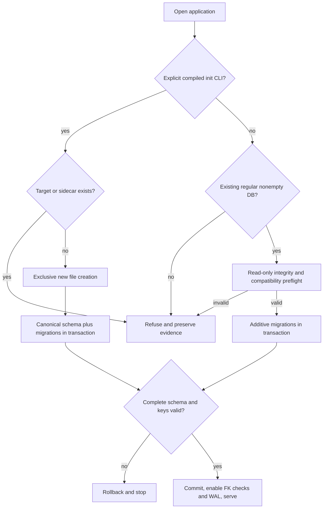
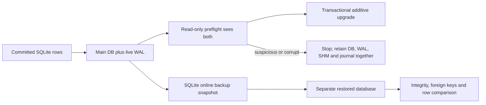
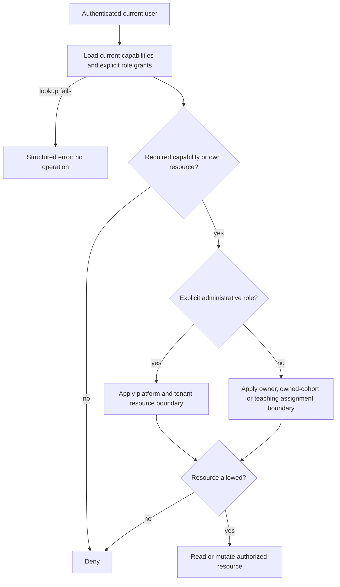
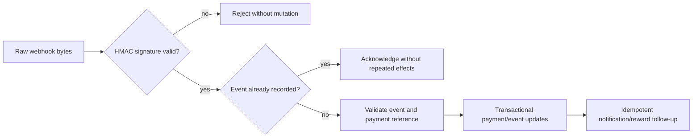
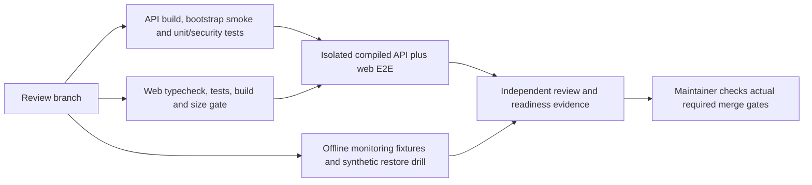
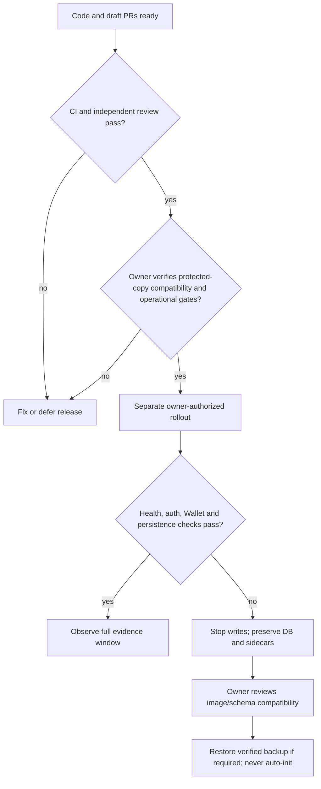

# AUTH-13 application integrity specification

Status: development and review only. Depends on unmerged platform/Wallet integration PR #77. No deployment is authorized. Evidence and operational gates are tracked in the release checklist and readiness report.

## Database invariants and failure paths

Normal startup never creates a missing database, repairs partial data by replaying a schema, rebuilds tables, or creates login accounts. Before a write-capable connection, inspect the existing regular nonempty file read-only, including committed WAL content. Validate integrity, baseline tables/columns, primary/unique/foreign keys and known legacy constraints. Missing or unsupported structures stop startup with preservation guidance.

Only the compiled CLI with `--initialize-new` can request creation. An environment variable or server argument cannot authorize it. Refuse every existing target, including zero bytes, and orphan WAL/SHM/journal sidecars. Use exclusive file creation. Apply `database/schema.sql`, then the same ordered additive migrations/default role/template seeds used on normal startup, in one immediate transaction. Validate the final required-schema contract before commit. A late failure rolls back earlier migrations/seeds. Retain the failed target for inspection; retry on a different new path.

`database/required-schema.json` records the complete current table/column/index/key contract. Future schema additions must update it using a disposable initialized database and add meaningful behavior tests. Additional application/customer objects are allowed. Missing required uniqueness (especially webhook idempotency) is rejected. The contract is a compatibility check, not a substitute for a migration plan or database backup.

Compiled production start is `node dist/server.js`; Docker entrypoint only executes its command. Build before `npm run db:init -- --initialize-new`. `db:schema` aliases this command; alternate schema overrides are removed. Development tsx tools remain available but normal startup and initialization do not invoke them. Source-free layout is exercised by `npm run test:compiled-bootstrap`. Docker build/runtime verification remains a CI/server-owner gate when Docker is unavailable locally.

Acceptance: real subprocess tests cover missing/zero/corrupt/unrelated/partial databases, explicit init and repeated-init refusal, orphan sidecars, valid restart, live WAL, legacy rewards, lost idempotency constraints and late failure rollback. Existing server data requires a separately authorized compatibility check on a protected copy before rollout. Never run initialization or test reset against customer data.

## Administrator and resource scope policy

Administrator identity must come from current explicit built-in role grants, not `billing.confirm`, `course.delete`, a JWT legacy role, an email, or a custom role name. Route capabilities are still required. Nonadministrators retain owner/cohort/assignment scopes even if granted powerful individual permissions. Administrators retain the existing platform/tenant boundaries; an admin label alone never implies cross-tenant course access. Missing context and database lookup failures deny access or produce a structured error without executing the operation.

The legacy insert trigger maps the server-written `users.role` to student/instructor/admin grants. Public registration must ignore supplied roles; trusted administrator provisioning is separate. Startup must not add super-admin based on an email. Explicit existing grants are preserved. Regression includes all admin tiers, custom capability combinations, own/cross/shared/revoked cohort membership, receipts/badges/downloads/mutations, stale context and lookup failures.

## Payment and CI evidence

E2E uses an isolated compiled API and disposable database. Each run generates a synthetic HMAC key shared only with its harness. Never consume a production provider secret. Valid signatures permit provider-event processing; invalid/missing/tampered signatures fail before mutation. Duplicate events must not repeat payment/reward effects. Provider API calls are stubbed where needed.

Green CI is execution evidence, not proof of branch-protection enforcement. Report actual repository protection metadata separately. No automatic issue closure or protection/secret mutation occurs.

## Monitoring, restore and release evidence

The offline verifier must distinguish PASS, PENDING and FAIL using timestamped evidence: complete observation duration, monitoring interval coverage/freshness, expected SHA, health/restarts/errors, container security, backup integrity/restore and dead-man/mail evidence. Missing evidence cannot produce PASS. Successful mail submission is distinct from confirmed receipt. Tests intercept shell commands and never contact the deployment, mail service, Docker daemon or provider.

A synthetic restore drill must snapshot committed WAL rows using SQLite backup, restore separately, and verify integrity, foreign keys and exact row evidence without changing source rows. This is tool validation; production rotation, off-host copies and post-hardening restore remain server-owner evidence requirements.

Rollback must use compatible API/web images and a verified database snapshot. Do not downgrade by deleting the database or by guessing at legacy table rebuilds. Keep historical AUTH-12 evidence distinct from any future AUTH-13 deployment window. Capability dropping, frontend filesystem changes, broad dependencies and installed-device verification remain separate releases.
