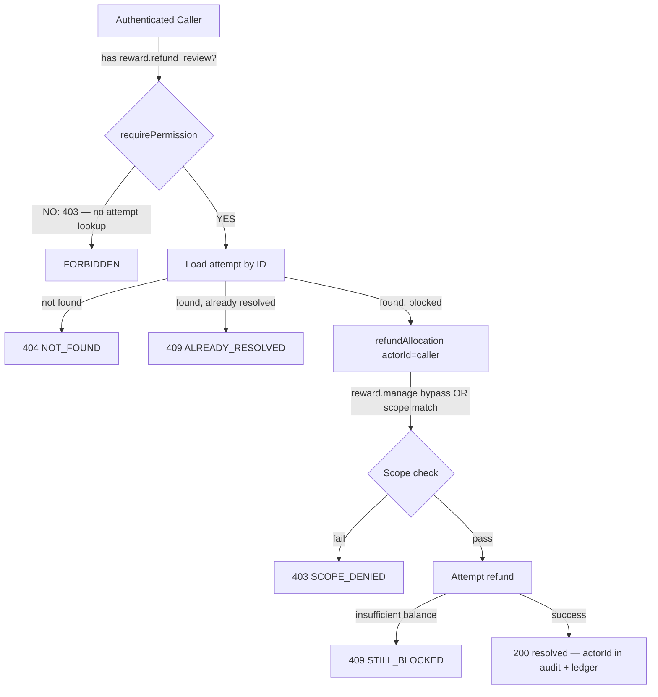

# W02-R2C — Admin Refund Retry: Authenticated-Caller Authorization

**Date:** 2026-10-29  
**Status:** COMPLETE — merged at `5cc386f` (PR #115, 2026-10-29); closure follow-up at `392a62f` (PR #116, 2026-10-30)  
**Branch:** `codex/w02-r2c` (PR #115) / `codex/w02-closure-follow-up` (PR #116)  
**Baseline:** `1229bd97` (PR #114 merged, main HEAD)

---

## Problem Statement

`POST /api/v1/admin/rewards/refund-attempts/:id/retry`
(`LMS-Server/src/routes/adminRewards.ts:86–153`) had two authorization defects:

1. **Wrong capability gate (P1-A):** The endpoint used `requirePermission('reward.refund')`.
   `reward.refund` is a regular sponsor capability (`role_sponsor` line 1052 of
   `database.ts`). Any active sponsor could POST to this route with a known attempt ID.

2. **Historical actor substitution (P1-B):** The route passed
   `attempt.attempted_by_user_id` as the `actorId` to `refundAllocation`. This meant
   scope validation succeeded for the original owner even though the *calling* user was
   someone else entirely. The real caller's authority was never verified against the reward.

Additionally, `refundAllocation`'s fresh write path (`rewardService.ts:778`) omitted the
`reward.manage` bypass that exists on every other path in the service (replay path at
line 758, and all other operations). Without this bypass, an authorized admin reviewer
(who has `reward.manage`) would hit a scope denial on the fresh path.

---

## Authority Diagram



---

## Retry Sequence (post-fix)

```mermaid
sequenceDiagram
    participant C as Authenticated Caller
    participant MW as requirePermission(reward.refund_review)
    participant R as retry handler
    participant S as refundAllocation
    participant DB as Database

    C->>MW: POST /refund-attempts/:id/retry
    alt No reward.refund_review
        MW-->>C: 403 FORBIDDEN — no attempt data
    else Has reward.refund_review
        MW->>R: next()
        R->>DB: SELECT attempt WHERE id = :id
        alt Attempt not found
            R-->>C: 404 NOT_FOUND
        else Already resolved
            R-->>C: 409 ALREADY_RESOLVED
        else Blocked
            R->>S: refundAllocation(allocationId, actorId, key, rewardId)
            Note over S: reward.manage bypass on fresh path — actorId is caller
            alt RewardError (ALLOCATION_NOT_FOUND or SCOPE_DENIED)
                S-->>R: throws RewardError
                R-->>C: 404 or 403 via handleRewardError
            else Success
                S->>DB: ledger entry actor=actorId; UPDATE allocation=refunded
                S-->>R: AllocationRow
                R->>DB: UPDATE attempt resolved_by=actorId; INSERT audit actor=actorId
                R-->>C: 200 {data: attempt, resolved_by=actorId, attempted_by=original}
            else Still blocked
                S-->>R: {blocked:true}
                R-->>C: 409 STILL_BLOCKED
            end
        end
    end
```

---

## Precise Changes (PR #115)

### 1. `LMS-Server/src/routes/adminRewards.ts`

| Line | Before | After |
|------|--------|-------|
| 89 | `requirePermission('reward.refund')` | `requirePermission('reward.refund_review')` |
| 115 | `attempt.attempted_by_user_id as string,` | `actorId,` |
| 111–112 | comment references original actor | update comment: W02-R2C |

### 2. `LMS-Server/src/services/rewards/rewardService.ts`

| Line | Before | After |
|------|--------|-------|
| 778–780 | `if (!validateScope(actorId, ...))` | `if (!hasPermission(actorId, 'reward.manage') && !validateScope(actorId, ...))` |

## Additional Changes (PR #116 — closure follow-up)

### 3. `LMS-Server/src/routes/adminRewards.ts`

Added `RewardError` import, `handleRewardError` helper, and try-catch around `refundAllocation`
call (see F1 below).

---

## Invariants Preserved

- `attempt.attempted_by_user_id` remains the historical record of who originally
  attempted the refund — never used as a proxy for caller authority.
- `resolved_by_user_id` and audit log `actor_user_id` use `actorId` — record the actual caller.
- `reward_transactions` ledger entry uses `actorId` passed to `refundAllocation` —
  records the actual admin, not the historical owner.
- All #114 parent binding checks (allocation.reward_id === requestedRewardId) unchanged;
  missing/mismatched parent still fails closed.
- R1/R1C idempotency binding to resource/action/source/reference unchanged.
- No `skipAuth` flag, no legacy-role bypass, no /admin-prefix assumption.

---

## Requirement-to-Test Matrix

| ID | Requirement | Test | Status |
|----|-------------|------|--------|
| R1 | Unrelated sponsor (reward.refund, no refund_review) → 403 before attempt lookup | RETRY-CALLER-1 | ✅ PR #115 |
| R2 | 403 with restored recipient balance; allocation NOT refunded; no ledger/audit mutation | RETRY-CALLER-2 | ✅ PR #115 |
| R3 | 403 with resolved attempt (no ALREADY_RESOLVED disclosure to unauthorized caller) | RETRY-CALLER-3 | ✅ PR #115 |
| R4 | 403 with unknown attempt ID (auth before DB — 403 not 404) | RETRY-CALLER-4 | ✅ PR #115 |
| R5 | Admin (reward.refund_review) + restored funds → 200, allocation refunded | RETRY-CALLER-5 | ✅ PR #115 |
| R6 | Admin → actual actor in audit log and ledger; historical owner preserved in attempt row | RETRY-CALLER-6 | ✅ PR #115 |
| R7 | Admin + still-blocked funds → 409 STILL_BLOCKED | RETRY-CALLER-7 | ✅ PR #115 |
| R8 | Admin + already-resolved attempt → 409 ALREADY_RESOLVED | RETRY-CALLER-8 | ✅ PR #115 |
| CF-F1-1 | Inconsistent attempt.reward_id → 404 ALLOCATION_NOT_FOUND (not 500) | F1-ERROR-1 | ✅ PR #116 |
| CF-F1-2 | All state unchanged after rejected inconsistent retry | F1-ERROR-2 | ✅ PR #116 |
| CF-F2-1 | review-only role: foreign resolved attempt → 409 ALREADY_RESOLVED (global visibility accepted) | F2-REVIEW-1 | ✅ PR #116 |
| CF-F2-2 | review-only role: unknown attempt → 404 NOT_FOUND | F2-REVIEW-2 | ✅ PR #116 |
| CF-F2-3 | review-only role: foreign blocked attempt → 403 SCOPE_DENIED (not 500) | F2-REVIEW-3 | ✅ PR #116 |
| CF-F2-4 | manage-only role: retry endpoint → 403 FORBIDDEN before lookup | F2-MANAGE-1 | ✅ PR #116 |
| CF-F2-5 | review-only role: list endpoint returns all attempts (global visibility) | F2-LIST-1 | ✅ PR #116 |

---

## Iterative Checkbox TDD Plan

- [x] Write RETRY-CALLER-1 through RETRY-CALLER-4 (RED — failed on main before fix)
- [x] Run RED: confirmed 1–4 failed, existing tests passed
- [x] Apply changes to adminRewards.ts + rewardService.ts
- [x] Run GREEN: confirmed 1–4 passed
- [x] Write RETRY-CALLER-5 through RETRY-CALLER-8 (GREEN from start — positive + attribution)
- [x] Run full affected suites: reward-admin-refund-caller-auth, reward-refund-admin, reward-nested-parent, reward-idempotency-binding, reward-cross-owner
- [x] TypeScript build: clean
- [x] Independent AI security review: APPROVED (Opus)
- [x] Fresh candidate CI (all 4 jobs): run 40894071751 — PASS
- [x] Claude merged exact reviewed head `b1ef80e` → main `5cc386f` (PR #115, 2026-10-29)
- [x] Verified resulting main CI: run 40895057757 — SUCCESS (4/4)

---

## Closure Follow-Up (PR #116, 2026-10-30)

Post-merge independent laptop testing against `5cc386f` found two findings not covered
by the original 8 tests.

### F1 — Error-contract defect (confirmed, fixed in PR #116)

**Root cause:** The retry handler called `refundAllocation` with no try-catch. `refundAllocation`
throws `RewardError(ALLOCATION_NOT_FOUND, 404)` when `allocation.reward_id !== requestedRewardId`
(inconsistent attempt row). Since `RewardError` does not extend `AppError`, the Express error
handler (which only checks `instanceof AppError`) returned HTTP 500.

The same issue caused HTTP 500 (instead of 403) when a `reward.refund_review`-only caller
(no `reward.manage`) attempted to retry a foreign blocked attempt — `refundAllocation`'s
`SCOPE_DENIED` `RewardError` was also not caught.

**Fix:** Added `RewardError` import, `handleRewardError` function, and try-catch around the
`refundAllocation` call in the retry handler — following the established pattern in
`sponsor.ts`, `employer.ts`, `teacher.ts`, and `parent.ts`.

**Tests:** `F1-ERROR-1` (404 not 500), `F1-ERROR-2` (all state unchanged).

### F2 — Visibility policy determination (documented, not a defect)

**Observation:** A custom role with only `reward.refund_review` (no `reward.manage`) receives:
- 409 ALREADY_RESOLVED for a foreign resolved attempt
- 404 NOT_FOUND for an unknown attempt

**Policy determination:** `reward.refund_review` deliberately grants **global** attempt visibility.
Evidence: the list endpoint (`GET /admin/rewards/refund-attempts`) also requires only
`reward.refund_review` and returns all attempts globally with no scope filter. The 409/404
responses on retry are consistent with this grant — they do not add disclosure beyond what the
list already grants.

**Mutation boundary:** Mutation authority requires `reward.manage` (bypass) or scope ownership —
enforced in `refundAllocation`. After the F1 fix, a `reward.refund_review`-only user attempting
to retry a foreign blocked attempt correctly receives 403 SCOPE_DENIED (not 500).

**Tests:** `F2-REVIEW-1/2/3` (visibility contract), `F2-MANAGE-1` (manage-only blocked at
route gate), `F2-LIST-1` (global list visibility confirmed).

### Closure follow-up checklist

- [x] F1-ERROR-1/2: RED on `5cc386f` (500 not 404/403), GREEN after fix
- [x] F2-REVIEW-1/2: GREEN immediately (409/404 already correct)
- [x] F2-REVIEW-3/MANAGE-1/LIST-1: GREEN after F1 fix
- [x] 131 affected tests (7 suites): all pass, 0 regressions
- [x] TypeScript build: clean
- [x] Independent code/security review: APPROVED
- [x] Fresh CI (all 4 jobs): PASS
- [x] Merged → main verified
