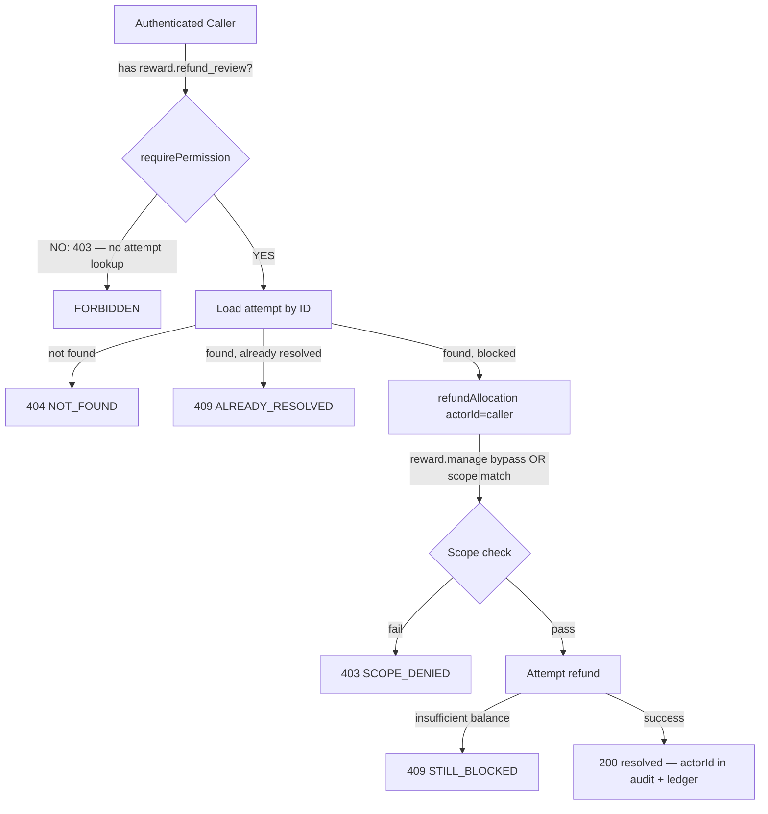

# W02-R2C — Admin Refund Retry: Authenticated-Caller Authorization

**Date:** 2026-10-29  
**Status:** IN PROGRESS  
**Branch:** `codex/w02-r2c`  
**Baseline:** `1229bd97` (PR #114 merged, main HEAD)

---

## Problem Statement

`POST /api/v1/admin/rewards/refund-attempts/:id/retry`
(`LMS-Server/src/routes/adminRewards.ts:86–153`) has two authorization defects:

1. **Wrong capability gate (P1-A):** The endpoint uses `requirePermission('reward.refund')`.
   `reward.refund` is a regular sponsor capability (`role_sponsor` line 1052 of
   `database.ts`). Any active sponsor can POST to this route with a known attempt ID.

2. **Historical actor substitution (P1-B):** The route passes
   `attempt.attempted_by_user_id` as the `actorId` to `refundAllocation`. This means
   scope validation succeeds for the original owner even though the *calling* user is
   someone else entirely. The real caller's authority is never verified against the reward.

Additionally, `refundAllocation`'s fresh write path (`rewardService.ts:778`) omits the
`reward.manage` bypass that exists on every other path in the service (replay path at
line 758, and all other operations). This means that even if we pass the correct
`actorId`, an authorized admin reviewer (who has `reward.manage`) would hit a scope
denial on the fresh path.

---

## Authority Diagram



---

## Retry Sequence (post-fix)

```mermaid
sequenceDiagram
    participant C as Authenticated Caller
    participant MW as requirePermission(reward.refund_review)
    participant R as retry handler
    participant S as refundAllocation
    participant DB as Database

    C->>MW: POST /refund-attempts/:id/retry
    alt No reward.refund_review
        MW-->>C: 403 FORBIDDEN — no attempt data
    else Has reward.refund_review
        MW->>R: next()
        R->>DB: SELECT attempt WHERE id = :id
        alt Attempt not found
            R-->>C: 404 NOT_FOUND
        else Already resolved
            R-->>C: 409 ALREADY_RESOLVED
        else Blocked
            R->>S: refundAllocation(allocationId, actorId, key, rewardId)
            Note over S: reward.manage bypass on fresh path — actorId is caller
            alt Scope denied (no manage, no scope)
                S-->>R: SCOPE_DENIED 403
                R-->>C: 403
            else Success
                S->>DB: ledger entry actor=actorId; UPDATE allocation=refunded
                S-->>R: AllocationRow
                R->>DB: UPDATE attempt resolved_by=actorId; INSERT audit actor=actorId
                R-->>C: 200 {data: attempt, resolved_by=actorId, attempted_by=original}
            else Still blocked
                S-->>R: {blocked:true}
                R-->>C: 409 STILL_BLOCKED
            end
        end
    end
```

---

## Precise Changes

### 1. `LMS-Server/src/routes/adminRewards.ts`

| Line | Before | After |
|------|--------|-------|
| 89 | `requirePermission('reward.refund')` | `requirePermission('reward.refund_review')` |
| 115 | `attempt.attempted_by_user_id as string,` | `actorId,` |
| 111–112 | comment references original actor | update comment: W02-R2C |

### 2. `LMS-Server/src/services/rewards/rewardService.ts`

| Line | Before | After |
|------|--------|-------|
| 778–780 | `if (!validateScope(actorId, ...))` | `if (!hasPermission(actorId, 'reward.manage') && !validateScope(actorId, ...))` |

---

## Invariants Preserved

- `attempt.attempted_by_user_id` remains the historical record of who originally
  attempted the refund — never used as a proxy for caller authority.
- `resolved_by_user_id` and audit log `actor_user_id` already use `actorId` in the
  handler — these continue to record the actual caller.
- `reward_transactions` ledger entry uses `actorId` passed to `refundAllocation` —
  after fix, this records the actual admin, not the historical owner.
- All #114 parent binding checks (allocation.reward_id === requestedRewardId) are
  unchanged; missing/mismatched parent still fails closed.
- R1/R1C idempotency binding to resource/action/source/reference unchanged.
- No `skipAuth` flag, no legacy-role bypass, no /admin-prefix assumption.

---

## Requirement-to-Test Matrix

| ID | Requirement | Test |
|----|-------------|------|
| R1 | Unrelated sponsor (reward.refund, no reward.refund_review) → 403 before attempt lookup | RETRY-CALLER-1 |
| R2 | 403 with restored recipient balance; allocation NOT refunded; no ledger/audit mutation | RETRY-CALLER-2 |
| R3 | 403 with resolved attempt (no ALREADY_RESOLVED disclosure to unauthorized caller) | RETRY-CALLER-3 |
| R4 | 403 with unknown attempt ID (auth before DB — 403 not 404) | RETRY-CALLER-4 |
| R5 | Admin (reward.refund_review) + restored funds → 200, allocation refunded | RETRY-CALLER-5 |
| R6 | Admin → actual actor in audit log and ledger; historical owner preserved in attempt row | RETRY-CALLER-6 |
| R7 | Admin + still-blocked funds → 409 STILL_BLOCKED | RETRY-CALLER-7 |
| R8 | Admin + already-resolved attempt → 409 ALREADY_RESOLVED | RETRY-CALLER-8 |

---

## Iterative Checkbox TDD Plan

- [ ] Write RETRY-CALLER-1 through RETRY-CALLER-4 (RED — must fail on current main)
- [ ] Run RED: confirm 1–4 fail, existing tests pass
- [ ] Apply changes to adminRewards.ts + rewardService.ts
- [ ] Run GREEN: confirm 1–4 pass
- [ ] Write RETRY-CALLER-5 through RETRY-CALLER-8 (GREEN from start — positive + attribution)
- [ ] Run full affected suites: reward-admin-refund-caller-auth, reward-refund-admin, reward-nested-parent, reward-idempotency-binding, reward-cross-owner
- [ ] TypeScript build
- [ ] Independent AI security review
- [ ] Fresh candidate CI (all 4 jobs)
- [ ] Claude merge exact reviewed head
- [ ] Verify resulting main CI
