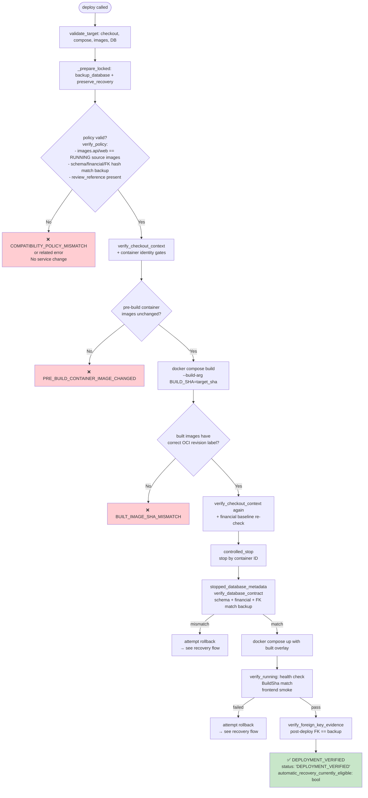
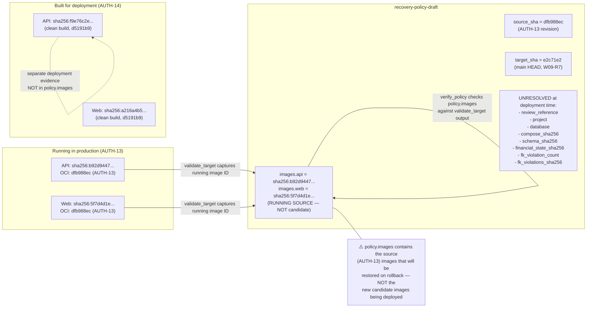

# AUTH-14 Deployment and Recovery Decision Flow

> Date: 2026-11-02  
> File: `scripts/release_recovery.py`  
> Covers: partial stop, changed database evidence, unverified containment

## Full Deployment Decision Flow

## Recovery Decision Flow (Partial Stop and Rollback)

```mermaid
flowchart TD
    subgraph CS["controlled_stop (AUTH-14 change)"]
        CS1[current_containers\nrequire_running=FALSE\nvalidate_database_configuration=FALSE\nAll identity gates still enforced]
        CS2[capture container IDs]
        CS3["docker container stop --time 30\n[id1, id2]"]
        CS4{both stopped\nand State.Running=false?}
        CS5["❌ RECOVERY_STOP_NOT_VERIFIED\n→ CONTAINMENT_UNVERIFIED"]
        CS6["✅ Containers stopped\nID-verified"]
        CS1 --> CS2 --> CS3 --> CS4
        CS4 --"No"--> CS5
        CS4 --"Yes"--> CS6
    end

    subgraph SDB["stopped_database_metadata"]
        SDB1{"WAL + SHM\nboth exist?"}
        SDB2["_source_metadata\n(live reader mode)"]
        SDB3{"any sidecar\nexists alone?"}
        SDB4["❌ STOPPED_DATABASE_SIDECAR_STATE_UNKNOWN"]
        SDB5["sqlite3 immutable=1\n(safe: no active writer)"]
        SDB6{file unchanged\nafter read?}
        SDB7["❌ STOPPED_DATABASE_CHANGED"]
        SDB8["✅ metadata returned"]
        SDB1 --"Yes (both)"--> SDB2
        SDB1 --"No"--> SDB3
        SDB3 --"Yes"--> SDB4
        SDB3 --"No"--> SDB5
        SDB5 --> SDB6
        SDB6 --"No"--> SDB7
        SDB6 --"Yes"--> SDB8
    end

    subgraph ROLLBACK["Rollback path"]
        R1[load_manifest\nverify eligibility=EXACT_SCHEMA_AND_FINANCIAL_STATE]
        R2[verify_checkout_context\nidentity gates]
        R3[verify_backup\nchecksum + evidence + contract]
        R4[verify_policy\nreview_reference + all hash gates]
        R5[inspect retained recovery tags\nimage IDs + OCI revision]
        R6[controlled_stop]
        R7[stopped_database_metadata\nverify_database_contract]
        R8["write rollback overlay\n(if not exists)"]
        R9[docker compose up\nwith rollback overlay]
        R10[verify_running\nhealth + buildSha == source_sha]
        R11[verify_database_contract\npost-rollback]
        R12["✅ ROLLBACK_VERIFIED"]
        R13["❌ ROLLBACK_FAILED_SERVICES_STOPPED"]

        R1 --> R2 --> R3 --> R4 --> R5 --> R6
        R6 --"stop succeeds"--> R7
        R7 --"contract match"--> R8 --> R9 --> R10
        R10 --"pass"--> R11 --> R12
        R10 --"fail"--> R6_retry[controlled_stop again] --> R13
        R7 --"mismatch"--> R13
    end

    subgraph OUTCOMES["Deploy failure outcomes"]
        O1["Deploy fails → Rollback attempted"]
        O2["DEPLOYMENT_FAILED_RECOVERY_VERIFIED\n(old image running again)"]
        O3["DEPLOYMENT_FAILED_RECOVERY_REFUSED_SERVICES_STOPPED\n(rollback failed, but stop succeeded)"]
        O4["DEPLOYMENT_FAILED_RECOVERY_REFUSED_CONTAINMENT_UNVERIFIED\n(rollback failed, stop also failed)"]

        O1 --"rollback succeeds"--> O2
        O1 --"rollback fails, stop succeeds"--> O3
        O1 --"rollback fails, stop fails"--> O4
    end

    style CS5 fill:#ffcdd2
    style SDB4 fill:#ffcdd2
    style SDB7 fill:#ffcdd2
    style R13 fill:#ffe0b2
    style R12 fill:#c8e6c9
    style O2 fill:#ffe0b2
    style O3 fill:#ffcdd2
    style O4 fill:#ffcccc
```

## verify_policy: Source Images vs. Candidate Images

## Writer Admission Sequence

```mermaid
gantt
    title Maintenance Window — Writer Admission Sequence
    dateFormat HH:mm
    axisFormat %H:%M

    section Running State
    All writers active (lms-api running)    : active, w1, 00:00, 5m

    section Pre-Stop
    Preflight capture (release_preflight.py): pf, 00:05, 3m

    section Stop
    docker stop lms-api (SIGTERM + 30s)    : crit, stop, 00:08, 2m
    Writers cease (all 9 writer types)     : milestone, m1, 00:10, 0m

    section Migration
    WAL checkpoint                         : wc, 00:10, 1m
    WAL-consistent backup (sqlite3.backup) : bk, 00:11, 1m
    Migration --plan (verify FK hash)      : plan, 00:12, 1m
    Migration --apply --fk-count N --fk-sha256 H : migrate, 00:13, 2m

    section Candidate Launch
    docker compose up (candidate image)    : launch, 00:15, 2m
    verify_running (health + buildSha)     : verify, 00:17, 1m

    section Recovery window
    Automatic rollback eligible            : rollback, 00:18, 30m
```

## Known Unknowns (Trust Boundaries)

| Claim | Status | Reason |
|-------|--------|--------|
| "60 seconds bounds the outage" | ❌ Not guaranteed | `verify_running` deadline is 60s, actual depends on startup/health |
| "Automatic rollback is guaranteed" | ❌ Not guaranteed | Rollback requires Docker, network, retained images to remain available |
| "Clean self-contained DB after stop" | ✅ Verified by sidecar check | `stopped_database_metadata` checks for WAL/SHM sidecars |
| "No financial writes during migration" | ✅ By construction | All writers in `lms-api` container; stop precedes migration |
| "Rollback safe after migration" | ✅ Conditional | Only while `release_unused` row count = 0 (currently 0) |
| "AUTH-13 rollback image retained" | ✅ Recovery capture tags it | Tagged as `lms-ammawallet-recovery-{api,web}:MANIFEST_ID` |
