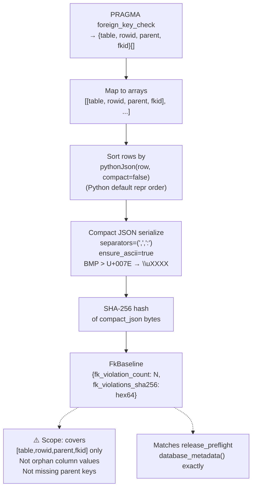
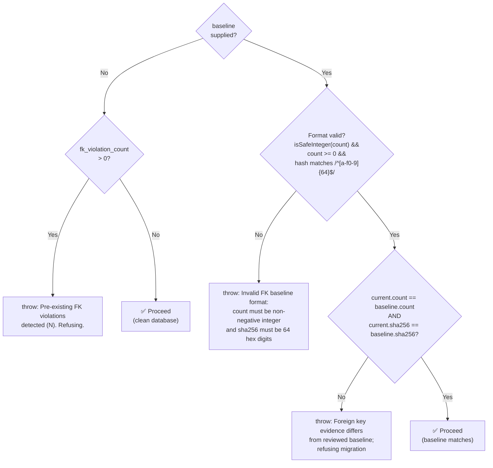
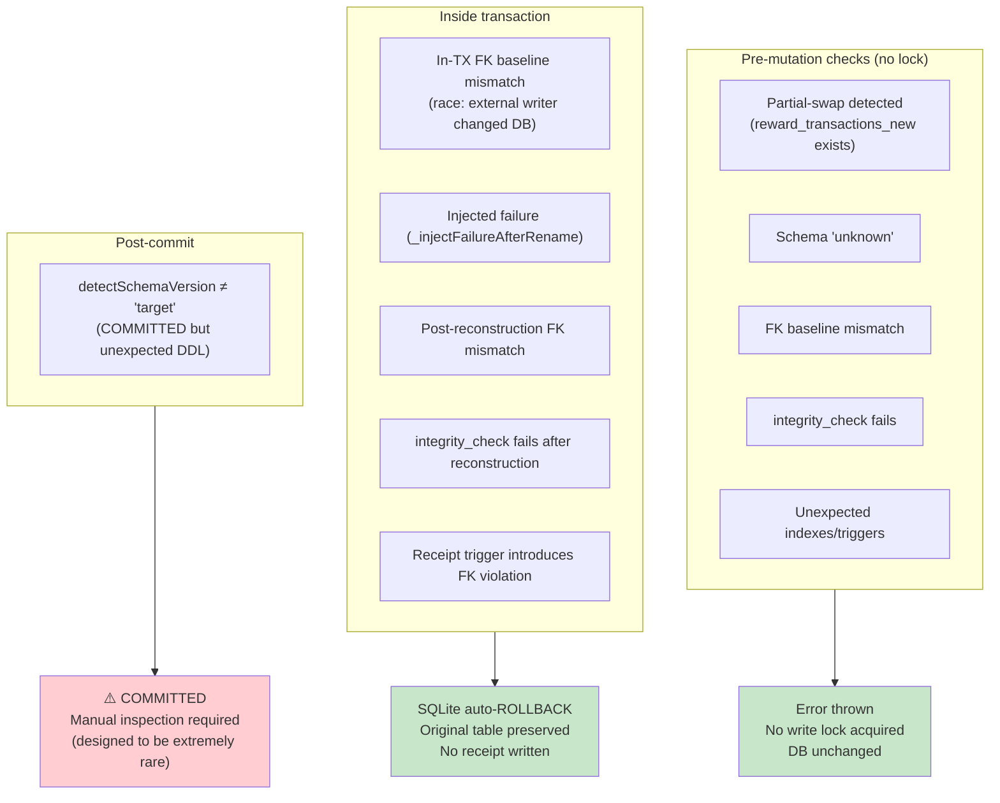

# AUTH-14 FK Baseline and Migration Transaction Sequence

> Date: 2026-11-02  
> File: `LMS-Server/src/scripts/migrateRewardTxnCheck.ts`

## FK Evidence Fingerprint Algorithm



## `requireFkBaseline` Decision Logic



## Migration Transaction Sequence

```mermaid
sequenceDiagram
    participant CLI as CLI / caller
    participant Phase1 as Phase 1: Pre-mutation
    participant TX as Phase 2: Transaction (BEGIN IMMEDIATE)
    participant Phase3 as Phase 3: Post-commit
    participant DB as SQLite DB

    CLI->>Phase1: applyUpgrade(dbPath, {fkBaseline})
    
    rect rgb(255, 248, 220)
        note over Phase1,DB: Phase 1 — Pre-mutation checks (no lock held yet)
        Phase1->>DB: SELECT reward_transactions_new (partial-swap check)
        Phase1->>DB: detectSchemaVersion → 'source'
        Phase1->>DB: requireFkBaseline(conn, baseline) ← Race window: external writers could change FK state here
        Phase1->>DB: integrity_check == 'ok'
        Phase1->>DB: inventoryDependencies == []
    end

    rect rgb(220, 240, 255)
        note over TX,DB: Phase 2 — Immediate transaction (write lock acquired)
        TX->>DB: PRAGMA legacy_alter_table = ON
        TX->>DB: PRAGMA foreign_keys = OFF
        TX->>DB: BEGIN IMMEDIATE ← write lock acquired; no other writers
        TX->>DB: requireFkBaseline ← in-tx check (catches phase 1 race)
        TX->>DB: detectSchemaVersion + inventoryDependencies (re-check)
        TX->>DB: CREATE TABLE reward_transactions_new (target DDL)
        TX->>DB: INSERT INTO reward_transactions_new SELECT ... FROM reward_transactions
        TX->>DB: DROP TABLE reward_transactions
        TX->>DB: ALTER TABLE reward_transactions_new RENAME TO reward_transactions
        TX->>DB: CREATE INDEX × 4 (reward, allocation, idem, fund_ref_unique)
        TX->>DB: requireFkBaseline ← after reconstruction
        TX->>DB: integrity_check == 'ok'
        TX->>DB: INSERT OR REPLACE INTO system_config (migration receipt)
        TX->>DB: INSERT OR REPLACE INTO system_config (fk_baseline, if provided)
        TX->>DB: requireFkBaseline ← after receipt writes (trigger guard)
        TX->>DB: COMMIT
    end

    rect rgb(220, 255, 220)
        note over Phase3,DB: Phase 3 — Post-commit verification
        Phase3->>DB: PRAGMA legacy_alter_table = OFF
        Phase3->>DB: PRAGMA foreign_keys = ON
        Phase3->>DB: detectSchemaVersion == 'target' ← final fingerprint
        Phase3->>CLI: {success: true, rowsCopied: N, alreadyAtTarget: false}
    end
```

## Error and Rollback Paths


