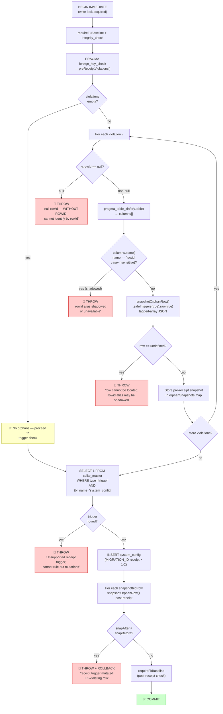
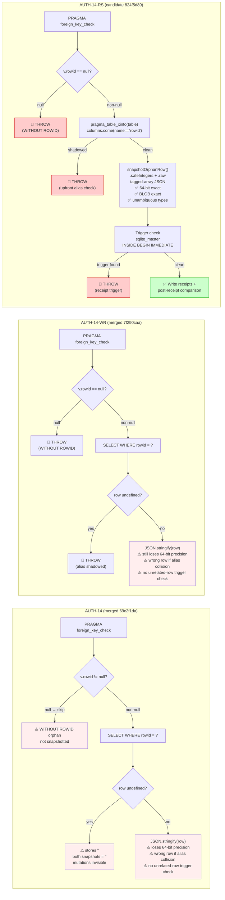
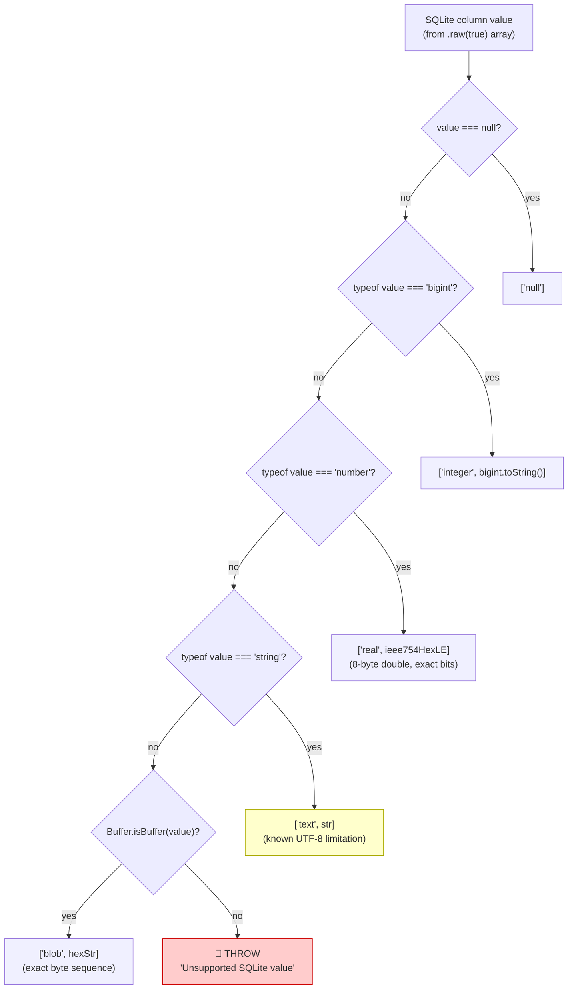
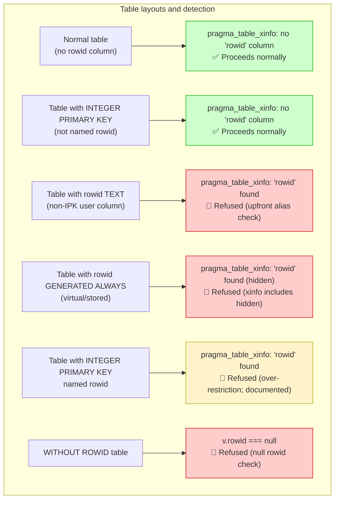

# AUTH-14-RS: Rowid Snapshot Guard — Flow Diagrams

> Date: 2026-11-02  
> Candidate: `824f5d89885b094d1d39d2d63bb47783c0b2bd29`  
> Base: `7f290caa39c190b6093c6bd1a10b35dffaa44426` (AUTH-14-WR)

---

## Updated Orphan Snapshot Loop + Trigger Check (AUTH-14-RS)

---

## Three-Generation Guard Evolution

---

## `snapshotOrphanRow` Serialization Format

**Limitation note**: TEXT values with invalid UTF-8 bytes may not round-trip losslessly through the Node.js string layer. This is a known limitation documented in `AUTH-14-ROWID-SNAPSHOT-SAFETY.md`.

---

## Rowid Alias Behaviour — `pragma_table_xinfo` Coverage

