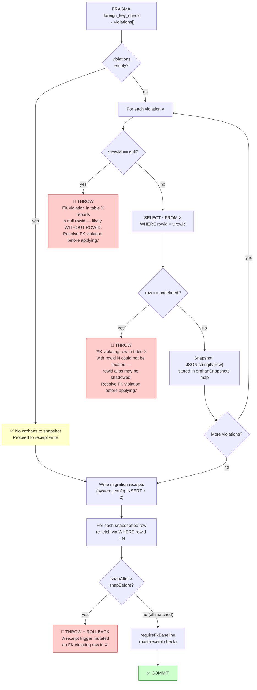
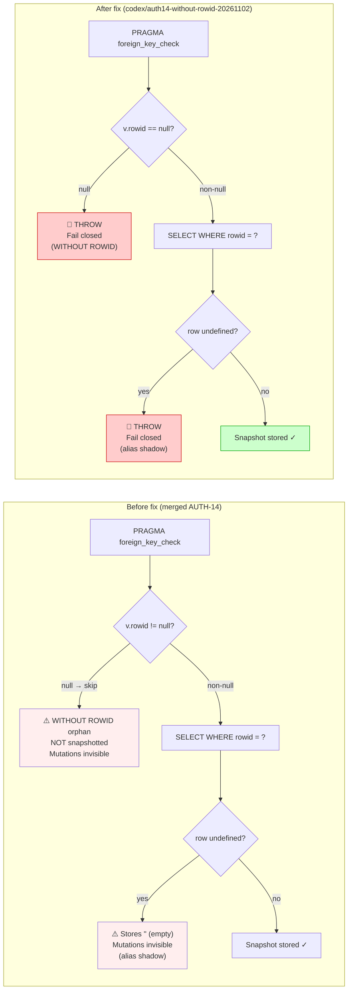
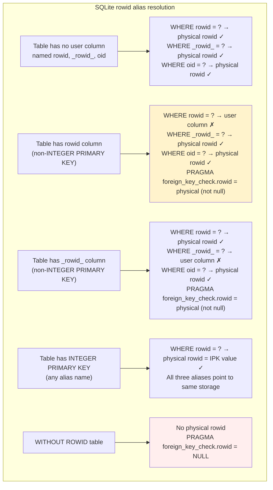

# AUTH-14-WR: Orphan Snapshot Fail-Closed Flow

> Date: 2026-11-02  
> File: `LMS-Server/src/scripts/migrateRewardTxnCheck.ts`  
> Context: Fix for WITHOUT ROWID and rowid-alias-shadowing gaps in orphan snapshot loop

## Updated Orphan Snapshot Guard (inside transaction)

## Before vs After Fix

## SQLite Rowid Alias Behaviour Reference

The fix handles T2 (rowid-alias shadow → undefined lookup → fail closed) and T5 (WITHOUT ROWID → null rowid → fail closed). T3 is handled correctly by existing `WHERE rowid = ?` without changes.
