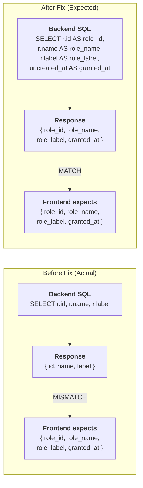
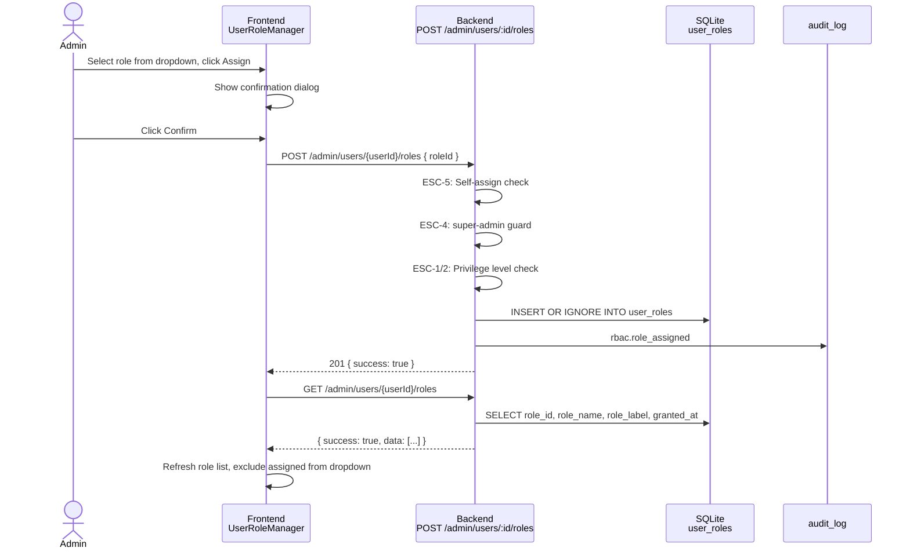
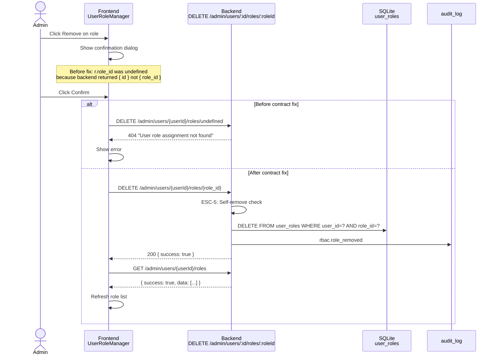
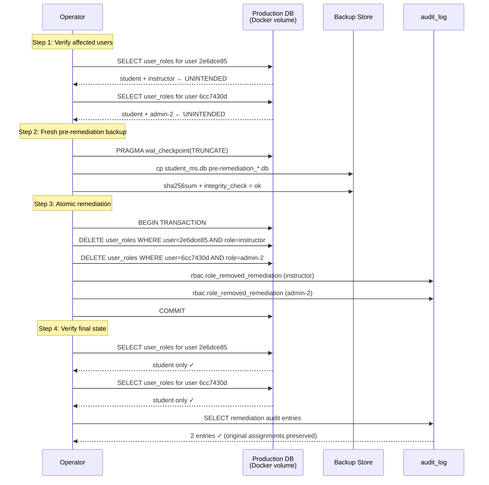

# RBAC Remediation — Mermaid Diagrams

## 1. Actual vs Expected GET /admin/users/:id/roles Response Contract



## 2. Role Assignment Sequence



## 3. Role Removal Sequence (including previous undefined-roleId failure)



## 4. Privilege Boundary Decision Flow

```mermaid
flowchart TD
  A[POST /admin/users/:id/roles<br/>{ roleId }] --> B{Authenticated?}
  B -->|No| C[401 Unauthorized]
  B -->|Yes| D{Has user.assign_role<br/>permission?}
  D -->|No| E[403 Insufficient<br/>permissions]
  D -->|Yes| F{roleId provided?}
  F -->|No| G[400 roleId is<br/>required]
  F -->|Yes| H{Role exists?}
  H -->|No| I[404 Role not found]
  H -->|Yes| J{ESC-5:<br/>Self-assign?}
  J -->|Yes| K[403 Cannot assign<br/>roles to yourself]
  J -->|No| L{ESC-4:<br/>super-admin?}
  L -->|Yes| M[403 super-admin<br/>cannot be assigned<br/>via API]
  L -->|No| N{ESC-1/2:<br/>targetLevel ≥<br/>assignerLevel?}
  N -->|Yes| O[403 Cannot assign<br/>role with equal or<br/>higher privilege]
  N -->|No| P[INSERT INTO<br/>user_roles]
  P --> Q[Audit log]
  Q --> R[201 Role assigned]
```

## 5. Production Remediation and Verification Sequence


