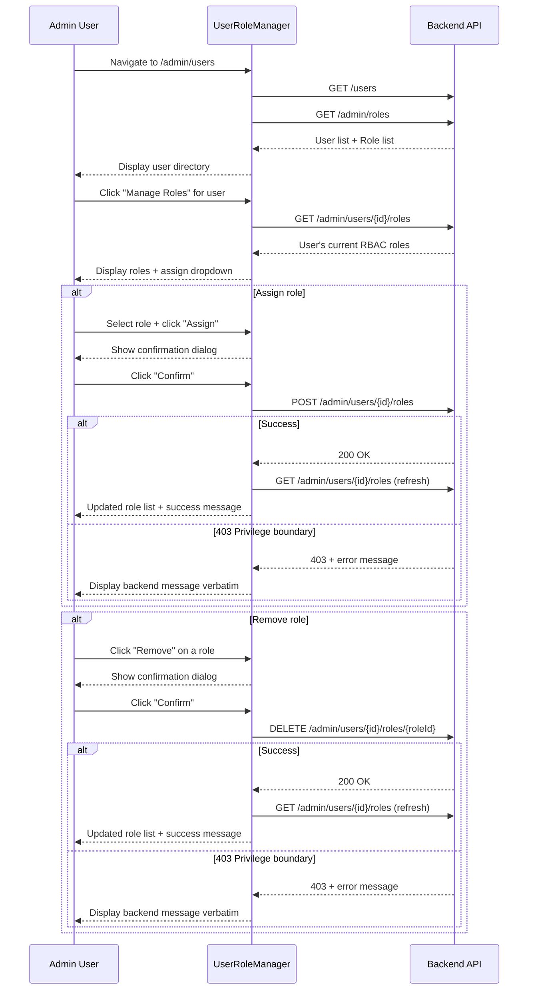

# Admin User Role Manager — Developer Specification

**Date**: 2026-10-14
**Branch**: `feat/admin-user-role-manager`
**Base**: `assess/rbac-instawards-d2` @ `e8cb060`

---

## 1. Overview

The Admin User Role Manager provides a frontend interface for authorized
administrators to view, assign, and remove RBAC roles for any user in the
system. It relies entirely on existing backend endpoints — no new API routes,
permissions, or migrations are introduced.

### Route

| Path            | Nav Label    | Visibility      |
|-----------------|-------------|-----------------|
| `/admin/users`  | User Roles  | Admin role only |

---

## 2. Architecture

### Files Created

| File | Purpose |
|------|---------|
| `LMS-Frontend/src/components/UserRoleManager.tsx` | Two-panel RBAC role management UI |
| `LMS-Frontend/src/__tests__/UserRoleManager.test.tsx` | 10 acceptance tests (URM-01 – URM-10) |

### Files Modified

| File | Change |
|------|--------|
| `LMS-Frontend/src/App.tsx` | Added `/admin/users` route with `ProtectedRoute allowedRole="admin"` |
| `LMS-Frontend/src/components/Layout.tsx` | Added "User Roles" nav item to admin navigation array |

### Services Consumed (existing, unmodified)

| Service | Method | Purpose |
|---------|--------|---------|
| `usersService` | `getUsers()` | Load all users for the left panel directory |
| `rbacService` | `getRoles()` | Load all assignable RBAC roles |
| `rbacService` | `getUserRoles(userId)` | Load a selected user's current RBAC assignments |
| `rbacService` | `assignUserRole(userId, roleId)` | Assign a role to a user |
| `rbacService` | `removeUserRole(userId, roleId)` | Remove a role from a user |

---

## 3. UI Design

### Left Panel (User Directory)

- **Search**: Client-side filtering by name or email (type `search`, `aria-label="Search users"`)
- **Table columns**: Name, Email, Legacy Role, Actions
- **Action button**: "Manage Roles" selects the user and opens the right panel
- Selected row is highlighted with a teal accent background

### Right Panel (Role Management)

- **User header**: Name, email, close button
- **Current RBAC roles**: Listed with per-role "Remove" button
- **Privilege boundary note**: Non-blocking informational banner:
  > "The backend enforces role privilege boundaries. Attempts to assign or
  > remove a role outside your permitted level will be rejected."
- **Assign role**: `<select>` dropdown (excludes already-assigned roles) + "Assign" button
- **Confirmation dialog**: Both assign and remove actions require explicit confirmation
- **Success/error feedback**: Inline status/alert banners with `role="status"` / `role="alert"`

### States

| State | Behavior |
|-------|----------|
| Loading | Spinner with "Loading users..." / "Loading roles..." |
| Empty | "No users found." / "No RBAC roles assigned." |
| Error | Error message + "Retry" button |
| Network failure | Error message from `getErrorMessage()` utility |
| Success | Green confirmation banner |
| 403 rejection | Backend error message displayed **verbatim** |

---

## 4. Privilege Boundary Handling

The frontend does **not** filter or hide roles. All assignable roles appear in
the dropdown. The backend is authoritative:

1. All roles shown in dropdown (backend decides what is allowed)
2. Backend 403 messages are displayed verbatim to the admin
3. Informational note explains the privilege boundary enforcement
4. No frontend copy of the privilege hierarchy

---

## 5. Accessibility

- Semantic `<table>` for user directory
- `<select>` element with `aria-label` for role assignment
- All buttons have explicit `aria-label` attributes
- Confirmation dialog uses `role="alertdialog"`
- Feedback uses `role="status"` (success) and `role="alert"` (error)
- Keyboard operable throughout
- `type="search"` input for user search

---

## 6. Mermaid Diagram — Admin Role Management Flow



---

## 7. Test Matrix

| ID | Test Name | Category | Assertion |
|----|-----------|----------|-----------|
| URM-01 | Renders loading then displays user list | Rendering | Loading indicator shown, then users appear |
| URM-02 | Search filters by name or email | Filtering | Only matching users visible after typing |
| URM-03 | Table has correct column headers | Structure | Name, Email, Legacy Role, Actions columns present |
| URM-04 | Selecting a user loads RBAC roles | Integration | `getUserRoles` called, roles displayed in right panel |
| URM-05 | Dropdown excludes assigned roles | Logic | Already-assigned roles filtered from `<select>` options |
| URM-06 | Assign with confirmation + refresh | Mutation | Confirmation shown, `assignUserRole` called, roles refreshed |
| URM-07 | Remove with confirmation + refresh | Mutation | Confirmation shown, `removeUserRole` called, roles refreshed |
| URM-08 | Network error shows retry | Error handling | Error message displayed, retry loads data |
| URM-09 | 403 message displayed verbatim | Privilege boundary | Backend 403 error text shown exactly as returned |
| URM-10 | Privilege boundary note displayed | Information | Informational note about backend enforcement visible |

---

## 8. Task Checklist

- [x] Create feature branch `feat/admin-user-role-manager` from `assess/rbac-instawards-d2`
- [x] Write 10 failing acceptance tests (URM-01 – URM-10)
- [x] Verify tests fail for expected reason (component module not found)
- [x] Implement `UserRoleManager.tsx` component
- [x] Register `/admin/users` route in `App.tsx`
- [x] Add "User Roles" navigation item in `Layout.tsx`
- [x] All 10 tests pass
- [x] Full test suite passes (412/412)
- [x] TypeScript type check clean
- [x] Production build succeeds
- [x] ESLint clean on new files (pre-existing issues unchanged)
- [x] Write documentation and demo script
- [x] Create focused commits
- [ ] Manual demonstration (requires running environment)

---

## 9. Manual Demonstration Script

> **Environment**: Local dev or staging with synthetic test users.
> Do NOT run against production data.

### Prerequisites

- LMS backend running (e.g., `npm run dev` in LMS-Server)
- LMS frontend running (e.g., `npm run dev` in LMS-Frontend)
- Test users seeded: at least one admin, one student, one lecturer

### Steps

1. **Sign in as admin**
   - Navigate to `http://localhost:5173/login`
   - Log in with an admin test account

2. **Navigate to User Role Manager**
   - Click "User Roles" in the sidebar navigation
   - URL should be `/admin/users`

3. **Verify user directory**
   - Confirm all seeded users appear in the table
   - Columns: Name, Email, Legacy Role, Actions

4. **Search for a test user**
   - Type the student's name or email in the search box
   - Confirm only matching users are shown

5. **View current RBAC roles**
   - Click "Manage Roles" for the test student
   - Right panel shows current RBAC role assignments

6. **Assign an approved lower-privilege role**
   - Select a role from the dropdown (e.g., "Content Reviewer")
   - Click "Assign"
   - Click "Confirm" in the confirmation dialog
   - Verify success message and the role appears in the list

7. **Remove that role**
   - Click "Remove" next to the just-assigned role
   - Click "Confirm"
   - Verify success message and the role disappears from the list

8. **Attempt a privilege-boundary-crossing assignment**
   - Select a role that exceeds the current admin's privilege level
   - Click "Assign" → "Confirm"
   - Verify the backend 403 rejection message is displayed verbatim
   - Verify the informational note is visible near the role selector

9. **Verify non-admin users cannot access**
   - Log out
   - Log in as a student/lecturer/sponsor
   - Navigate directly to `/admin/users`
   - Verify redirect away (ProtectedRoute enforcement)
   - Verify "User Roles" does not appear in their sidebar

---

## 10. Evidence Report

### Branch

```
Branch:    feat/admin-user-role-manager
Base:      assess/rbac-instawards-d2 @ e8cb060
PR #58:    OPEN, unchanged
```

### Test Results

```
Test Files:  44 passed (44)
Tests:       412 passed (412)
Duration:    ~30s
New tests:   10/10 passed (URM-01 – URM-10)
```

### TypeScript Type Check

```
npx tsc --noEmit → 0 errors
```

### Production Build

```
npx vite build → ✓ built successfully
```

### ESLint

```
New files: 0 errors, 0 warnings
Full repo: 23 errors, 23 warnings (all pre-existing)
```

### Implementation Summary

| Deliverable | Status |
|-------------|--------|
| UserRoleManager component | Complete |
| Route `/admin/users` | Registered |
| Navigation "User Roles" | Added to admin sidebar |
| 10 acceptance tests | All passing |
| Privilege boundary note | Displayed |
| 403 verbatim display | Implemented |
| Accessibility | Semantic HTML, ARIA labels, keyboard support |
| Documentation | This document |

### No Push / PR / Merge / Deploy

This work is committed locally only. No push, pull request, merge, or
deployment has been performed.
