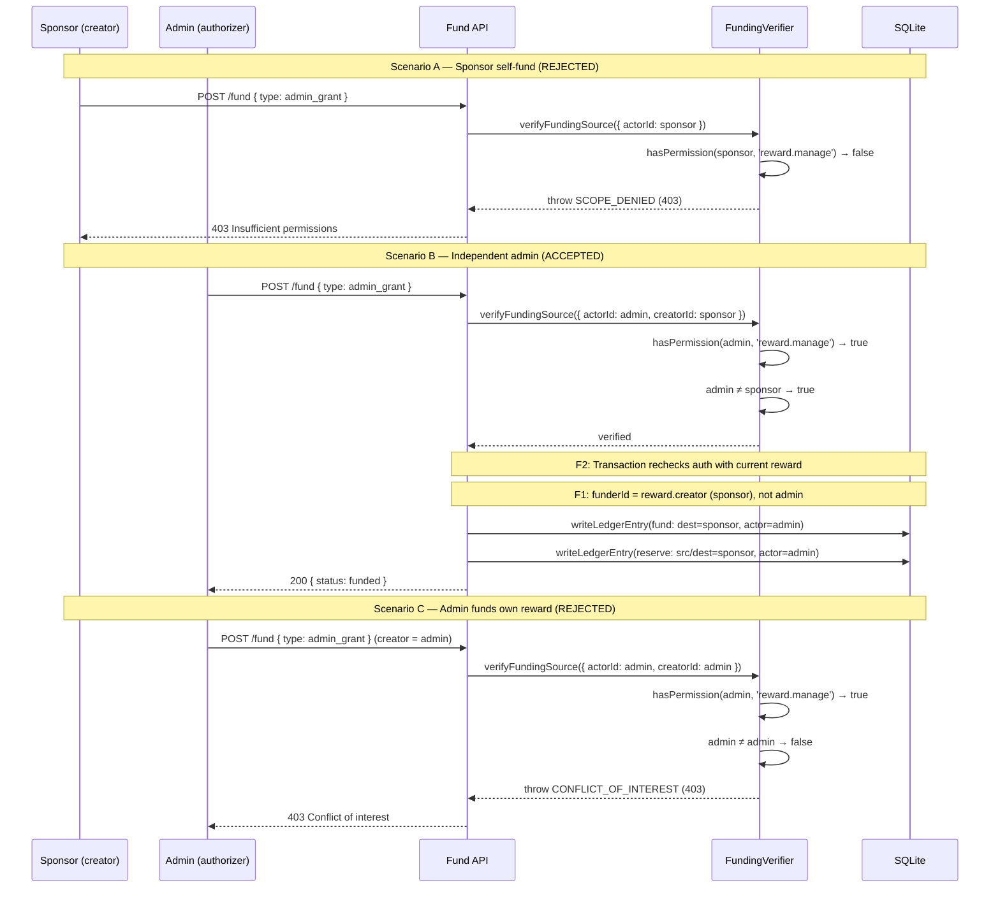
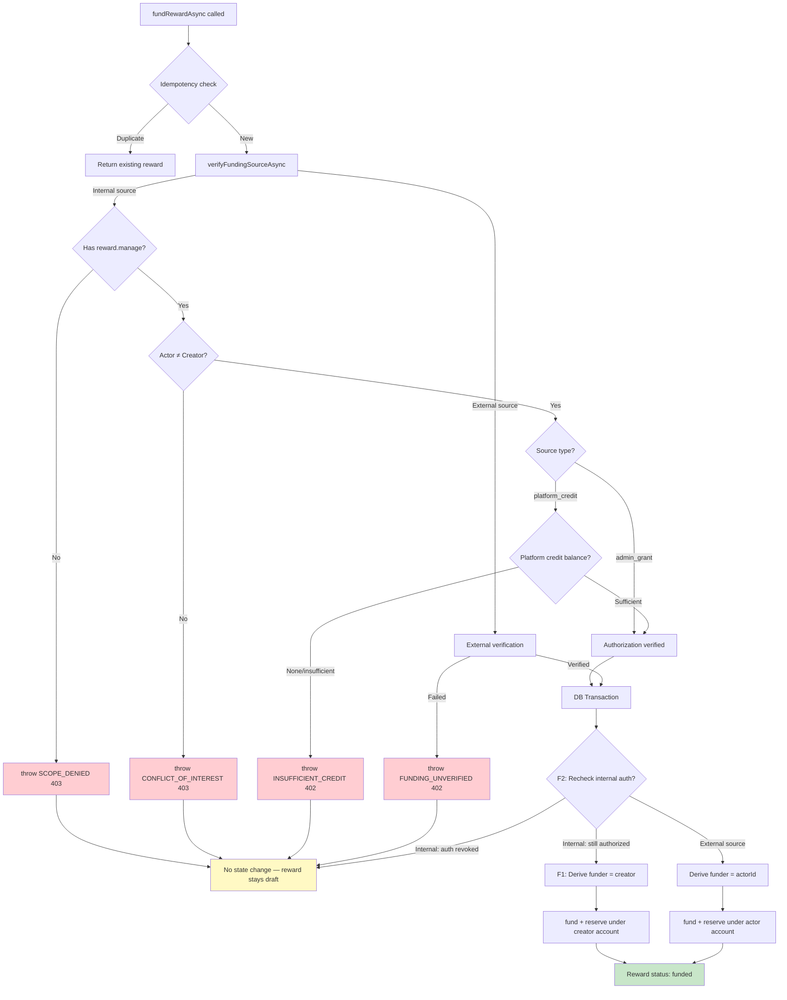
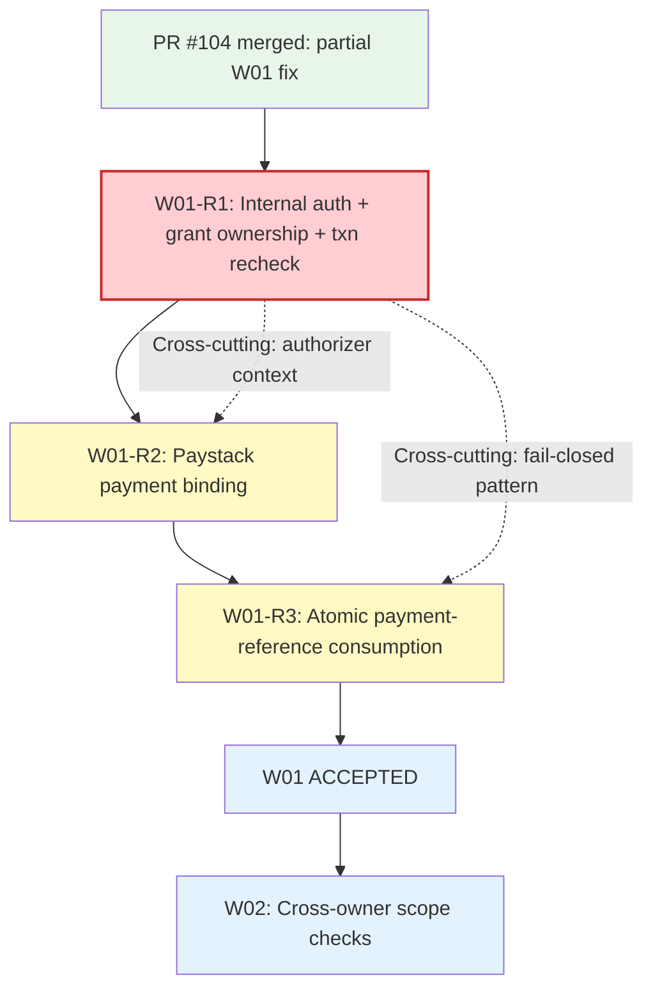

# W01-R1: Internal funding authorization and credit backing

Date: 2026-10-27 | Revised: 2026-10-28 | Priority: P1 | Stage: S2-T01 (repair unit R1)
Status: **CHANGES_REQUIRED** → correcting R1-F1 (grant ownership) and R1-F2 (transaction-time auth)
Source: `docs/release/SERVER-HANDOVER-W01-REVIEW-AND-REPAIR.md` at `223b262`
Review: `docs/release/SERVER-HANDOVER-W01-R1-PR105-REVIEW.md` at `8c1b8cb`
Base: `main` at `115d8c4f836a059aff733bb4cdeaabc9750963f2` (PR #104 merged)

## 1. Problem

PR #104 added a funding verification gate but left `platform_credit` and
`admin_grant` source types as pass-through (`break`) in both
`verifyFundingSourceSync` and `verifyFundingSourceAsync`
(`rewardFundingVerifier.ts:62-64, 110-114`).

All four fund routes (sponsor:275, parent:304, teacher:255, employer:331)
require only `reward.fund` permission. Any user with `reward.fund` can
fund a reward with `platform_credit` or `admin_grant` as the source type.
The ledger then credits the funder's available balance from nothing — no
`reward.manage` check, no independent-authorizer gate, no credit backing.

The reward foundation spec (section 5) requires:

- `admin_grant`: actor has `reward.manage`; actor ≠ reward creator; audit record
- `platform_credit`: actor has `reward.manage`; actor ≠ reward creator; credit
  balance backing

The previous W01 spec referenced `reward.admin_grant` which **does not exist**
in the RBAC seed data. The correct policy uses `reward.manage` (held by admin,
admin-2, super-admin) plus independent-authorizer enforcement.

## 2. Scope

**In scope (R1):**
- Enforce `reward.manage` for `platform_credit` and `admin_grant` in the shared
  verifier (covers all sync/async callers)
- Enforce actor ≠ reward creator (conflict-of-interest / self-enrichment)
- Fail closed for `platform_credit` — no credit provisioning mechanism exists;
  reject with `INSUFFICIENT_CREDIT`
- **(F1 correction)** Grant ownership: derive the financial beneficiary (funder)
  from the reward's `creator_user_id`, not the authorizing admin's `actorId`.
  Admin is `actorUserId` (audit trail); creator is `destinationUserId` (financial
  ownership). Cancel/expire/refund/release route back to the creator.
- **(F2 correction)** Transaction-time recheck: enforce `verifyInternalAuthorization`
  inside the write transaction immediately before financial mutation, using the
  current reward's `creator_user_id`. Scope ownership must not substitute for
  `reward.manage` on internal sources.
- Audit evidence: ledger `actor_user_id` is the authorizing admin;
  `destination_user_id` is the intended funder (creator)
- Update all test fixtures that use self-grant `platform_credit`/`admin_grant`
  to use legitimate independent authorization; correct any that assert admin as
  funder/beneficiary
- RED/GREEN tests for every authorization gap including grant ownership and
  transaction-time recheck

**Out of scope (tracked separately):**
- R2: Paystack payment binding (amount/currency/ownership)
- R3: Atomic reference consumption (race condition)
- Credit provisioning system for `platform_credit` (would be a new feature)
- A1-A3, A5 advisories from PR #104 review

## 3. Invariants

1. No reward receives `funded` status via `platform_credit` or `admin_grant`
   without a `reward.manage`-holding actor who is NOT the reward creator.
2. `platform_credit` fails closed with `INSUFFICIENT_CREDIT` until a credit
   provisioning mechanism is established.
3. `admin_grant` is the legitimate internal funding path when authorized by an
   independent admin.
4. External funding types (`stellar`, `paystack`) are unaffected by this change.
5. Existing funded rewards remain valid — no retroactive changes.
6. All test fixtures use legitimate funding (independent admin authorization or
   mocked external verification).
7. **(F1)** For internal sources, the financial beneficiary (funder account,
   ledger `destination_user_id`, cancel/expire/refund/release routing) is the
   reward's `creator_user_id` — never the authorizing admin. The admin appears
   only as `actor_user_id` in the ledger (audit trail).
8. **(F2)** Internal-source authorization (`reward.manage` + independent
   authorizer) is enforced inside the write transaction using the current
   reward state, not only at the pre-transaction verification point. Scope
   ownership alone does not authorize internal funding.

## 4. Authorization model

### Current (defective)

```
Route middleware: requirePermission('reward.fund')
         │
    fundRewardAsync(rewardId, actorId, source, key)
         │
    verifyFundingSourceAsync(source, rewardId)
         │
    platform_credit → break (pass-through)
    admin_grant     → break (pass-through)
         │
    DB transaction: credit funder.available from nothing
```

### Intended (R1 fix, revised after F1/F2 correction)

```
Route middleware: requirePermission('reward.fund')
         │
    fundRewardAsync(rewardId, actorId, source, key)
         │
    Lookup reward.creator_user_id
         │
    verifyFundingSourceAsync(source, rewardId, { actorId, creatorId })
         │                            ┌── Pre-transaction gate ──┐
    platform_credit → require reward.manage
                    → require actorId ≠ creatorId
                    → check platform credit balance (FAIL CLOSED: none exists)
    admin_grant     → require reward.manage
                    → require actorId ≠ creatorId
                    → record audit evidence (authorizer = actorId)
         │                            └──────────────────────────┘
    DB transaction:
      │  ┌── F2: Transaction-time recheck (defense-in-depth) ──┐
      │  (internal sources only)
      │  Re-read reward.creator_user_id from DB
      │  verifyInternalAuthorization({ actorId, creatorId })
      │  └──────────────────────────────────────────────────────┘
      │  ┌── F1: Funder identity derivation ───────────────────┐
      │  funderId = internal ? reward.creator_user_id : actorId
      │  └──────────────────────────────────────────────────────┘
      │  Create/get funder account for funderId (not actorId)
      │  Ledger fund:   destinationUserId = funderId, actorUserId = actorId
      │  Ledger reserve: source/destination = funderId, actorUserId = actorId
```

### Actors and permissions

| Actor Role | Has `reward.fund` | Has `reward.manage` | Can authorize internal? |
|-----------|-------------------|--------------------|-----------------------|
| sponsor | Yes | No | No |
| parent | Yes | No | No |
| teacher | Yes | No | No |
| employer | Yes | No | No |
| admin | Yes | Yes | Yes (if ≠ creator) |
| admin-2 | Yes | Yes | Yes (if ≠ creator) |
| super-admin | Yes | Yes | Yes (if ≠ creator) |

### Typical legitimate flow

1. Sponsor creates reward (creator = sponsor)
2. Sponsor requests internal funding
3. Route checks `reward.fund` — sponsor has it ✓
4. Verifier checks `reward.manage` — sponsor lacks it ✗
5. → Reject with 403 SCOPE_DENIED
6. Admin calls fund endpoint for the same reward
7. Route checks `reward.fund` — admin has it ✓
8. Verifier checks `reward.manage` — admin has it ✓
9. Verifier checks admin ≠ creator — admin ≠ sponsor ✓
10. `admin_grant` proceeds; `platform_credit` fails closed

## 5. API changes

### New error responses

| Code | HTTP | When |
|------|------|------|
| `SCOPE_DENIED` | 403 | Actor lacks `reward.manage` for internal source |
| `CONFLICT_OF_INTEREST` | 403 | Actor is the reward creator for internal source |
| `INSUFFICIENT_CREDIT` | 402 | `platform_credit` with no available balance |

### Existing responses (unchanged)

| Code | HTTP | When |
|------|------|------|
| `FUNDING_UNVERIFIED` | 402 | External source verification failed |
| `DUPLICATE_REFERENCE` | 409 | Reference reused across rewards |

## 6. Touched files

| File | Change |
|------|--------|
| `src/services/rewards/rewardFundingVerifier.ts` | Add authorization checks for internal sources; accept context parameter |
| `src/services/rewards/rewardService.ts` | Look up reward creator before calling verifier; pass context |
| `src/services/rewards/rewardErrors.ts` | Add `AUTHORIZATION_REQUIRED` if needed (reuse `SCOPE_DENIED` and `CONFLICT_OF_INTEREST`) |
| `src/__tests__/reward-internal-funding-auth.test.ts` | NEW: R1 security acceptance tests |
| `src/__tests__/reward-funding-verification.test.ts` | Update `platform_credit`/`admin_grant` tests to use legitimate authorization |
| `src/__tests__/reward-lifecycle.test.ts` | Update self-grant fixtures |
| `src/__tests__/reward-student-view.test.ts` | Update self-grant fixtures |
| `src/__tests__/reward-expiry-worker.test.ts` | Update self-grant fixtures |
| `src/__tests__/reward-eligibility.test.ts` | Update self-grant fixtures |
| `src/__tests__/reward-refund-admin.test.ts` | Update self-grant fixtures |
| `src/__tests__/reward-sponsor.test.ts` | Update self-grant fixtures (HTTP-level) |

## 7. Implementation plan

### Step 1: Extend verifier interface

Add optional `FundingAuthorizationContext` to both verifier entry points:

```typescript
export interface FundingAuthorizationContext {
  actorId: string;
  rewardCreatorId: string;
}
```

### Step 2: Add authorization checks in verifier

For `platform_credit` and `admin_grant` cases:
1. If no context provided → throw (defensive; service must always pass it)
2. Check `hasPermission(context.actorId, 'reward.manage')` → 403
3. Check `context.actorId !== context.rewardCreatorId` → 403 CONFLICT_OF_INTEREST
4. For `platform_credit` only: fail closed with INSUFFICIENT_CREDIT

### Step 3: Pass context from service

In `fundReward` and `fundRewardAsync`:
1. Look up reward via `getRewardRow(rewardId)` before verification
2. Pass `{ actorId, rewardCreatorId: reward.creator_user_id }` to verifier

### Step 4: Create test helper for legitimate funding

```typescript
function fundWithIndependentAdmin(rewardId: string, creatorId: string): RewardRow {
  const adminId = createUserWithRole('admin');
  return fundReward(rewardId, adminId, { type: 'admin_grant' }, `fund-${uuidv4()}`);
}
```

### Step 5: Update all test fixtures

Replace every `fundReward(rewardId, creatorId, { type: 'platform_credit' }, ...)` and
`fundReward(rewardId, creatorId, { type: 'admin_grant' }, ...)` where creator = funder
with the legitimate funding helper.

### Step 6 (F1 correction): Derive funder from reward creator for internal sources

In `fundReward()` and `fundRewardVerified()` transactions:
```typescript
const funderId = isInternalSource(source.type) ? reward.creator_user_id : actorId;
```
Use `funderId` for `getOrCreateAccount`, `destinationUserId` in fund entry, and
`sourceUserId`/`destinationUserId` in reserve entry. Keep `actorId` for `actorUserId`.

### Step 7 (F2 correction): Recheck internal auth inside write transaction

In both transaction bodies, before financial mutation:
```typescript
if (isInternalSource(source.type)) {
  verifyInternalAuthorization(
    { actorId, rewardCreatorId: reward.creator_user_id },
    source.type,
  );
}
```
Export `verifyInternalAuthorization` from the verifier for transaction-time use.

### Step 8: Update test assertions for funder identity

Update lifecycle and orchestration tests that assert admin's funder account balances
to instead assert the creator's funder account balances.

## 8. Test matrix

### R1 security acceptance tests (23 total — original 11 + 12 F1/F2 corrections)

| # | Test | Actor | Source | Expected | Status |
|---|------|-------|--------|----------|--------|
| 1 | Sponsor self-funds with platform_credit | sponsor (no reward.manage) | platform_credit | 403 SCOPE_DENIED | ✓ GREEN |
| 2 | Sponsor self-funds with admin_grant | sponsor (no reward.manage) | admin_grant | 403 SCOPE_DENIED | ✓ GREEN |
| 3 | Admin self-funds own reward with admin_grant | admin (creator = admin) | admin_grant | 403 CONFLICT_OF_INTEREST | ✓ GREEN |
| 4 | Independent admin funds with admin_grant | admin (≠ creator, has manage) | admin_grant | 200 funded | ✓ GREEN |
| 5 | Independent admin funds with platform_credit | admin (≠ creator, has manage) | platform_credit | 402 INSUFFICIENT_CREDIT | ✓ GREEN |
| 6 | Revoked admin (manage removed) tries admin_grant | user (manage revoked) | admin_grant | 403 SCOPE_DENIED | ✓ GREEN |
| 7 | External sources unaffected (stellar) | sponsor | stellar | 402 FUNDING_UNVERIFIED | ✓ GREEN |
| 8 | Audit evidence: authorizer recorded | admin (≠ creator) | admin_grant | actor_user_id = admin | ✓ GREEN |
| 9 | No ledger entries on auth failure | sponsor (no manage) | admin_grant | 0 transactions | ✓ GREEN |
| 10 | Sponsor self-funds via async path | sponsor (no manage) | admin_grant | 403 SCOPE_DENIED | ✓ GREEN |
| 11 | Admin self-funds platform_credit | admin (creator = admin) | platform_credit | 403 | ✓ GREEN |
| **F1-1** | **Fund ledger credits creator, not admin** | admin (≠ creator) | admin_grant | dest = creator | ✓ GREEN (was RED) |
| **F1-2** | **Reserve ledger under creator account** | admin (≠ creator) | admin_grant | src/dest = creator | ✓ GREEN (was RED) |
| **F1-3** | **Funder account belongs to creator** | admin (≠ creator) | admin_grant | creator has account, admin does not | ✓ GREEN (was RED) |
| **F1-4** | **Cancellation returns to creator** | admin (≠ creator) | admin_grant | creator.available = amount | ✓ GREEN (was RED) |
| **F1-5** | **Expiry returns to creator** | admin (≠ creator) | admin_grant | creator.available = amount | ✓ GREEN (was RED) |
| **F1-6** | **Release debits creator account** | admin (≠ creator) | admin_grant | creator.reserved = 0 | ✓ GREEN (was RED) |
| **F1-7** | **Refund returns to creator** | admin (≠ creator) | admin_grant | creator.available = amount | ✓ GREEN (was RED) |
| **F1-8** | **Async path credits creator** | admin (≠ creator) | admin_grant | dest = creator | ✓ GREEN (was RED) |
| **F2-1** | **Sync: manage revoked → rejected** | admin (manage revoked) | admin_grant | 403, draft, no txns | ✓ GREEN |
| **F2-2** | **Scope ownership ≠ internal-source auth** | admin (scope only, no manage) | admin_grant | 403, draft, no txns | ✓ GREEN |
| **F2-3** | **Creator changed → conflict detected** | admin (became creator) | admin_grant | CONFLICT_OF_INTEREST | ✓ GREEN |
| **F2-4** | **Async: manage revoked + scope → rejected** | admin (scope only) | admin_grant | 403, draft, no txns | ✓ GREEN |

### Existing test impact (corrected for F1 funder identity)

| File | Tests affected | Action |
|------|---------------|--------|
| reward-funding-verification.test.ts | 2 (platform_credit, admin_grant pass-through) | Change to independent admin |
| reward-lifecycle.test.ts | 3 fixtures + balance assertions | Change to independent admin; assert creator (not admin) as funder |
| reward-orchestration.test.ts | 2 balance assertions | Assert creator (not admin) as funder account owner |
| reward-student-view.test.ts | 2 fixtures | Change to independent admin |
| reward-expiry-worker.test.ts | 6 fixtures | Change to independent admin |
| reward-eligibility.test.ts | 1 fixture | Change to independent admin |
| reward-refund-admin.test.ts | 1 fixture | Change to independent admin |
| reward-sponsor.test.ts | 2 HTTP fixtures | Change to independent admin |

## 9. Rollback

If this change causes regressions:
1. Revert the merge commit on main
2. The previous behavior (pass-through for internal sources) is restored
3. The authorization gap reverts to the state after PR #104
4. R1 remains open; repeat with corrected implementation

## 10. Mermaid diagrams

### Internal funding authorization sequence



### Denied-path rollback



### R1/R2/R3 to W02 dependency chain



## 11. Acceptance criteria

- [x] All 23 R1 security tests pass (11 original + 8 F1 were RED→GREEN + 4 F2)
- [x] No existing test regressions (1850+ pass count maintained; 1 pre-existing
  `dependency-security.test.ts` failure unrelated to R1)
- [x] `platform_credit` fails closed in all paths
- [x] `admin_grant` requires `reward.manage` + independent authorizer
- [x] **(F1)** Internal grants credit the reward creator, not the authorizing admin
- [x] **(F1)** Cancel/expire/refund/release route funds to creator
- [x] **(F2)** Internal-source authorization rechecked inside write transaction
- [x] **(F2)** Scope ownership does not substitute for `reward.manage` on internal sources
- [x] All test fixtures use legitimate funding with correct funder identity
- [x] TypeScript build succeeds (`tsc --noEmit`)
- [ ] Independent security review APPROVED against corrected head
- [ ] CI checks pass on corrected head
- [ ] Ledger correctly updated to PARTIALLY_FIXED with R1 corrected, R2/R3 outstanding
