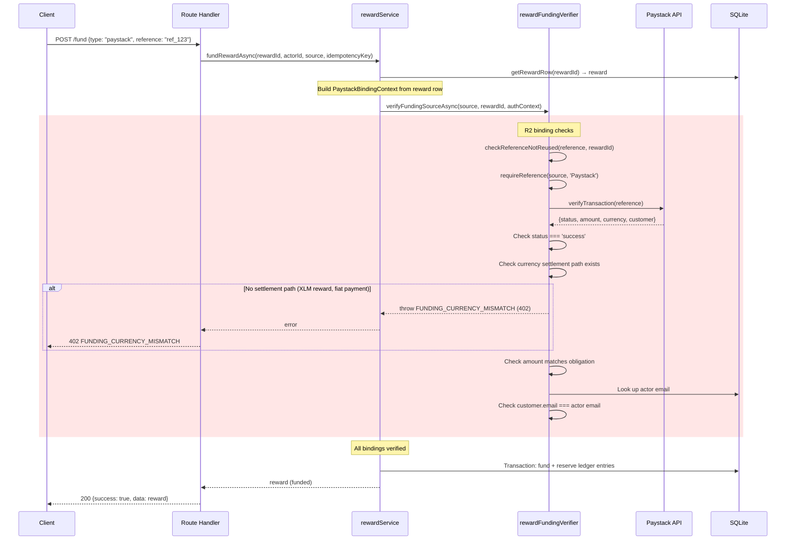
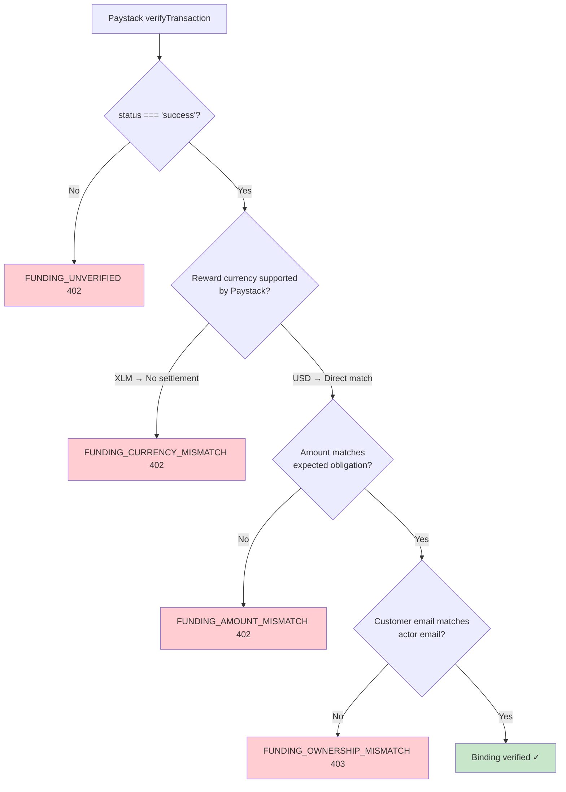

# W01-R2: Paystack payment binding

Date: 2026-10-28 | Priority: P1 | Stage: S2-T01-R2
Parent: W01 (reward funding trusts caller without verified evidence)
Dependencies: R1 MERGED (#105 at `8096b9b`), C1 MERGED (#106 at `fa187b8`)
Main baseline: `fa187b8` (verified)

## Problem

`verifyPaystack()` in `rewardFundingVerifier.ts:215-233` contacts the Paystack API
and checks only `result.status === 'success'`. It does NOT verify:

1. **Amount**: The Paystack transaction amount is not compared to the reward obligation.
2. **Currency**: The Paystack transaction currency is not checked against expected currency.
3. **Ownership**: No verification that the Paystack payer is the actor calling the fund endpoint.
4. **Obligation**: No verification that the Paystack payment was intended for this specific reward.

A user with any successful Paystack payment reference can fund any reward they have
scope access to, regardless of the payment's amount, currency, or intended purpose.

### Currency settlement gap (critical)

Rewards are denominated in XLM stroops (`currencyConfig.ts:3` — only XLM supported).
Paystack payments are denominated in fiat (USD, initialized at `paystackService.ts:67`).
There is **no settlement policy, exchange rate service, or XLM-to-fiat conversion
mechanism** anywhere in the codebase. The `SUPPORTED_CURRENCIES` array contains only
`['XLM']`. Course pricing has manual `stellar_price_xlm`/`stellar_price_usdc` fields
per course, but these are not applicable to reward funding.

Per prompt guidance: "Where required evidence or a supported settlement path is absent,
fail closed and record the capability gap."

### Paystack API response structure

`verifyTransaction()` returns `PaystackVerifyResponse['data']` (`paystackService.ts:23-35`):
```typescript
{
  status: string;     // 'success' | 'failed' | 'abandoned'
  reference: string;  // transaction reference
  amount: number;     // amount in smallest currency unit (cents/kobo)
  currency: string;   // e.g., 'USD', 'ZAR', 'NGN'
  paid_at: string | null;
  channel: string;    // e.g., 'card'
  metadata: Record<string, unknown>;  // arbitrary fields from initialization
}
```

Note: The current interface does NOT include `customer.email` (available from Paystack
API but not captured). Extending the interface is required for ownership binding.

### Existing Paystack integration paths

1. **Course checkout** (`routes/payments.ts:476-581`): Initializes Paystack with
   `{applicationId, courseId, userId}` metadata, generates `lms-pay-{uuid}` reference,
   creates local `payments` record. Webhook handler (`routes/webhooks.ts`) confirms
   payment by matching reference to `payments` table.

2. **Reward funding** (`routes/sponsor.ts:278`, etc.): Accepts `{sourceType, reference}`
   from request body. No Paystack initialization for rewards exists. No local payment
   record links a Paystack transaction to reward funding. Reference comes from client.

These are **separate payment flows**. The course checkout pipeline has amount/currency/
identity binding through the `payments` table and webhook handler. The reward funding
path has none — it only calls `verifyTransaction()` for status.

## Design: Fail closed with verifiable bindings

### Binding verification matrix

| Binding | Source of truth | Verification method | R2 status |
| --- | --- | --- | --- |
| Status = 'success' | Paystack API | `result.status === 'success'` | Exists (R0/PR #104) |
| Reference uniqueness | `reward_transactions` table | `checkReferenceNotReused()` | Exists (R0/PR #104); atomic enforcement deferred to R3 |
| Currency match | Reward: `currency_code` (XLM); Paystack: `result.currency` (fiat) | Compare currencies; require settlement path | **R2: fail closed** — no XLM-to-fiat settlement |
| Amount match | Reward: `amount_stroops * max_recipients`; Paystack: `result.amount` (cents) | Convert via settlement policy; compare | **R2: blocked by currency gap** |
| Ownership | Reward scope actor; Paystack: `result.customer.email` or `result.metadata` | Match actor email to Paystack customer | **R2: implemented** (where verifiable) |
| Obligation | Reward ID; Paystack: `result.metadata.rewardId` (if set at init) | Match metadata to reward context | **R2: documented gap** — no reward Paystack init flow exists |

### Net effect

Paystack funding of XLM-denominated rewards **fails closed** with error code
`FUNDING_CURRENCY_MISMATCH` (402). The system cannot verify that a fiat Paystack
payment corresponds to an XLM reward obligation without a settlement policy.

This is the correct security posture. The previous behavior — accepting any
successful Paystack reference regardless of amount, currency, or ownership — was
the vulnerability being fixed.

### What enables Paystack funding in the future

Either:
- Add fiat-denominated rewards (e.g., `SUPPORTED_CURRENCIES` includes `'USD'`), or
- Add a trusted settlement/quote service that converts XLM obligations to fiat amounts

When either path exists, the verifier already has the structure to verify amount and
currency. R2 implements the binding framework; the settlement policy is the missing input.

## Implementation

### Changes to `rewardFundingVerifier.ts`

1. **New interface `PaystackBindingContext`**:
   ```typescript
   interface PaystackBindingContext {
     rewardId: string;
     expectedAmountStroops: number;
     expectedCurrency: string;  // reward's currency_code
     actorId: string;
   }
   ```

2. **Enhanced `verifyPaystack()` signature**:
   ```typescript
   async function verifyPaystack(
     source: FundingSource,
     bindingContext: PaystackBindingContext,
   ): Promise<void>
   ```

3. **Currency settlement check** (NEW — fail closed):
   After confirming `result.status === 'success'`, check if the reward currency has
   a supported settlement path to the Paystack payment currency. For XLM rewards and
   fiat Paystack payments: no path exists → throw `FUNDING_CURRENCY_MISMATCH`.

4. **Amount binding** (NEW — blocked by currency):
   If currencies match (future), verify `result.amount === expectedAmountMinorUnits`.
   For now: unreachable because the currency check fails first.

5. **Ownership binding** (NEW):
   Extend `PaystackVerifyResponse` to capture `customer: { email: string }`.
   Look up actor's email from DB. Verify `result.customer.email === actorEmail`.
   If the Paystack response does not include customer info, fail with `OWNERSHIP_UNVERIFIABLE`.

6. **Obligation binding** (documented gap):
   No Paystack initialization flow exists for reward funding, so `metadata.rewardId`
   is not set. This gap is documented but cannot be verified without an init flow.
   Fail closed is achieved through the currency check, so obligation binding is
   defense-in-depth rather than the primary gate.

### Changes to `verifyFundingSourceAsync()`

Pass `PaystackBindingContext` to `verifyPaystack()`. The context is built from
the reward's authoritative DB row (looked up before the call).

### Changes to `rewardService.ts`

`fundRewardAsync()` already looks up the reward row at line 218. Pass the reward's
`amount_stroops`, `currency_code`, `max_recipients`, and the actor ID to the
async verifier as binding context.

### Changes to `paystackService.ts`

Extend `PaystackVerifyResponse['data']` to include:
```typescript
customer?: { email: string; };
```

### New error codes in `rewardErrors.ts`

| Code | HTTP | Meaning |
| --- | --- | --- |
| `FUNDING_CURRENCY_MISMATCH` | 402 | Reward currency has no settlement path to payment currency |
| `FUNDING_AMOUNT_MISMATCH` | 402 | Payment amount does not match expected obligation |
| `FUNDING_OWNERSHIP_MISMATCH` | 403 | Payment was not made by the funding actor |

### Files touched

| File | Change |
| --- | --- |
| `src/services/rewards/rewardFundingVerifier.ts` | Add `PaystackBindingContext`, enhance `verifyPaystack()`, add currency/amount/ownership checks |
| `src/services/rewards/rewardService.ts` | Pass binding context from reward row to async verifier |
| `src/services/paystackService.ts` | Extend verify response interface with `customer` |
| `src/services/rewards/rewardErrors.ts` | Add new error codes (if not already string-typed) |
| `src/__tests__/reward-paystack-binding.test.ts` | **New**: R2 binding tests |

### What is NOT changed

- Course payment checkout flow (`routes/payments.ts`)
- Webhook handler (`routes/webhooks.ts`)
- Internal funding sources (`admin_grant`, `platform_credit`) — R1 invariants preserved
- Stellar source — remains denied (deferred)
- Sync `fundReward()` — Paystack already rejected on sync path

## Invariants (R2 adds to R1)

1. Paystack funding requires currency settlement path between reward and payment currencies
2. When settlement path exists: payment amount must match reward obligation (amount * maxRecipients converted to payment currency)
3. Paystack payer identity must match the funding actor
4. All R1 invariants preserved (25 tests)
5. R3 atomic-consumption gate remains separately pending — R2 does not claim reference uniqueness is concurrent-safe

## Mermaid: Paystack funding verification flow



## Mermaid: Currency settlement decision



## R3 boundary (NOT in R2)

R2 uses `checkReferenceNotReused()` which is a sequential SELECT check.
Under concurrent requests, two transactions could both pass the SELECT before either
writes the reference. R3 must:
- Add DB-level UNIQUE constraint on `reward_transactions.funding_reference`
- Handle the resulting constraint violation gracefully
- Prove under concurrent load that exactly one request wins

R2 does not implement or claim atomic reference consumption. The R3 gate
remains explicitly pending.

## Capability gaps recorded

| Gap | Impact | Resolution path |
| --- | --- | --- |
| No XLM↔fiat settlement policy | Paystack cannot fund XLM rewards | Add fiat rewards or settlement service |
| No Paystack init for reward funding | Cannot verify obligation via metadata | Add reward-specific Paystack checkout flow |
| `PaystackVerifyResponse` missing `customer` | Ownership check requires interface extension | Extend interface (R2 implements) |
| No DB UNIQUE on `funding_reference` | Concurrent duplicate possible | R3 adds constraint |
