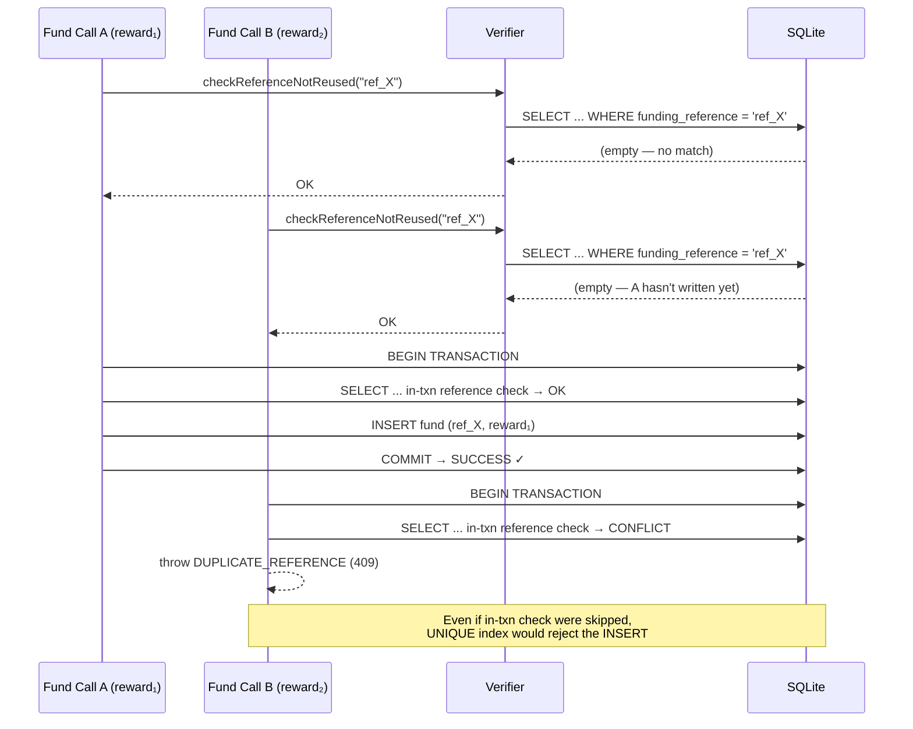
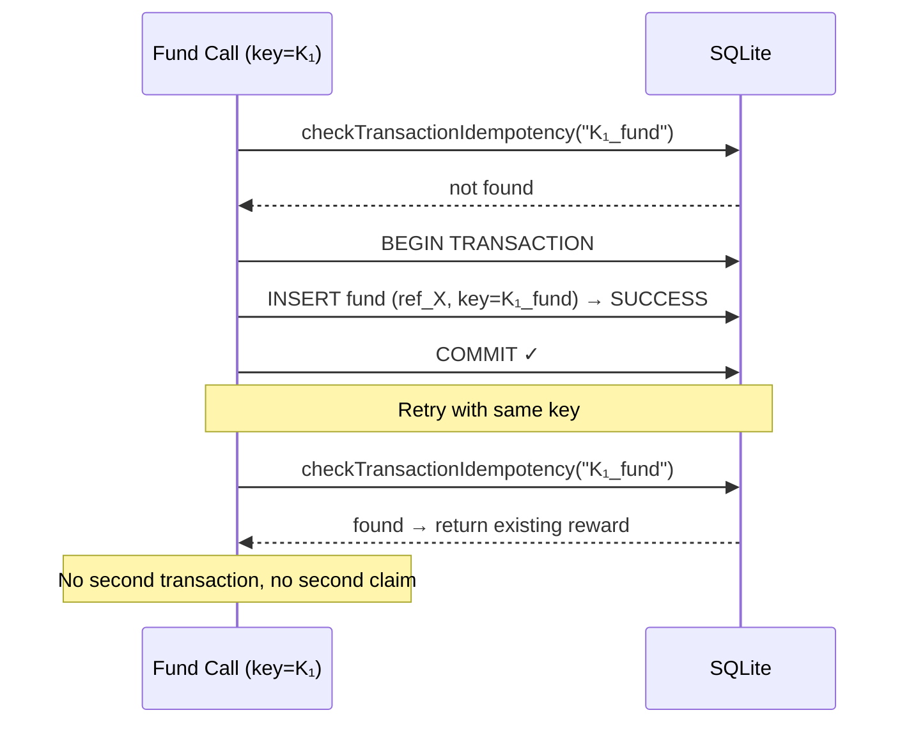
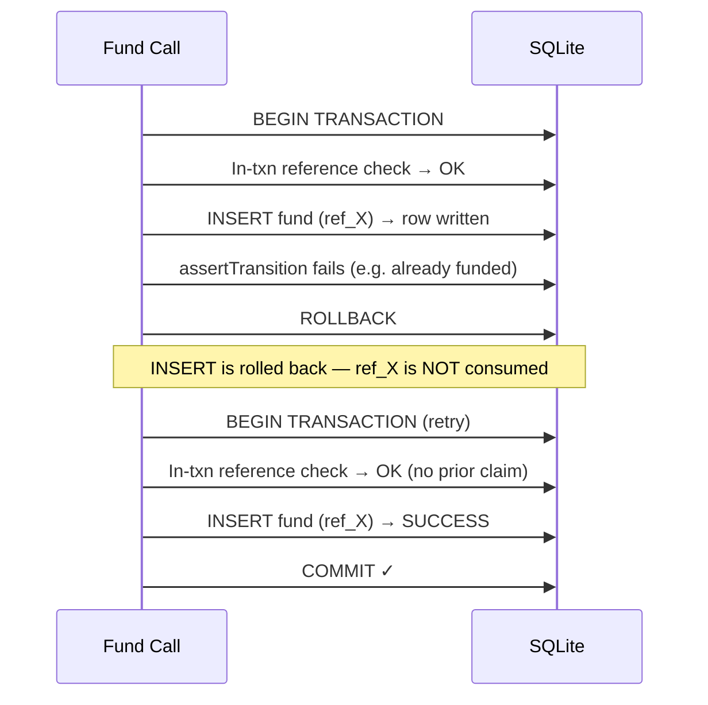
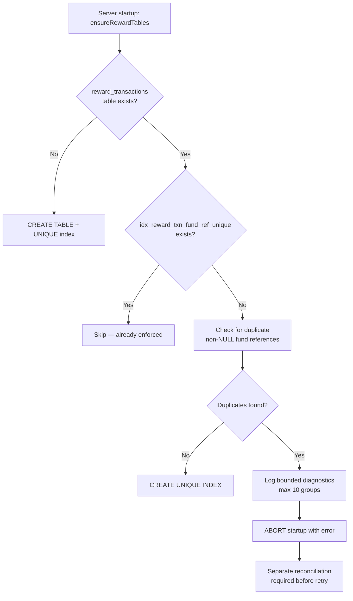
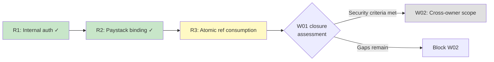

# W01-R3: Atomic payment-reference consumption

Date: 2026-10-28
Status: DRAFT
Dependencies: R1 merged (#105), R2 merged (#107), C1 merged (#106)
Base: `17d93f0` (main after R2)
Advisory: A3 (no DB-level UNIQUE on funding_reference)

## Problem statement

`checkReferenceNotReused()` in `rewardFundingVerifier.ts:339-353` runs a
SELECT outside the write transaction. Two concurrent fund operations for
different rewards with the same reference can both pass the check before
either writes. Since `reward_transactions.funding_reference` has no UNIQUE
constraint (database.ts:1656), both INSERTs succeed. Result: one external
payment funds two rewards — a financial integrity violation.

### Root cause: TOCTOU between check and write

```
Call A: checkReferenceNotReused("ref_X", rewardA)  → OK (no match)
Call B: checkReferenceNotReused("ref_X", rewardB)  → OK (no match yet)
        ──── async boundary (e.g. Paystack await) ────
Call A: db.transaction() → INSERT fund with ref_X for rewardA  → SUCCESS
Call B: db.transaction() → INSERT fund with ref_X for rewardB  → SUCCESS (BUG)
```

### Current state

| Aspect | Value |
| --- | --- |
| `funding_reference` column | `TEXT`, nullable, no index, no UNIQUE constraint |
| `checkReferenceNotReused()` | SELECT outside transaction; allows same ref for same reward |
| `idempotency_key` | `TEXT NOT NULL UNIQUE` — prevents same-key duplicates, not same-reference |
| Error message (A2) | Leaks another reward's ID: `"already used for reward ${existing.reward_id}"` |
| Cancel/expire/refund | Do not release references — permanent consumption (correct) |
| NULL references | Used by internal grants (admin_grant without explicit reference) |

## Canonical funding identity

A **funding reference** is an opaque string identifying an external payment
or administrative grant event. Its identity semantics:

| Property | Rule |
| --- | --- |
| Case sensitivity | **Preserved exactly.** Do not lowercase, normalize, or trim opaque provider references. |
| Uniqueness scope | One non-NULL funding_reference may appear in at most ONE `fund` transaction, regardless of source type or reward. |
| NULL | Allowed. Means "no external reference" (valid for admin_grant without explicit reference). NULLs are never unique-constrained against each other (SQL standard). |
| Empty string | **Invalid.** Normalized to NULL before storage. An empty reference is not a reference. |
| Whitespace-only | **Invalid.** Normalized to NULL before storage. |
| Source-type scoping | None. A Paystack reference and a Stellar hash with identical byte strings would conflict. This is vanishingly unlikely and correct — they represent the same claimed payment evidence. |
| Reward ID in key | **NOT included.** The uniqueness key is `funding_reference` alone among fund transactions. Including reward ID would allow the same payment to fund different rewards. |

## Solution design

### 1. Partial UNIQUE index (database enforcement)

```sql
CREATE UNIQUE INDEX IF NOT EXISTS idx_reward_txn_fund_ref_unique
  ON reward_transactions(funding_reference)
  WHERE funding_reference IS NOT NULL AND transaction_type = 'fund';
```

This enforces: among all `fund` transactions with non-NULL references, each
reference string appears at most once. NULLs are excluded (internal grants
without references are unlimited). The index also accelerates
`checkReferenceNotReused()` lookups.

### 2. Migration safety

Before creating the index, check for pre-existing duplicate references:

```sql
SELECT funding_reference, COUNT(*) as cnt
FROM reward_transactions
WHERE funding_reference IS NOT NULL AND transaction_type = 'fund'
GROUP BY funding_reference
HAVING cnt > 1
LIMIT 10;
```

- **No duplicates**: Create the index.
- **Duplicates found**: Log bounded diagnostics (up to 10 groups) and
  **abort startup** with a clear error. Do not continue unprotected.
  A separate reconciliation procedure handles cleanup before retry.

### 3. Reference normalization

Before `checkReferenceNotReused()` and before writing to the ledger,
normalize the reference:

```typescript
function normalizeReference(ref: string | undefined | null): string | null {
  if (ref == null) return null;
  const trimmed = ref.trim();
  return trimmed.length === 0 ? null : trimmed;
}
```

This is NOT lowercasing or transforming the reference — it only eliminates
empty/whitespace-only strings that would create false singletons in the
UNIQUE index.

### 4. In-transaction reference claim

Inside both `fundReward()` and `fundRewardVerified()` transaction bodies,
**after** state transition checks and **before** `writeLedgerEntry()`:

```typescript
if (normalizedReference !== null) {
  const conflict = db.prepare(
    `SELECT 1 FROM reward_transactions
     WHERE funding_reference = ? AND transaction_type = 'fund'
     LIMIT 1`
  ).get(normalizedReference);
  if (conflict) {
    throw new RewardError(
      'DUPLICATE_REFERENCE',
      'This funding reference has already been consumed by another operation',
      409,
    );
  }
}
```

Note: the in-transaction check does NOT include `reward_id != ?` because
each reward can only have one fund transaction (state machine enforces
draft → funded is one-way). Note also: the error message does NOT leak
the other reward's ID (resolves advisory A2).

### 5. UNIQUE constraint violation handler

As belt-and-suspenders, catch `SQLITE_CONSTRAINT_UNIQUE` on the
`writeLedgerEntry()` INSERT. If the violated constraint is the funding
reference index, convert to DUPLICATE_REFERENCE (409):

```typescript
try {
  writeLedgerEntry({ ... });
} catch (err: unknown) {
  if (isFundingReferenceConstraintViolation(err)) {
    throw new RewardError(
      'DUPLICATE_REFERENCE',
      'This funding reference has already been consumed by another operation',
      409,
    );
  }
  throw err; // Re-throw non-reference constraint errors (e.g. idempotency_key)
}
```

### 6. Outer pre-check preserved (defense-in-depth)

`checkReferenceNotReused()` in `rewardFundingVerifier.ts` is preserved as an
early-reject optimization. It catches sequential duplicates before entering
the (more expensive) write transaction. Updated to:
- Use normalized reference
- NOT leak the conflicting reward's ID

## Sequence diagrams

### Competing requests — one winner



### Same-operation retry



### Transaction rollback — no orphan claim



### Legacy upgrade — duplicate detection



### R3-to-W02 dependency



## Files to modify

| File | Change |
| --- | --- |
| `src/config/database.ts` | Add migration: duplicate check + partial UNIQUE index in `ensureRewardTables()` |
| `src/services/rewards/rewardFundingVerifier.ts` | Add `normalizeReference()`, update `checkReferenceNotReused()` to not leak reward ID, export for in-txn use |
| `src/services/rewards/rewardService.ts` | Add in-transaction reference claim in `fundReward()` and `fundRewardVerified()`, normalize references, catch UNIQUE violation |
| `src/services/rewards/rewardErrors.ts` | No change needed (DUPLICATE_REFERENCE already exists) |
| `src/__tests__/reward-atomic-reference.test.ts` | NEW: R3 concurrency/uniqueness/migration tests |
| `src/__tests__/reward-funding-verification.test.ts` | Update: verify A2 fix (no reward ID leak in error messages) |

## Acceptance criteria

1. Two fund operations with same non-NULL reference for different rewards: exactly one succeeds, other gets DUPLICATE_REFERENCE (409)
2. Retry with same idempotency key returns existing reward (no second claim/credit)
3. Different references fund independently without false conflicts
4. Failed transaction (rollback) does not consume the reference — retry succeeds
5. Cancel/expire/refund of a funded reward does NOT release the reference for reuse by another reward
6. Direct SQL INSERT with duplicate fund reference is rejected by DB constraint
7. Error message does NOT leak another reward's ID (A2 resolved)
8. Clean bootstrap creates the UNIQUE index
9. Upgrade from pre-R3 schema with no duplicates adds the index
10. Upgrade from pre-R3 schema with pre-existing duplicates aborts safely with diagnostics
11. NULL references (internal grants) are unconstrained — multiple admin_grants without references coexist
12. Empty/whitespace-only references are normalized to NULL
13. All 25 R1 tests pass; all 12 R2 tests pass; 0 regressions

## Explicitly NOT in scope

- Stellar Horizon client (deferred, fail-closed is correct)
- Paystack operational enablement (R2 containment only — XLM+fiat fails closed)
- Fiat settlement service or currency conversion
- W02 cross-owner scope checks
- W03–W04 reward security fixes
- Production migration or live data inspection
- Real payments or external provider calls
