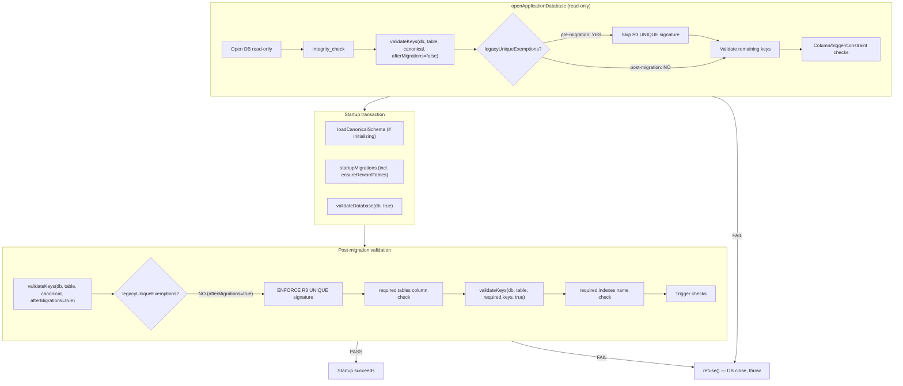

# W01-R3D: Strict final-constraint validation

Date: 2026-10-28
Status: CORRECTION SPEC
Parent: W01-R3C (PR #109, merged at `a929836`)
Handover: `docs/release/SERVER-HANDOVER-W01-R3C-PR109-REVIEW.md` at `564b2e8` on `codex/platform-wiring-audit`

## Problem statement

PR #109 verified the upgrade path and opaque-reference identity. Two implementation gaps remain in the post-migration constraint enforcement and test coverage.

### R3C-F1: Compatibility exemption disables strict final validation (P2)

`legacyUniqueExemptions` in `databaseBootstrap.ts:47` applies unconditionally inside `validateKeys()`. That function runs both before and after migrations. The expected funding-reference UNIQUE signature is therefore skipped in **both** phases.

`required-schema.json` adds `idx_reward_txn_fund_ref_unique` to the required-index list, but `keys.reward_transactions.unique` only contains `idempotency_key` and `id`. The post-migration `required.indexes` loop checks existence by **name only**, not UNIQUE status/columns/predicate.

**Result:** A same-named ordinary (non-UNIQUE) index passes `validateDatabase(db, true)` because:
1. The canonical baseline `validateKeys` skips the signature via `legacyUniqueExemptions`
2. The `required.keys.reward_transactions.unique` contract doesn't include the partial UNIQUE signature
3. The `required.indexes` loop only checks `SELECT 1 FROM sqlite_master WHERE type='index' AND name=?`

### R3C-F2: Remaining test gaps (P2)

- T04: Attempts already-funded reward with new reference; fails at state machine before any financial writes. Does not inject a failure after fund/reserve begins.
- T11/T12: Use test-local `runR3Migration()` containing copied SQL. These can pass while the actual startup/migration entry point is broken.
- No test exercises `validateDatabase(db, true)` rejection of a non-UNIQUE or wrong-definition same-name index.
- No `fundRewardAsync()` competing-call regression.
- No injected post-fund write failure with state/accounts/ledger rollback proof.

## Solution

### F1: Pre-migration-only exemption + full post-migration UNIQUE signature

1. **`databaseBootstrap.ts`**: Add `afterMigrations` parameter to `validateKeys()`. Apply `legacyUniqueExemptions` only when `afterMigrations === false`. Pass the flag from both call sites in `validateDatabase()`.

2. **`required-schema.json`**: Add the partial UNIQUE signature to `keys.reward_transactions.unique`:
   ```json
   ["WHERE funding_reference IS NOT NULL AND transaction_type = 'fund'", "funding_reference"]
   ```

After fix, post-migration validation enforces:
- The canonical baseline `validateKeys(db, table, contract, true)` checks the full UNIQUE signature (exemption not applied)
- The `required.keys.reward_transactions.unique` contract includes the partial UNIQUE signature
- A same-named non-UNIQUE index fails because `keys()` only returns `i.unique` indexes in `actual.unique`

### F2: Genuine startup, async competition and rollback regressions

| Test | What it proves |
|------|---------------|
| T17 | `validateDatabase(db, true)` rejects same-name non-UNIQUE index on `reward_transactions` |
| T18 | `validateDatabase(db, true)` rejects wrong-definition same-name index (different columns/predicate) |
| T19 | Concurrent `fundRewardAsync()` calls with same reference — one succeeds, one fails DUPLICATE_REFERENCE |
| T20 | Injected post-fund write failure: transaction rolls back, reference freed, state/accounts/ledger clean; new operation with same reference succeeds |

## Startup validation phase diagram



## Files to modify

| File | Change |
|------|--------|
| `src/config/databaseBootstrap.ts` | Add `afterMigrations` param to `validateKeys()`; pass from both call sites |
| `database/required-schema.json` | Add partial UNIQUE signature to `keys.reward_transactions.unique` |
| `src/__tests__/reward-atomic-reference.test.ts` | Add T17-T20 |

## Acceptance criteria

1. `validateDatabase(testDb, true)` refuses a DB where `idx_reward_txn_fund_ref_unique` exists as non-UNIQUE
2. `validateDatabase(testDb, true)` refuses a DB where `idx_reward_txn_fund_ref_unique` has wrong columns/predicate
3. `validateDatabase(testDb, false)` accepts a pre-R3 DB (legacyUniqueExemptions still applies pre-migration)
4. Concurrent `fundRewardAsync()` with same reference: one succeeds, one fails DUPLICATE_REFERENCE
5. Injected failure after fund entry: transaction rolls back, reference freed, state/accounts clean
6. All existing T01-T16 tests continue to pass
7. R1 authorization, R2 Paystack binding, opaque reference identity preserved
8. Full test suite: 0 regressions
