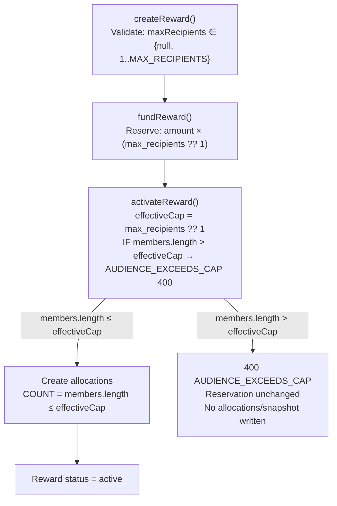
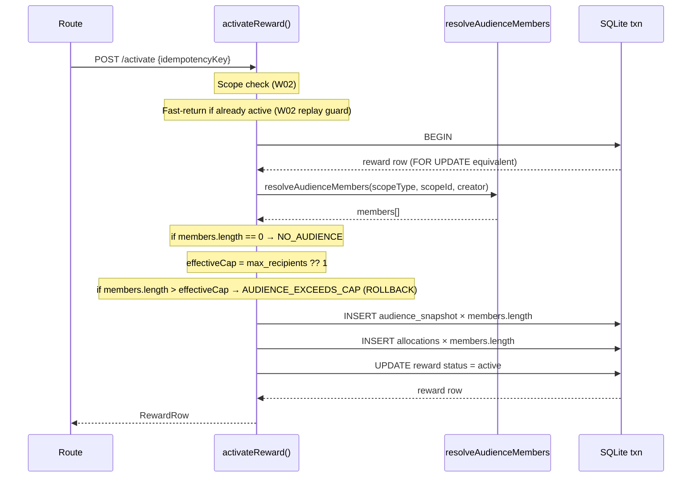
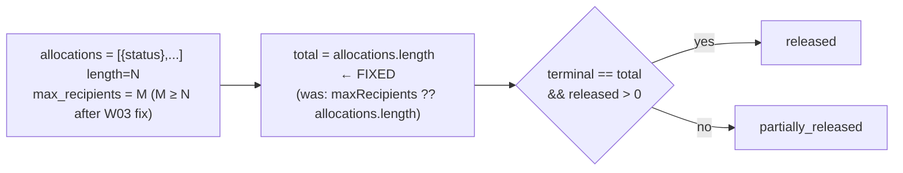

# W03 — Allocation Cap Enforcement and Funded-Capacity Contract

**Date:** 2026-10-30
**Status:** IN PROGRESS
**Branch:** `codex/w03-allocation-cap`
**Baseline:** `e306cf9b54ecf5acf0d4ed0825abcea57a1d724b` (PR #116, W02 closure follow-up)
**Supersedes:** `docs/superpowers/specs/2026-10-27-W03-allocation-cap.md` (null-cap acceptance criterion is incorrect; see §Null-Cap Policy)

---

## Problem Statement

`activateReward()` in `rewardService.ts` creates one allocation per audience member without
enforcing `max_recipients`. Funding calculates total exposure as
`amount_stroops * (max_recipients ?? 1)` — a null cap reserves for **one** recipient. When
audience size exceeds the funded capacity, activation creates more allocations than were
paid for.

Additionally the existing specification (2026-10-27) accepted `max_recipients=null` as
"unlimited". This contradicts funding's fallback of `?? 1` and is rejected here. A null cap
does **not** authorise unbounded obligations; it selects the conservative funded capacity of 1.

---

## Null-Cap Policy (resolved contradiction)

| `max_recipients` value | Effective cap at activation | Rationale |
|---|---|---|
| positive integer N | N | Explicit cap; funding reserved for N × amount |
| `null` / omitted | 1 | Matches funding formula `?? 1`; conservative; funded for 1 recipient |
| 0 | **Rejected at creation** — `INVALID_RECIPIENT_COUNT` | Funding formula produces 0-stroop reservation; nonsensical and immediately uncorrectable |
| negative integer | **Rejected at creation** — `INVALID_RECIPIENT_COUNT` | Same reasoning |
| fractional (3.5) | **Rejected at creation** — `INVALID_RECIPIENT_COUNT` | Not a whole number of recipients |
| non-numeric | **Rejected at creation** — `INVALID_RECIPIENT_COUNT` | Cannot safely convert to integer |
| > MAX\_RECIPIENTS (10 000) | **Rejected at creation** — `INVALID_RECIPIENT_COUNT` | Exposure safety bound already defined in currencyConfig |

Null is accepted at creation: the owner may defer the cap decision until before funding. At
funding, `?? 1` is applied. A null-capped reward therefore has a funded capacity of 1 and
activation rejects an audience larger than 1.

---

## Defects

### D1 — No cap check in `activateReward` (P1)

**Location:** `rewardService.ts:503-515` (current lines; treat as pointer only)

```
if (members.length === 0) {
  throw new RewardError('NO_AUDIENCE', ...);
}
// ← cap check missing here
for (const memberId of members) {   // allocates ALL members
  insertAlloc.run(...);
}
```

**Impact:** With cap=1 audience=3: reserves 100 stroops, allocates 300 stroops. If all
release, 300 stroops move out against 100 reserved — ledger deficit.

### D2 — `createReward` silently stores invalid `max_recipients` (P2)

**Location:** `rewardService.ts:66-68`

```typescript
if (params.maxRecipients != null && params.maxRecipients > 0) {
  calculateMaxExposure(amount, BigInt(params.maxRecipients));
}
```

Values 0, negative, fractional, non-numeric: stored without error. A 0-capped reward funds
for 0 stroops (`?? 1` does not apply at funding — only at the `null` path). A negative cap
produces negative BigInt, which `calculateMaxExposure` would accept (no sign guard).
A fractional value causes an uncaught `TypeError` in `BigInt()` at funding time (HTTP 500).

### D3 — `deriveAggregateStatus` phantom denominator for below-cap activation (P2, coupling)

**Location:** `rewardStateMachine.ts:93`

```typescript
const total = maxRecipients ?? allocations.length;
if (terminal === total && released > 0) return 'released';
```

With cap=5 and only 3 audience members: activation creates 3 allocations, `total=5`,
`terminal` can never reach 5 → aggregate status stays `partially_released` even when all
3 are complete → funds are stranded (cancel path blocked from `partially_released`).

This is a direct coupling to the W03 fix: after enforcement, below-cap activation is a
normal expected path (cap=5, audience=3 activates successfully).

---

## Authority / Funding-to-Activation Flow



---

## Transaction and Replay Flow



---

## Aggregate Status Fix (D3)



The `maxRecipients` parameter to `deriveAggregateStatus` is removed. The caller
(`updateRewardAggregateStatus`) passes actual allocation rows; their length is the correct
denominator.

---

## Invariants

1. Allocation count ≤ `max_recipients ?? 1` at activation time.
2. Total new monetary obligations (allocations × amount) ≤ verified reservation for this reward.
3. `max_recipients` is null or a positive integer ≤ 10 000 at creation.
4. A failed activation leaves reward status, reservation, audience snapshots, and allocations unchanged.
5. Repeated activation on an already-active reward returns the cached row (W02 replay guard); no duplicate allocations or snapshot growth.
6. `deriveAggregateStatus` completes correctly when allocations < cap (below-cap activation).
7. Another reward's pooled funder balance cannot mask over-allocation for this reward.

---

## Precise Changes

### 1. `rewardErrors.ts`

Add two new error codes:

```typescript
AUDIENCE_EXCEEDS_CAP: 'AUDIENCE_EXCEEDS_CAP',
INVALID_RECIPIENT_COUNT: 'INVALID_RECIPIENT_COUNT',
```

### 2. `rewardService.ts` — `createReward` validation (D2 fix)

Replace:
```typescript
if (params.maxRecipients != null && params.maxRecipients > 0) {
  calculateMaxExposure(amount, BigInt(params.maxRecipients));
}
```

With:
```typescript
if (params.maxRecipients !== undefined && params.maxRecipients !== null) {
  if (!Number.isInteger(params.maxRecipients) || params.maxRecipients <= 0 || params.maxRecipients > MAX_RECIPIENTS) {
    throw new RewardError('INVALID_RECIPIENT_COUNT',
      `max_recipients must be a positive integer no greater than ${MAX_RECIPIENTS}`, 400);
  }
  calculateMaxExposure(amount, BigInt(params.maxRecipients));
}
```

Import `MAX_RECIPIENTS` from `./currencyConfig.js`.

### 3. `rewardService.ts` — `activateReward` cap check (D1 fix)

Insert after the `NO_AUDIENCE` guard and before `createAudienceSnapshot`:

```typescript
const effectiveCap = reward.max_recipients ?? 1;
if (members.length > effectiveCap) {
  throw new RewardError(
    'AUDIENCE_EXCEEDS_CAP',
    `Audience has ${members.length} members but effective cap is ${effectiveCap}`,
    400,
  );
}
```

### 4. `rewardStateMachine.ts` — `deriveAggregateStatus` denominator fix (D3 fix)

Remove the `maxRecipients` parameter from the function signature and body:

```typescript
// Before:
export function deriveAggregateStatus(
  allocations: Array<{ status: AllocationState }>,
  maxRecipients?: number | null
): RewardState | null {
  ...
  const total = maxRecipients ?? allocations.length;

// After:
export function deriveAggregateStatus(
  allocations: Array<{ status: AllocationState }>
): RewardState | null {
  ...
  const total = allocations.length;
```

Update `rewardService.ts:updateRewardAggregateStatus` call site to drop the second argument.

---

## Compatibility Limitations

- **Legacy rewards with null cap and audience > 1 already activated:** Not silently repaired.
  These rewards have more allocations than their funding supports. The fix does not
  retroactively cancel excess allocations. Operator assessment required before release.
- **Legacy rewards with 0 or negative max_recipients created before this fix:** Creation
  path now rejects these. Any already-stored rows are not altered. They cannot be
  activated against the new cap check (0 ?? 1 = 0... wait: `0 ?? 1 = 0` since `??` only
  triggers on null/undefined. `0` is a falsy non-null value → `effectiveCap = 0` → any
  audience > 0 → AUDIENCE_EXCEEDS_CAP). Operator assessment needed.
- **Replay idempotency key (`_idempotencyKey` parameter):** Currently `activateReward`
  does not record or check an idempotency key. The W02 fast-return guard (status ≠ funded)
  is the only replay protection. This is pre-existing and outside W03 scope.

---

## Requirement-to-Test Matrix

| ID | Requirement | Test | Status |
|----|-------------|------|--------|
| CAP-1 | cap=1, audience=3 → 400 AUDIENCE_EXCEEDS_CAP; reward stays funded | CAP-ENFORCE-1 | pending |
| CAP-2 | cap=1, audience=3 → reservation unchanged, no allocations, no snapshot | CAP-ENFORCE-2 | pending |
| CAP-3 | cap=2, audience=2 (equal) → success, 2 allocations, correct amounts | CAP-ENFORCE-3 | pending |
| CAP-4 | cap=5, audience=3 (below cap) → success, 3 allocations, aggregate status correct | CAP-BELOW-1 | pending |
| CAP-5 | cap=5, audience=3 all released → aggregate 'released' (not 'partially_released') | CAP-BELOW-2 | pending |
| NULL-1 | null cap funded (1 recipient), audience=1 → success (effective cap=1) | CAP-NULL-1 | pending |
| NULL-2 | null cap funded (1 recipient), audience=2 → 400 AUDIENCE_EXCEEDS_CAP | CAP-NULL-2 | pending |
| NULL-3 | null cap, 1 allocation released → aggregate 'released' | CAP-NULL-3 | pending |
| INV-1 | max_recipients=0 at creation → 400 INVALID_RECIPIENT_COUNT | CAP-INVALID-1 | pending |
| INV-2 | max_recipients=-1 at creation → 400 INVALID_RECIPIENT_COUNT | CAP-INVALID-2 | pending |
| INV-3 | max_recipients=3.5 at creation → 400 INVALID_RECIPIENT_COUNT | CAP-INVALID-3 | pending |
| INV-4 | max_recipients="abc" at creation → 400 INVALID_RECIPIENT_COUNT | CAP-INVALID-4 | pending |
| INV-5 | max_recipients=10001 at creation → 400 INVALID_RECIPIENT_COUNT | CAP-INVALID-5 | pending |
| INV-6 | max_recipients=10000 at creation → success (boundary) | CAP-INVALID-6 | pending |
| AUD-1 | empty audience (0 members) → NO_AUDIENCE (pre-existing; preserved) | CAP-AUD-1 | pending |
| AUD-2 | duplicate audience inputs → no duplicate allocations (INSERT OR IGNORE) | CAP-AUD-2 | pending |
| AUD-3 | member joins cohort after funding, before activation → counted (no bypass) | CAP-AUD-3 | pending |
| AUD-4 | member joins cohort after activation → no allocation growth, snapshot unchanged | CAP-AUD-4 | pending |
| RPT-1 | repeated activation (already active) → returns same row, no new allocations | CAP-RPT-1 | pending |
| POOL-1 | two rewards same funder: reward A oversubscribed → reward B balance unaffected | CAP-POOL-1 | pending |
| AUTH-1 | unrelated role-only user cannot activate (SCOPE_DENIED / NOT_FOUND) | CAP-AUTH-1 | pending |
| AUTH-2 | reward.manage admin can activate any scope | CAP-AUTH-2 | pending |
| EXP-1 | successful activation → expiry worker sees correct allocations | CAP-EXP-1 | pending |
| REC-1 | failed activation (AUDIENCE_EXCEEDS_CAP) then audience narrowed → retry succeeds | CAP-REC-1 | pending |

---

## TDD Iterative Checkbox Plan

- [ ] T01: Write CAP-ENFORCE-1/2 RED tests (cap=1, audience=3 → expect 400; confirm 3 allocs created currently — this is the defect proof)
- [ ] T02: Run RED — confirm defect: currently activates successfully
- [ ] T03: Write CAP-ENFORCE-3, CAP-BELOW-1/2, CAP-NULL-1/2/3 RED tests
- [ ] T04: Run RED — confirm CAP-ENFORCE-3 GREEN (already passes), BELOW and NULL behaviour
- [ ] T05: Write INV-1 through INV-6 RED/GREEN tests (creation boundary)
- [ ] T06: Run INV tests RED — confirm 0/negative/fractional/over-max currently allowed
- [ ] T07: Write AUD-1/2/3/4, RPT-1, POOL-1, AUTH-1/2, EXP-1, REC-1 tests
- [ ] T08: Add `AUDIENCE_EXCEEDS_CAP` and `INVALID_RECIPIENT_COUNT` to rewardErrors.ts
- [ ] T09: Fix `createReward` validation (D2)
- [ ] T10: Add cap check in `activateReward` (D1)
- [ ] T11: Fix `deriveAggregateStatus` denominator — drop maxRecipients param (D3)
- [ ] T12: Run full new test suite GREEN
- [ ] T13: Run all affected regression suites: reward-lifecycle, reward-sponsor, reward-teacher, reward-parent, reward-employer, reward-schema, reward-state-machine, reward-expiry-worker, reward-eligibility, reward-balance, reward-ledger
- [ ] T14: TypeScript build clean
- [ ] T15: Independent code/security review — APPROVED
- [ ] T16: Candidate CI 4/4 PASS
- [ ] T17: Merge → main; verify resulting SHA and post-merge CI
